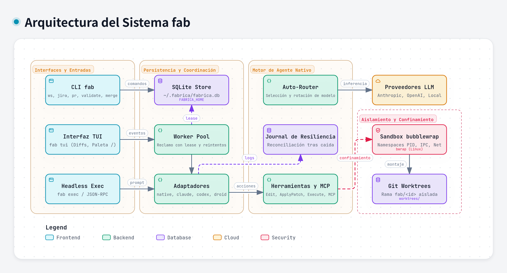
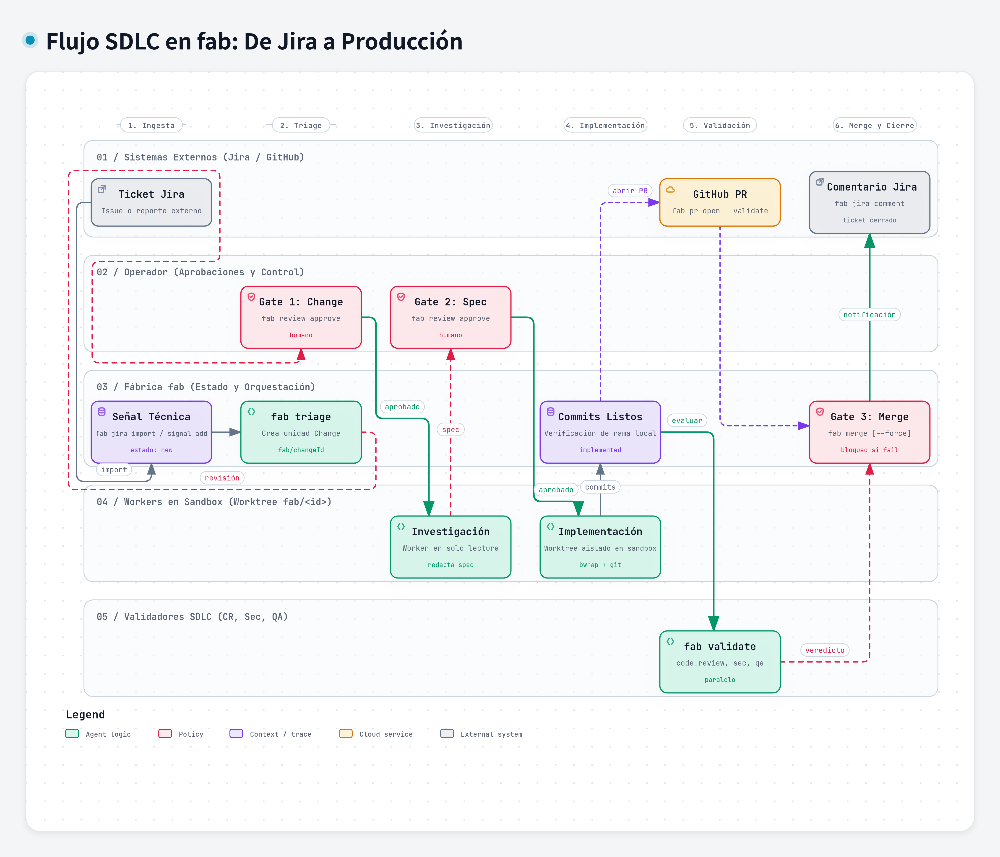

<p align="center">
  <picture>
    <source srcset="./docs/assets/brand/fab-logo-dark.svg" media="(prefers-color-scheme: dark)">
    
  </picture>
</p>

<p align="center">
  Fábrica de software local y entorno de ejecución para agentes de código con aislamiento en worktrees, validación automatizada y control de gates.
</p>

<p align="center">
  <a href="https://www.npmjs.com/package/@okuanb/fab"></a>
  <a href="https://github.com/DarkCodePE/sw-factory/actions/workflows/ci.yml"></a>
  <a href="https://bun.sh">= 1.1"></a>
  <a href="https://www.typescriptlang.org"></a></p>

---

## ¿Por qué fab?

Construir un script que interactúe con un LLM es sencillo. Ejecutar un flujo continuo de ingeniería de software de forma autónoma, segura y predecible no lo es: se requiere aislamiento del espacio de trabajo, validación formal, control humano entre etapas y protección del sistema anfitrión.

`fab` resuelve este ciclo de desarrollo estructurado (SDLC) localmente:

- **Aislamiento por cambio en Git Worktrees:** Cada unidad de trabajo se investiga e implementa en un `git worktree` dedicado sobre la rama `fab/<changeId>`. La rama principal de tu repositorio nunca se ensucia con pruebas parciales o código roto.
- **Sandbox estricto (`bwrap`):** En Linux, los comandos de herramientas (`Execute`, `Script`) se confinan mediante `bubblewrap` con sistema raíz en solo lectura, `/tmp` privado en memoria, namespaces desasociados (PID, IPC, UTS, red) y permisos de red por llamada (`deny`, `ask`, `auto`) o modo efímero `--yolo`.
- **Puntos de control humano (Gates):** El operador supervisa y aprueba transiciones clave: revisión de la unidad de cambio (`Gate 1`), aprobación de la especificación técnica (`Gate 2`) y autorización de fusión (`Gate 3`).
- **Validadores automáticos independientes:** Tras la implementación, una batería de validadores de solo lectura (`code_review`, `security_audit`, `qa`) audita el cambio en busca de regresiones, fallos de seguridad o suites rotas.
- **Puerta de fusión protegida (Merge Gate):** El comando `fab merge` bloquea de forma preventiva la integración si existen validadores pendientes o con veredicto en fallo (`fail`), admitiendo `--force` únicamente ante decisión explícita.
- **Conectores bidireccionales con Jira y GitHub:** Importa requerimientos de Jira como señales, abre Pull Requests vinculados en GitHub, publica resúmenes de auditoría y actualiza el ticket con el resultado final.
- **Libertad de modelos y agentes:** Compatible con proveedores líderes (Anthropic, OpenAI, suscripciones de ChatGPT, Ollama/vLLM local), selección automática de modelos con clasificador (`-m auto`), soporte de protocolos MCP con OAuth, y adaptadores para Claude Code, Codex, Antigravity (`agy`), Droid y Fake.
- **Persistencia local sin dependencias externas:** Todo el estado de workstreams, señales, cambios, actividades y auditoría reside en una base de datos SQLite local (`~/.fabrica/fabrica.db`). Sin Redis, sin Docker ni servicios externos obligatorios.

---

## Quickstart

### 1. Instalación

#### Vía npm (recomendado)

Se distribuye el paquete global `@okuanb/fab`:

```bash
# Canal de prelanzamiento (versión actual recomendada)
npm install -g @okuanb/fab@next

# Canal estable
npm install -g @okuanb/fab@latest
```

#### Vía script instalador (binario autónomo compilado)

Detecta automáticamente Linux (glibc) o macOS (x64 y ARM64), verifica la firma criptográfica y ubica el binario en `~/.local/bin/fab` sin requerir Node.js ni Bun previos:

```bash
# Canal de prelanzamiento (RC actual)
curl -fsSL https://raw.githubusercontent.com/DarkCodePE/sw-factory/main/scripts/install.sh | sh -s -- --channel prerelease

# Canal estable
curl -fsSL https://raw.githubusercontent.com/DarkCodePE/sw-factory/main/scripts/install.sh | sh
```

*(Asegúrate de tener `~/.local/bin` en tu variable de entorno `PATH`).*

#### Autoactualización (`fab update`)

Detecta el método de instalación original y actualiza a la última versión disponible:

```bash
fab update --check         # Comprueba si hay actualizaciones sin tocar el sistema
fab update                 # Descarga e instala la última versión de tu canal
fab update --channel next  # Cambia explícitamente de canal
```

---

### 2. Primer uso

`fab` ofrece tres modos de entrada según la tarea:

#### A. Exploración interactiva en terminal (`fab tui`)
Inicia una sesión conversacional con el agente en el repositorio actual:
```bash
fab tui
```
Presiona `/` para abrir la paleta de comandos, `Tab` para ajustar el esfuerzo de razonamiento, o `Ctrl+O` para alternar la vista de diffs.

#### B. Ejecución de una tarea puntual autónoma (`fab exec`)
Ejecuta el agente de código sin interfaz gráfica para scripting o correcciones rápidas:
```bash
fab exec "Corrige el test fallido en tests/auth.test.ts y ejecuta la suite" --auto medium
```

#### C. Flujo de fábrica desatendida (`fab ws`)
Configura un flujo organizado por señales y cambios con revisión humana:
```bash
# 1. Registrar y activar un workstream
fab ws create mi-app --repo /ruta/a/mi-repo --goal "Estabilizar suite de pagos"
fab ws state mi-app active

# 2. Agregar una señal técnica y realizar triage
fab signal add mi-app "Error en cálculo de IVA" --body "Devuelve 0 cuando el país es PE"
fab triage --all mi-app

# 3. Revisar y autorizar el change en la bandeja
fab inbox mi-app
fab review <activityId> approve

# 4. Investigar el problema (solo lectura) y aprobar el plan
fab run mi-app --once
fab inbox mi-app
fab review <activityId> approve

# 5. Implementar en rama fab/<changeId> y fusionar
fab run mi-app --once
fab merge <changeId>
```

---

## Arquitectura

La arquitectura de `fab` desacopla las interfaces de usuario, la persistencia local, la orquestación concurrente de actividades y el confinamiento de ejecución:

<p align="center">
  <picture>
    <source srcset="./docs/assets/architecture-dark.png" media="(prefers-color-scheme: dark)">
    <source srcset="./docs/assets/architecture-light.png" media="(prefers-color-scheme: light)">
    
  </picture>
</p>
<p align="center">
  <em>Ver <a href="./docs/diagrams/architecture.html">diagrama interactivo de arquitectura</a> (HTML autónomo con temas claro/oscuro y animación).</em>
</p>

### Componentes principales

| Componente | Rol en el sistema | Ubicación |
|---|---|---|
| **CLI & TUI** | Entradas interactivas (`fab tui`), comandos administrativos (`fab ws`, `fab jira`, `fab pr`, `fab validate`) y modo headless (`fab exec`, JSON-RPC). | `src/cli.ts`, `src/tui.ts`, `src/chat/` |
| **SQLite Store** | Base de datos transaccional local (`fabrica.db`). Gestiona transiciones de estado, concurrencia y enlaces a sistemas externos sin servidores adicionales. | `src/store.ts`, `src/connectors/links.ts` |
| **Worker Pool** | Despachador concurrente con leases temporales (`owner`, `expires`). Reclama actividades, supervisa reintentos (hasta 3) y recupera procesos interrumpidos. | `src/pool.ts` |
| **Motor Nativo** | Agente autónomo con catálogo de 30 herramientas, selector dinámico de modelos (`autoRouter`), misiones jerárquicas y journal de recuperación atómica. | `src/agent/` |
| **Sandbox `bwrap`** | Confinamiento de aislamiento en Linux mediante `bubblewrap`. Monta la raíz como solo lectura, aísla namespaces y sanea variables de entorno. | `src/sandbox/` |
| **Git Worktrees** | Entorno físico de trabajo por cada cambio en `.fabrica/worktrees/<id>/` sobre la rama `fab/<id>`, impidiendo colisiones entre tareas concurrentes. | `src/worktrees.ts` |

---

## Flujo SDLC: De Jira a Producción

El ciclo de desarrollo en `fab` sigue un flujo determinista con compuertas de control humano y automatizado:

<p align="center">
  <picture>
    <source srcset="./docs/assets/sdlc-workflow-dark.png" media="(prefers-color-scheme: dark)">
    <source srcset="./docs/assets/sdlc-workflow-light.png" media="(prefers-color-scheme: light)">
    
  </picture>
</p>
<p align="center">
  <em>Ver <a href="./docs/diagrams/sdlc-workflow.html">diagrama interactivo del flujo SDLC</a> (HTML autónomo con temas claro/oscuro y animación).</em>
</p>

### Fases del ciclo:

1. **Ingesta y enlace:**
   - Mediante conector Jira: `fab jira import <KEY> --ws <slug> [--triage]` importa la historia de usuario o bug, traduciendo el contenido ADF a Markdown y vinculando la señal.
   - Mediante señal local: `fab signal add <slug> <título> [--body <texto>]`.
2. **Triage:** `fab triage <signalId>` o `fab triage --all <slug>` convierte las señales `new` en unidades `change` y encola la primera actividad.
3. **Punto de Control 1 (Gate de Change):** Si el workstream requiere aprobación de cambio, el operador revisa la propuesta en `fab inbox [slug]` y aprueba con `fab review <activityId> approve`.
4. **Investigación (`investigation`):** `fab run <slug> [--once]` lanza un worker en modo de solo lectura sobre el repositorio para reproducir el problema y redactar una especificación técnica de solución.
5. **Punto de Control 2 (Gate de Spec):** El operador inspecciona la especificación técnica en `fab inbox [slug]` y aprueba la solución propuesta con `fab review <activityId> approve`.
6. **Implementación (`implementation`):** `fab run <slug> [--once]` asigna un worktree dedicado y confinado en sandbox bajo la rama `fab/<changeId>`. El worker realiza cambios mínimos, agrega pruebas de regresión y crea commits locales. El pool valida la existencia de commits y coloca el change en estado `implemented`.
7. **Batería de validación automatizada (`change_review`):**
   - Se ejecutan validadores independientes (`code_review`, `security_audit`, `qa`) con `fab validate <changeId>`.
   - Cada validador audita sin modificar archivos y emite un veredicto estructurado (`pass`, `fail` o `needs_human`).
8. **Apertura de Pull Request y publicación:**
   - `fab pr open <changeId> [--validate]` sube la rama y abre el PR en GitHub (con `--validate` encola de inmediato la auditoría).
   - `fab validate publish <changeId>` publica una tabla consolidada de resultados como comentario en el PR de GitHub.
9. **Punto de Control 3 (Merge Gate):**
   - `fab merge <changeId>` comprueba el `ValidationSummary`. Si existen validadores pendientes o con veredicto en `fail`, **bloquea la fusión**.
   - Con `--force`, el operador humano puede autorizar la integración por excepción.
   - Al fusionar, integra la rama `fab/<id>` a la rama base, elimina el worktree y cierra el change como `completed`.
10. **Cierre de ciclo:** `fab jira comment <changeId>` notifica en la issue de Jira vinculada la resolución satisfactoria del ticket.

---

## Comandos de Conectores y Validación (v0.1.0-rc.10 / PR #10)

### 1. Conector de Jira (`fab jira`)

Permite interactuar con Atlassian Jira Cloud utilizando las credenciales de entorno (`JIRA_HOST` o `JIRA_URL`, `JIRA_EMAIL` y `JIRA_API_TOKEN`):

```bash
# Inspeccionar una issue de Jira en solo lectura
fab jira show PROJ-123

# Importar una issue como señal en un workstream (con triage inmediato opcional)
fab jira import PROJ-123 --ws mi-workstream --triage

# Simular la importación sin crear señales ni realizar escrituras
fab jira import PROJ-123 --ws mi-workstream --dry-run

# Comentar en la issue de Jira vinculada al change el estado de la entrega
fab jira comment <changeId>
fab jira comment <changeId> --dry-run
```

### 2. Conector de GitHub Pull Requests (`fab pr`)

Gestiona la publicación y seguimiento de Pull Requests utilizando la CLI oficial `gh` o el token de entorno `GITHUB_TOKEN`:

```bash
# Abrir un Pull Request para la rama fab/<changeId> del change implementado
fab pr open <changeId> --base main

# Abrir PR y disparar automáticamente la batería de validadores
fab pr open <changeId> --validate

# Abrir PR en modo borrador apuntando a un repositorio específico
fab pr open <changeId> --draft --repo mi-org/mi-repo

# Previsualizar el título, cuerpo y comandos sin realizar llamadas a GitHub
fab pr open <changeId> --dry-run

# Consultar el estado del Pull Request enlazado
fab pr show <changeId>
```

### 3. Validadores automáticos (`fab validate`)

Ejecuta actividades de validación independientes sobre changes implementados sin alterar su estado ni sus ramas:

```bash
# Encolar la batería completa de validadores (code_review, security_audit, qa)
fab validate <changeId>

# Encolar únicamente validadores específicos
fab validate <changeId> --only code_review,security_audit

# Ver el resumen estructurado de validación consolidado
fab validate status <changeId>

# Publicar el informe de validación como comentario en el Pull Request de GitHub
fab validate publish <changeId>
fab validate publish <changeId> --dry-run
```

**Tipos de validadores:**
- `code_review`: Analiza corrección lógica, posibles regresiones, cobertura de pruebas y estilo, indicando archivo y línea de los hallazgos.
- `security_audit`: Inspecciona inyecciones de código, secretos expuestos, validación de rutas, elevación de permisos y dependencias vulnerables.
- `qa`: Ejecuta la suite de pruebas del proyecto y verifica los criterios de aceptación en el worktree limpio.

### 4. Fusión con compuerta de validación (`fab merge`)

```bash
# Fusión estándar (bloquea si hay validadores pendientes o en fail)
fab merge <changeId>

# Fusión forzada (ignora advertencias y bloqueos de validación)
fab merge <changeId> --force
```

---

## Modos de Operación

### 1. Interfaz Interactiva de Terminal (`fab tui`)

Lanza el entorno interactivo para explorar código, ejecutar turnos conversacionales y revisar diferencias:

```bash
fab tui                    # En el directorio actual
fab tui --cwd /ruta/repo   # En un repositorio específico
fab tui mi-workstream      # Panel de control del workstream
```

- **Paleta en vivo (`/`):** Despliega menú interactivo con búsqueda en tiempo real de 36 comandos locales y 15 con estado.
- **Atajos de teclado:**
  - `Tab`: Alterna el esfuerzo de razonamiento del modelo (`low`, `medium`, `high`, `default`).
  - `Shift+Tab`: Alterna entre modo interactivo (`auto`) y modo de solo lectura (`spec`). Activa `mission` en autonomía `high`.
  - `Ctrl+N`: Cicla entre los modelos configurados en settings.
  - `Ctrl+L`: Alterna el nivel de autonomía (`off`, `low`, `medium`, `high`).
  - `Ctrl+O`: Alterna la vista de diferencias de código expandidas (hasta 400 líneas).
  - `Ctrl+T`: Alterna el panel de seguimiento de Mission Control.
  - `Ctrl+C`: Cancela el turno en curso o la pregunta activa.
  - `Ctrl+D` o `/exit`: Sale de la terminal.
- **Rebobinado seguro (`/rewind`):** Restaura de forma atómica archivos modificados o creados por herramientas de edición (`Create`, `Edit`, `ApplyPatch`) al estado de un checkpoint previo.

### 2. Agente Autónomo CLI (`fab exec`)

Ejecuta el motor de agente sin interfaz para integración continua, scripts o invocaciones desatendidas:

```bash
# Tarea puntual con selección de modelo y autonomía
fab exec -m anthropic:claude-3-5-sonnet --auto medium "Corrige el test en tests/auth.test.ts"

# Modo spec con modelo dedicado para planificación y confirmación de estado
fab exec --use-spec --spec-model openai:o1 --require-status "Diseña la migración de base de datos"

# Inyección dinámica de herramientas externas o servidores MCP
fab exec --add-tools "MCP:github/*" "ApplyPatch" "Corrige los imports rotos"

# Creación de worktree aislado para la tarea
fab exec -w tarea-auth "Refactoriza el módulo de autenticación"

# Misión jerárquica con validadores independientes
fab exec --mission --auto high --worker-model anthropic:claude-3-5-sonnet "Implementa soporte OAuth2"
```

### 3. Protocolos de Entrada y Streaming

- **JSON-RPC bidireccional:** `fab exec --input-format stream-jsonrpc --output-format stream-jsonrpc` soporta comunicación sobre stdio con ack de herramientas, preguntas al usuario (`AskUser`) y control de permisos bidireccionales.
- **Entrada `stream-json` multi-turno:** Permite enviar turnos sucesivos sobre el mismo proceso persistente con eventos estructurados `user`, `interrupt` y `end`.
- **SDK de fab (`fabrica/sdk`):** Permite instanciar sesiones programáticas, crear herramientas personalizadas y desplegar servidores MCP en proceso con bearer token y validación JSON Schema.

---

## Seguridad, Sandbox y Aislamiento

### Sandbox de procesos (`bwrap`)

En sistemas Linux, las herramientas de ejecución operan confinadas en `bubblewrap`:
- **Montaje raíz en solo lectura:** El sistema se monta con `--ro-bind / /`.
- **Workdir exclusivo de escritura:** Únicamente el directorio del worktree cuenta con permisos de escritura.
- **Espacios de nombres aislados:** Namespaces de PID (`--unshare-pid`), IPC (`--unshare-ipc`), UTS (`--unshare-uts`) y red (`--unshare-net`) desasociados.
- **Entorno saneado:** Limpieza estricta de variables de entorno (`--clearenv`), inyectando únicamente las indispensables.
- **Detección de restricciones del kernel:** Si Ubuntu 24.04 o AppArmor restringen user namespaces no privilegiados, el sistema realiza sondeo real y avisa la degradación en modo `best-effort` o detiene la ejecución en modo `required`.

### Control de red por invocación (`--sandbox-network`)

- `deny`: Bloquea permanentemente todo tráfico saliente dentro del sandbox.
- `ask`: Solicita confirmación explícita al operador antes de permitir tráfico de red a un comando.
- `auto`: Permite red automáticamente solo bajo autonomía `high`; en niveles inferiores solicita confirmación.

### Modo YOLO efímero (`--yolo`, `/yolo`)

Permite ejecutar comandos directamente sobre el anfitrión sin confinamiento de sandbox ni confirmaciones interactivas:
- **Ámbito estrictamente efímero:** Aplica exclusivamente a la invocación actual. **Nunca se persiste** en la sesión ni se propaga al reanudar (`--session-id`) o bifurcar (`--fork`).
- **Restricciones inviolables:** El modo de solo lectura (`spec`), la consulta lateral `/btw` y la verificación de misiones mantienen sus restricciones de seguridad aunque `--yolo` esté activo.

---

## Proveedores y Adaptadores

### Proveedores integrados en el motor nativo

1. **Anthropic:** Implementación nativa de Messages API en streaming con `x-api-key` o `bearer`, mapeo de herramientas y soporte de bloques `thinking` configurables.
2. **OpenAI / Suscripción ChatGPT:** Endpoints compatibles con Responses API y reutilización segura de la autenticación local de Codex CLI sin almacenar credenciales en texto plano.
3. **Modelos locales (Ollama / vLLM):** Probado y validado con modelos locales como `qwen3.5-32k` y `LiquidAI/LFM2.5-2.6B`.
4. **Auto-Router con clasificador (`-m auto`):** Selección dinámica del modelo más económico y adecuado para la tarea evaluando el prompt con clasificadores locales o remotos (TypeSafe Jev).

### Adaptadores externos para el pool de fábrica

- `native`: Motor propio con catálogo completo de 30 herramientas, subagentes y misiones.
- `claude`: Invoca Claude Code en modo print (`claude -p`).
- `codex`: Invoca Codex CLI bajo sandbox seguro `--sandbox workspace-write`.
- `agy`: Invoca Antigravity CLI de Google AI en modo headless (`agy -p`).
- `droid`: Invoca una CLI compatible externa en modo print (`droid exec`).
- `fake`: Adaptador determinista en memoria para pruebas automáticas sin consumo de API.

---

## Límites Conocidos

1. **Dos modos de verificación por diseño:** En el flujo de trabajo estándar (`signal/change`), el pool verifica que la implementación haya dejado commits válidos en la rama `fab/<id>` y la validación técnica recae en los validadores (`fab validate`) y gates humanos. La verificación estricta en tiempo de ejecución con comandos inviolables (`verificationCommands`, `protectedPaths`) pertenece al modo de misiones de `fab exec --mission`.
2. **Aislamiento en plataformas no-Linux:** El sandbox fuerte de procesos depende de las primitivas de namespaces de Linux (`bubblewrap`). En entornos macOS se monitorean descriptores de archivo nativos pero sin aislamiento de namespaces; en sistemas Windows se requiere el uso de WSL (Windows Subsystem for Linux).
3. **Rendimiento de inferencia en CPU y modelos ultraligeros:** La inferencia de modelos locales sobre CPU resulta lenta frente al temporizador de inactividad de streams (120 s por defecto); se recomienda aceleración por GPU. Modelos de escala ultraligera (< 3B parámetros) carecen habitualmente de capacidad multi-turno para planificar cadenas complejas de herramientas.
4. **Protocolos no implementados:** El protocolo ACP (Agent Communication Protocol) y la exposición de la fábrica como demonio remoto abierto a la red pública no están contemplados en el diseño (`fab` opera como una factoría local).
5. **Alcance del rebobinado (`/rewind`):** El mecanismo de rewind en la TUI revierte de forma atómica archivos modificados por herramientas de edición (`Create`, `Edit`, `ApplyPatch`), pero no deshace modificaciones del sistema originadas por comandos arbitrarios ejecutados en shell mediante `Execute`.
6. **Gestión de contexto en repositorios masivos:** En proyectos con miles de archivos, la exploración sin filtros puede saturar la ventana de contexto del modelo; se recomienda el uso de `/compress`, subagentes o limitar la búsqueda mediante flags de herramientas.

---

## Desarrollo y Verificación

Para ejecutar la suite de pruebas y la verificación estricta de tipos estáticos:

```bash
bun test
bunx tsc --noEmit
git diff --check
```

La suite contiene actualmente **602 pruebas unitarias pasando sin fallos (0 fail)** en **67 archivos de prueba** con **3.537 aserciones (`expect()`)**.
