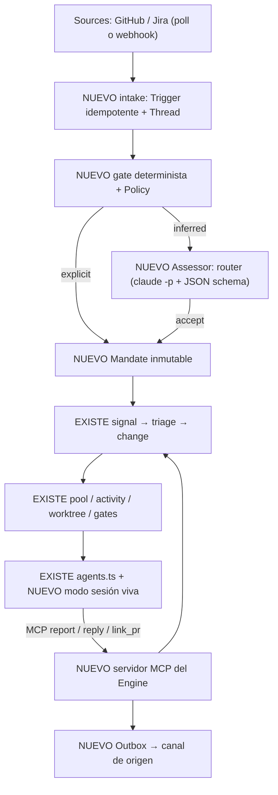

# Diseño (borrador): incorporar el modelo del superagent de DSH a la fab

Estado: **borrador para revisión EGM**. Elefante: Claude Opus 5.5, 2026-11-09. No es un ADR todavía.

Commits citados: fab `ce84fc4` (rama `feat/t2-corpus`), `deepseek-ai/dsh-superagent-prototype@8c32a9d` (MIT), `deepseek-ai/deepseek-harness@fcc0ad4` (MIT). Las citas `S/…` son del superagent, `H/…` del harness y sin prefijo de la fab.

Material de apoyo (léelo si una afirmación te parece débil):
- `/home/orlando/Desktop/ia-master/dsh-analisis/SINTESIS.md`: síntesis de tres análisis de superagent y dsh-herdr.
- `/home/orlando/Desktop/ia-master/dsh-analisis/mapa-harness.md`: arquitectura de DSH.
- `/home/orlando/Desktop/ia-master/dsh-analisis/mapa-portabilidad.md`: superficie de DSH que usa el superagent y su equivalente en Claude Code.

## 1. Problema

La fab convierte una señal en un change revisado, implementado por un agente headless, verificado y fusionado (`techdocs/docs/factory/00-blueprint.md`). El operador la conduce: crea workstreams, importa HU de Jira y aprueba gates. El superagent de DSH resuelve otro tramo: **escuchar** a un equipo (GitHub, Feishu), **decidir** con reglas qué petición se convierte en trabajo y con qué autoridad, **conversar** en el canal de origen y mantener un **worker vivo** por Ticket al que se le puede corregir el rumbo.

Pregunta de diseño: ¿cómo se incorpora ese tramo a la fab sin duplicar lo que ya tiene y sin atarlo a un harness concreto?

Fuera de alcance: implementar; Feishu; el panel React de DSH; reemplazar Jira.

## 2. Qué tiene ya la fab (verificado en `ce84fc4`)

| Concepto del superagent | Equivalente en la fab | Evidencia |
|---|---|---|
| Trigger | `signals` | `src/store.ts:145-147@ce84fc4` |
| Ticket | `changes` (máquina de estados con `in_review`, `blocked`, `implemented`…) | `src/store.ts:148-151@ce84fc4`, `techdocs/docs/factory/02-modelo-de-datos.md:113-138` |
| Assignment | `activities` con `lease_expires_at`, `worker_id`, `retry_count`, `agent_pgid` | `src/store.ts:152-158@ce84fc4` |
| Domain events | `events` | `src/store.ts:160-162@ce84fc4` |
| Executor con slots | pool con claim, lease y heartbeat; `worker_concurrency` por workstream | `src/pool.ts`, `src/store.ts:140-144@ce84fc4` |
| prepare + worktree | un worktree y rama `fab/<id>` por change | `src/worktrees.ts` |
| Adaptadores de harness | `AgentAdapter { name, command(prompt, {readOnly}), env?, parse?, factoryCommits? }` con claude, codex, agy, droid, native, fake | `src/agents.ts:32-40,79-146@ce84fc4` |
| Gates humanos | `require_change_approval` y `require_approval`; `blockActivity` deja el change en `in_review` | `src/store.ts:140-144@ce84fc4`, `techdocs/docs/factory/02-modelo-de-datos.md:181` |
| Intake de Source | `importIssue`: Jira por clave, idempotente con `ChangeLinkStore`, `triageSignal` opcional | `src/connectors/intake.ts:16-51@ce84fc4` |
| Channel de vuelta | `TicketGateway.comment` y `ticketComment(pr_opened|merged|status)` | `src/connectors/types.ts:29-31@ce84fc4`, `src/connectors/intake.ts:60-64@ce84fc4` |

Corrección respecto a una versión anterior de esta propuesta: la fab **sí tiene intake**, pero **por pull del operador** y por clave. No escucha ni decide sola.

## 3. Qué le falta (lo que aporta el superagent)

1. **Admisión**. Un gate determinista decide si un evento externo es admisible y con qué fuerza (`explicit` o `inferred`). Un **Mandate** inmutable guarda versión de la Policy, fuerza, alcance y base, y se revalida al reanudar. Hay modo `off|observe|auto`. Evidencia: `S/src/policy.ts:40,167`, `S/src/core/model.ts:103`, `S/src/core/tickets.ts:37`.
2. **Conversación**. Thread por conversación, una Eval por Thread, Subscriptions que entregan contexto a un Ticket **sin dar autoridad**, y Outbox con recibos para responder en el canal de origen. Evidencia: `S/docs/002-authorization.md:18`, `S/src/app/outbox.ts:23`.
3. **Router**. Una sesión de modelo valora candidatos inferidos con salida estructurada y conversa. El gate es código; el modelo solo juzga intención. Evidencia: `S/src/app/assessment.ts:94`.
4. **Worker vivo**. Los adaptadores de la fab son de un solo disparo (`command(prompt) → argv`, `src/agents.ts:34`). El superagent entrega mensajes a una sesión viva con modos `queue`, `steer` (siguiente paso) e `inject` (sin despertar) (`H/packages/core/agent-loop/src/agent.ts:179-189`).

## 4. Propuesta

**Extender la fab dentro del mismo proceso y el mismo `fabrica.db`.** Descartado: un proyecto aparte (duplicaría store, pool, worktrees, gates y adaptadores) y una capa externa encima (dos dueños del estado).

El diagrama muestra el reparto de piezas. Lo nuevo entra **antes** del `signal` (admisión y conversación) y **al lado** de `agents.ts` (sesión viva y MCP). El dueño del estado sigue siendo el `change`: el Mandate y el Thread se enlazan a él y no se crea una segunda máquina de estados. Hay que cuidar que el Outbox reutilice el `TicketGateway` existente en vez de crear otro canal.

### 4.1 Decisiones

- **D1. Las etapas `person/*` se derivan de los estados del change.** `person/review` = `in_review` por gate; `person/blocked` = `blocked`; `person/answer` = nueva razón de bloqueo `human_action`. **Supuesto no verificado**: que `in_review`/`blocked` más una razón basten sin estado nuevo.
- **D2. Puertos agnósticos al harness.** `Executor { start, deliver(modo), stop }` y `Assessor { request, release }` como en `S/src/core/ports.ts:49-68`. `agents.ts` sigue siendo la frontera de harness; se añade una **matriz de capacidades** por adaptador (reanudar, steer, inject, cancel, MCP, permisos duros).
- **D3. Herramientas del worker por MCP.** `report(state, human_action)`, `reply`, `link_pr` las sirve la fab. Claude Code, Codex y agy hablan MCP.
- **D4. Primer adaptador vivo: Claude Code con stdin stream-json.** Prueba hecha (n=1, Haiku): un mensaje enviado durante una tool entró en el siguiente paso del mismo turno (`"…PRIMERO, y incluyo BANANA como pediste"`, un solo `result`). Sin probar: `inject`, Codex, agy, cuota de suscripción con varios workers.
- **D5. Gate duro fuera del prompt.** Hooks `PreToolUse` y el sandbox `bwrap` existente (`techdocs/docs/factory/07-seguridad.md`). Un worktree no es frontera de seguridad (`S/docs/003-execution.md:80`).

### 4.2 Fases

1. **Admisión en modo observe**: poller GitHub, Trigger/Thread idempotentes, gate y Mandate; registra `would_accept`, no crea changes.
2. **MCP del worker y sesión viva para `claude`**, detrás de la matriz de capacidades.
3. **Router, Subscriptions y Outbox** hacia GitHub y Jira.

## 5. Riesgos y preguntas abiertas

- Cuota de la suscripción con varios workers vivos: hacen falta slots y prioridad, más un slot reservado para mensajes humanos (`S/docs/003-execution.md:31`).
- Dos modelos de ejecución conviviendo (one-shot y vivo) en el mismo pool: ¿lease y heartbeat siguen valiendo para una sesión que espera a un humano?
- ¿Dónde vive el Thread de una HU de Jira frente a un issue de GitHub? ¿Un change puede tener varios Threads?
- El modelo de seguridad de la fab (`readOnly` real solo con `codex` y `native`, `techdocs/docs/investigacion/index.md`) frente a workers vivos con más privilegios.
- Términos de uso de la suscripción para conducir `claude` de forma programática: no verificado.

## 6. Procedencia y verificación

- Fab leída con el método fab-research (ADR-0008): `graft-lector init/skeleton/rg --no-refresh` y lectura de tramos; graft sincronizado (4031 nodos).
- Superagent y harness: lectura estática con graft; experimento de steer ejecutado (ver D4).
- No ejecutado: tests de la fab, ningún flujo de intake real, ninguna sesión viva con MCP.
