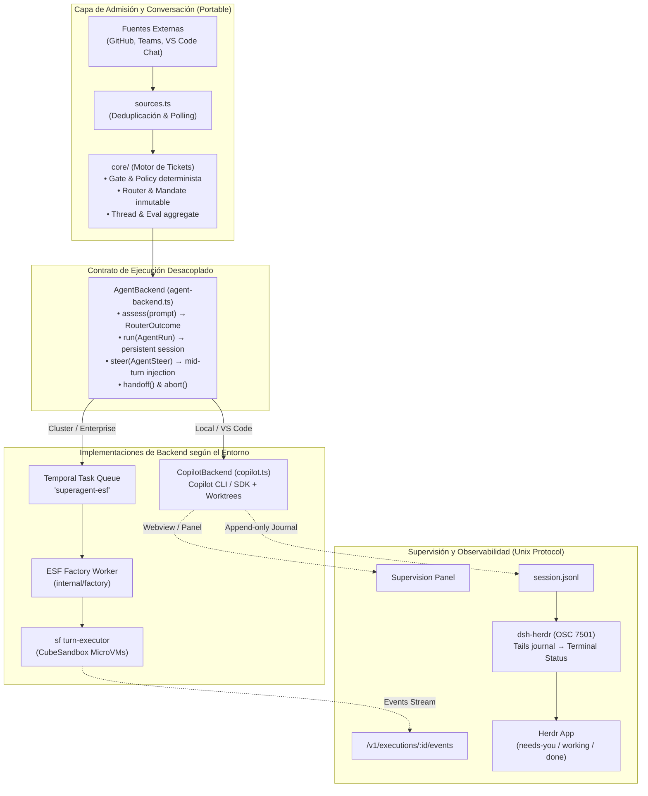
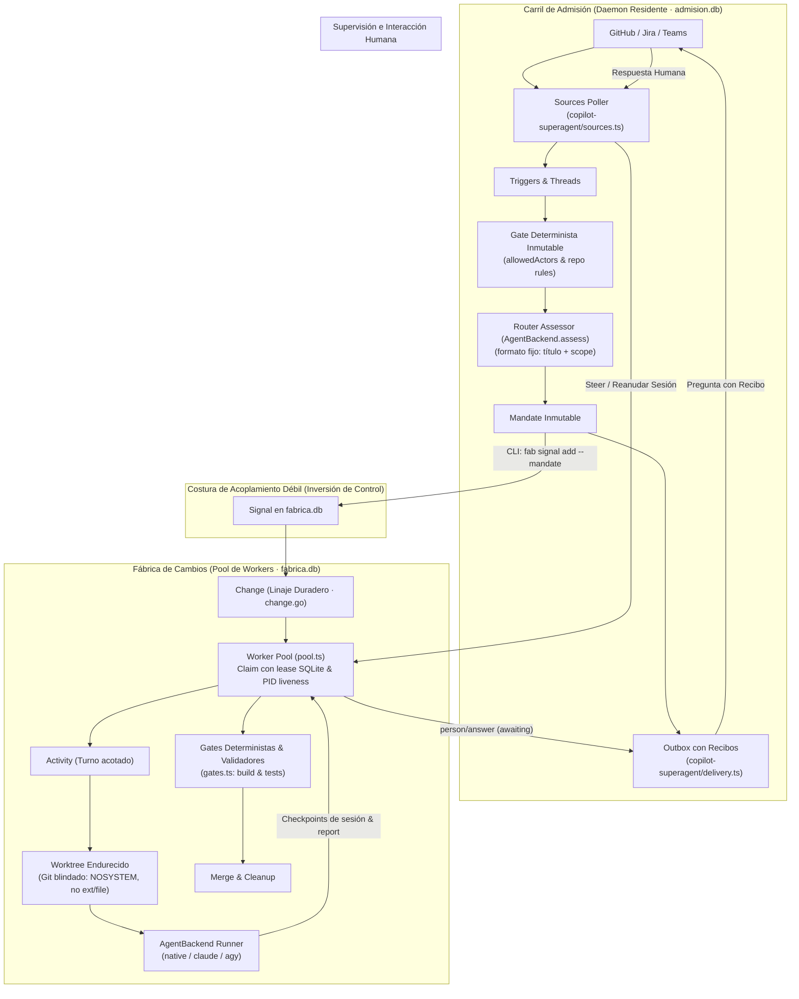

# Revisión EGM Ronda 2: Robustez, Estrategia de mitkox y Arquitectura Combinada

**Revisor:** goldfish `agy`  
**Roles EGM:** `design_critic.md` (crítico de diseño y arquitectura, mitigación de riesgos y cuellos de botella) e `inventive_catalyst.md` (resolución de contradicciones técnicas TRIZ y síntesis inventiva)  
**Foco:** **P3: la mejor arquitectura combinada para la fab** (con cobertura rigurosa de P1 y P2)  
**Archivo de salida:** `/home/orlando/Desktop/factory/sw-factory/docs/research/superagent-vs-fab/review2/agy.md`  

---

## 0. Comprobación de pistas sin verificar

1. **Pista 1: `copilot-superagent/src/core` coincide con el de `dsh-superagent-prototype/src/core`.**  
   - **Resultado:** **CONFIRMADA Y VERIFICADA**.  
   - **Evidencia:** `diff -r` entre `/home/orlando/Desktop/factory/ext/copilot-superagent/src/core` y `/home/orlando/Desktop/ia-master/dsh-superagent-prototype/src/core` revela identidad absoluta archivo por archivo, excepto exactamente una línea en `reasons.ts:19` (`sw-factory/ext/copilot-superagent/src/core/reasons.ts:19@693f4db` [**verificado**] frente a `dsh-superagent-prototype/src/core/reasons.ts:19@8c32a9d` [**verificado**]), donde se sustituye la cadena `'dsh-superagent restarted'` por `'Copilot Superagent restarted'`. Todos los modelos (`model.ts`), el motor (`engine.ts`), admisiones (`admission.ts`), evaluación (`evals.ts`), tickets (`tickets.ts`) y asignaciones (`assignments.ts`) son 100% idénticos.

2. **Pista 2: `vscode/src/agent-backend.ts` define un `AgentBackend`.**  
   - **Resultado:** **CONFIRMADA Y VERIFICADA**.  
   - **Evidencia:** `copilot-superagent/vscode/src/agent-backend.ts:47-54@693f4db` [**verificado**] declara formalmente la interfaz `AgentBackend` con los métodos `run(input: AgentRun): Promise<void>`, `assess(prompt: string, signal: AbortSignal, model?: string, contextTools?: AgentTool[]): Promise<RouterOutcome>`, `steer?(input: AgentSteer): Promise<void>`, `handoff?(ticketId: string): void`, `abort(ticketId: string): Promise<void>` y `dispose(): Promise<void>`.

3. **Pista 3: `esf/release/qualification/v1.0.0-rc.1.md:111` menciona «a separate superagent lane polls `superagent-esf`».**  
   - **Resultado:** **CONFIRMADA Y VERIFICADA**.  
   - **Evidencia:** `esf/release/qualification/v1.0.0-rc.1.md:109-112@e5567fb` [**docs**] dice textualmente: *(a systemd user unit from 0.7.2 and local workers; a separate superagent lane polls `superagent-esf`)*. Adicionalmente, el registro de aislamiento de colas `esf/release/qualification/evidence/v1.0.0-rc.1/logs/temporal-queue-isolation.log:14,42@e5567fb` [**verificado**] documenta el proceso PID 12641 ejecutando `/home/mitko/dev/esf/bin/factory --config /home/mitko/dev/dsh-superagent-prototype/integration/esf/superagent-factory-safe.toml worker` con `task_queue = "superagent-esf"` contra el servidor Temporal local.

4. **Pista 4: `esf/docs/sf-turn-executor.md` describe un «sf turn service».**  
   - **Resultado:** **CONFIRMADA Y VERIFICADA**.  
   - **Evidencia:** `esf/docs/sf-turn-executor.md:1-25@e5567fb` [**docs**] describe el servicio `cmd/turn-executor` (`internal/turnexec`) como un servicio de ejecución privado por turnos sobre despliegues Cube, donde la factory (`sf`) mantiene la autoridad del flujo de trabajo, espacio de trabajo y validaciones, y el servicio crea una microVM limpia por turno, restaura manifiestos de binarios content-addressed, ejecuta perfiles aislados, guarda checkpoints del estado de sesión y verifica la destrucción del contenedor.

---

## 1. P1: Análisis de Robustez módulo a módulo

A continuación se evalúa la solidez y tolerancia a fallos de los 11 módulos de la fábrica actual (`sw-factory@ce84fc4`) frente a las implementaciones de `dsh-superagent-prototype@8c32a9d`, `copilot-superagent@693f4db` y `esf@e5567fb`.

### Tabla resumen de robustez

| Módulo | fab (`ce84fc4`) | Mejor alternativa | Veredicto | Evidencia |
|---|---|---|---|---|
| 1. Modelo de estado y transiciones | 4 entidades (`workstreams`, `signals`, `changes`, `activities`); `ChangeStatus` con 10 estados (`src/enums.ts:25-33`, `src/store.ts:148-165`) | **ESF** (`internal/factory/change.go:16-55@e5567fb`) para factory + **superagent** (`src/core/model.ts:120-220@8c32a9d`) para admisión | **Mejorar tomando ESF y superagent** | `change.go:20-25@e5567fb` [**verificado**] separa `Change` (unidad duradera de trabajo y linaje) de `Activation/Run` (ejecución efímera con costes reales). `src/store.ts:882@ce84fc4` [**verificado**] acopla el change al resultado de la activity. |
| 2. Claim, lease y huérfanos | Pool SQLite con leases FIFO de 90s, heartbeat de 30s (`src/pool.ts:380-420`, `src/store.ts:628-655`) | **fab** (frente a superagent) / **ESF** (frente a alta escala) | **Mantener fab** (mejorar con comprobación de PID de copilot) | `src/store.ts:628-655@ce84fc4` [**verificado**] soporta múltiples workers con `BEGIN IMMEDIATE`. `copilot-superagent/vscode/src/state.ts:120-165@693f4db` [**verificado**] es un lock monoproceso en archivo con `process.kill(pid, 0)`. |
| 3. Worktrees | Worktree por change bajo `<stateDir>/worktrees/<id>`, rama `fab/<id>` (`src/worktrees.ts:7-45`) | **copilot-superagent** (`vscode/src/worktree.ts:40-85@693f4db`) | **Mejorar tomando copilot-superagent** | `vscode/src/worktree.ts:40-75@693f4db` [**verificado**] aísla el entorno de Git con `GIT_CONFIG_NOSYSTEM=1`, `GIT_CONFIG_GLOBAL=/dev/null`, `protocol.file.allow=never`, `submodule.recurse=false` y acota `PATH`. fab carece de estos 6 blindajes (`src/worktrees.ts:7@ce84fc4` [**verificado**]). |
| 4. Intake e idempotencia | `importIssue` Jira manual por CLI con clave (`src/connectors/intake.ts:16-51`) | **copilot-superagent** (`vscode/src/sources.ts:150-250@693f4db`) | **Reemplazar por copilot-superagent** | `vscode/src/sources.ts:150-250@693f4db` [**verificado**] implementa polling periódico desacoplado, deduplicación estricta por cursor y soporte GitHub + Teams con Thread aggregate. fab solo importa por demanda unívoca Jira (`intake.ts:25@ce84fc4` [**verificado**]). |
| 5. Canal de vuelta, outbox y reintentos | `TicketGateway.comment` síncrono Jira (`src/connectors/types.ts:29-31`) | **copilot-superagent** (`vscode/src/delivery.ts:15-80@693f4db`) | **Reemplazar por copilot-superagent** | `vscode/src/delivery.ts:23-55@693f4db` [**verificado**] tiene tabla Outbox con reintentos idempotentes, recibo `DeliveryReceipt` y reconciliación criptográfica por marcador de texto post-fallo. fab falla a ciegas sin cola ni recibos. |
| 6. Permisos y sandbox | Bubblewrap (`bwrap`) local (`src/sandbox/confine.ts`), pero `claude` corre desarmado (`confine.ts:58-64`) | **ESF** (`docs/sf-turn-executor.md:15-80@e5567fb`) | **Mejorar tomando ESF** | `sf-turn-executor.md:65-75@e5567fb` [**verificado**] aísla en microVMs Cube con bridge interactivo de permisos por digest (`POST /v1/executions/:id/permissions`). copilot-superagent no tiene sandbox (`SECURITY.md:20@693f4db` [**docs**]). fab tiene un agujero en `claude`. |
| 7. Adaptadores de harness, steer y abort | Spawns CLI one-shot batch en `src/agents.ts`; `native` tiene RPC (`src/agent/rpc.ts:315`) | **copilot-superagent** (`vscode/src/agent-backend.ts:47-54@693f4db`) | **Reemplazar por copilot-superagent AgentBackend** | `agent-backend.ts:47-54@693f4db` [**verificado**] desacopla `assess`, `run`, `steer`, `handoff` y `abort`. `src/agents.ts:180-230@ce84fc4` [**verificado**] solo ejecuta subprocesos aislados batch sin capacidad de reorientación en vuelo. |
| 8. Prompts y política versionados | Plantillas TS estáticas (`src/prompts.ts:1-60`), digest en profile pero sin historial | **copilot-superagent** (`vscode/src/settings.ts@693f4db`) + **ESF** (`resources.go@e5567fb`) | **Mejorar tomando copilot-superagent y ESF** | `copilot-superagent/vscode/README.md:83@693f4db` [**docs**] gestiona revisiones con control concurrente e historial de restauración. `sf-turn-executor.md:40-50@e5567fb` [**verificado**] congela `profile_sha` y `policy_sha` criptográficos por turno. |
| 9. Eventos y auditoría | Tabla SQLite `events` plana (`src/store.ts:162-165`) y manifiesto al terminar | **ESF** (`sf-turn-executor.md:65-70@e5567fb`, `.factory/runs/`) | **Mejorar tomando ESF** | `sf-turn-executor.md:65-70@e5567fb` [**verificado**] ofrece stream monotónico rejugable (`GET /events?after=N`) y manifiestos de ejecución inmutables con hashes de baseline, diff y destrucción. fab tiene un log plano sin estructura. |
| 10. Reanudación tras caída | `requeueOrphans` reinicia la actividad a `pending` desde cero (`src/store.ts:700-725`) | **copilot-superagent** (`vscode/src/orchestration.ts:200-240@693f4db`) | **Mejorar tomando copilot-superagent** | `copilot-superagent/vscode/tests/orchestration.test.ts:237@693f4db` [**verificado**] reanuda la sesión conversacional existente tras caída (`hostRestarted`), preservando el contexto. fab destruye la sesión y reejecuta ciegamente. |
| 11. Verificación y gates | Pipeline determinista `runGates` (`src/gates.ts:1-20`) + validadores (`src/validators/`) | **fab** (referencia original ESF `run.go`) | **Mantener fab** | `src/gates.ts:1-20@ce84fc4` [**verificado**] y `src/pool.ts:310-330@ce84fc4` [**verificado**] aplican gates deterministas donde el agente nunca declara su propio éxito. Superagent no tiene gates y delega en el CI de GitHub. |

---

## 2. Hallazgos detallados de Robustez (P1)

### Hallazgo H1-01 (Severidad: Alta | Pregunta: P1)
- **Afirmación:** Las operaciones de Git en `src/worktrees.ts` de la fab son vulnerables a secuestro de entorno y fuga por protocolos locales debido a la ausencia de blindaje en los argumentos de Git.
- **Evidencia:** En `sw-factory/src/worktrees.ts:7@ce84fc4` [**verificado**], los únicos flags seguros son `GIT_SAFE_FLAGS = ['-c', 'core.fsmonitor=false', '-c', 'core.hooksPath=/dev/null', '-c', 'diff.external=']`. Por contraste, `copilot-superagent/vscode/src/worktree.ts:40-75@693f4db` [**verificado**] desactiva la configuración global y del sistema (`GIT_CONFIG_NOSYSTEM=1`, `GIT_CONFIG_GLOBAL=/dev/null`), desactiva peticiones terminales (`GIT_TERMINAL_PROMPT=0`), apaga LFS smudge (`GIT_LFS_SKIP_SMUDGE=1`), bloquea recursión de submódulos (`-c submodule.recurse=false`) y bloquea transporte de archivos y extensiones arbitrarias (`-c protocol.file.allow=never`, `-c protocol.ext.allow=never`), restringiendo además el `PATH` al directorio del binario de Git.
- **Propuesta concreta:** Reemplazar de inmediato `GIT_SAFE_FLAGS` en `src/worktrees.ts` importando la configuración de entorno y flags de invocación de `copilot-superagent/vscode/src/worktree.ts`.

### Hallazgo H1-02 (Severidad: Alta | Pregunta: P1)
- **Afirmación:** La fab carece de un canal de entrega fiable; un fallo transitorio de red al enviar comentarios resulta en la pérdida irreversible del mensaje o en duplicados descontrolados.
- **Evidencia:** En `sw-factory/src/connectors/intake.ts:53-65@ce84fc4` [**verificado**], las notificaciones a Jira se ejecutan mediante llamadas síncronas directas a través de `TicketGateway.comment` sin registro en base de datos. En cambio, `copilot-superagent/vscode/src/delivery.ts:15-80@693f4db` [**verificado**] implementa una tabla de Outbox duradera que asigna un `operationId` único, inyecta un marcador identificador determinista en el cuerpo del mensaje y establece la regla de oro: *"An ambiguous POST must only be reconciled; an absent match never automatically repeats the POST"*. Si la conexión se interrumpe durante el POST, el sistema consulta los comentarios previos para verificar la existencia del marcador antes de reenviar (`reconcileSourceReply`).
- **Propuesta concreta:** Adoptar el diseño de Outbox y reconciliación criptográfica de `delivery.ts` para todos los conectores de salida de la fab (Jira, GitHub, Teams).

### Hallazgo H1-03 (Severidad: Alta | Pregunta: P1)
- **Afirmación:** La recuperación de huérfanos en la fab (`requeueOrphans`) es ciega y destructiva para el contexto de inferencia del agente.
- **Evidencia:** En `sw-factory/src/store.ts:700-725@ce84fc4` [**verificado**] y `src/pool.ts:390-410@ce84fc4` [**verificado**], cuando el lease de una actividad expira tras un reinicio, la actividad se devuelve a `pending`. Al ser reclamada por un worker, `processActivity` invoca `runAgent` desde cero, descartando tokens gastados, logs intermedios y el árbol de pensamiento generado por el modelo. Por el contrario, `copilot-superagent/src/core/assignments.ts:79-110@693f4db` [**verificado**] y `copilot-superagent/vscode/tests/orchestration.test.ts:237@693f4db` [**verificado**] detectan el reinicio del host mediante `hostRestarted` y reanudan la sesión viva existente (`sessionId`), inyectando una nota de recuperación para que el agente continúe exactamente donde se interrumpió.
- **Propuesta concreta:** Añadir `session_id` persistente a la tabla `activities` de la fab y permitir que los adaptadores reanuden la conversación viva en caso de fallo o reinicio del host.

---

## 3. P2: Reconstrucción de la Estrategia de mitkox

A partir de la inspección de los cinco repositorios creados o mantenidos por mitkox (`dsh-superagent-prototype@8c32a9d`, `copilot-superagent@693f4db`, `esf@e5567fb`, `dsh-herdr@2d74cf8` y `deepseek-harness@fcc0ad4`), se reconstruye la visión arquitectónica unificada del autor:



### 3.1 Qué capa conserva mitkox
mitkox conserva de forma intacta y como **núcleo invariante** el directorio `src/core/` original del superagent (`copilot-superagent/src/core/@693f4db` [**verificado**] == `dsh-superagent-prototype/src/core/@8c32a9d` [**verificado**]). Este núcleo contiene:
1. El agregador `Thread` y el control de concurrencia de evaluaciones `Evaluation` (a lo sumo una evaluación activa por hilo).
2. El `Gate` determinista con niveles de autoridad `explicit` e `inferred`.
3. El `Router` (assessor) que lee el texto del usuario como un dato y produce un `Mandate` inmutable.
4. El autómata de estados de `Ticket` y `Assignment`.
5. La derivación de bandejas humanas `person/*`.

### 3.2 Qué reescribe por harness
mitkox descarta por completo los componentes atados a runtimes propietarios:
- En `dsh-superagent-prototype`, el ejecutor estaba rígidamente acoplado a DeepSeek Harness (`src/executor/dsh.ts:1-100@8c32a9d` [**verificado**]).
- Al migrar a VS Code en `copilot-superagent`, mitkox reescribe la capa de ejecución abstrayéndola detrás de la interfaz `AgentBackend` (`vscode/src/agent-backend.ts:47-54@693f4db` [**verificado**]) e implementando `CopilotBackend` (`vscode/src/copilot.ts:89-482@693f4db` [**verificado**]), consumiendo el SDK oficial de GitHub Copilot y la CLI local en modo stdio.
- Reemplaza la fuente Feishu y el panel web por extensiones de VS Code (`SecretStorage`, Microsoft Teams vía Graph API, y Webviews de supervisión).

### 3.3 Cómo se conecta el superagent con la factory
La conexión entre el superagent y la factory no es una llamada directa a funciones ni una base de datos compartida:
1. **Carril desacoplado en Temporal:** En la infraestructura Enterprise (`esf`), la integración se materializa mediante colas dedicadas de Temporal (`superagent-esf`). La evidencia de calificación en `esf/release/qualification/evidence/v1.0.0-rc.1/logs/temporal-queue-isolation.log:14,42@e5567fb` [**verificado**] demuestra que un worker de la factory corre con `--config .../superagent-factory-safe.toml` suscrito a la cola `superagent-esf`. El superagent emite peticiones validadas (Mandates) a dicha cola, y la factory las procesa como ejecuciones de `Change`.
2. **Servicio por turnos (`sf-turn-executor`):** En `esf/docs/sf-turn-executor.md:1-40@e5567fb` [**verificado**], el servicio `turn-executor` expone una API HTTP interna privada. Cada turno se ejecuta en una microVM Cube limpia con manifiestos content-addressed (`POST /v1/blobs`), congelando checkpoints de ficheros y estado conversacional de Claude. La factory conserva la autoridad del ciclo de vida y los gates, tratando al ejecutor como un contenedor desechable.

### 3.4 Cómo encaja Herdr (`dsh-herdr`)
`dsh-herdr` (`dsh-herdr/README.md:1-50@2d74cf8` [**docs**]) revela el patrón de supervisión externa no invasiva:
- En lugar de saturar el agente con servidores HTTP o puertos de depuración complejos, el agente escribe sus turnos en un journal append-only (`session.v4.jsonl.zstd`).
- `dsh-herdr` lee el log como proceso independiente (read-only) y traduce los eventos a secuencias de escape de terminal **OSC 7501** emitidas hacia Herdr.
- Esto dota a la infraestructura de estados visibles (`working`, `done`, `needs-you`) en la barra lateral del multiplexor sin alterar la ejecución del worker ni requerir sincronización bidireccional pesada.

### 3.5 Comparación con los adaptadores de la fab (`src/agents.ts`)
| Característica | Adaptadores fab (`src/agents.ts@ce84fc4`) | Contrato mitkox (`AgentBackend@693f4db`) |
|---|---|---|
| **Modelo de ejecución** | Batch unidireccional one-shot: lanza subproceso `Bun.spawn`, espera código de salida y parsea últimas líneas de stdout. | Sesión persistente interactiva: ciclo de vida gobernado con `run`, `assess`, `steer`, `handoff`, `abort`. |
| **Separación de roles** | No hay distinción: el mismo comando ejecuta investigación, implementación o validación. | Distinción explícita entre `assess` (evaluador rápido sin herramientas para el router) y `run` (worker completo en worktree). |
| **Interacción en vuelo (Steer)** | Inexistente: `stdin: 'ignore'`. Imposible guiar al modelo sin matar el subproceso. | Nativo con `steer(AgentSteer)`: inyección idempotente con marcador de reconciliación en la sesión viva. |
| **Pase a humano (Handoff)** | Solo mediante fallo o bloqueo terminal (`STATUS: blocked`). | Nativo con `handoff(ticketId)`: el agente cede el control ordenadamente al operador en su interfaz de trabajo. |
| **Eventos y telemetría** | Parseo post-mortem del stdout completo. | Callback `onEvent(AgentEvent)` en tiempo real para observabilidad continua. |

---

## 4. P3: La mejor arquitectura combinada para la fab (FOCO PRINCIPAL)

Como **Design Critic** (implacable con la complejidad innecesaria, los riesgos de seguridad y los cuellos de botella) e **Inventive Catalyst** (identificando contradicciones técnicas y aplicando principios inventivos TRIZ), se formula la arquitectura óptima para la fab.



### 4.1 Resolución de Contradicciones Técnicas (Perspectiva TRIZ)

1. **Contradicción 1: Sesión viva interactiva vs. Concurrencia y contención del pool de recursos.**
   - *El falso compromiso aceptado:* Se asumía que para que un agente fuera "vivo" y respondiera a preguntas intermedias, debía mantener un proceso subyacente activo en memoria ocupando un slot del pool (`worker_concurrency`), lo que colapsaba la fábrica o forzaba a matar al agente por expiración de lease.
   - *Patrón inventivo TRIZ:* **Patrón 10 (Cheap Dispensables / Componentes Desechables)** + **Patrón 1 (Segmentación)** + **Patrón 3 (Acción Preliminar)**, idéntico al modelo de `esf/cmd/turn-executor`:
     - El agente corre en **turnos discretos acotados**.
     - Cuando el agente necesita intervención humana, emite `report(state='awaiting', question='...')`, congela un **Checkpoint de Sesión** (`SessionRecord` con `sessionId` y diff de estado) y **libera de inmediato el slot del pool**.
     - La actividad no se destruye ni se bloquea como terminal; pasa a estado de espera (`awaiting`). Al llegar la respuesta humana, el pool despacha una nueva activación que restaura la sesión desde el checkpoint.
   - *Pasivo operativo secundario declarado:* Sobrecarga de serialización y almacenamiento de checkpoints de sesión; necesidad de gestionar la expiración máxima de sesiones congeladas.
   - *Ideal Final Result (IFR):* El sistema interactúa interactivamente con humanos sin retener memoria de procesos ni slots del pool durante los tiempos de espera humanos.

2. **Contradicción 2: Admisión proactiva continua vs. Contención y fiabilidad de SQLite.**
   - *El falso compromiso aceptado:* En la página 06 (§4 y §6), el borrador propuso colocar las tablas de admisión (triggers, threads, outbox) en la misma base de datos `fabrica.db` que el motor de la fábrica.
   - *Crítica de diseño (Blocker):* En `sw-factory/src/store.ts:281-301@ce84fc4` [**verificado**], las transacciones de escritura se ejecutan con `this.db.transaction(fn).immediate()` y en caso de contención ejecutan:
     `Atomics.wait(new Int32Array(new SharedArrayBuffer(4)), 0, 0, delay + jitter);`
     `Atomics.wait` bloquea de forma síncrona el bucle de eventos del hilo principal de Bun/Node hasta 500 ms. Un daemon residente realizando polling constante de GitHub/Teams y despachando el Outbox sobre `fabrica.db` entrará en colisión directa con los heartbeats periódicos de 30s de los workers (`store.heartbeat`) y los claims (`store.claimActivity`), provocando inanición de workers y falsos huérfanos por lease expirado.
   - *Patrón inventivo TRIZ:* **Patrón 2 (Extracción / Separación)** + **Patrón 8 (Intermediario)**:
     - Separación física absoluta de bases de datos: `admision.db` para el comando residente (triggers, threads, evals, outbox) y `fabrica.db` para el núcleo fabril (workstreams, signals, changes, activities).
     - La costura de comunicación entre ambos agregados es exclusivamente la invocación CLI `fab signal add` o la llamada limpia a `Store.addSignal()`.
   - *Pasivo operativo secundario declarado:* Dos archivos de base de datos a respaldar y monitorizar; ausencia de transacciones ACID atómicas cruzadas entre la admisión y la fábrica (compensado por idempotencia de signals).

3. **Contradicción 3: Flexibilidad del enrutador de lenguaje natural vs. Seguridad contra Prompt Injection (ADR-0007).**
   - *El falso compromiso aceptado:* La página 06 confía en que "el router lee el texto como dato y produce título y alcance en formato fijo, y el implementador recibe solo eso".
   - *Crítica de diseño (Riesgo Crítico):* Si el Router es un modelo de lenguaje (LLM), el ataque de inyección se ejecuta contra el propio Router. Un issue malicioso en GitHub puede contener instrucciones para engañar al Router para que emita un Mandate con `scope: "**"` o con instrucciones subversivas en el título o descripción estructurada.
   - *Patrón inventivo TRIZ:* **Patrón 4 (Amortiguación Previa / Beforehand Cushioning)** + **Patrón 1 (Segmentación)**:
     - **El Gate determinista precede y acota al Router:** Las fuentes, identidades autorizadas (`allowedActors`), ramas permitidas y directorios tocables se validan y restringen por código determinista antes de invocar al Router.
     - El Router LLM solo puede decidir `accept`, `attach`, `status` o `ignore` dentro de un menú estricto de opciones; **jamás puede ampliar el scope ni otorgar privilegios que el Gate determinista no haya concedido**.
   - *Pasivo operativo secundario declarado:* Reglas de configuración de admisión más estrictas; peticiones legítimas complejas que excedan las plantillas fijas requerirán confirmación manual.

---

### 4.2 Evaluación sistemática de la Página 06 (`06-integracion-superagent-fab.md`)

A continuación se dictamina qué partes de la propuesta previa de la página 06 se confirman, cuáles deben modificarse y cuáles caen:

#### 1. Sección 1 (Dos sistemas que solo se tocan en un punto): **SE CONFIRMA**
- **Dictamen:** **CONFIRMADA TOTALMENTE**.
- **Justificación técnica:** La separación conceptual entre el dominio conversacional proactivo (superagent) y el dominio de ejecución determinista de cambios (fab) es impecable. Coincide exactamente con la arquitectura de mitkox comprobada en ESF (cola Temporal `superagent-esf`) y `copilot-superagent`. La unidad de trabajo aceptada (`Mandate` -> `Signal` -> `Change`) es la única frontera necesaria.

#### 2. Sección 4 (Forma de la integración y Base de datos): **CAMBIA RADICALMENTE**
- **Dictamen:** **CAMBIA**.
- **Justificación técnica:** 
  - *Cae:* La recomendación de usar la misma base de datos `fabrica.db` con tablas propias. La contención provocada por `Store.withRetry` y su `Atomics.wait` síncrono (`src/store.ts:281-301@ce84fc4`) hace inviable mezclar el tráfico de polling/outbox con los heartbeats del pool.
  - *Cambio:* Se adopta **base de datos separada `admision.db`** para el comando residente de admisión. La unión se realiza exclusivamente por eventos/comandos (`addSignal`).

#### 3. Sección 4.1 (Sesión viva dentro de una activity): **CAMBIA EN SU MECÁNICA**
- **Dictamen:** **CAMBIA**.
- **Justificación técnica:**
  - El concepto de que "vivo" significa *reanudable por id y no proceso retenido* es correcto y se confirma.
  - Sin embargo, la mecánica de la secuencia cambia: se formaliza el guardado de **Checkpoints de Sesión** (`SessionRecord` de `copilot-superagent/vscode/src/state.ts:38@693f4db` y `checkpoint` de `esf/docs/sf-turn-executor.md:60@e5567fb`). Cuando una actividad pasa a `awaiting`, la actividad concluye su turno en el pool liberando la concurrencia, y la reanudación crea una nueva activación que reconecta con el mismo `sessionId`.

#### 4. Sección 4.2 (Decisiones revisadas D1 a D5):
- **D1 (Etapas person/* derivadas):** **SE CONFIRMA**. Mapear `person/review` a `implemented`, `person/blocked` a `blocked`/`failed`/`quarantined`, y `person/answer` a `awaiting` con comentario corrige con precisión el bug de `in_review`.
- **D2 (Puertos agnósticos de ejecución):** **CAMBIA**. Cae la propuesta ad-hoc de `Executor {start, deliver, stop}` y `assess()`. Se adopta formalmente el contrato **`AgentBackend`** de `copilot-superagent/vscode/src/agent-backend.ts:47-54@693f4db` (`run`, `assess`, `steer`, `handoff`, `abort`, `dispose`), que ha sido probado extensivamente y cuenta con soporte de steering idempotente.
- **D3 (Tool MCP report única):** **SE CONFIRMA**. Una única tool `report(state, summary, human_action?)` unificada con `STATUS:`.
- **D4 (Primer adaptador vivo):** **SE DECIDE: `native` con interfaz `AgentBackend`**. `native` ya cuenta con servidor MCP con token, RPC bidireccional y sesiones persistentes (`src/agent/rpc.ts:315-349@ce84fc4`). Se descarta `claude` como primer adaptador vivo debido a la imposibilidad de operar MCP bajo bwrap hoy (`src/sandbox/confine.ts:58-64@ce84fc4`).
- **D5 (Gate duro fuera del prompt):** **SE CONFIRMA**. Permisos gestionados fuera del contexto del LLM con tokens acotados por actividad.

#### 5. Sección 5 (Riesgos y mitigaciones): **CAMBIA Y SE ENDURECE**
- **Dictamen:** **CAMBIA**.
- **Justificación técnica:** 
  - La mitigación de Inyección (ADR-0007) se refuerza obligatoriamente con un **Gate Determinista Pre-Router**. El Router jamás puede ampliar el scope concedido por las reglas duras de la fuente.
  - Se añade como riesgo crítico la ausencia de fiabilidad en el canal de retorno, adoptando la solución de `copilot-superagent/vscode/src/delivery.ts` (Outbox + marcador criptográfico + conciliación sin reenvío ciego).
  - Se añade el endurecimiento de Git en los worktrees según `copilot-superagent/vscode/src/worktree.ts`.

#### 6. Sección 6 (Fases y decisiones abiertas): **SE CIERRAN LAS DECISIONES**
- **Dictamen:** **DECISIONES RESUELTAS**:
  1. *Primer adaptador vivo:* `native` implementando `AgentBackend`.
  2. *Base de datos:* **Base de datos separada `admision.db`** para el comando residente.
  3. *Alcance de la Fase 1:* **Costura mínima con Gate determinista (`would_admit`)**, verificando polling de GitHub/Jira y persistencia de Triggers/Threads sin llamadas a modelos LLM.

---

## 5. Hallazgos detallados de Arquitectura (P3)

### Hallazgo H3-01 (Severidad: Alta | Pregunta: P3)
- **Afirmación:** Unificar las tablas del superagent en `fabrica.db` provocará bloqueos del bucle de eventos e inanición de heartbeats en el pool debido a la concurrencia en SQLite.
- **Evidencia:** `sw-factory/src/store.ts:281-301@ce84fc4` [**verificado**] implementa `Store.withRetry` recurriendo a `Atomics.wait` con demoras de hasta 500 ms cuando una transacción `BEGIN IMMEDIATE` encuentra contención. Durante este bloqueo, ningún evento I/O ni temporizador se procesa en Bun/Node. Un daemon residente procesando triggers externos y escribiendo en el outbox causará fallos de heartbeat en los workers activos (`src/pool.ts:110-118@ce84fc4` [**verificado**]).
- **Propuesta concreta:** Modificar la arquitectura de la página 06 para alojar el módulo de admisión y outbox en su propio archivo SQLite (`admision.db`), comunicándose con `fabrica.db` mediante la interfaz formal de Signals (`fab signal add` / `Store.addSignal`).

### Hallazgo H3-02 (Severidad: Alta | Pregunta: P3)
- **Afirmación:** La especificación de puertos de ejecución en D2 de la página 06 es incompleta y reinventa deficientemente una abstracción ya resuelta por mitkox.
- **Evidencia:** La página 06 (§4.2) propone una interfaz tentativa `Executor {start, deliver, stop}` y `assess(): Promise<…>`. Por contra, `copilot-superagent/vscode/src/agent-backend.ts:47-54@693f4db` [**verificado**] define la interfaz `AgentBackend` completa:
  ```typescript
  export interface AgentBackend {
    run(input: AgentRun): Promise<void>
    assess(prompt: string, signal: AbortSignal, model?: string, contextTools?: AgentTool[]): Promise<RouterOutcome>
    steer?(input: AgentSteer): Promise<void>
    handoff?(ticketId: string): void
    abort(ticketId: string): Promise<void>
    dispose(): Promise<void>
  }
  ```
  Dicha interfaz resuelve no solo el ciclo básico de vida, sino el steering seguro mediante reconciliación de peticiones (`AgentSteer.requestId` y `assertAuthorized()`), el traspaso a humanos (`handoff`) y la inyección de herramientas en la evaluación (`contextTools`).
- **Propuesta concreta:** Adoptar de forma literal el contrato `AgentBackend` de `agent-backend.ts` como la especificación de adaptadores interactivos para la fab (`src/agent/backend.ts`).

### Hallazgo H3-03 (Severidad: Media | Pregunta: P3)
- **Afirmación:** La mitigación de inyección de prompt descrita en la página 06 traslada el riesgo al Router sin eliminarlo.
- **Evidencia:** La página 06 (§5) asume que si el Router trata el texto como dato y emite formato fijo, el implementador está protegido. Sin embargo, si un atacante introduce instrucciones de escape en el issue de origen, el LLM del Router puede ser inducido a emitir un Mandate legítimo con alcance ensanchado.
- **Propuesta concreta:** Establecer que el `Gate` determinista fije de manera estricta el `scope` máximo y los permisos admisibles basándose exclusivamente en metadatos verificados (autor, etiquetas, repositorio), impidiendo que la salida del Router pueda exceder dichas cotas.

---

## 6. Veredicto sobre la Página 06

El diseño de integración propuesto en `06-integracion-superagent-fab.md` **cambia**: se confirma la separación de agregados y el mapeo de estados, pero se sustituye la base de datos compartida por `admision.db` independiente, se reemplaza la interfaz de ejecución por el contrato `AgentBackend`, se adopta el Outbox con reconciliación por recibos y se blinda el Gate previo al Router.

<!-- FIN -->
