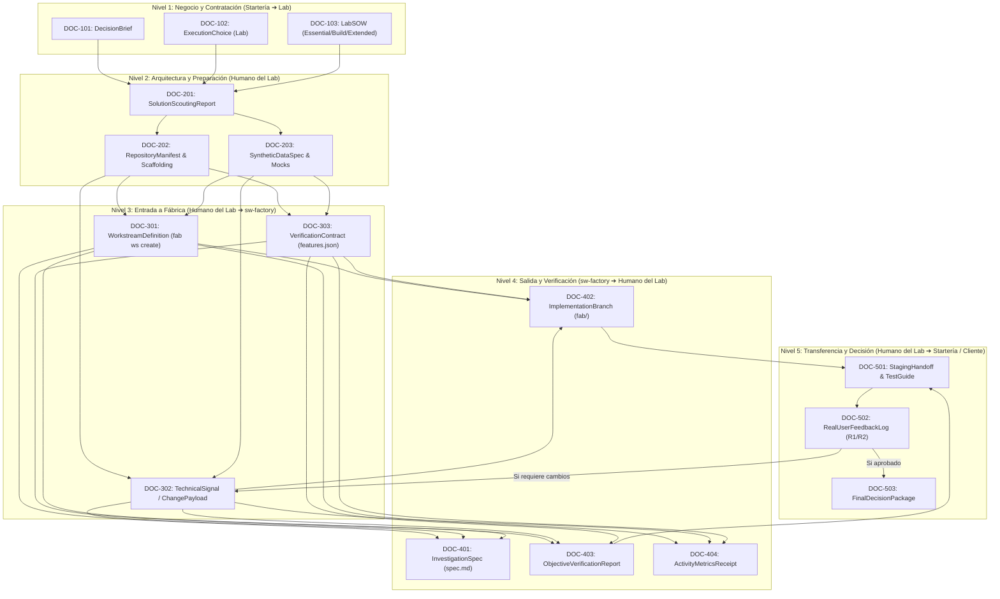

# Taxonomía Documental y Contratos de Interfaz: Startería ➔ Lab ➔ sw-factory

**Versión:** 1.0  
**Fecha:** 18 de octubre de 2026  
**Destinatarios:** Product Lead (Startería), Engineering Lead (Startería), Solution Architect / Tech Lead (Startería Lab), Operadores de `sw-factory`  
**Objetivo:** Estandarizar la clasificación, estructura, responsabilidades y formatos de todos los documentos e intercambios de información que participan en la ejecución de la **Modalidad C (Startería Lab)**.

---

## 1. Principio Fundamental de Aislamiento

Para garantizar calidad de software, predictibilidad de costes y seguridad, se establece un principio de dos fronteras:

```
[ Startería: Negocio / Producto ]
               │
               ▼  Frontera 1: Handoff de Negocio (Brief / SOW)
[ Humano del Lab: Ingeniería / Arquitectura ]
               │
               ▼  Frontera 2: Handoff Técnico (Repo / Signals / Verification)
[ sw-factory: Motor de Construcción & Verificación Automatizada ]
```

- **Frontera 1 (Startería ➔ Humano del Lab):** Intercambia documentos comerciales, estratégicos, alcances de usuario y restricciones de negocio.
- **Frontera 2 (Humano del Lab ➔ `sw-factory`):** Intercambia exclusivamente código Git, instrucciones técnicas precisas, comandos de prueba y políticas de sandbox. **La fábrica jamás recibe ni procesa documentos de negocio sin traducir.**

---

## 2. Taxonomía de Documentos (Los 5 Niveles)



---

### Nivel 1: Negocio, Diagnóstico y Contratación (Startería ➔ Humano del Lab)

Documentos elaborados por el Product Lead de Startería en conjunto con el cliente durante la fase diagnóstica.

#### `DOC-101: DecisionBrief`
- **Emisor:** Product Lead de Startería.
- **Receptor:** Cliente y Humano del Lab (Solution Architect).
- **Propósito:** Enmarcar el problema de la empresa, el cuello de botella identificado, la meta deseada y el decisor responsable.
- **Contenido mínimo obligatorio:**
  - Contexto de la empresa y restricciones de presupuesto/tiempo.
  - Alternativas actuales probadas y por qué fallaron.
  - Tabla comparativa de rutas A (Por su cuenta), B (Startería Guided) y C (Startería Lab).
  - Justificación de por qué la Modalidad C es la recomendada.

#### `DOC-102: ExecutionChoice`
- **Emisor:** Cliente / Startería.
- **Receptor:** Humano del Lab.
- **Propósito:** Registro formal e idempotente de que el cliente autorizó la ejecución bajo la modalidad C (Lab).

#### `DOC-103: LabSOW (Statement of Work)`
- **Emisor:** Product Lead de Startería + Solution Architect del Lab.
- **Receptor:** Cliente (para firma) y Humano del Lab (para ejecución).
- **Propósito:** Define los límites contractuales y técnicos del servicio Lab.
- **Contenido mínimo obligatorio:**
  - **Paquete seleccionado:** `Essential` (1 supuesto crítico / proxy), `Build` (aplicación acotada utilizable) o `Extended` (integración y seguimiento delimitados).
  - **Límites de iteración:** Máximo 2 rondas de feedback (`R1` y `R2`) con tope de horas pactado.
  - **Condiciones de prueba real:** Quiénes son los usuarios designados del cliente para probar el software entregado.
  - **Cláusulas de propiedad intelectual y no-garantía:** El software se entrega con tests aprobados; el Lab no garantiza ROI comercial ni validación de mercado.

---

### Nivel 2: Arquitectura, Scouting y Preparación (Humano del Lab)

Documentos y artefactos generados por el Ingeniero / Arquitecto del Lab antes de tocar la fábrica.

#### `DOC-201: SolutionScoutingReport`
- **Emisor:** Humano del Lab (Solution Architect).
- **Receptor:** Product Lead de Startería y archivo técnico del proyecto.
- **Propósito:** Evaluar y comparar de 1 a 3 opciones técnicas reales para abordar el encargo (ej. template SaaS vs. desarrollo serverless vs. app local). Justifica el stack tecnológico elegido.

#### `DOC-202: RepositoryManifest & Scaffolding`
- **Emisor:** Humano del Lab (Ingeniero de Software).
- **Receptor:** Sistema de archivos local (entorno de trabajo de `sw-factory`).
- **Propósito:** Repositorio Git inicializado (`git init`) que contiene el scaffolding base de la aplicación: estructura de directorios, configuración de empaquetado (`package.json`, `pyproject.toml`), linter y suite de tests mínima funcionando con salida determinista.

#### `DOC-203: SyntheticDataSpec & Mocks`
- **Emisor:** Humano del Lab.
- **Receptor:** Repositorio Git (`fixtures/` o `mocks/`).
- **Propósito:** Datos de prueba sintéticos, esquemas de bases de datos de desarrollo y mocks de APIs de terceros. **Queda estrictamente prohibido introducir datos bancarios o PII de producción.**

---

### Nivel 3: Interfaz de Entrada a la Fábrica (Humano del Lab ➔ `sw-factory`)

Instrucciones técnicas estructuradas que el Ingeniero del Lab inyecta en el motor `sw-factory`.

#### `DOC-301: WorkstreamDefinition`
- **Comando / Mecanismo:** `fab ws create <slug> --repo <path> --goal "<meta>" --agent <agent>`
- **Receptor:** Base de datos SQLite de la fábrica (`~/.fabrica/fabrica.db`).
- **Propósito:** Crear el espacio de trabajo ligado al repositorio Git local, definiendo nivel de concurrencia y gates de aprobación obligatorios (`require_change_approval: true`, `require_approval: true`).

#### `DOC-302: TechnicalSignal / ChangePayload`
- **Comando / Mecanismo:** `fab signal add <slug> "<titulo>" --body "<especificacion>"`
- **Propósito:** Traducción de un requerimiento funcional en una unidad técnica atómica de cambio (`change`).
- **Estructura requerida:**
  - **Título:** Acción técnica concisa (ej. `Implementar autenticación por token en API /api/v1/auth`).
  - **Contexto técnico:** Archivos involucrados, contratos de entrada y salida esperados.
  - **Criterios de aceptación:** Comportamientos comprobables mediante código.

#### `DOC-303: VerificationContract (Misiones)`
- **Mecanismo:** Archivo `features.json` en modo `--mission` de `fab exec`.
- **Propósito:** Definir los límites inmutables que el runner de la fábrica auditará para evitar falsos positivos o que el modelo declare éxito sin haber probado.
- **Campos obligatorios:**
  - `verificationCommands`: Array de comandos exactos que se ejecutan en sandbox estricto sin red (ej. `["bun test tests/auth.test.ts"]`).
  - `protectedPaths`: Array de archivos que los agentes tienen prohibido modificar (ej. `["tests/auth.test.ts"]`), asegurando que no debiliten los tests para aprobar la tarea.

---

### Nivel 4: Ejecución, QA y Salidas de Fábrica (`sw-factory` ➔ Humano del Lab)

Artefactos generados automáticamente por la fábrica como resultado del trabajo de los agentes y sus verificadores.

#### `DOC-401: InvestigationSpec (spec.md)`
- **Origen:** Actividad `investigation` de la fábrica.
- **Receptor:** Inbox de revisión del Humano del Lab (vía TUI o CLI `fab inbox`).
- **Propósito:** Documento de diseño técnico preliminar generado en solo lectura. Explica qué archivos se modificarán y cómo se abordará el cambio antes de autorizar la escritura de código. Requiere aprobación humana (Gate 2).

#### `DOC-402: ImplementationBranch`
- **Origen:** Actividad `implementation` de la fábrica.
- **Receptor:** Árbol Git del repositorio.
- **Propósito:** Rama de trabajo aislada con formato `fab/<changeId>` que contiene los commits atómicos con el código modificado y funcionando.

#### `DOC-403: ObjectiveVerificationReport`
- **Origen:** Runtime de misiones (`mission-evidence.ts`).
- **Receptor:** Humano del Lab / Archivo de evidencias.
- **Propósito:** Comprobación formal de que el runtime observó la ejecución de las herramientas requeridas y que los `verificationCommands` arrojaron `exitCode: 0` sobre una copia desechable en sandbox.

#### `DOC-404: ActivityMetricsReceipt`
- **Origen:** Registro en SQLite (`activities.completed_at`, `durationMs`).
- **Receptor:** Humano del Lab para auditoría de costes.
- **Propósito:** Registro exacto de segundos de cómputo empleados, turnos del modelo consumidos y tokens acumulados para costeo del proyecto.

---

### Nivel 5: Transferencia, Prueba Real e Iteración (Humano del Lab ➔ Startería / Cliente)

Artefactos de cierre que permiten al cliente experimentar la solución y decidir el siguiente paso.

#### `DOC-501: StagingHandoff & TestGuide`
- **Emisor:** Humano del Lab.
- **Receptor:** Product Lead de Startería y usuarios designados del cliente.
- **Propósito:** URL de acceso al prototipo desplegado en ambiente de staging, credenciales temporales de prueba y guía paso a paso de tareas que los usuarios deben realizar para probar el flujo.

#### `DOC-502: RealUserFeedbackLog`
- **Emisor:** Startería + Cliente ➔ Humano del Lab.
- **Propósito:** Registro estructurado del feedback obtenido durante la prueba con usuarios reales.
- **Clasificación de feedback:**
  - **Ajuste Menor (Dentro de R1 o R2):** Se traduce a una nueva señal en la fábrica dentro del SOW original.
  - **Cambio de Alcance / Pivot (Fuera de R1/R2):** Requiere un nuevo SOW o cotización de ampliación.

#### `DOC-503: FinalDecisionPackage`
- **Emisor:** Humano del Lab + Product Lead de Startería.
- **Receptor:** Decisor del Cliente.
- **Propósito:** Entrega final que recopila:
  - Repositorio de código limpio con commits y tests aprobados.
  - Resultados observados en la prueba con usuarios reales.
  - Recomendación fundamentada de siguiente paso: adoptar en producción, pausar la iniciativa o contratar una fase `Extended`.

---

## 3. Matriz de Trazabilidad y Ciclo de Vida

| Código | Documento / Artefacto | Responsable Emisión | Consumidor Directo | Gate Asociado | Herramienta / Soporte |
| :--- | :--- | :--- | :--- | :--- | :--- |
| **DOC-101** | `DecisionBrief` | Product Lead Startería | Cliente / Lab Lead | Aprobación de alcance | Markdown / Notion / Core |
| **DOC-102** | `ExecutionChoice` | Cliente | Startería / Lab Lead | Confirmación Ruta C | Registro en Startería Core |
| **DOC-103** | `LabSOW` | Startería + Lab Lead | Cliente (Firma) | Firma contractual | Contrato / SOW formal |
| **DOC-201** | `SolutionScoutingReport` | Solution Architect Lab | Startería / Archivo Lab | Selección de arquitectura | Markdown |
| **DOC-202** | `RepositoryManifest` | Ingeniero del Lab | `sw-factory` (Disco) | Verificación inicial de tests | Git Repository local |
| **DOC-203** | `SyntheticDataSpec` | Ingeniero del Lab | `sw-factory` (Fixtures) | Gate de Seguridad (Sin PII) | JSON / CSV / SQL mocks |
| **DOC-301** | `WorkstreamDefinition` | Ingeniero del Lab | `sw-factory` SQLite | Creación de workstream | `fab ws create` |
| **DOC-302** | `TechnicalSignal` | Ingeniero del Lab | `sw-factory` Store | Gate 1: `change_review` | `fab signal add` / `triage` |
| **DOC-303** | `VerificationContract` | Ingeniero del Lab | Runner de misiones | Sellado de contrato de QA | `features.json` |
| **DOC-401** | `InvestigationSpec` | Agente `sw-factory` | Ingeniero del Lab | Gate 2: `spec_review` | `spec.md` en worktree |
| **DOC-402** | `ImplementationBranch`| Agente `sw-factory` | Ingeniero del Lab | Gate 3: `fab merge` | Rama Git `fab/<id>` |
| **DOC-403** | `ObjectiveVerification` | Runner `sw-factory` | Ingeniero del Lab | Aprobación de milestone | `result.json` / logs sandbox |
| **DOC-404** | `ActivityMetricsReceipt` | Engine `sw-factory` | Ingeniero del Lab | Cierre técnico de change | SQLite `activities` / metrics |
| **DOC-501** | `StagingHandoff` | Ingeniero del Lab | Product Lead / Cliente | Inicio de prueba real | URL Staging + Guía Markdown |
| **DOC-502** | `RealUserFeedbackLog` | Product Lead Startería | Ingeniero del Lab | Activación de ronda R1/R2 | Formulario / Registro feedback |
| **DOC-503** | `FinalDecisionPackage` | Lab + Startería | Decisor del Cliente | Cierre de iniciativa | Decision Package exportable |

---

## 4. Plantillas y Ejemplos de Implementación

### 4.1 Plantilla para `DOC-103: LabSOW` (Extracto Técnico)
```markdown
# STARTERÍA LAB — Statement of Work (SOW)
**Iniciativa:** Automatización de Conciliación de Pedidos B2B
**Cliente:** Distribuidora XYZ | **Fecha:** 2026-10-20
**Paquete:** Build (Solución usable acotada)

1. Alcance Incluido:
   - Extracción de datos de facturas PDF estándar.
   - Cruce contra tabla de pedidos en base de datos PostgreSQL de prueba.
   - Endpoint API que devuelve discrepancias detectadas.
2. Exclusiones Explícitas:
   - No incluye integración directa con el ERP corporativo SAP (se usan CSVs proxy).
   - No incluye despliegue en infraestructura definitiva del cliente.
3. Protocolo de Iteraciones:
   - V0: Entrega en entorno de staging en 7 días laborables.
   - R1: Ajustes derivados del primer test con 3 operadores (máximo 8 horas de ingeniería).
   - R2: Ajustes finales tras segunda validación (máximo 4 horas de ingeniería).
4. Usuarios de Prueba Designados:
   - Responsable operativo: Juan Pérez (Jefe de Facturación).
5. Aceptación Técnica:
   - Cobertura de tests unitarios >= 80% verificados objetivamente por la fábrica.
```

### 4.2 Plantilla para `DOC-302: TechnicalSignal / ChangePayload`
```markdown
# SIGNAL: Parser de PDFs para facturas comerciales tipo B
**Workstream:** distribuidora-xyz
**Severidad / Tipo:** Feature

## Descripción Técnica
Implementar el módulo `src/parsers/invoice_b.ts` capaz de leer archivos PDF generados por el emisor ABC y extraer:
- Número de factura (string).
- Fecha de emisión (ISO 8601).
- Total e impuestos (números decimales con precisión de 2 dígitos).

## Criterios de Aceptación
1. Función `parseInvoiceB(buffer: Buffer): InvoiceData` exportada en `src/parsers/index.ts`.
2. Manejo de error con excepción tipada `InvalidInvoiceFormatError` si faltan campos obligatorios.
3. Tests en `tests/parsers/invoice_b.test.ts` deben pasar al 100%.

## Archivos Involucrados
- Crear: `src/parsers/invoice_b.ts`
- Modificar: `src/parsers/index.ts`
```

### 4.3 Plantilla para `DOC-303: VerificationContract` (`features.json`)
```json
{
  "features": [
    {
      "id": "invoice-parser-b",
      "description": "Implementar parser de facturas B con validación de totales",
      "skillName": "typescript-backend",
      "milestone": "parsers-v1",
      "expectedBehavior": [
        "Extrae correctamente los 3 campos obligatorios de fixtures/sample_b.pdf",
        "Lanza InvalidInvoiceFormatError ante un PDF dañado"
      ],
      "verificationCommands": [
        "bun test tests/parsers/invoice_b.test.ts",
        "bunx tsc --noEmit"
      ],
      "protectedPaths": [
        "tests/parsers/invoice_b.test.ts",
        "fixtures/sample_b.pdf"
      ],
      "status": "pending"
    }
  ]
}
```

---

## 5. Reglas de Oro para el Equipo

1. **Cero Datos Sensibles (Regla Airgap):** Bajo ninguna circunstancia Startería ni el cliente deben enviar datos reales confidenciales, números de tarjetas, contraseñas o PII a la fábrica. Todo input de prueba debe ser sintético (`DOC-203`).
2. **Inmutabilidad de Pruebas:** Los tests que juzgan el trabajo del agente son definidos por el Humano del Lab y declarados en `protectedPaths`. Ningún agente de la fábrica puede modificar los archivos de test para forzar la aprobación de un cambio.
3. **Respeto a los Gates Humanos:** La fábrica se detiene por diseño en la revisión del cambio (`change_review`), en la revisión del spec (`spec_review`) y en el merge final (`fab merge`). Ningún agente puede auto-aprobarse ni fusionar código a `main`.
4. **Desacoplamiento de Horas:** Las horas humanas de consultoría de Startería y del Lab se miden y cobran según el SOW; los agentes de la fábrica cobran únicamente en segundos de cómputo y consumo de tokens de modelo (`DOC-404`).
