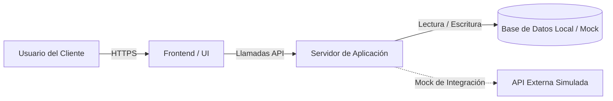

# DOC-201: SolutionScoutingReport

**Código:** DOC-201  
**Versión:** 1.0  
**Fase:** F1C — Preparación Técnica del Lab  
**Emisor:** Solution Architect / Tech Lead (Startería Lab)  
**Receptores:** Product Lead (Startería) / Archivo Técnico del Proyecto  
**Iniciativa Relacionada:** `[Nombre de la iniciativa / Ref. DOC-103]`

---

## 1. Requerimiento Técnico de Alto Nivel

- **Problema Técnico a Resolver:** `[Descripción sucinta de la funcionalidad a construir]`
- **Entradas principales:** `[Formatos de archivo, APIs, eventos]`
- **Salidas requeridas:** `[Estructuras de datos, vistas de usuario, endpoints]`
- **Restricciones del Cliente:** `[Stack preferido, políticas de seguridad, presupuesto cloud]`

---

## 2. Comparativa de Alternativas Técnicas (1 a 3 Soluciones)

> **Regla de Honestidad Técnica:** Comparar únicamente opciones viables reales. No forzar la inclusión de 3 opciones si solo existen 1 o 2 soluciones razonables para el problema.

| Criterio de Decisión | Alternativa 1 (Recomendada) | Alternativa 2 | Alternativa 3 (Opcional) |
| :--- | :--- | :--- | :--- |
| **Nombre de la Solución** | `[Ej. Next.js + SQLite/PostgreSQL local]` | `[Ej. FastAPI + Vue.js]` | `[Ej. Retool / Supabase (No-Code)]` |
| **Tipo de Arquitectura** | Monolito modular ligero. | API desacoplada + frontend SPA. | Plataforma low-code comercial. |
| **Complejidad de Construcción**| Baja / Media. | Media / Alta. | Baja en setup, alta en personalización. |
| **Compatibilidad con `sw-factory`**| **Alta:** Repositorio estándar, tests Bun/Node deterministas. | **Alta:** Tests Pytest deterministas. | **Nula:** Configuración basada en clics; incompatible con fábrica de código. |
| **Dependencias Externas** | Mínimas (runtime local/Docker). | Python 3.12, node.js para frontend. | Cuenta de pago en proveedor SaaS. |
| **Tiempo Estimado (Días V0)** | `[X días]` | `[Y días]` | `[Z días]` |
| **Seguridad y Control de Datos**| Control total en staging propio. | Control total en staging propio. | Datos almacenados en nube de terceros. |
| **Coste Recurrente Post-Lab** | Prácticamente nulo en VPS básica. | Mínimo en VPS básica. | Cuota recurrente por usuario ($/mes). |

---

## 3. Justificación de la Alternativa Seleccionada

### 3.1 Solución Elegida
`[Indicar nombre de la alternativa elegida, ej. Alternativa 1: Next.js + SQLite / TypeScript]`

### 3.2 Motivos Técnicos
1. **Velocidad de iteración con la fábrica:** `sw-factory` cuenta con soporte nativo de primera clase para TypeScript, Node y Bun, permitiendo ciclos de build y test en menos de 60 segundos.
2. **Portabilidad:** Permite empaquetar la aplicación completa en un único contenedor Docker o binario ejecutable para desplegar en staging sin configuraciones complejas.
3. **Mantenibilidad para el cliente:** No ata al cliente a licencias de software propietario ni arquitecturas sobre-diseñadas.

---

## 4. Diagrama de Arquitectura de Alto Nivel

---

## 5. Próximos Pasos Técnicos

1. `[ ]` Inicializar el repositorio Git base (`DOC-202`).
2. `[ ]` Crear fixtures de datos sintéticos (`DOC-203`).
3. `[ ]` Registrar el workstream en la fábrica de software (`DOC-301`).
