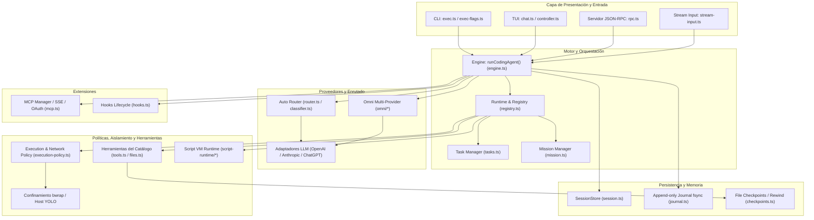
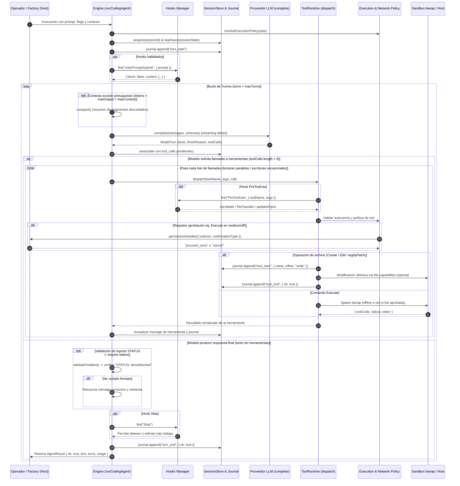
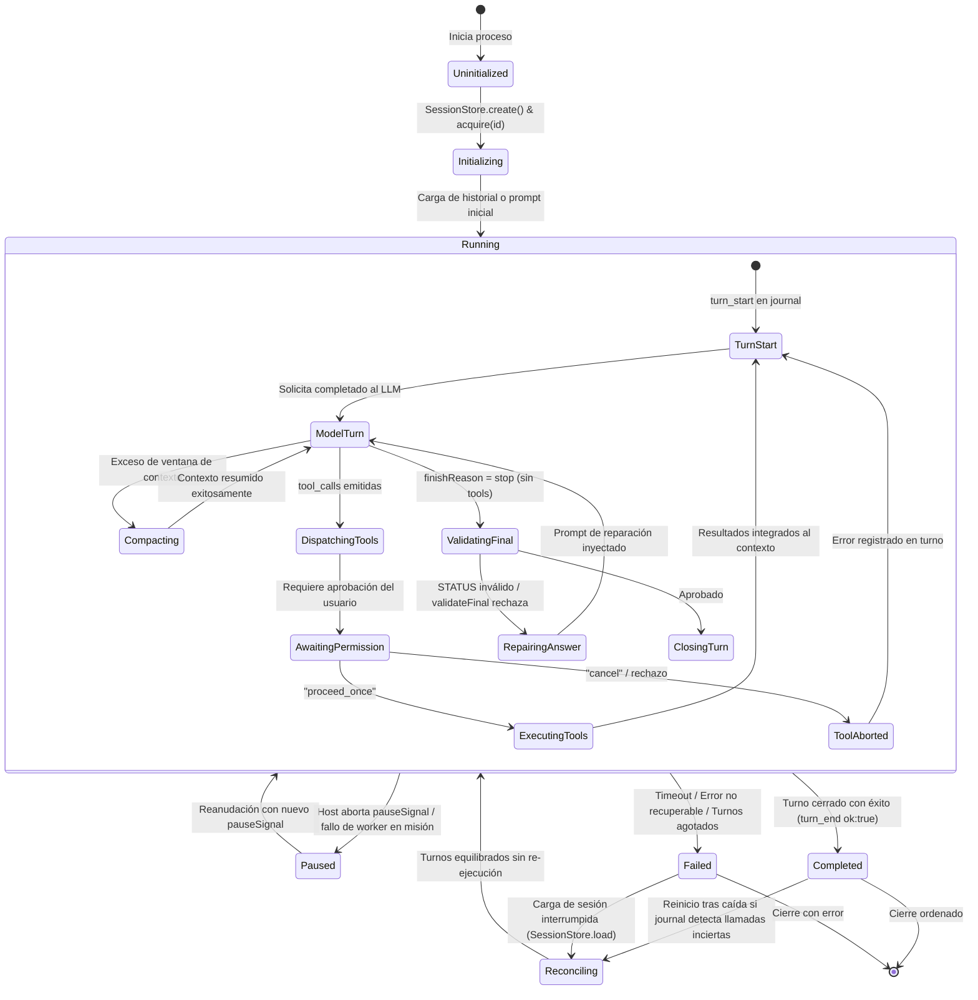

# Blueprint de Arquitectura

El motor nativo de `fab exec` es un agente autónomo de desarrollo de software implementado en **TypeScript sobre Bun**. Opera de forma desacoplada de la infraestructura externa, proporcionando capacidades de análisis de código, edición atómica, ejecución confinada de pruebas y orquestación jerárquica de misiones.

---

## 1. Contexto del Sistema y Componentes Globales

El sistema se compone de siete subsistemas principales que interactúan de forma coordinada durante la resolución de tareas:

### Componentes Principales

1. **Entrada y Protocolos (`src/agent/exec.ts:42-305`, `src/agent/rpc.ts:36-383`):** Procesa flags CLI, normaliza parámetros, gestiona worktrees Git aislados (`src/agent/exec-worktree.ts:67-171`) o despacha llamadas bidireccionales JSON-RPC 2.0 y NDJSON.
2. **Motor Conversacional (`src/agent/engine.ts:33-335`):** Coordina el bucle de turnos, streaming de deltas, acumulación y despacho concurrente de llamadas a herramientas, y compactación semántica de contexto.
3. **Despacho y Registro de Herramientas (`src/agent/registry.ts:22-260`):** `ToolRuntime` unifica la verificación de permisos, observación de comandos para misiones, ejecución de hooks de ciclo de vida e interceptación de escrituras en archivos.
4. **Enrutado y Modelos (`src/agent/providers/router.ts:47-115`, `src/agent/omni/runtime.ts:76-122`):** Permite selección estática de modelos o dinámica mediante clasificación en tiempo real (`-m auto`) o distribución de carga por coste/ToS (`-m omni`).
5. **Seguridad y Políticas (`src/agent/execution-policy.ts:15-30`, `src/agent/network-policy.ts:15-19`):** Resuelve la autoridad efectiva del agente (`standard` vs `yolo`), gobierna la concesión de interfaces de red por comando y administra el sandbox Linux `bwrap`.
6. **Persistencia Atómica (`src/agent/session.ts:34-153`, `src/agent/journal.ts:13-55`):** Registra snapshots de sesión en JSON y un diario transaccional de operaciones append-only con llamadas forzadas a `fsync` antes de ejecutar mutaciones.

---

## 2. Secuencia de un Turno de Ejecución

El siguiente diagrama detalla la traza temporal de un turno completo desde que se recibe un prompt hasta que se retorna el resultado al anfitrión:

---

## 3. Máquina de Estados de una Sesión

El ciclo de vida de una sesión conversacional se rige por una máquina de estados determinista (`src/agent/session.ts:7-33`):

### Transiciones y Casos Críticos

- **`Running` → `Compacting` (`src/agent/engine.ts:178-218`):** Se activa cuando el tamaño estimado del historial más `maxOutputTokens` supera `maxContextTokens`. Se compactan los turnos antiguos en fragmentos de texto procesados por el modelo, reteniendo de forma literal todas las restricciones y directivas de usuario.
- **`Running` → `Paused` (`src/agent/mission.ts:68-73`):** Exclusivo de misiones (`--mission`). Ocurre cuando el anfitrión aborta el `pauseSignal`, o ante violaciones de rutas protegidas o fallos de validadores. Drena todos los procesos en ejecución antes de cambiar de estado.
- **`Reconciling` (`src/agent/journal.ts:57-93`):** Al reanudar una sesión cuyo proceso previo terminó bruscamente (por ejemplo por `SIGKILL`), el diario transaccional evalúa si el PID original sigue vivo. Si ha muerto, recupera el lock e inserta respuestas sintéticas de interrupción para las llamadas pendientes, garantizando que ninguna acción mutadora quede en estado incierto ni se reproduzca a ciegas.

---

## 4. Presupuestos y Límites del Sistema

El motor impone límites estrictos para prevenir consumo descontrolado de recursos, bucles infinitos de agentes y agotamiento de memoria (`src/agent/engine.ts:74-88`):

| Parámetro | Default | Rango / Límite Máximo | Comportamiento al Exceder |
| :--- | :--- | :--- | :--- |
| `timeoutMs` | 20 min (`1.200.000 ms`) | Configurable (`> 0`) | Aborta el turno con error `{ type: 'timeout' }` y mata todos los procesos hijos. |
| `maxTurns` | `128` | Entero (`1..N`) | Finaliza con error `{ type: 'limit', message: 'Agent turn budget exhausted' }`. |
| `maxRecoveryAttempts` | `3` | Entero (`0..N`) | Límite de reparaciones automáticas por truncado o rechazo de respuesta final. |
| `maxContextTokens` | `32.000` | Entero (`> maxOutputTokens`) | Dispara la compactación obligatoria. Falla si no logra reducir el historial. |
| `maxOutputTokens` | `4.096` | Entero (`< maxContextTokens`) | Acota el tamaño máximo de la respuesta generada por el proveedor en un turno. |
| `maxToolConcurrency` | `8` | Entero (`1..N`) | Límite de herramientas de lectura concurrentes en `Promise.all`. |
| `maxDepth` (Subagentes) | `2` | Máximo runtime: `4` | Lanza excepción si se solicita profundidad mayor a 4 en subagentes. |
| `maxAgents` (Subagentes) | `8` | Máximo runtime: `32` | Número acumulado de subagentes por árbol conversacional. |
| `agentConcurrency` | `2` | Máximo runtime: `8` | Subagentes ejecutándose simultáneamente en paralelo. |
| `maxModelCalls` | `256` | Máximo runtime: `4.096` | Llamadas acumuladas al proveedor consumibles por todo el linaje de subagentes. |
| `maxBackgroundProcesses`| `4` | Máximo runtime: `32` | Subprocesos lanzados en segundo plano mediante `Execute(background: true)`. |
| `maxProcessOutputBytes` | 1 MiB (`1.048.576 B`) | Configurable | Trunca la captura de stdout/stderr y añade `\n[output truncated at limit]\n`. |
| Límite Frame RPC | 10 MiB (`10.485.760 B`)| Invariable | Desconexión inmediata por violación de tamaño de frame NDJSON. |

---

## 5. Contraste con `src/agent/README.md` (Discrepancias con el Código)

El archivo `src/agent/README.md` documenta la visión inicial del motor nativo. Al contrastar dicha documentación histórica con la implementación real del código fuente, se identifican las siguientes discrepancias y evoluciones:

1. **Métodos JSON-RPC Inbound:**
   - *README (línea 110):* Afirma la existencia de **8 métodos de solicitud entrantes**.
   - *Código real (`src/agent/rpc.ts:252-375`):* Implementa **11 métodos entrantes**. Se incorporaron formalmente `droid.list_mcp_servers`, `droid.list_mcp_tools` y `droid.authenticate_mcp_server` para la administración dinámica de servidores MCP y autenticación OAuth en caliente.
2. **Flags CLI de Selección de Herramientas:**
   - *README (línea 43-44):* Documenta únicamente `--only-tools` y `--remove-tools`.
   - *Código real (`src/agent/exec-flags.ts:44-126`):* Soporta adicionalmente `--add-tools` y reconoce selectores basados en prefijos (`toolPrefixSelector`) para habilitar o deshabilitar familias completas de herramientas.
3. **Persistencia de Títulos de Sesión:**
   - *README:* No menciona el renombrado automático de sesiones desde la invocación CLI.
   - *Código real (`src/agent/exec.ts:279-289`):* Admite el flag `--session-title <title>`, actualizando el título de la sesión en disco de forma atómica inmediatamente tras completarse la ejecución del turno.
4. **Transporte de Entrada `stream-json`:**
   - *README (línea 489):* Lo documenta como formato funcional soportado.
   - *Código real (`src/agent/exec.ts:273`):* Marca `stream-json` explícitamente como **deprecado**, emitiendo un aviso por consola (`stream-json deprecado, usa stream-jsonrpc`) y promoviendo el uso exclusivo de `stream-jsonrpc`.
5. **Comandos Locales de la TUI:**
   - *README (líneas 131-172):* Describe la lista de 36 comandos locales y 15 sin backend.
   - *Código real (`src/chat/commands.ts:3-52`, `src/chat/controller.ts:146-159`):* La TUI añade soporte para invocar skills dinámicas como comandos directos (`/<skill>`) descubiertos bajo `.agents/skills/`, además de los comandos estáticos definidos en la tabla.

---

## Archivos

| Archivo | Responsabilidad |
| :--- | :--- |
| `src/agent/exec.ts` | Entrada CLI principal `fab exec`, resolución de banderas y control del ciclo de vida. |
| `src/agent/exec-flags.ts` | Parsing de argumentos con `parseArgs`, validación de tipos y normalización de `argv`. |
| `src/agent/exec-worktree.ts` | Creación y desmontaje de worktrees Git efímeros para invocaciones aisladas de `exec`. |
| `src/agent/engine.ts` | Implementación del bucle central `runCodingAgent` y gestión de presupuestos. |
| `src/agent/registry.ts` | Registro `ToolRuntime`, despacho centralizado de herramientas, validación de permisos y hooks. |
| `src/agent/types.ts` | Definición de interfaces TypeScript fundamentales (`AgentOptions`, `AgentResult`, `ToolContext`, etc.). |
