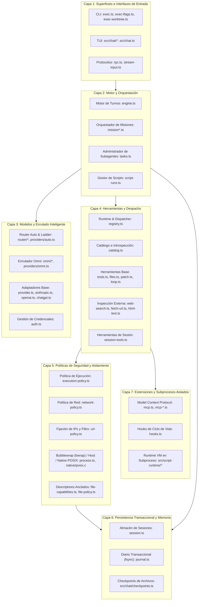

# Modelo de Capas y Dependencias

La arquitectura interna de `fab exec` está organizada en siete capas concéntricas con responsabilidades estrictamente delimitadas. El principio fundamental de diseño es que **las capas superiores conocen a las inferiores, pero las capas inferiores nunca importan ni dependen directamente de las capas superiores**.

---

## 1. Jerarquía de Capas

---

## 2. Descripción de Capas y Límites

### Capa 1: Superficies e Interfaces de Entrada
- **Responsabilidad:** Recepción de comandos del usuario, parsing de argumentos CLI (`src/agent/exec-flags.ts:128-206`), renderizado de interfaz interactiva en consola (`src/chat/controller.ts:45-501`) y exposición de endpoints JSON-RPC 2.0 (`src/agent/rpc.ts:36-383`).
- **Regla de dependencia:** Es la capa más externa. Puede importar `src/agent/engine.ts`, `src/agent/settings.ts` y tipos de `src/agent/types.ts`. Ningún módulo interno de `src/agent/` importa código de `src/chat/` ni de `src/cli.ts`.

### Capa 2: Motor y Orquestación
- **Responsabilidad:** Coordinar el ciclo de vida del agente (`runCodingAgent` en `src/agent/engine.ts:33-335`). Gobierna el flujo entre la obtención de completados de LLM, el despacho de herramientas, la administración de presupuestos de subagentes (`AgentBudget` en `src/agent/tasks.ts:18-48`) y la jerarquía de roles en misiones (`MissionManager` en `src/agent/mission.ts:20-406`).
- **Regla de dependencia:** Depende de las capas de Proveedores (Capa 3), Herramientas (Capa 4), Persistencia (Capa 6) y Extensiones (Capa 7).

### Capa 3: Modelos y Enrutado Inteligente
- **Responsabilidad:** Normalizar el transporte HTTP/SSE hacia los proveedores de LLM (`src/agent/provider.ts:129-198`), gestionar autenticación dinámica con rotación de credenciales (`src/agent/providers/auth.ts:28-111`), clasificar la dificultad de tareas para elegir modelo óptimo (`src/agent/router/classifier.ts:143-210`) y planificar intentos multi-proveedor basados en ToS y coste (`src/agent/omni/plan.ts:95-204`).
- **Regla de dependencia:** Desacoplada del sistema de archivos del workspace y de la lógica de herramientas. Solo produce objetos `ModelTurn` a partir de `ModelRequest` y mensajes normalizados.

### Capa 4: Herramientas y Despacho
- **Responsabilidad:** Definir el catálogo de capacidades ejecutables (`src/agent/tools.ts:256-359`). El componente central `ToolRuntime` (`src/agent/registry.ts:22-260`) valida que las herramientas invocadas cumplan los filtros activos (`only-tools`, `remove-tools`), verifica la compatibilidad de modo (`auto` vs `spec`) y gestiona la ejecución paralela o serial.
- **Regla de dependencia:** No invoca directamente APIs del sistema operativo de forma descontrolada; canaliza toda mutación o ejecución a través de la Capa 5 de Políticas y Aislamiento.

### Capa 5: Políticas de Seguridad y Aislamiento
- **Responsabilidad:** Resolver la autoridad inmutable del agente (`src/agent/execution-policy.ts:15-30`), verificar la política de red opt-in para comandos (`src/agent/network-policy.ts:15-19`), auditar destinos de red para prevenir ataques SSRF contra redes privadas (`src/agent/url-policy.ts:39-47`) y aislar procesos con `bwrap` o descriptores de directorio `openat` (`src/agent/file-capabilities.ts:47-52`, `src/agent/native/posix.c:27-34`).
- **Regla de dependencia:** Es una capa de contención pura; sus reglas no pueden ser relajadas por las capas superiores (por ejemplo, el modelo no puede elevar sus permisos vía RPC ni self-invocarse YOLO).

### Capa 6: Persistencia Transaccional y Memoria
- **Responsabilidad:** Garantizar la integridad del estado conversacional y de los archivos modificados. `SessionStore` (`src/agent/session.ts:34-153`) guarda el snapshot en disco bajo locks atómicos, mientras que `Journal` (`src/agent/journal.ts:13-55`) registra cada intención con `fsync` antes de ejecutar mutaciones.
- **Regla de dependencia:** Independiente del motor conversacional; expone métodos primitivos `load`, `save`, `acquire`, `append` y `reconcile`.

### Capa 7: Extensiones y Subprocesos Aislados
- **Responsabilidad:** Integración de protocolos externos como MCP (`src/agent/mcp.ts:57-293`), ejecución de scripts definidos por el usuario en `hooks.json` (`src/agent/hooks.ts:30-149`) y ejecución de código JavaScript en subprocesos aislados con sandboxing de kernel (`src/script-runtime/run.ts:49-233`).
- **Regla de dependencia:** Las extensiones operan como subsistemas subordinados: si una extensión falla o se cierra, el runtime del agente limpia los recursos sin comprometer la estabilidad del proceso padre.

---

## 3. Invariantes de Aislamiento y Comunicación

1. **Invariante de Autoridad del Host (`src/agent/execution-policy.ts:15-30`):** La política de ejecución (`permissionMode`, `effectiveAutonomy`, `sandbox`, `networkPolicy`) se resuelve únicamente al arrancar la invocación a partir de los parámetros del host. Ninguna llamada JSON-RPC ni ningún prompt del modelo puede alterar esta política.
2. **Invariante de Aislamiento de Red (`src/agent/network-policy.ts:15-19`):** Por defecto, la ejecución dentro del sandbox Linux carece de interfaces de red externas (`--unshare-net`). El acceso a la red del host es opt-in y debe solicitarse por llamada explícita mediante `network: true`.
3. **Invariante de Anclaje de Archivos (`src/agent/files.ts:11-29`, `src/agent/file-capabilities.ts:47-52`):** Todas las lecturas y escrituras de archivos se anclan mediante descriptores de directorio validados (`openat`), impidiendo ataques mediante enlaces simbólicos que apunten fuera de la raíz del workspace.

---

## Archivos

| Archivo | Responsabilidad |
| :--- | :--- |
| `src/agent/types.ts` | Definición de tipos universales compartidos entre todas las capas (`AgentOptions`, `ModelTurn`, `ToolContext`, etc.). |
| `src/agent/engine.ts` | Implementación del motor de la Capa 2 y frontera con la Capa 3 y 4. |
| `src/agent/registry.ts` | Hub central de la Capa 4: registra herramientas y aplica permisos. |
| `src/agent/execution-policy.ts` | Lógica de autoridad y permisos inmutables de la Capa 5. |
| `src/agent/session.ts` | Persistencia y gestión de sesiones de la Capa 6. |
| `src/agent/mcp.ts` | Integración del protocolo MCP de la Capa 7. |
| `src/script-runtime/index.ts` | Punto de entrada del subsistema de aislamiento de scripts en VM de la Capa 7. |
