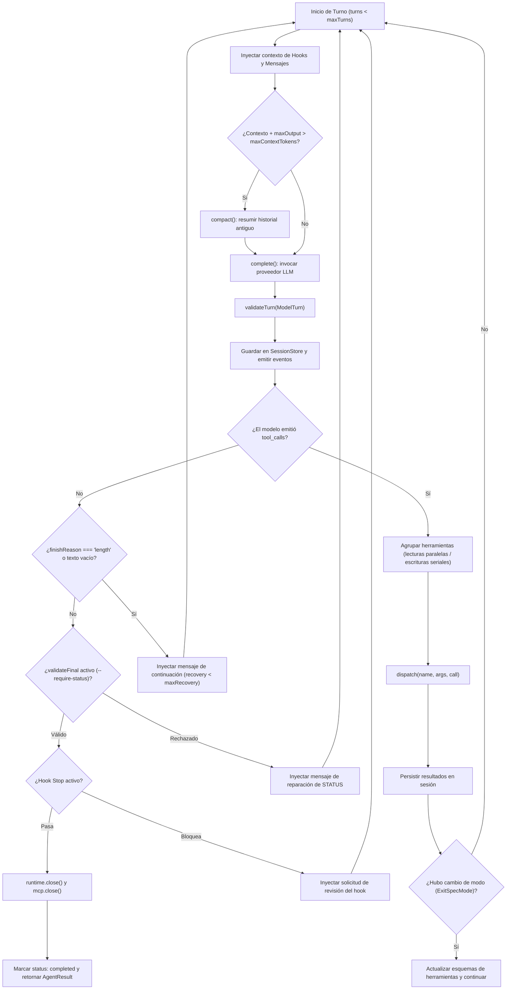
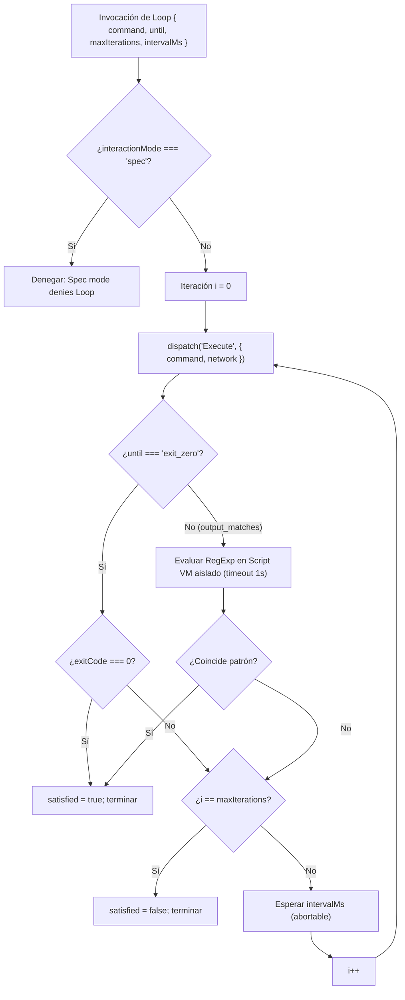

# Motor y Bucle del Agente

El núcleo de ejecución de `fab exec` reside en la función `runCodingAgent` (`src/agent/engine.ts:33-335`). Este módulo orquesta el intercambio conversacional entre el modelo de lenguaje y el entorno local, administrando presupuestos, eventos por streaming, despacho de herramientas concurrentes y recuperación ante fallos.

---

## 1. El Bucle Central de `runCodingAgent`

El motor opera como un bucle iterativo de turnos (`turns < maxTurns`, con valor por defecto `128`, `src/agent/engine.ts:75`). Cada turno procesa la entrada actual, consulta al modelo de lenguaje, interpreta su respuesta y ejecuta las herramientas solicitadas:



---

## 2. Streaming de Respuestas y Métricas de Uso

Durante la llamada a `complete` del proveedor activo (`src/agent/engine.ts:152-176`):
- Se inyecta al inicio de la conversación un recordatorio dinámico de la política vigente (`policyPrompt`, `src/agent/engine.ts:157-161`), especificando si la invocación corre bajo modo YOLO o bajo permisos estándar.
- El texto del asistente se transmite en tiempo real al anfitrión emitiendo eventos `assistant_delta` a medida que llegan los chunks (`src/agent/engine.ts:164`).
- Al completarse el turno, se acumulan los tokens reportados en `response.usage` (`inputTokens` y `outputTokens`), emitiendo un evento `usage` junto a la estimación actual de tokens de la conversación completa (`src/agent/engine.ts:165-168`).

---

## 3. Despacho Concurrente de Herramientas

Cuando el modelo solicita múltiples herramientas en un mismo turno, el motor optimiza su despacho mediante un planificador de lotes (`src/agent/engine.ts:253-263`):

1. **Partición por Efectos:**
   - Si la siguiente herramienta en la lista es de lectura (`effect === 'read'`), el motor agrupa las siguientes herramientas de lectura consecutivas hasta alcanzar el límite de paralelismo (`parallel = budget(opts.maxToolConcurrency, 8)`, `src/agent/engine.ts:79, 257`).
   - El lote de lecturas se ejecuta de forma concurrente mediante `Promise.all(batch.map(run))` (`src/agent/engine.ts:258`).
   - Las herramientas con efectos mutadores (`effect === 'write'` o `effect === 'execute'`) nunca se paralelizan entre sí; se despachan de forma estrictamente serial en lotes de tamaño 1.
2. **Límites de Salida por Herramienta:**
   - La respuesta cruda de cada herramienta se acota antes de ser devuelta al modelo (`src/agent/engine.ts:248-250`):
     - `FetchUrl`, `Script`, `WaitForScript`: hasta **8.192 KiB (8 MiB)**.
     - `Loop`: hasta **2.048 KiB (2 MiB)**.
     - Resto de herramientas (`Execute`, `Read`, etc.): hasta **256 KiB**.
   - Si la salida excede el presupuesto, se sustituye por un mensaje de error explícito (`Error: Tool result exceeds N KiB`) con `isError: true`.

---

## 4. Contrato de STATUS y Validación Final

Cuando el agente se invoca con `--require-status` (`src/agent/exec.ts:269`), el motor enlaza el validador `validateReportStatus` (`src/prompts.ts:79-83`):

1. **Requisito Formal:** La primera línea reconocible del reporte final debe coincidir exactamente con el patrón:
   ```text
   STATUS: done
   ```
   o bien:
   ```text
   STATUS: blocked - <motivo descriptivo>
   ```
2. **Bucle de Reparación Guiada (`src/agent/engine.ts:288-294`):**
   - Si la respuesta final del modelo no incluye una línea `STATUS:` válida, `validateFinal` devuelve un mensaje de rechazo explicativo.
   - Si el contador de recuperaciones no ha agotado `maxRecoveryAttempts` (por defecto 3, `src/agent/engine.ts:76`), el motor no falla: añade un mensaje al historial instruyendo al modelo a corregir su respuesta:
     ```text
     The caller rejected the final answer: Include a first STATUS line containing exactly STATUS: done or STATUS: blocked - <reason>.
     Repair the answer using the evidence already collected. Do not invent actions or test results.
     ```
   - Si se supera el presupuesto de recuperación, lanza la excepción `Final answer repair budget exhausted` (`src/agent/engine.ts:291`).

---

## 5. La Herramienta `Loop`

La herramienta `Loop` (`src/agent/loop.ts:35-65`) permite repetir un comando de primer plano hasta que se cumpla una condición predeterminada, evitando gastar turnos conversacionales completos del modelo para tareas repetitivas de verificación:



### Invariantes de Seguridad de `Loop`
- **Sin Shell Expansions:** Acepta únicamente un comando simple acotado a 16 KiB sin operadores de encadenamiento (`&&`, `||`, pipes) (`src/agent/README.md:325`).
- **Permisos por Ejecución:** Cada iteración pasa por el dispatcher normal de `Execute`. Si la autonomía es `off` o `low`, cada iteración puede requerir aprobación interactiva individual.
- **Evaluación Aislada de Expresiones Regulares (`src/agent/loop.ts:25-34`):** Cuando `until === 'output_matches'`, la evaluación de la expresión regular se ejecuta en un worker de Script VM aislado con un deadline de 1 segundo, protegiendo al agente frente a ataques de ReDoS (expresiones regulares con backtracking exponencial).

---

## 6. Cancelación Limpia y Drenado

El motor escucha señales de cancelación (`AbortSignal`) provenientes de timeouts, señales del sistema operativo (`SIGINT`, `SIGTERM`) o peticiones remotas (`droid.interrupt_session` en RPC):

- **Interrupción Inmediata (`src/agent/engine.ts:53`):** Al abortarse el controlador, `runtime?.interruptProcesses()` envía inmediatamente `SIGTERM` y escala a `SIGKILL` sobre todos los subprocesos hijos y subagentes en background.
- **Drenado Seguro en `finally` (`src/agent/engine.ts:327-334`):**
  - Se espera a que todos los descriptores de archivos y pipes cierren ordenadamente (`runtime?.close()`).
  - Se desconectan los clientes MCP (`mcp?.close()`).
  - Se cierran los hooks y se libera el lock de la sesión (`store?.close()`).
- **Reconciliación de Pausa en Misiones (`src/agent/engine.ts:316-320`):** Si una misión fue pausada por el anfitrión durante la ejecución de herramientas, las llamadas pendientes se balancean insertando respuestas de error explícitas indicando que los efectos pueden haber sido parciales, impidiendo que el motor intente reproducir llamadas inciertas en el siguiente arranque.

---

## Archivos

| Archivo | Responsabilidad |
| :--- | :--- |
| `src/agent/engine.ts` | Implementación de `runCodingAgent`: bucle de turnos, presupuestos, streaming y manejo de fallos. |
| `src/agent/loop.ts` | Definición de la herramienta compuesta `Loop`, matching seguro de salida y ciclo de iteración. |
| `src/agent/cancellation.ts` | Utilidad `abortable` para envolver promesas con cancelación limpia mediante `AbortSignal`. |
| `src/prompts.ts` | Lógica de validación del contrato de estatus (`validateReportStatus`, `parseReportStatus`). |
