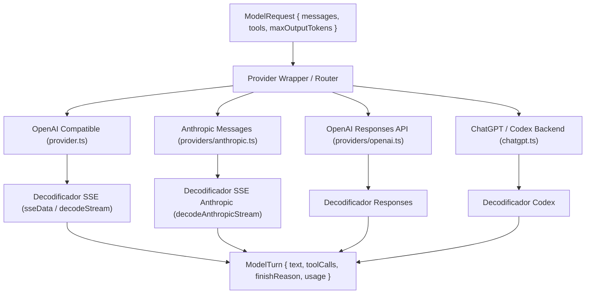
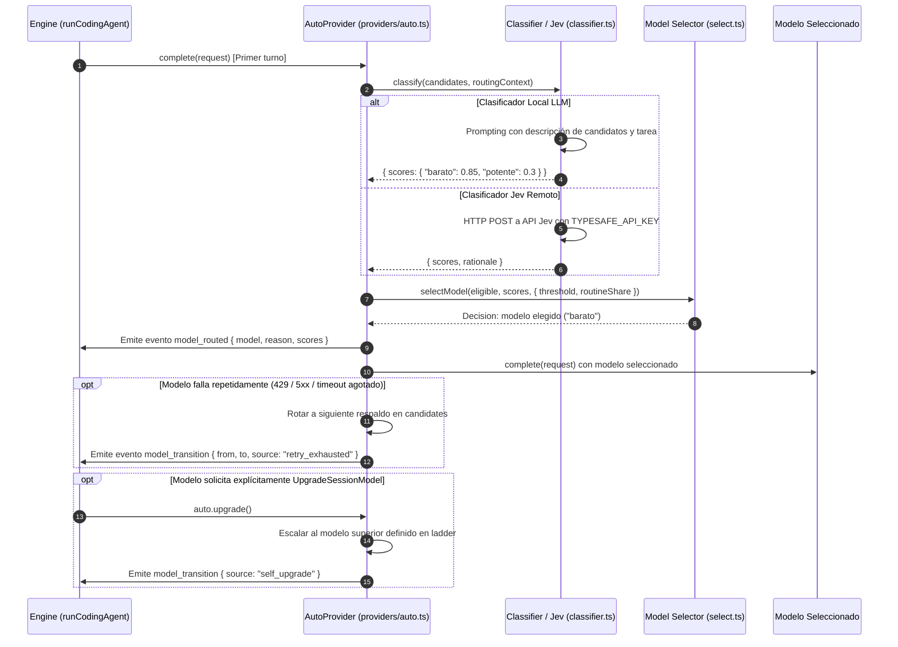

# Proveedores y Router de Modelos

El subsistema de modelos de `fab exec` desacopla el bucle del motor conversacional de los diferentes proveedores de inteligencia artificial mediante una interfaz común (`ModelProvider`), incorporando autenticación resiliente, rotación automática ante fallos y un router inteligente con escalado adaptativo.

---

## 1. Adaptadores de Proveedores Base

### 1. OpenAI-Compatible (`src/agent/provider.ts:129-198`)
- **Protocolo:** Consume el endpoint `/chat/completions` enviando JSON con `stream: true`.
- **Decodificación de Stream (`src/agent/provider.ts:75-127`):** Procesa frames Server-Sent Events (`data: {...}`). Acumula los deltas de texto, reconstruye fragmentos parciales de llamadas a herramientas (`tool_calls[i].function.arguments`) y valida el turno final (`validateTurn`, `src/agent/provider.ts:54-73`), descartando llamadas con argumentos corruptos o IDs no únicos.
- **Protección contra Inactividad (`src/agent/transport.ts:31-76`):** Envuelve el stream en un `IdleGuard` que aborta la conexión si no se reciben bytes en un intervalo configurable (`FABRICA_STREAM_IDLE_MS`, por defecto 60 segundos).

### 2. Anthropic Messages (`src/agent/providers/anthropic.ts:286-376`)
- **Protocolo:** Consume la API `/v1/messages` con versión `anthropic-version: 2023-06-01` y cabeceras beta opcionales (`interleaved-thinking-2024-11-20`).
- **Transformación de Mensajes (`src/agent/providers/anthropic.ts:46-181`):** Convierte el rol `system` a un parámetro top-level `system`, mapea las llamadas y resultados de herramientas a bloques de contenido `{ type: 'tool_use', id, name, input }` y `{ type: 'tool_result', tool_use_id, content }`, y calcula presupuestos de razonamiento (`thinkingBudget`) cuando se configura `reasoningEffort`.

### 3. OpenAI Responses API (`src/agent/providers/openai.ts:20-106`)
- Proporciona integración nativa con la nueva API `/v1/responses`, adaptando la estructura de instrucciones y herramientas.

### 4. Backend ChatGPT / Codex (`src/agent/chatgpt.ts:139-169`)
- **Autenticación sin Claves Explícitas (`src/agent/chatgpt.ts:42-56`):** Lee credenciales OAuth persistidas en el directorio de usuario (por ejemplo `~/.config/codex/auth.json`), decodifica los claims del token JWT (`jwtClaims`, `src/agent/chatgpt.ts:30-35`) para verificar expiración y conecta contra los endpoints de backend designados.

---

## 2. Autenticación y Manejo de Fallos HTTP

- **Resolución de Credenciales (`src/agent/providers/auth.ts:28-111`):** Soporta tanto claves estáticas directas como resolución dinámica mediante comandos externos (`credentialCommand`, `src/agent/providers/auth.ts:69-102`), refrescando tokens automáticamente cuando se detecta expiración o ante respuestas HTTP 401.
- **Detección de Fallos HTTP (`src/agent/providers/http-failure.ts:79-90`):** Extrae metadatos seguros del cuerpo de respuestas de error sin exponer secretos. Parsea cabeceras `Retry-After` para coordinar pausas exactas (`retryAtFromHeader`, `src/agent/providers/http-failure.ts:62-76`).
- **Política de Reintentos con Jitter (`src/agent/providers/attempt-policy.ts:29-33`):** Aplica retroceso exponencial con variación aleatoria (`retryDelayMs = Math.min(30_000, 200 * 2 ** attempt + random() * 200)`), garantizando que las ráfagas de reconexión no sobrecarguen los endpoints de inferencia.

---

## 3. Router Inteligente (`-m auto`)

Cuando se especifica `-m auto` o `modelId: "auto"` en la configuración (`src/agent/providers/auto.ts:105-200`), el agente no fija un modelo único, sino que delega la elección en un router dinámico respaldado por una matriz de candidatos (`autoRouter` en `settings.json`):

### Componentes del Router

1. **Clasificación en Tiempo Real (`src/agent/router/classifier.ts:143-210`):** Evalúa el primer prompt de usuario junto con la presencia de imágenes, tamaño del árbol de trabajo y descripción de los modelos candidatos, produciendo un mapa de puntuaciones normalizadas (`0.0..1.0`).
2. **Clasificador Jev Remoto (`src/agent/router/jev.ts:15-105`):** Permite delegar la clasificación en el servicio remoto de Jev si se define `JEV_API_KEY` o `TYPESAFE_API_KEY` en el entorno.
3. **Selección Determinista (`src/agent/router/select.ts:29-160`):** Aplica umbrales de coste y balanceo de tareas rutinarias (`routineShare`), garantizando que tareas sencillas utilicen modelos ligeros y económicos, mientras que refactorizaciones complejas activen modelos de razonamiento avanzado.
4. **Escalera de Modelos y Auto-Escalado (`src/agent/router/ladder.ts:15-68`):**
   - Si la sesión está en modo `auto`, se registra en el catálogo la herramienta `UpgradeSessionModel` (`src/agent/registry.ts:93-101`).
   - El modelo puede invocar esta herramienta cuando reconoce que ha entrado en un punto muerto técnico o que la tarea exige mayor profundidad analítica de la que su nivel actual puede resolver. La transición es irreversible para el resto de la sesión.

---

## Archivos

| Archivo | Responsabilidad |
| :--- | :--- |
| `src/agent/provider.ts` | Adaptador universal OpenAI-compatible, decodificador SSE y validación de turnos. |
| `src/agent/providers/anthropic.ts` | Adaptador de la API Anthropic Messages y gestión de thinking budget. |
| `src/agent/providers/openai.ts` | Adaptador para la nueva API OpenAI Responses. |
| `src/agent/chatgpt.ts` | Adaptador del backend ChatGPT / Codex y extracción de credenciales JWT. |
| `src/agent/providers/auth.ts` | Caching de tokens y resolución de credenciales estáticas o por comando. |
| `src/agent/providers/attempt-policy.ts` | Control de intentos, delays con jitter y detección de errores recuperables. |
| `src/agent/providers/http-failure.ts` | Análisis de códigos de fallo HTTP y parsing de cabeceras `Retry-After`. |
| `src/agent/providers/router.ts` | Envoltorio para ejecución con fallback ante rate limits o timeouts. |
| `src/agent/providers/auto.ts` | Implementación del proveedor dinámico `AutoProvider`. |
| `src/agent/router/classifier.ts` | Clasificador de tareas sobre modelos LLM locales. |
| `src/agent/router/select.ts` | Algoritmo de selección de candidatos según puntuación y coste relativo. |
| `src/agent/router/ladder.ts` | Jerarquía y transiciones de escalado de modelos. |
| `src/agent/router/jev.ts` | Conector para clasificación remota con el servicio Jev. |
| `src/agent/catalog.ts` | Utilidades para introspección y selección de herramientas del catálogo. |
