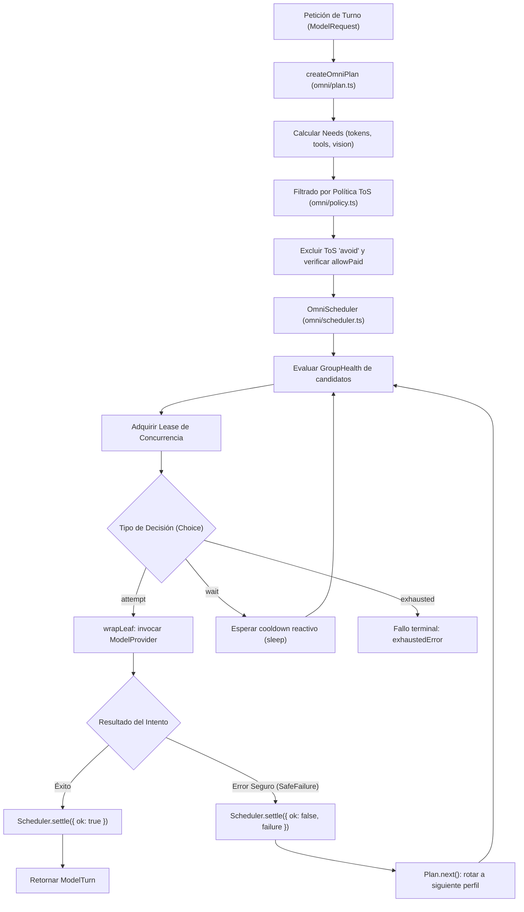

# Enrutador Multi-Proveedor Omni

El subsistema **Omni** (`src/agent/omni/**`, `src/agent/providers/omni.ts:20-40`) es el enrutador multi-proveedor avanzado de `fab exec`. Está diseñado para distribuir el consumo de inferencia entre múltiples hojas de ejecución (endpoints locales o remotos) optimizando costes, respetando restricciones de Términos de Servicio (ToS) y previniendo la saturación de cuotas mediante leases de concurrencia.

---

## 1. Arquitectura y Filosofía de Omni

Omni se activa cuando se invoca el agente con `-m omni` en combinación con un archivo de configuración `--settings <file>` que defina las secciones `omniRouter` y `customModels` (`src/agent/exec.ts:35-37`).

A diferencia del router `auto` (que clasifica la dificultad técnica de una tarea para elegir un escalón de la escalera), Omni opera a nivel de **planificación de intentos por turno**:
- Evalúa los requerimientos de la solicitud (`Needs`: contexto requerido, soporte de herramientas, visión).
- Filtra perfiles inadmisibles por ToS (`avoid` queda estrictamente excluido).
- Prioriza modelos gratuitos antes de considerar opciones de pago (salvo que `allowPaid: true` esté autorizado).
- Coordina la tasa de peticiones mediante leases temporales y seguimiento de la salud de grupos (`GroupHealth`).

---

## 2. Contratos y Evaluación de ToS (`src/agent/omni/contracts.ts`, `src/agent/omni/policy.ts`)

Omni clasifica cada perfil de modelo según sus Términos de Servicio (`Tos`, `src/agent/omni/contracts.ts:6`):
- `ok`: Cumple plenamente con políticas de privacidad sin retención para entrenamiento.
- `caution`: Requiere atención, pero es admisible en contextos estándar.
- `ambiguous`: Políticas no concluyentes; admisible con advertencia.
- `avoid`: **Inadmisible.** Modelos o endpoints que entrenan con datos del usuario o violan restricciones de seguridad corporativa.
- `unknown`: Sin metadatos conocidos; evaluado según las reglas por defecto del entorno.

### Invariantes de Selección (`src/agent/omni/policy.ts:39-48, 73-121`)
1. **Exclusión Absoluta de `avoid`:** La función `isTosAdmissible(profile)` rechaza tajantemente cualquier perfil calificado como `avoid`, independientemente de su coste o disponibilidad.
2. **Precedencia Gratuita:** Los perfiles con coste cero (`costRank === 0`) se ordenan prioritariamente. Los perfiles con coste asociado solo se consideran si la configuración explícitamente incluye `allowPaid: true` (`src/agent/exec.ts:36`).

---

## 3. Planificador y Leases de Concurrencia (`src/agent/omni/scheduler.ts`)

El componente `OmniScheduler` (`src/agent/omni/scheduler.ts:52-187`) administra la concurrencia y los límites de tasa hacia los diferentes grupos de proveedores:

```mermaid
stateDiagram-v2
    [*] --> Idle: Inicialización de Grupo

    Idle --> ActiveLease: Petición entrante adquiere Lease
    ActiveLease --> Idle: settle({ ok: true }) / liberación exitosa

    ActiveLease --> Cooldown: settle({ ok: false, failure: rate_limit / 429 })
    Cooldown --> Cooldown: Nueva petición rechazada; entra en wait
    Cooldown --> Idle: Transcurrido retryAt / periodo de retroceso

    ActiveLease --> QuotaBlocked: settle({ ok: false, failure: quota })
    QuotaBlocked --> Idle: Ventana de cuota restablecida

    ActiveLease --> TransientBackoff: Fallo transitorio 5xx
    TransientBackoff --> Idle: Jitter exponencial cumplido
```

### Mecánica del Scheduler
- **Adquisición Atómica:** Cada llamada a `select(ctx)` devuelve un objeto `Choice` (`src/agent/omni/contracts.ts:26-27`):
  - `{ kind: 'attempt', lease }`: Concede permiso inmediato para despachar el turno hacia la hoja designada.
  - `{ kind: 'wait', until }`: El grupo está en pausa reactiva por rate-limit; el motor duerme de forma cancelable hasta la marca temporal `until`.
  - `{ kind: 'exhausted', retryAt }`: Todos los perfiles admisibles han agotado sus cuotas o intentos.
- **Salud de Grupo (`GroupHealth`, `src/agent/omni/scheduler.ts:14-19`):** Rastrea las peticiones activas en vuelo (`inFlight`), fallos consecutivos (`consecutiveFailures`), marca temporal del último fallo y tiempo de reapertura tras rate limits.

---

## 4. Runtime y Ejecución de Hojas (`src/agent/omni/runtime.ts`)

El runtime (`src/agent/omni/runtime.ts:76-122`) construye las instancias reales de `ModelProvider` correspondientes a cada hoja (`resolveLeaf`), envolviéndolas en:
- **Protección de Timeout Individual (`withOmniTimeout`, `src/agent/omni/runtime.ts:51-60`):** Evita que una hoja con alta latencia bloquee indefinidamente el turno del agente.
- **Clasificación Segura de Fallos (`src/agent/omni/failures.ts`):** Convierte errores brutos de red y HTTP en instancias normalizadas de `SafeFailure` (`src/agent/omni/contracts.ts:19-22`), protegiendo cadenas de conexión y tokens de autenticación para que nunca aparezcan en los registros de diagnóstico ni en los eventos del agente.

---

## Archivos

| Archivo | Responsabilidad |
| :--- | :--- |
| `src/agent/providers/omni.ts` | Proveedor `OmniProvider` que implementa `ModelProvider` e integra el planificador. |
| `src/agent/omni/contracts.ts` | Definición de interfaces, tipos ToS, estados de lease y diagnósticos de Omni. |
| `src/agent/omni/config.ts` | Validación y normalización del esquema de configuración de `omniRouter`. |
| `src/agent/omni/policy.ts` | Reglas de filtrado de perfiles, evaluación de ToS y control de acceso a modelos de pago. |
| `src/agent/omni/plan.ts` | Creación de planes de intentos por turno (`RoutedAttemptPlan`) y rotación de fallos. |
| `src/agent/omni/scheduler.ts` | Planificador de concurrencia, seguimiento de `GroupHealth` y gestión de leases. |
| `src/agent/omni/runtime.ts` | Inicialización de hojas de inferencia, resolución de dependencias y timeouts. |
| `src/agent/omni/failures.ts` | Mapeo y sanitización de excepciones HTTP/red a fallos estructurados `SafeFailure`. |
| `src/agent/omni/catalog.ts` | Catálogo de metadatos conocidos de modelos, capacidades y costes de Omni. |
