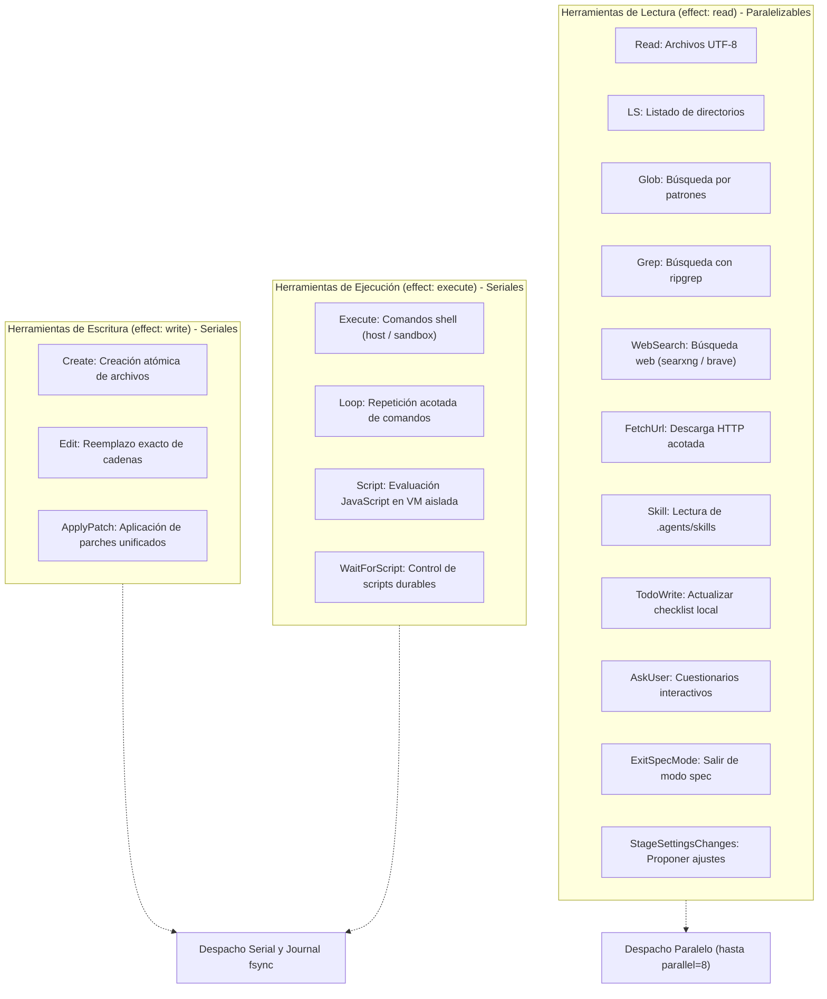

# Catálogo de Herramientas y Acceso a Archivos

El catálogo de herramientas (`src/agent/tools.ts:256-359`, `src/agent/catalog.ts:23-38`) define el conjunto de capacidades operativas que el agente puede invocar. Cada herramienta declara su esquema de parámetros, sus efectos secundarios (`read`, `write`, `execute`) y su nivel de autonomía requerido.

---

## 1. Clasificación y Matriz de Herramientas



### Tabla Completa del Catálogo

| Herramienta | ID Interno | Efecto | Autonomía Mínima | Descripción y Restricciones |
| :--- | :--- | :--- | :--- | :--- |
| `Read` | `read` | `read` | `off` | Lee líneas de un archivo UTF-8 (`offset`, `limit` hasta 2.000 líneas). Registra lectura para `requireReadBeforeEdit`. |
| `LS` | `ls` | `read` | `off` | Enumera entradas de un directorio (hasta 1.000 entradas). |
| `Glob` | `glob` | `read` | `off` | Encuentra rutas relativas con `Bun.Glob` sin seguir symlinks (hasta 1.000 resultados). |
| `Grep` | `grep` | `read` | `off` | Búsqueda rápida con `rg` acotada a archivos de hasta 1 MiB y 100 coincidencias. |
| `Create` | `create` | `write` | `low` | Crea directorios padre y escribe un archivo de forma atómica (`atomicReplace`). |
| `Edit` | `edit` | `write` | `low` | Reemplaza cadenas exactas (`old_str` → `new_str`). Falla si el texto es ambiguo salvo `change_all: true`. |
| `ApplyPatch` | `apply-patch-cli`| `write` | `low` | Aplica un parche de archivo único de hasta 128 hunks con búsqueda KMP. |
| `Execute` | `execute` | `execute` | `medium` | Ejecuta `/bin/sh -c` en sandbox o host. Soporta `background: true` y `network: true`. |
| `Loop` | `loop-cli` | `execute`| `medium` | Repite un comando foreground hasta `exit_zero` o `output_matches`. Denegada en spec. |
| `WebSearch` | `web_search` | `read` | `off` | Consulta motores de búsqueda configurados (`searxng` o `brave`). Red opt-in. |
| `FetchUrl` | `fetch_url` | `read` | `off` | Descarga HTTP(S) de hasta 1 MiB con extracción de texto plano de HTML. |
| `TodoWrite` | `todo_write` | `read` | `off` | Guarda el checklist de tareas de la sesión en memoria (`state.todos`). |
| `AskUser` | `ask_user` | `read` | `off` | Envía un cuestionario estructurado al operador humano. |
| `Skill` | `skill` | `read` | `off` | Lee las instrucciones de una habilidad en `.agents/skills/<name>/SKILL.md`. |
| `ExitSpecMode` | `exit-spec-mode`| `read` | `high` (o aprobación)| Solicita la transición de modo `spec` a `auto` para el siguiente turno. |
| `StageSettingsChanges`| `stage_settings_changes`| `read`| `off` | Propone cambios de modelo o autonomía para revisión del usuario. |
| `TaskOutput` | `task_output` | `read` | `off` | Muestrea o espera la salida de un proceso o subagente en background. |
| `TaskStop` | `task_stop` | `execute`| `low` | Detiene un subproceso enviando `SIGTERM` y escalando a `SIGKILL`. |
| `ListAgents` | `list_agents` | `read` | `off` | Enumera los procesos y subagentes activos de la sesión. |
| `Script` | `script` | `execute`| `low` | Lanza evaluación JavaScript aislada en `src/script-runtime/`. |
| `WaitForScript`| `wait_for_script`| `execute`| `low` | Controla o espera el resultado de un script en background. |

---

## 2. Seguridad en el Acceso a Archivos: Descriptores Anclados

Para prevenir ataques de directory traversal o escapes del workspace mediante la manipulación concurrente de enlaces simbólicos (time-of-check to time-of-use o TOCTOU), el motor implementa **acceso anclado por descriptores de archivo** (`src/agent/file-capabilities.ts:47-67`):

1. **Resolución Componente a Componente:**
   - La función `withWorkspaceFile` (`src/agent/files.ts:11-29`) descompone la ruta solicitada en sus segmentos individuales relativos a la raíz del workspace.
   - Cada directorio intermedio se abre secuencialmente obteniendo un descriptor de archivo (`CapabilityHandle`) mediante llamadas nativas `openat` (`src/agent/native/posix.c:27-34`).
   - Se valida que ningún descriptor intermedio sea un enlace simbólico que apunte fuera de la jerarquía permitida.
2. **Reemplazo Atómico (`atomicReplace`, `src/agent/files.ts:50-63`):**
   - Las escrituras (`Create`, `Edit`, `ApplyPatch`) no sobrescriben directamente el archivo en su ubicación final.
   - Crean un archivo temporal temporalmente anclado en el mismo directorio padre (`.fab-tmp-...`).
   - Sincronizan los bytes y los permisos del archivo (`mode`).
   - Invocan `renameat` para sustituir el archivo original de forma atómica a nivel del sistema de archivos, garantizando que un fallo o interrupción durante la escritura no deje el archivo en un estado corrupto o a medio escribir.

---

## 3. Política de Lectura Obligatoria Previa (`requireReadBeforeEdit`)

Cuando el anfitrión habilita `opts.requireReadBeforeEdit: true` (`src/agent/file-policy.ts:3-7`):
- Cada llamada exitosa a `Read` calcula el hash SHA-256 del contenido leído y lo almacena en `context.fileReads` (`rememberRead`).
- Antes de que `Edit` o `ApplyPatch` modifiquen un archivo existente, `checkRead` verifica que el archivo haya sido leído previamente en la sesión actual y que su hash en disco en el instante exacto de la mutación coincida con los bytes observados por el modelo.
- Si el archivo fue modificado externamente o si el modelo intenta editar "a ciegas" sin haber inspeccionado el código, la operación se rechaza inmediatamente con un error descriptivo.

---

## 4. Motor de Parches con Búsqueda KMP (`src/agent/patch.ts`)

La herramienta `ApplyPatch` utiliza un formato de parche unificado simplificado y seguro:

```text
*** Update File: /ruta/absoluta/archivo.ts
@@
 línea de contexto previa
-código a eliminar
+código a insertar
 línea de contexto posterior
```

O para creación de nuevos ficheros:
```text
*** Add File: /ruta/absoluta/nuevo.ts
+primera línea
+segunda línea
```

- **Búsqueda KMP sin Coste Cuadrático (`src/agent/patch.ts:29-48`):** Para localizar la posición de los bloques de contexto en archivos repetitivos o de gran tamaño, utiliza el algoritmo Knuth-Morris-Pratt (`uniqueMatch`), evitando la degradación de rendimiento cuadrática ($O(N \cdot M)$) de las búsquedas ingenuas.
- **Límites de Seguridad:** Acepta como máximo **128 hunks** por invocación y un tamaño máximo de parche de **1 MiB**. Rechaza parches con rutas relativas, modificaciones de múltiples archivos en un mismo payload o líneas de contexto ambiguas.

---

## 5. Inspección Web y Descargas HTTP

### WebSearch (`src/agent/web-search.ts:81-247`)
- **Efecto de Solo Lectura:** Clasificada como `effect: 'read'`.
- **Motores Soportados:** `searxng` (API JSON) y `brave` (API REST con cabecera `X-Subscription-Token`). Si no hay proveedor configurado, la herramienta se desactiva en el catálogo.
- **Confinamiento:** Timeout estricto de 15 segundos (`AbortSignal.timeout(15_000)`), respuesta acotada a un máximo de 64 KiB y saneamiento de claves de API en errores.

### FetchUrl (`src/agent/fetch-url.ts:72-95`)
- **Protección Anti-SSRF:** Antes de iniciar la conexión HTTP, resuelve las direcciones IP del host mediante `pinAddresses` (`src/agent/url-policy.ts:39-47`). Bloquea inmediatamente accesos a `localhost` (`127.0.0.1`), rangos privados RFC 1918 (`10.0.0.0/8`, `172.16.0.0/12`, `192.168.0.0/16`), enlaces locales (`169.254.0.0/16`), multicast y rangos IPv6 reservados.
- **Extracción Lineal de Texto (`src/agent/html-text.ts:2-36`):** Si la respuesta es de tipo HTML o XHTML, un analizador lineal ligero elimina etiquetas `<script>`, `<style>`, comentarios y tags HTML, retornando únicamente el texto visible estructurado sin ejecutar scripts ni cargar subrecursos.

---

## Archivos

| Archivo | Responsabilidad |
| :--- | :--- |
| `src/agent/tools.ts` | Definición e instanciación de las herramientas base (`builtinTools`, `execute`, `scriptTool`). |
| `src/agent/files.ts` | Operaciones de archivos ancladas por descriptor (`withWorkspaceFile`, `atomicReplace`). |
| `src/agent/file-capabilities.ts` | Capa de abstracción de descriptores POSIX (`openat`, `mkdirat`, `renameat`). |
| `src/agent/file-policy.ts` | Comprobación de lectura previa requerida (`checkRead`, `rememberRead`). |
| `src/agent/patch.ts` | Parser y aplicador de parches unificados con algoritmo de coincidencia KMP. |
| `src/agent/session-tools.ts` | Herramientas de control de sesión (`ExitSpecMode`, `StageSettingsChanges`). |
| `src/agent/web-search.ts` | Herramienta `WebSearch` y conectores a motores SearxNG y Brave. |
| `src/agent/fetch-url.ts` | Herramienta `FetchUrl` para recuperación HTTP confinada y validación de redirecciones. |
| `src/agent/html-text.ts` | Extractor de texto plano a partir de payloads HTML/XHTML sin ejecución de código. |
| `src/agent/native/posix.c` | Implementación en C del puente Node-API para las llamadas POSIX `*at`. |
