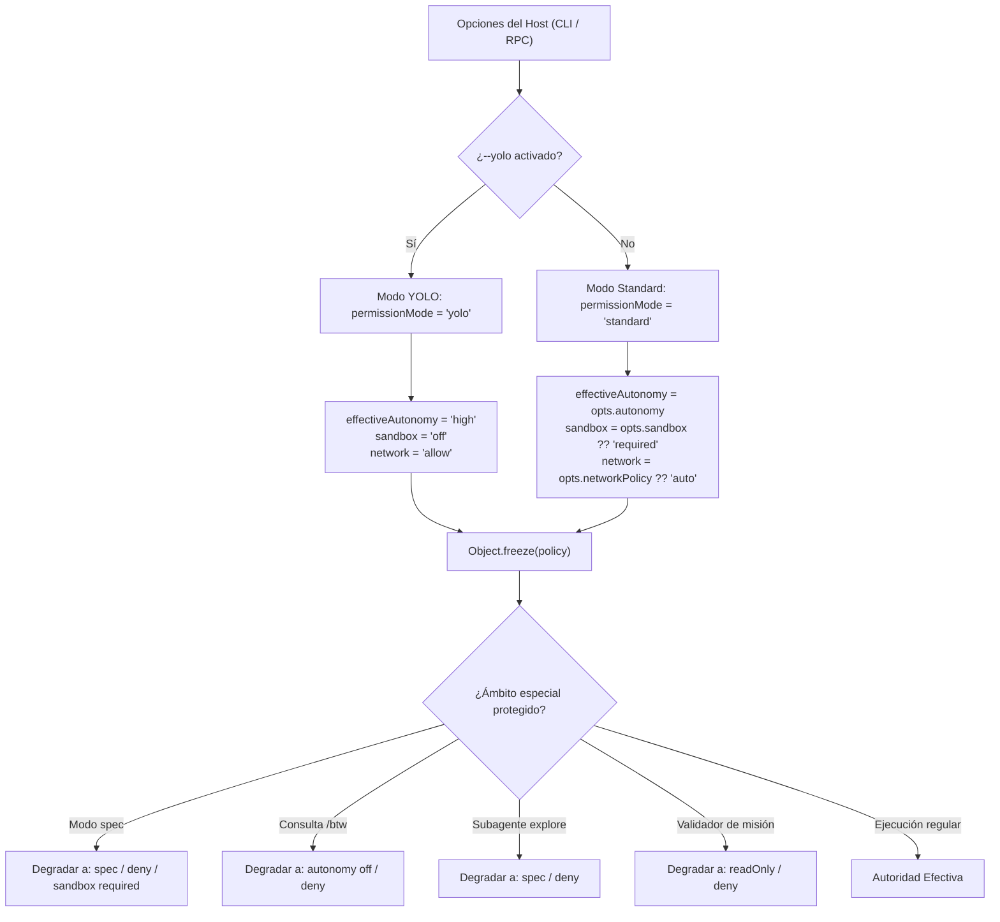
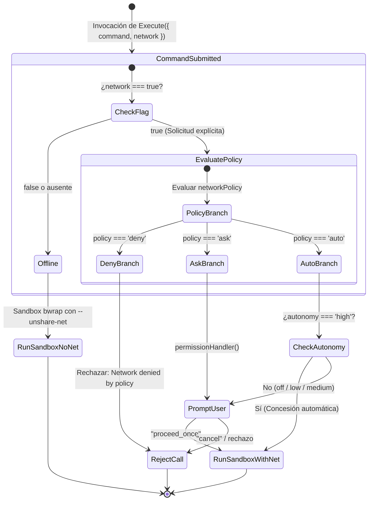

# Políticas de Seguridad, Red y Sandbox

La seguridad de `fab exec` se basa en el principio de contención estricta y mínima autoridad. Ninguna instrucción del modelo ni petición remota puede auto-otorgarse privilegios; toda autoridad emana de la configuración resuelta en el anfitrión al inicializar el agente.

---

## 1. Resolución Inmutable de Autoridad (`src/agent/execution-policy.ts`)

Al inicio de la invocación, la función `resolveExecutionPolicy` (`src/agent/execution-policy.ts:15-30`) evalúa las opciones CLI y congela el resultado en un objeto inmutable mediante `Object.freeze`:

### Reglas Fundamentales de Autoridad
1. **Invariante de Efimeridad de YOLO (`src/agent/execution-policy.ts:25`):** El modo YOLO aplica **únicamente a la invocación actual**. Nunca se guarda en el snapshot de la sesión (`state.executionPolicy` no se persiste como YOLO permisivo para reanudaciones). Si una sesión se reanuda con `--session-id` o se bifurca con `--fork`, el motor vuelve de forma determinista al modo estándar.
2. **Rechazo Tajante en RPC (`src/agent/rpc.ts:76-79`):** Las peticiones JSON-RPC que intenten enviar campos como `yolo`, `permissionMode` o relajar `executionPolicy` son rechazadas inmediatamente con el código de error `-32602` (`Invalid params`).

---

## 2. Aislamiento con Bubblewrap (`bwrap`) en Linux

En entornos Linux, el confinamiento de comandos shell se implementa invocando Bubblewrap (`bwrap`), creando espacios de nombres aislados del kernel (`src/agent/tools.ts:356`):

- **Namespaces Aislados:** Se aíslan namespaces de PID (`--unshare-pid`), IPC (`--unshare-ipc`), UTS (`--unshare-uts`) y sistemas de archivos (`--unshare-mount`).
- **Sistema de Archivos Efímero:**
  - El directorio raíz del sistema operativo (`/usr`, `/lib`, `/bin`) se monta en modo de solo lectura (`--ro-bind`).
  - El workspace del proyecto se monta en modo de lectura/escritura (`--bind <workspace> <workspace>`), restringiendo cualquier escritura fuera de dicho árbol.
  - Se proporciona un `/tmp` privado en memoria (`--tmpfs /tmp`) destruido al finalizar el proceso.
- **Aislamiento de Red (`--unshare-net`):** Por defecto, el contenedor se crea sin interfaces de red externas, disponiendo únicamente de la interfaz de loopback desconectada.

---

## 3. Política de Red Opt-In para `Execute` (`src/agent/network-policy.ts`)

El acceso a Internet o servicios de red corporativos desde comandos shell es **estrictamente opt-in**:

### Invariantes de la Política de Red
- **Sin Concesión Duradera:** `network: true` es una solicitud puntual que debe incluirse en **cada comando individual y en cada reintento**. La aprobación de un comando no se hereda para comandos posteriores.
- **Alcance Restringido:** La política de red rige exclusivamente las herramientas `Execute` y `WebSearch`. No interfiere con el transporte HTTP del proveedor del modelo ni con los servidores MCP que utilicen su propia configuración de red (`allowNetwork: true`, `src/agent/mcp.ts:29-31`).
- **Pistas en Fallos Offline (`offlineNetworkHint`, `src/agent/tools.ts:116-119`):** Si un comando falla con código de salida distinto de cero en modo offline y su salida contiene errores típicos de resolución DNS o conexión rechazada (`Could not resolve host`, `Connection refused`, `ETIMEDOUT`), el motor inyecta automáticamente una sugerencia en el resultado informando al modelo que el comando carecía de red y que debe solicitar `network: true` si necesita acceso remoto.

---

## 4. Política de URLs e IPs (`src/agent/url-policy.ts`)

Para herramientas como `FetchUrl` que descargan recursos HTTP externos, el módulo `url-policy.ts` previene ataques de Server-Side Request Forgery (SSRF):

1. **Resolución y Fijación de Dirección (`pinAddresses`, `src/agent/url-policy.ts:39-47`):**
   - Resuelve todas las direcciones asociadas al hostname mediante DNS antes de conectar.
   - Aplica el filtro `publicAddress` (`src/agent/url-policy.ts:17-32`).
   - Fija la IP validada en el socket de conexión, impidiendo ataques de DNS Rebinding donde el hostname cambie de IP entre la validación y la petición HTTP.
2. **Rangos Prohibidos:**
   - IPv4 Loopback (`127.0.0.0/8`).
   - IPv4 Privadas RFC 1918 (`10.0.0.0/8`, `172.16.0.0/12`, `192.168.0.0/16`).
   - Enlace Local / APIPA (`169.254.0.0/16`).
   - CGNAT (`100.64.0.0/10`) y Multicast (`224.0.0.0/4`).
   - IPv6 Loopback (`::1`), Link-Local (`fe80::/10`) y direcciones IPv4 mapeadas en IPv6 (`::ffff:0:0/96`).

---

## 5. Gestión de Procesos y Concurrencia en Host (`src/agent/process.ts`, `src/agent/execute-host.ts`)

En modo YOLO o cuando se ejecutan comandos del host:
- La ejecución se realiza mediante `runProcess` (`src/agent/process.ts:4-40`), canalizando stdout y stderr a búferes acotados por `maxBytes` (por defecto 256 KiB).
- **Control de Grupos de Procesos:** En Unix, los subprocesos se ejecutan bajo su propio grupo (`process group`). Ante cancelación por `AbortSignal`, se envía `SIGTERM` a todo el árbol de procesos dependientes y, si no finalizan en 200 ms, se escala a `SIGKILL` forzado, previniendo procesos huérfanos en segundo plano.

---

## Archivos

| Archivo | Responsabilidad |
| :--- | :--- |
| `src/agent/execution-policy.ts` | Resolución inmutable de la autoridad del agente (`resolveExecutionPolicy`). |
| `src/agent/network-policy.ts` | Matriz de evaluación de red opt-in para comandos shell (`networkDecision`). |
| `src/agent/url-policy.ts` | Validación y fijación de IPs públicas anti-SSRF (`pinAddresses`, `publicAddress`). |
| `src/agent/execute-host.ts` | Adaptador de comandos shell directos en anfitrión para modo YOLO. |
| `src/agent/process.ts` | Gestión de subprocesos con Bun, límites de búfer y cancelación con escalado a SIGKILL. |
| `src/agent/cancellation.ts` | Envoltorio para ejecución abortable ligada a señales `AbortSignal`. |
| `src/agent/native/posix.c` | Implementación nativa de llamadas al kernel para operaciones seguras de archivos. |
