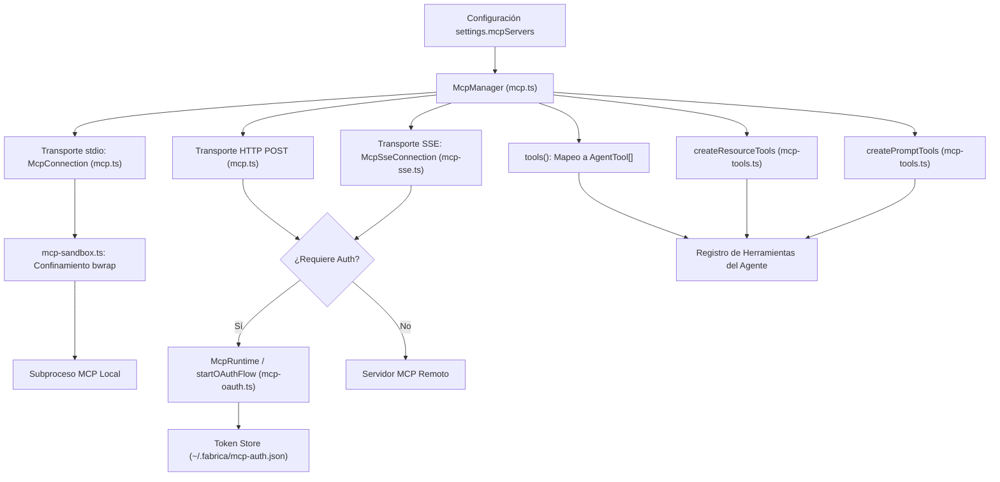

# Integración Model Context Protocol (MCP)

`fab exec` incorpora soporte nativo para el estándar **Model Context Protocol (MCP)** (`src/agent/mcp.ts:57-449`), permitiendo al agente descubrir e invocar herramientas, recursos y prompts expuestos por servidores externos tanto locales como remotos.

---

## 1. Arquitectura y Componentes de MCP

El gestor central `McpManager` (`src/agent/mcp.ts:295-449`) administra el ciclo de vida de los servidores definidos en la configuración (`settings.mcpServers`):



---

## 2. Transportes Soportados

1. **Transporte `stdio` (`src/agent/mcp.ts:80-121`):**
   - Lanza el servidor como un subproceso local (`command`, `args`, `env`).
   - Comunicación mediante frames JSON-RPC sobre `stdin` y `stdout` del proceso hijo.
   - En Linux, el comando puede envolverse opcionalmente en el sandbox `bwrap` (`wrapMcpCommand`, `src/agent/mcp-sandbox.ts:8-35`), aislando su sistema de archivos y otorgando acceso de red únicamente si se especifica `allowNetwork: true`.
2. **Transporte `http` (`src/agent/mcp.ts:160-213`):**
   - Envía peticiones JSON-RPC mediante llamadas HTTP POST a la URL designada, inyectando cabeceras personalizadas y tokens de autorización OAuth.
3. **Transporte `sse` (`src/agent/mcp-sse.ts:24-322`):**
   - Abre un stream Server-Sent Events hacia el endpoint SSE para recibir mensajes asíncronos y notificaciones del servidor.
   - Envía solicitudes del cliente mediante HTTP POST al endpoint de retorno descubierto durante el handshake inicial.

---

## 3. Autenticación OAuth 2.0 Dinámica (`src/agent/mcp-oauth.ts`)

Para servidores remotos protegidos por OAuth 2.0, el runtime implementa un flujo automatizado de autorización según los estándares RFC 8414 y RFC 7591 (`src/agent/mcp-oauth.ts:209-403`):

```mermaid
sequenceDiagram
    autonumber
    participant Agent as RPC / Chat TUI
    participant OAuth as McpOAuth Runtime (mcp-oauth.ts)
    participant Server as Servidor MCP Remoto
    participant Browser as Navegador del Operador

    Agent->>OAuth: Conectar servidor con oauth: true
    OAuth->>Server: GET /.well-known/oauth-authorization-server
    Server-->>OAuth: { authorizationEndpoint, tokenEndpoint, registrationEndpoint }

    opt Requiere registro dinámico de cliente (RFC 7591)
        OAuth->>Server: POST registrationEndpoint { redirect_uris }
        Server-->>OAuth: { client_id, client_secret }
    end

    OAuth->>OAuth: Inicia servidor HTTP local en 127.0.0.1:<puerto_libre>
    OAuth->>Agent: Emite estado "needs authentication" y authorizeUrl
    Agent->>Browser: Abre authorizeUrl en navegador
    Browser->>Server: Operador aprueba acceso
    Server->>OAuth: Redirección HTTP hacia 127.0.0.1:<puerto_libre>/callback?code=...
    OAuth->>Server: POST tokenEndpoint con authorization_code
    Server-->>OAuth: { access_token, refresh_token, expires_in }
    OAuth->>OAuth: Persiste en ~/.fabrica/mcp-auth.json
    OAuth->>OAuth: Cierra servidor HTTP local temporal
    OAuth-->>Agent: Estado cambia a "connected"; reconecta MCP
```

### Gestión de Tokens y Estados (`src/agent/mcp-oauth.ts:7-15`)
- **Estados Notificados:** `connected`, `connecting`, `needs authentication`, `failed`.
- **Refresco Silencioso (`refreshAccessToken`, `src/agent/mcp-oauth.ts:191-207`):** Cuando un token almacenado expira o el servidor responde HTTP 401, el runtime intenta renovar las credenciales en segundo plano utilizando el `refresh_token` antes de marcar el servidor como no autenticado.

---

## 4. Confinamiento de Servidores MCP (`src/agent/mcp-sandbox.ts`)

Los servidores locales que ejecuten código binario o runtimes como Node/Python pueden aislarse para evitar que accedan al sistema de archivos del usuario:

- **Espacio de Nombres Restringido (`src/agent/mcp-sandbox.ts:15-30`):** Monta la raíz del sistema operativo en solo lectura (`--ro-bind / /`).
- **Permisos de Archivos Adicionales (`readPaths`):** Si el servidor requiere acceder a rutas externas para consultar documentación o fuentes, se montan de forma explícita en modo lectura.
- **Conmutación de Red:** Si `allowNetwork` es `false`, se incluye `--unshare-net`, impidiendo que el servidor MCP se comunique con Internet.

---

## 5. Exposición Dinámica de Recursos y Prompts (`src/agent/mcp-tools.ts`)

Además de las herramientas estándar (`tools`), el runtime traduce recursos y prompts de MCP en herramientas invocables por el modelo:

- **Herramientas de Recursos (`createResourceTools`, `src/agent/mcp-tools.ts:12-138`):** Expone herramientas como `mcp__list_resources` y `mcp__read_resource` para inspeccionar y leer URIs documentales registradas en los servidores.
- **Herramientas de Prompts (`createPromptTools`, `src/agent/mcp-tools.ts:140-237`):** Expone `mcp__list_prompts` y `mcp__get_prompt` para recuperar plantillas y directivas preconfiguradas en el ecosistema MCP.

---

## Archivos

| Archivo | Responsabilidad |
| :--- | :--- |
| `src/agent/mcp.ts` | Conexión `McpConnection`, despacho JSON-RPC y administrador `McpManager`. |
| `src/agent/mcp-sse.ts` | Cliente de transporte bidireccional sobre Server-Sent Events (SSE). |
| `src/agent/mcp-oauth.ts` | Flujo OAuth 2.0 dinámico, servidor local de callback y almacenamiento de tokens. |
| `src/agent/mcp-sandbox.ts` | Envoltorio de sandboxing Bubblewrap para comandos de servidores `stdio`. |
| `src/agent/mcp-tools.ts` | Adaptadores para exponer recursos y prompts de MCP como herramientas del agente. |
