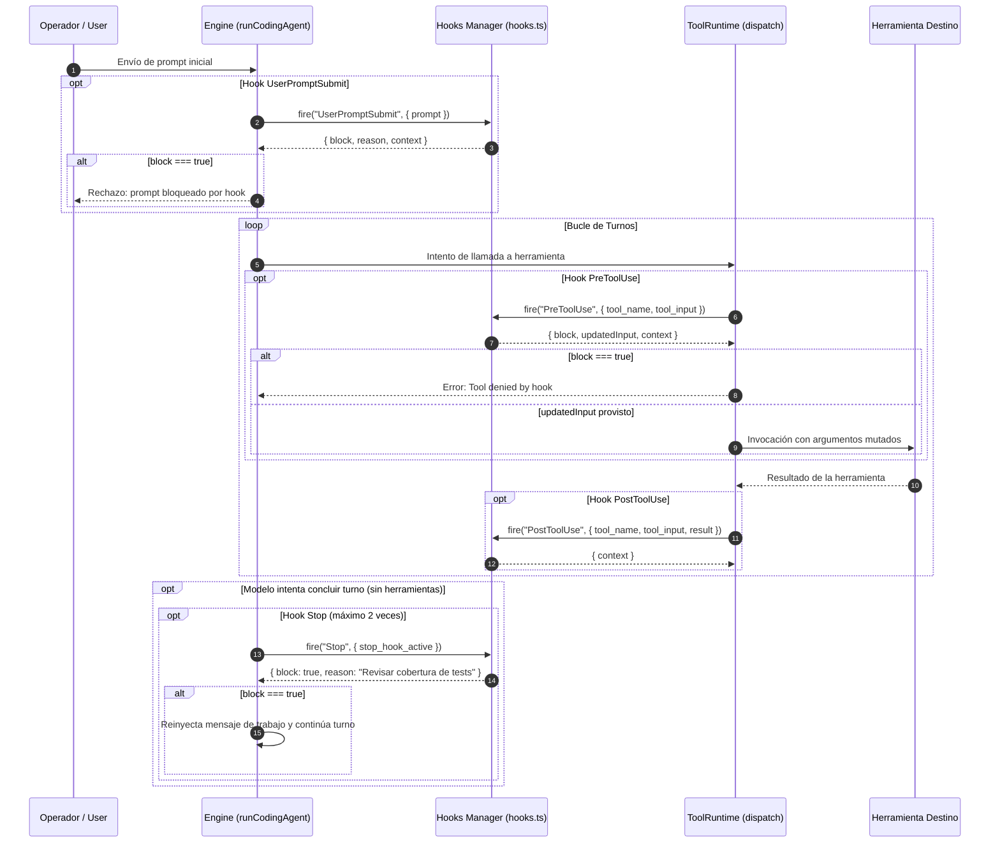

# Sistema de Hooks

El subsistema de **Hooks** (`src/agent/hooks.ts:30-149`) permite a los mantenedores y desarrolladores integrar scripts locales y comprobaciones automatizadas que interceptan el ciclo de vida del agente, inyectando directivas de contexto o bloqueando acciones inseguras antes de su ejecución.

---

## 1. Descubrimiento y Activación

Los hooks son estrictamente **opt-in** (`src/agent/hooks.ts:18-28`). Se activan únicamente si se pasa la bandera `--hooks` en el CLI (`src/agent/exec.ts:245`) o si el archivo de configuración define `hooks.enabled: true` en `settings.json`.

El motor carga las definiciones desde dos ubicaciones estándar:
1. **Configuración Global del Anfitrión:** `$FABRICA_HOME/hooks.json` (por defecto `~/.fabrica/hooks.json`).
2. **Configuración Local del Proyecto:** `.fab/hooks.json` (ubicado dentro de la raíz del workspace activo).

---

## 2. Eventos del Ciclo de Vida

El runtime expone seis puntos de intercepción deterministas (`HookEvent`, `src/agent/hooks.ts:10`):

### Detalle de Eventos

1. **`UserPromptSubmit` (`src/agent/engine.ts:134-136`):** Se evalúa antes de agregar el prompt del usuario al historial conversacional. Puede vetar el prompt (`block: true`) con un mensaje de rechazo descriptivo o aportar directivas adicionales de contexto.
2. **`PreToolUse` (`src/agent/registry.ts:139-140`):** Se dispara inmediatamente antes de despachar una llamada a herramienta. Permite:
   - Bloquear la ejecución (`deny: true` o `block: true`).
   - Reemplazar los argumentos solicitados por el modelo (`updatedInput`), validando el nuevo payload a través del esquema de la herramienta.
   - Inyectar contexto técnico previo.
3. **`PostToolUse` (`src/agent/registry.ts:221`):** Se ejecuta tras completarse la herramienta, recibiendo sus datos de salida y estado de error.
4. **`Stop` (`src/agent/engine.ts:295-298`):** Se invoca cuando el modelo decide finalizar su turno sin emitir más herramientas. Si un hook requiere comprobaciones adicionales (por ejemplo, verificar que los tests pasan antes de cerrar el turno), puede bloquear la detención (`block: true`).
   - **Límite Anti-Bucle:** El motor acota el bloqueo de `Stop` a un **máximo de 2 veces consecutivas** (`stopBlocks < 2`). Al tercer intento, la finalización prosigue incondicionalmente para evitar bloqueos permanentes.
5. **`SessionStart` / `SessionEnd` (`src/agent/engine.ts:127, 304`):** Notifican la inicialización y el cierre ordenado de la sesión conversacional.

---

## 3. Invariantes de Seguridad y Límites de Ejecución

Para garantizar que los hooks no comprometan la estabilidad del anfitrión ni relajen las defensas del agente:

1. **Invariante de Mínima Autoridad:** Un hook nunca puede anular una política de red `deny`, romper el confinamiento de modo `spec`, eludir filtros de herramientas (`--only-tools`) ni alterar archivos protegidos por contratos de misión. Su aprobación (`allow`) únicamente sustituye la confirmación interactiva puntual del usuario.
2. **Presupuestos y Timeouts Estrictos (`src/agent/hooks.ts:43-99`):**
   - **Comandos por Evento:** Como máximo **8 comandos** por punto de enganche.
   - **Timeout Individual:** Cada comando dispone de un tiempo límite de **60 segundos** (`timeout: 60_000 ms`).
   - **Captura de Salida Acotada:** La captura de stdout/stderr se trunca estrictamente a **64 KiB** por hook.
   - **Expresiones Regulares Protegidas:** La coincidencia de patrones y filtros regex se ejecuta en un contexto protegido con un deadline estricto de **500 ms**, mitigando riesgos de denegación de servicio por expresiones catastróficas.
3. **Aislamiento en Subagentes y Scripts:** Los hooks se desactivan de forma obligatoria en la ejecución de subagentes anidados y dentro del entorno Script VM (`child.hooks = undefined`, `src/agent/engine.ts:145`).

---

## Archivos

| Archivo | Responsabilidad |
| :--- | :--- |
| `src/agent/hooks.ts` | Clase `Hooks`, carga de configuración desde disco, ejecución de comandos y evaluación de decisiones. |
| `src/agent/registry.ts` | Disparo e integración de los hooks `PreToolUse` y `PostToolUse` en el despacho de herramientas. |
| `src/agent/engine.ts` | Disparo e integración de los hooks `UserPromptSubmit`, `Stop`, `SessionStart` y `SessionEnd`. |
