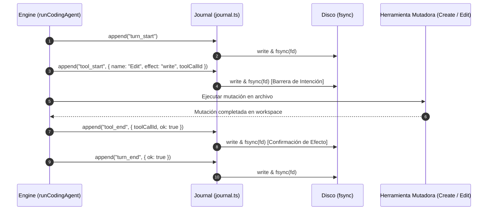
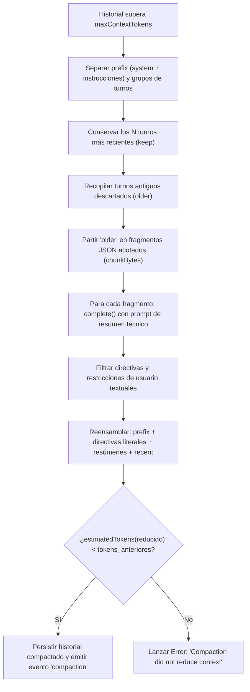

# Sesiones, Journal y Compactación de Contexto

La arquitectura de persistencia de `fab exec` está diseñada para soportar ejecuciones prolongadas, caídas imprevistas del anfitrión y ventanas de contexto acotadas, garantizando la recuperación del estado conversacional sin duplicación de efectos secundarios en el código.

---

## 1. Almacenamiento de Sesiones (`src/agent/session.ts`)

La clase `SessionStore` (`src/agent/session.ts:34-153`) administra la persistencia de snapshots conversacionales en disco bajo el directorio configurado (`opts.sessionDir`, por defecto `~/.fabrica/agent-sessions`):

- **Control de Concurrencia mediante Locks:**
  - Antes de leer o escribir en una sesión, el motor adquiere un cerrojo exclusivo (`acquire`, `src/agent/session.ts:51-82`) escribiendo un archivo `<sessionDir>/<id>.lock` con el PID del proceso anfitrión.
  - Si el lock ya existe, verifica mediante señales POSIX (`process.kill(pid, 0)`) si el proceso propietario sigue con vida. Si el PID está muerto, asume la propiedad del lock de forma segura.
- **Estructura del Snapshot (`SessionState`, `src/agent/session.ts:7-33`):**
  - Identificador único (`id`), versión de esquema, directorio de trabajo (`cwd`), identificador del proveedor LLM (`provider`).
  - Historial completo de mensajes (`messages`), turnos completados (`turns`), etiquetas (`tags`).
  - Lista de llamadas a herramientas en vuelo (`pending`): identificadores de llamadas que fueron emitidas por el modelo pero cuyos resultados aún no han sido integrados.
  - Estado terminal (`status`: `'running' | 'completed' | 'failed' | 'paused'`).
  - Metadatos de misión activa (`mission`), si aplica.

---

## 2. Diario Transaccional Append-Only (`src/agent/journal.ts`)

Para evitar la incertidumbre sobre qué herramientas llegaron a ejecutarse tras una terminación abrupta (corte de energía, `SIGKILL` o pánico del runtime), el agente mantiene un diario de operaciones append-only sincronizado a disco (`src/agent/journal.ts:13-55`):



### Reconciliación Determinista tras Caídas (`src/agent/journal.ts:57-93`)
Al cargar una sesión que se encontraba en estado `running`:
1. Si el diario contiene un registro `tool_start` sin su correspondiente `tool_end`, el runtime reconoce que la herramienta pudo haber producido efectos parciales antes de la interrupción.
2. La función `reconcile` inserta un mensaje sintético de resultado para dicha herramienta en el historial:
   ```text
   Error: Interrupted by previous crash. Tool execution state is uncertain. Inspect workspace before continuing.
   ```
3. Limpia la lista `state.pending` y emite el evento `reconciled` (`src/agent/engine.ts:126`). De este modo, **el agente nunca re-ejecuta a ciegas herramientas mutadoras interrumpidas**, evitando corrupciones en cascada.

---

## 3. Compactación de Contexto (`src/agent/engine.ts:178-218`)

Cuando el tamaño estimado de la conversación más el presupuesto de salida supera el límite configurado (`estimatedTokens(messages) + maxOutputTokens > maxContextTokens`, `src/agent/engine.ts:225`):



### Invariantes de la Compactación
- **Sin Pérdida Silenciosa de Datos:** Ningún fragmento se corta a ciegas. Si una herramienta produjo un resultado masivo, el JSON completo de los turnos antiguos se serializa y se divide en fragmentos uniformes (`chunkBytes`, `src/agent/engine.ts:197-204`) para que el modelo los resuma de forma estructurada.
- **Retención Literal de Restricciones (`src/agent/engine.ts:212-214`):** Los resúmenes generados por modelos suelen perder detalles sutiles. Para evitar que el agente olvide directivas negativas o requerimientos específicos, todos los mensajes con rol `user` no resumidos previamente se conservan de forma íntegra junto a los resúmenes de trabajo anterior.
- **Verificación Estricta:** Si el historial resultante tras la compactación no es estrictamente menor en tokens que el original, el motor aborta con excepción en vez de entrar en un bucle infinito de reintentos infructuosos.

---

## 4. Rebobinado de Archivos (`/rewind` en `src/chat/checkpoints.ts`)

La interfaz conversacional implementa un sistema determinista de control de versiones local de archivos modificados por las herramientas del agente (`Create`, `Edit`, `ApplyPatch`):

- **Diario Privado Aislado:** Los estados previos y posteriores a cada edición se guardan fuera del árbol de trabajo, bajo `~/.fabrica/file-checkpoints/` (`src/chat/checkpoints.ts:27-29`).
- **Verificación Criptográfica (`src/chat/checkpoints.ts:11-12, 115-118`):** Cada entrada registra el hash SHA-256 exacto del archivo antes y después de la operación. Al invocar `/rewind <id>`, el sistema comprueba los hashes actuales antes de restaurar, asegurando que no se sobrescriban ediciones humanas externas.
- **Barrera de `Execute` (`src/chat/checkpoints.ts:94-97`):** Cuando el modelo ejecuta un comando arbitrario mediante `Execute` o `Loop`, el diario coloca una **barrera permanente de invalidación**. Dado que un script de shell puede modificar cualquier archivo del sistema sin pasar por las herramientas del agente, los checkpoints anteriores al comando ya no pueden restaurarse de forma segura.

---

## Archivos

| Archivo | Responsabilidad |
| :--- | :--- |
| `src/agent/session.ts` | Clase `SessionStore`, adquisición de locks atómicos de sesión y serialización JSON. |
| `src/agent/journal.ts` | Clase `Journal`, escritura append-only con `fsync` y algoritmo de reconciliación determinista. |
| `src/agent/engine.ts` | Algoritmo de partición, resumen en fragmentos y compactación de contexto (`compact`). |
| `src/chat/checkpoints.ts` | Sistema de puntos de restauración (`Checkpoints`) y rebobinado de archivos para la TUI. |
