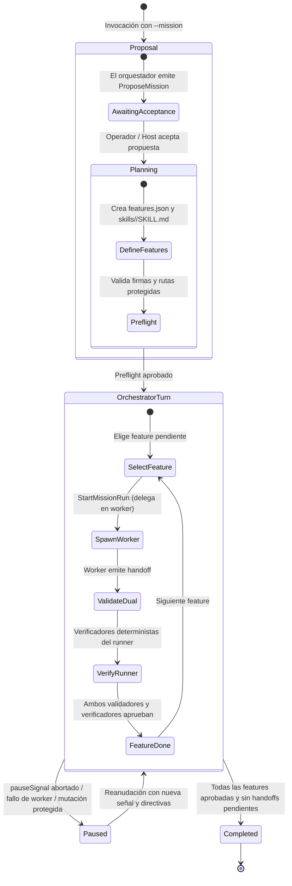
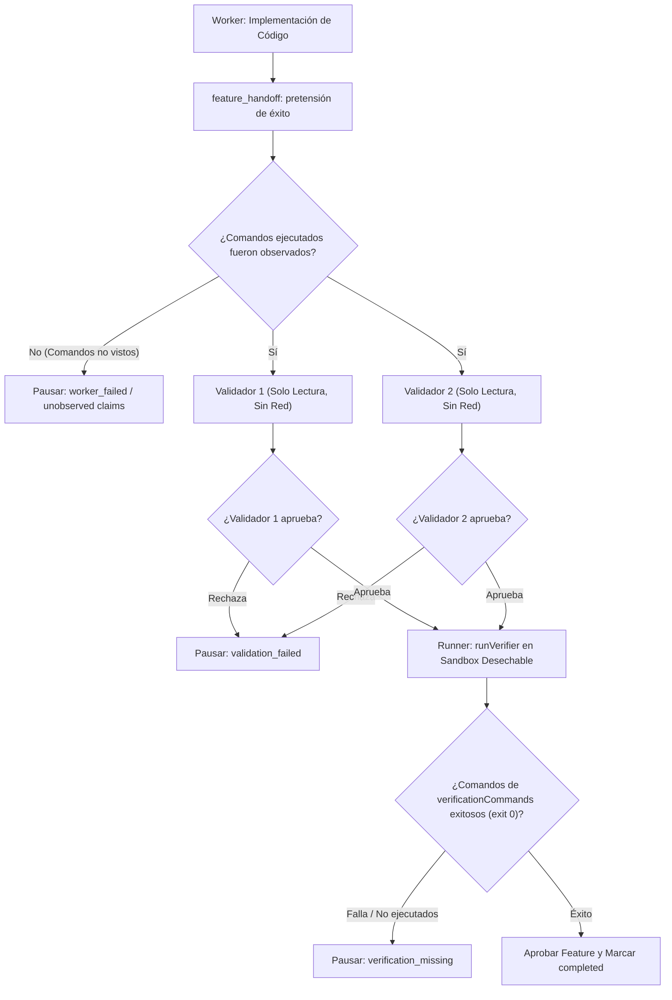

# Misiones Autónomas y Validación Dual

El subsistema de **Misiones** (`--mission`, `src/agent/mission.ts:20-406`) permite resolver objetivos de desarrollo complejos mediante una arquitectura jerárquica con orquestador central, implementadores especializados (workers) y validación dual independiente en solo lectura.

---

## 1. Ciclo de Vida y Máquina de Estados de una Misión

Para operar en modo misión, el agente requiere autonomía máxima (`--mission --auto high`, `src/agent/engine.ts:97`). El ciclo de vida transita por cinco estados formales (`MissionState['state']`, `src/agent/mission-contract.ts:41-54`):

---

## 2. Contrato de Características (`features.json`) y Skills

La planificación de una misión queda sellada en el directorio de metadatos de la misión (`missionDir`, `src/agent/mission-files.ts:11-12`). La especificación exige:

1. **Definición de Características (`src/agent/mission-contract.ts:107-127`):**
   Un archivo `features.json` con una lista de objetos `MissionFeature`:
   - `id`: Identificador alfanumérico único.
   - `description`: Objetivo técnico de la característica.
   - `skillName`: Habilidad requerida bajo el subdirectorio `skills/<skillName>/SKILL.md`.
   - `milestone`: Hito de entrega al que pertenece.
   - `preconditions` y `expectedBehavior`: Comportamientos esperados verificables.
   - `status`: Estado actual (`pending | in_progress | completed | failed`).
2. **Rutas Protegidas (`protectedPaths`, `src/agent/mission-files.ts:81-89`):**
   Archivos que los workers tienen **estrictamente prohibido modificar** (por ejemplo, suites de test de referencia o contratos de API). Al finalizar cada intento, `fingerprintWorkspace` y `digestPaths` verifican que los hashes SHA-256 de las rutas protegidas no hayan cambiado. Si un worker altera una ruta protegida, la misión se detiene inmediatamente (`paused` con `reason: 'protected_paths_changed'`).

---

## 3. Protocolo de Validación Dual y Verificadores Deterministas

Para evitar alucinaciones o aprobaciones complacientes donde el modelo afirme que el código funciona sin haberlo probado realmente, la aprobación de cada hito exige un triple filtro de evidencia (`src/agent/mission.ts:140-234`, `src/agent/mission-evidence.ts:161-173`):

### 1. Observador de Comandos del Worker (`src/agent/mission-evidence.ts:34-55`)
- Durante el turno del worker, `createCommandObserver` registra de forma pasiva cada comando ejecutado mediante `Execute` o `Loop` (hasta un máximo de 200 registros).
- Si en su handoff el worker afirma haber ejecutado suites de prueba que no figuran en los registros del observador, la afirmación se descarta como falsa (`unobservedClaims`, `src/agent/mission-evidence.ts:58-62`).

### 2. Validación Dual en Solo Lectura (`src/agent/mission.ts:140-234`)
- Dos agentes validadores independientes inspeccionan el código resultante.
- **Confinamiento de Validadores:** Operan en modo `spec` estricto, con sandbox `bwrap` requerido, sin red (`--unshare-net`) y sin herramientas mutadoras (`src/agent/README.md:92`).
- Si cualquiera de los dos validadores detecta discrepancias o no emite una aprobación explícita, la característica no se aprueba.

### 3. Verificadores Deterministas del Runner (`src/agent/mission-evidence.ts:161-197`)
- El propio proceso runner ejecuta los comandos definidos en `verificationCommands` fuera del control del LLM.
- La ejecución tiene lugar en una copia temporal desechable del código (`verifierWorkspace`), en un sandbox sin red con un timeout de 120 segundos.
- Sin la ejecución exitosa (código de salida 0) de estos comandos deterministas, el hito jamás puede marcarse como completado.

---

## 4. Pausas del Anfitrión y Reconciliación (`src/agent/mission-pause.ts`)

El anfitrión puede pausar una misión en cualquier instante suministrando un `pauseSignal`:

- **Interrupción Inmediata (`src/agent/mission-pause.ts:5-22`):** Abortar el `pauseSignal` durante la ejecución de un worker o validador envía señales de cancelación, mata los subprocesos y drena la sesión hija.
- **Registro de Pausa Limpio:** El intento en curso se marca con `error: 'Paused by host'` y `pausedByHost: true`, emitiendo el evento `mission_paused` con `reason: 'host_request'`.
- **Reanudación Controlada:** Al reanudar con una nueva señal (`pauseSignal`), el orquestador retoma exactamente la sesión hija interrumpida (`resumeWorkerSessionId`), transmitiendo nuevas directivas sin perder el progreso previo de la misión.

---

## Archivos

| Archivo | Responsabilidad |
| :--- | :--- |
| `src/agent/mission.ts` | Clase central `MissionManager`, coordinación de roles y flujo de misiones. |
| `src/agent/mission-contract.ts` | Definición de esquemas de `features.json`, handoffs y tipos de estado de misión. |
| `src/agent/mission-evidence.ts` | Observador pasivo de comandos y ejecutor de verificadores deterministas en sandbox desechable. |
| `src/agent/mission-files.ts` | Gestión del directorio de metadatos de la misión, firmas SHA-256 e integridad de rutas protegidas. |
| `src/agent/mission-pause.ts` | Manejo de interrupciones de anfitrión mediante `pauseSignal` y drenado de workers. |
| `src/agent/mission-progress.ts` | Construcción de instantáneas de progreso `MissionProgressSnapshot` y métricas de consumo. |
