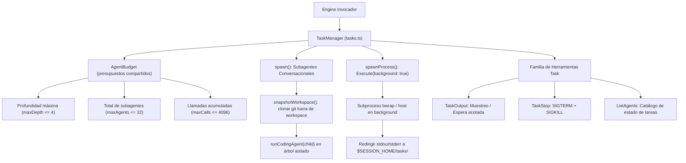
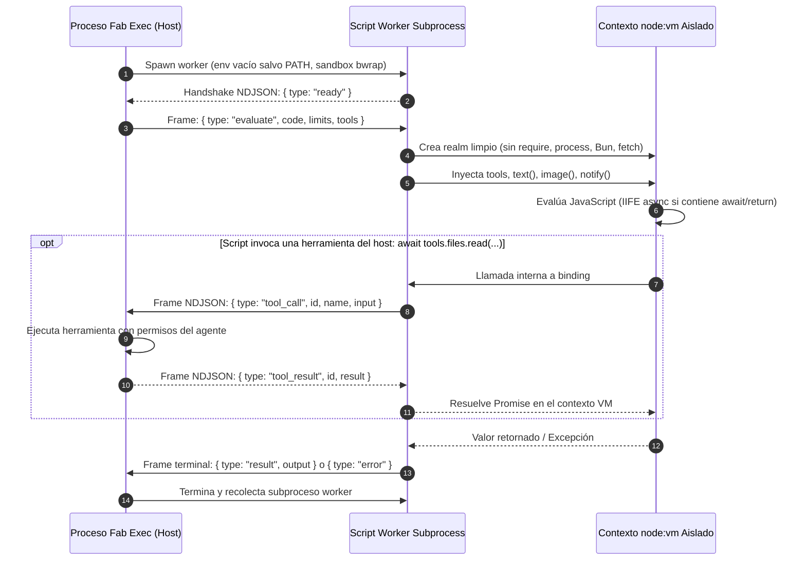

# Tareas en Segundo Plano y Script Runtime

`fab exec` incorpora una arquitectura para la concurrencia de herramientas, la ejecución desatendida de comandos duraderos en segundo plano y el aislamiento de programas JavaScript dinámicos en máquinas virtuales protegidas.

---

## 1. Concurrencia de Subagentes y Tareas (`src/agent/tasks.ts`)

La clase `TaskManager` (`src/agent/tasks.ts:182-595`) gestiona dos tipos de tareas asíncronas: subagentes conversacionales hijos y subprocesos del sistema en background.

### Invariantes de Procesos en Background (`Execute` con `background: true`)
1. **Lanzamiento Inmediato (`src/agent/tasks.ts:285-459`):** Al invocar `Execute` con `background: true`, el subproceso se inicia y retorna inmediatamente un handle `{ taskId: string, pid: number, status: 'running' }` sin bloquear el turno del agente.
2. **Aislamiento de Archivos y Logs:** Los streams de salida nunca se escriben en el workspace del proyecto. Se canalizan a `$SESSION_HOME/tasks/<taskId>.stdout` y `.stderr` (o a un directorio temporal privado `/tmp/fab-session-.../tasks/`).
3. **Salida Acotada (`maxProcessOutputBytes`):** La captura de salida en disco se limita estrictamente a **1 MiB** (configurable). Al alcanzar el límite, la escritura se detiene y se añade el marcador `\n[output truncated at limit]\n`.
4. **Drenado Obligatorio en el Ciclo de Vida (`src/agent/tasks.ts:580-594`):** Al concluir la invocación principal del agente (por fin normal, timeout o cancelación), `TaskManager.close()` detiene y drena todos los procesos en ejecución antes de resolver, impidiendo procesos huérfanos en el anfitrión.

---

## 2. Planificador de Concurrencia de Herramientas (`src/agent/scheduler.ts`)

La clase `ToolScheduler` (`src/agent/scheduler.ts:2-31`) implementa un modelo clásico de bloqueo lectores-escritor para la ejecución de herramientas del agente:

- **Lecturas Concurrentes (`run(read = true)`):** Permite hasta `maxReaders` (determinado por `opts.maxToolConcurrency`, por defecto 8) herramientas de lectura ejecutándose simultáneamente.
- **Escrituras Exclusivas (`run(read = false)`):** Las herramientas de mutación (`Create`, `Edit`, `ApplyPatch`) y comandos shell (`Execute`, `Loop`) exigen exclusión mutua. El scheduler espera a que todos los lectores activos finalicen antes de conceder el turno al escritor y bloquea cualquier nueva lectura mientras una escritura esté en curso.

---

## 3. Gestor de Scripts Durables (`src/agent/script-runs.ts`)

La herramienta `Script` permite ejecutar programas JavaScript que orquestan herramientas locales. Su ejecución puede ser síncrona o convertirse en una tarea en background durable mediante la herramienta complementaria `WaitForScript`:

- **Observación y Timeouts:** `Script({ code, await?: boolean })` observa hasta 30 segundos por defecto (o hasta 10 minutos con `await: true`). Si el script sigue vivo tras el plazo, retorna `{ status: 'running', runId, toolCallId }`.
- **Control con `WaitForScript`:** Permite consultar el progreso parcial, recolectar notificaciones emitidas mediante `notify(string)` o detener el script con `kill: true`.
- **Búfer Acotado:** El gestor `ScriptRunManager` (`src/agent/script-runs.ts:43-211`) limita la retención en memoria a **5 MiB por run** y **5 MiB acumulados entre todos los runs**, descartando excesos con advertencia para proteger el heap del proceso padre.

---

## 4. Runtime Aislado en Subproceso VM (`src/script-runtime/**`)

Para que el modelo pueda evaluar código dinámico sin poner en riesgo el anfitrión ni acceder a secretos del entorno, el runtime ejecuta un subproceso worker separado (`src/script-runtime/run.ts:49-233`, `src/script-runtime/worker.ts`):

### Invariantes de Seguridad del Script Runtime
1. **Sin APIs Privilegiadas del Host (`src/script-runtime/README.md:58-63`):** Dentro del contexto `node:vm` no existen `require`, `process`, `Bun`, `fetch`, `WebAssembly`, `SharedArrayBuffer` ni `Atomics`. Los módulos del sistema no pueden importarse dinámicamente.
2. **Entorno Vacío:** El subproceso worker arranca con un entorno de variables vacío salvo la variable `PATH` indispensable para la ejecución del binario; no se cargan archivos `.env` ni se heredan secretos de API.
3. **Frames de Protocolo Acotados:** La comunicación se realiza mediante NDJSON sobre stdin/stdout con un tamaño máximo estricto de **10 MiB por frame** (`src/script-runtime/README.md:20-21`).
4. **Presupuesto de Ejecución:** Defaults de 5 MiB para el resultado, 5 MiB para notificaciones, hasta 64 timers y 30 segundos de timeout total incluyendo arranque y llamadas a herramientas.

---

## Archivos

| Archivo | Responsabilidad |
| :--- | :--- |
| `src/agent/tasks.ts` | Clase `TaskManager`, presupuestos de linaje `AgentBudget` y control de procesos en background. |
| `src/agent/scheduler.ts` | Clase `ToolScheduler`, exclusión mutua de lectores y escritores para herramientas. |
| `src/agent/script-runs.ts` | Clase `ScriptRunManager`, slots de ejecución de scripts durables y búfer de salida. |
| `src/script-runtime/run.ts` | Función `runScript`, ciclo de vida del subproceso worker y despacho de llamadas a tools. |
| `src/script-runtime/worker.ts` | Punto de entrada del worker aislado; crea el contexto `node:vm` y ejecuta el código. |
| `src/script-runtime/protocol.ts` | Definición de mensajes del protocolo NDJSON v1 y decodificación de tramas. |
| `src/script-runtime/bootstrap.ts` | Script de inicialización inyectado en la VM para construir las APIs globales del script. |
| `src/script-runtime/types.ts` | Tipos TypeScript de opciones, resultados y errores del subsistema Script VM. |
| `src/script-runtime/README.md` | Documentación técnica del contrato y límites del runtime de scripts. |
