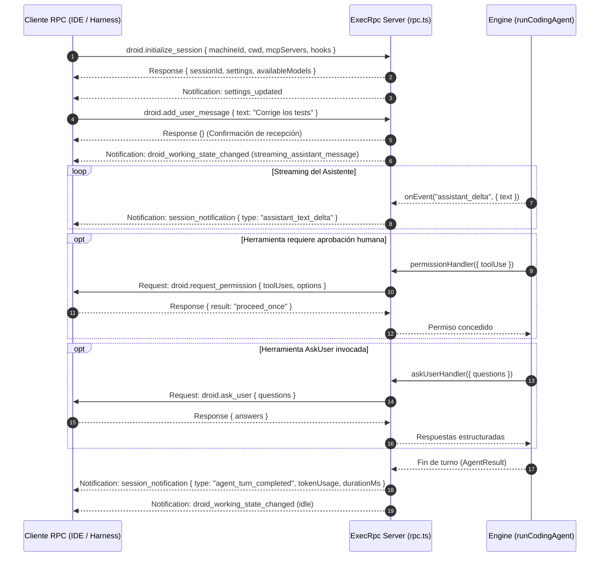

# Protocolos de Comunicación y RPC

`fab exec` soporta múltiples modos de comunicación para integrarse con clientes externos, IDEs, extensiones y orquestadores desatendidos. El protocolo principal para integración de alto nivel es **JSON-RPC 2.0 bidireccional sobre NDJSON** (`src/agent/rpc.ts:36-383`).

---

## 1. Servidor JSON-RPC 2.0 Bidireccional (`src/agent/rpc.ts`)

El modo RPC se activa suministrando flags coincidentes de entrada y salida:
```bash
fab exec --input-format stream-jsonrpc --output-format stream-jsonrpc
```

### Cabeceras y Límites de Transporte
- **Frames Acotados:** Cada línea NDJSON tiene un tamaño máximo garantizado de **10 MiB** (`10.485.760 bytes`). Toda línea que supere este tamaño provoca el cierre inmediato de la conexión por violación de protocolo.
- **Cabeceras Protocolarias:** El protocolo implementa las cabeceras `factoryApiVersion: 1.0.0` y `factoryProtocolVersion: 1.269.0` (`src/agent/README.md:13`).
- **Límite de Peticiones:** La sesión registra los identificadores de peticiones procesadas (`seenIds`), admitiendo hasta 100.000 solicitudes antes de requerir reciclaje de conexión (`src/agent/rpc.ts:248-250`).

---

## 2. Catálogo Completo de Métodos RPC

A diferencia del inventario preliminar de 8 métodos entrantes documentado en el README histórico, el código implementa **11 métodos entrantes**, **2 métodos salientes** y un sistema de **notificaciones asíncronas**:



### Métodos de Solicitud Entrantes (Inbound — 11 Métodos)

| Método | Parámetros Clave | Respuesta / Acción |
| :--- | :--- | :--- |
| `droid.initialize_session` | `machineId`, `cwd`, `mcpServers`, `hooks` | Inicializa la sesión, genera `sessionId`, carga hooks y devuelve configuración. |
| `droid.list_models` | — | Devuelve el array `models` configurado para el runtime. |
| `droid.list_tools` | — | Devuelve el catálogo completo de herramientas con su estado y nivel de autonomía. |
| `droid.list_mcp_servers` | — | Enumera los servidores MCP configurados y su estado de conexión o autenticación. |
| `droid.list_mcp_tools` | — | Descubre y devuelve las herramientas expuestas por los servidores MCP activos. |
| `droid.authenticate_mcp_server` | `serverName` | Dispara el flujo OAuth local y devuelve `{ authorizeUrl }` para el navegador. |
| `droid.update_session_settings` | `modelId`, `autonomy`, `mode`, `onlyTools` | Actualiza la configuración de la sesión en caliente sin reiniciar el proceso. |
| `droid.add_user_message` | `text` | Agrega un mensaje de usuario e inicia el turno conversacional en background. |
| `droid.interrupt_session` | — | Aborta inmediatamente el controlador del turno en ejecución (`controller.abort`). |
| `droid.load_session` | `sessionId` | Carga una conversación guardada previamente desde el `SessionStore`. |
| `droid.close_session` | — | Cierra ordenadamente la sesión, drena subprocesos y libera recursos de hooks y MCP. |

### Métodos de Solicitud Salientes (Outbound — 2 Métodos)
- `droid.request_permission` (`src/agent/rpc.ts:162-176`): Solicita al cliente confirmación interactiva para ejecutar una herramienta que excede la autonomía concedida (`proceed_once` o `cancel`).
- `droid.ask_user` (`src/agent/rpc.ts:177-188`): Envía un cuestionario interactivo estructurado con preguntas y opciones (`UserQuestion[]`).

### Notificaciones Salientes (`droid.session_notification`)
El servidor emite eventos estructurados bajo el tipo unificado `droid.session_notification`:
- `droid_working_state_changed`: Transición entre estados `'streaming_assistant_message'` e `'idle'`.
- `assistant_text_delta`: Chunks de texto emitidos por el modelo en tiempo real.
- `agent_turn_completed`: Fin del turno, reportando razón (`completed`, `interrupted`, `error`), consumo de tokens (`tokenUsage`) y duración.
- `settings_updated`: Notificación de cambios en los ajustes activos de la sesión.
- `mcp_auth_required` y `mcp_server_status_changed`: Cambios en la disponibilidad de servidores MCP.

---

## 3. Protocolo Deprecado `stream-json` (`src/agent/stream-input.ts`)

La modalidad `--input-format stream-json -o stream-json` permite enviar prompts y comandos interactivos mediante líneas NDJSON simples:
- Mensaje de usuario: `{"type": "user", "content": "texto del prompt"}`.
- Interrupción de turno: `{"type": "interrupt"}`.
- Cierre de stream: `{"type": "end"}`.

!!! warning "Estado de `stream-json`: Deprecado"
    El soporte para `stream-json` está formalmente **deprecado** (`src/agent/exec.ts:273`). Emite una advertencia en stderr y se conserva únicamente por compatibilidad hacia atrás con scripts heredados. Se recomienda utilizar el protocolo formal `stream-jsonrpc`.

---

## 4. Transporte y Protección de Inactividad (`src/agent/transport.ts`)

Para evitar bloqueos silenciosos en conexiones HTTP/SSE remotas con modelos que dejan de emitir bytes sin cerrar la conexión:
- **`IdleGuard` (`src/agent/transport.ts:31-76`):** Envuelve los flujos de lectura en un temporizador de inactividad. Si transcurre el intervalo límite (`DEFAULT_STREAM_IDLE_MS`, 60 segundos) sin recibir ningún chunk, el guard aborta la señal del stream (`abort(new ProviderError('Stream idle timeout exceeded', true))`).
- **`ProviderError` (`src/agent/transport.ts:11-13`):** Error especializado que clasifica si el fallo es reintentable (`retryable`), si se debió a exceso de ventana de contexto (`contextLimit`) o si incluye una pausa obligatoria por rate limits (`retryAfterMs`).

---

## 5. Catálogo de Eventos del Agente (`src/agent/types.ts`)

El callback `onEvent` del motor emite eventos tipados a lo largo de toda la ejecución:

| Evento | Carga Útil | Significado |
| :--- | :--- | :--- |
| `init` | `executionPolicy`, `cwd`, `tools`, `model` | Inicialización del runtime y lista de herramientas visibles. |
| `assistant` | `text` | Texto acumulado producido por el asistente al completar un turno. |
| `assistant_delta` | `text` | Chunk incremental de texto recibido por streaming. |
| `tool_call` | `id`, `toolName`, `arguments` | El modelo ha solicitado la invocación de una herramienta. |
| `tool_result` | `id`, `isError`, `value` | Resultado de la herramienta listo para ser devuelto al modelo. |
| `usage` | `usage`, `contextTokens`, `maxContextTokens` | Consumo acumulado de tokens de entrada y salida. |
| `compaction` | `estimatedTokens` | Se ha ejecutado una reducción del historial conversacional. |
| `reconciled` | `reconciled` | Reconciliación de herramientas inciertas tras reinicio de sesión. |
| `mode_changed` | `interactionMode`, `autonomy` | Transición entre modos `spec` y `auto`. |
| `settings_staged` | `proposal` | Propuesta de ajustes generada por `StageSettingsChanges`. |
| `model_routed` | `model`, `reason`, `scores` | Selección de modelo tomada por el clasificador de `autoRouter`. |
| `model_transition`| `from`, `to`, `source` | Rotación de modelo por error o por `UpgradeSessionModel`. |
| `mission_*` | Diversos metadatos de misión | Avance de hitos, inicio/fin de workers y validaciones de misión. |
| `result` | `result` | Objeto terminal `AgentResult` con éxito o fallo final. |

---

## Archivos

| Archivo | Responsabilidad |
| :--- | :--- |
| `src/agent/rpc.ts` | Servidor JSON-RPC 2.0 bidireccional (`ExecRpc`, `serveExecRpc`) y despacho de métodos `droid.*`. |
| `src/agent/stream-input.ts` | Lector de línea por línea para el formato NDJSON deprecado `stream-json`. |
| `src/agent/interaction.ts` | Formateador de cuestionarios para `AskUser` y estructura de permisos interactivos. |
| `src/agent/transport.ts` | Clases de error `ProviderError`, temporizador de inactividad `IdleGuard` y control de streaming. |
| `src/agent/types.ts` | Definición de eventos `AgentEvent`, mensajes conversacionales y contratos de tipos del motor. |
