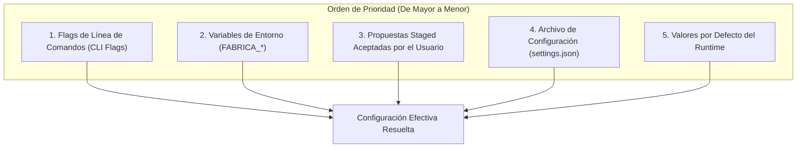
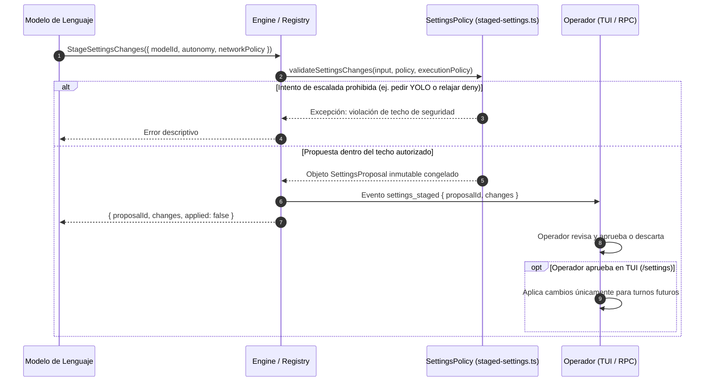

# Configuración y Flags CLI

El comportamiento operativo de `fab exec` se personaliza mediante una cascada de configuración determinista que combina opciones de línea de comandos (CLI), variables de entorno, perfiles persistidos en archivos JSON y propuestas de cambio en caliente durante la conversación.

---

## 1. Cascada de Precedencia de Configuración

Cuando un parámetro puede definirse en múltiples fuentes, el motor resuelve el valor efectivo según el siguiente orden jerárquico estricto:



1. **Flags CLI:** Argumentos explícitos pasados a `fab exec` (`--model`, `--auto`, `--yolo`, etc.). Tienen prioridad absoluta sobre cualquier otra fuente.
2. **Variables de Entorno:** Variables del sistema como `FABRICA_LLM_MODEL`, `FABRICA_LLM_BASE_URL` o `FABRICA_AGENT_AUTONOMY`.
3. **Propuestas Staged Aceptadas:** Ajustes dinámicos propuestos por el modelo mediante `StageSettingsChanges` y ratificados explícitamente por el operador en la TUI.
4. **Archivo de Configuración (`--settings <file>`):** Perfiles definidos en formato JSON (`src/agent/settings.ts:63-226`).
5. **Defaults del Runtime:** Valores base cableados en el código (por ejemplo, timeout de 20 minutos, 128 turnos máximos, sandbox Bubblewrap requerido).

---

## 2. Archivo de Ajustes (`settings.json`) y Resolución de Variables

El archivo JSON de configuración admite la definición estructurada de modelos, servidores MCP y políticas (`src/agent/settings.ts:38-50`):

```json
{
  "modelId": "custom:claude-3-7-sonnet",
  "autonomy": "high",
  "networkPolicy": "auto",
  "hooks": {
    "enabled": true
  },
  "customModels": [
    {
      "id": "custom:claude-3-7-sonnet",
      "provider": "anthropic",
      "model": "claude-3-7-sonnet-20250219",
      "apiKey": "${ANTHROPIC_API_KEY}"
    }
  ],
  "mcpServers": {
    "filesystem": {
      "command": "npx",
      "args": ["-y", "@modelcontextprotocol/server-filesystem", "/tmp"]
    }
  }
}
```

### Sustitución de Variables de Entorno (`envValue`, `src/agent/settings.ts:54-61`)
Los valores de configuración admiten referencias dinámicas a variables de entorno con la sintaxis `${NOMBRE_VARIABLE}`. El parser sustituye la referencia por el valor vigente en el entorno del proceso, impidiendo que claves de API o tokens sensibles queden grabados en texto plano en archivos compartidos en el repositorio.

---

## 3. Propuestas de Configuración en Caliente (`src/agent/staged-settings.ts`)

Durante una sesión interactiva, el modelo puede proponer ajustes de configuración mediante la herramienta `StageSettingsChanges` (`src/agent/session-tools.ts:28-37`):



### Invariantes de Seguridad de las Propuestas Staged
- **Nunca se Auto-Aplican (`applied: false`):** La invocación de la herramienta jamás modifica la configuración activa por sí misma; genera una propuesta pendiente de aprobación.
- **Techo Inmutable de Autoridad:** La política `SettingsPolicy` impone que una política de red `deny` nunca pueda pasar a `auto`, ni una política `ask` relajarse sin confirmación. Los campos relacionados con el modo YOLO o desactivación de sandbox están completamente vetados del esquema de propuestas.

---

## 4. Normalización de Argumentos CLI (`src/agent/exec-flags.ts`)

El analizador de flags resuelve ambigüedades comunes de la línea de comandos:

- **Lookahead de Worktree (`normalizeExecArgv`, `src/agent/exec-flags.ts:7-42`):** La opción `-w` o `--worktree` puede recibir un nombre de rama opcional o interpretarse como bandera booleana. El normalizador inspecciona los argumentos posteriores para distinguir si el siguiente token es el nombre de la rama temporal o si se trata del texto del prompt posicional.
- **Filtros de Herramientas Avanzados (`resolveToolSelection`, `src/agent/exec-flags.ts:51-126`):** Soporta `--only-tools`, `--add-tools` y `--remove-tools`, permitiendo el uso de prefijos y comodines para habilitar o excluir familias completas de herramientas (por ejemplo, excluir todas las herramientas MCP o restringir a herramientas de solo lectura).

---

## 5. Aislamiento en Worktrees Git (`src/agent/exec-worktree.ts`)

Cuando se suministra la bandera `-w` o `--worktree [nombre]` (`src/agent/exec-worktree.ts:67-171`), el agente no trabaja directamente sobre el directorio de trabajo actual:

1. **Creación de Worktree Temporal:** Invoca `git worktree add` para crear un árbol de trabajo vinculado fuera de la rama principal (por ejemplo en `.fab/worktrees/<nombre>`).
2. **Rama Efímera Aislada:** El agente opera sobre una nueva rama Git temporal. Si la tarea se interrumpe o el código generado es erróneo, el árbol de trabajo original del desarrollador permanece completamente inalterado y limpio de modificaciones no deseadas.
3. **Limpieza Automática:** Al concluir la tarea, el runtime puede desmontar el worktree conservando la rama resultante para inspección o merge.

---

## Archivos

| Archivo | Responsabilidad |
| :--- | :--- |
| `src/agent/settings.ts` | Carga de `settings.json`, resolución de variables `${ENV}` y resolución de proveedores. |
| `src/agent/staged-settings.ts` | Validación de propuestas de cambio de configuración en caliente (`validateSettingsChanges`). |
| `src/agent/exec-flags.ts` | Parsing estricto de banderas CLI, normalización de argumentos y selección de herramientas. |
| `src/agent/exec-worktree.ts` | Preparación y gestión de árboles de trabajo Git vinculados para ejecuciones aisladas. |
