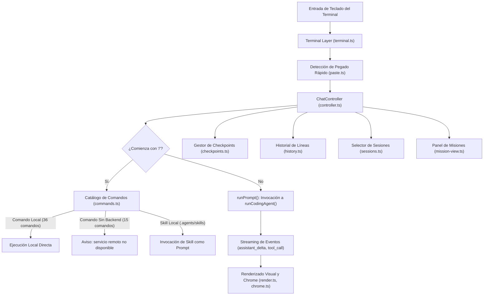

# Interfaz de Chat Interactiva (TUI)

`fab chat` (con alias `fab tui`, `src/chat.ts:24-124`) proporciona una interfaz conversacional en terminal para interactuar en tiempo real con el agente de codificación nativo. Está diseñada sobre el mismo motor `runCodingAgent` que el CLI desatendido, añadiendo capacidades de navegación visual, autocompletado, rebobinado de archivos y paneles de supervisión de misiones.

---

## 1. Arquitectura del Controlador de Chat

El componente central `ChatController` (`src/chat/controller.ts:45-501`) administra el ciclo de eventos del terminal, la renderización visual y la comunicación con el motor de turnos:

---

## 2. Catálogo de Comandos Slash (`src/chat/commands.ts`)

La interfaz registra **36 comandos locales activos** y **15 comandos con advertencia explícita de servicio remoto no disponible** (`src/chat/commands.ts:3-52`):

### Comandos Locales Activos

| Grupo | Comando | Parámetros / Alias | Acción en el Código |
| :--- | :--- | :--- | :--- |
| **Ayuda** | `/help` | `/?` | Despliega el catálogo de comandos interactivos y atajos de teclado. |
| **Ayuda** | `/terminal-setup`| — | Diagnóstico de compatibilidad de terminal sin alterar la configuración del sistema. |
| **Ayuda** | `/exit` | `/quit` | Cierra ordenadamente la sesión interactiva y restaura la consola. |
| **Configuración** | `/model` | `[id]` | Abre selector interactivo o asigna un nuevo modelo para turnos subsiguientes. |
| **Configuración** | `/reasoning` | `[default\|low\|medium\|high]` | Modifica el nivel de esfuerzo de razonamiento del modelo (también con tecla `Tab`). |
| **Configuración** | `/auto` | `[off\|low\|medium\|high]` | Cambia el nivel de autonomía del agente. |
| **Configuración** | `/yolo` | — | Informa el estado del modo YOLO (solo activable vía `--yolo` al arrancar el proceso). |
| **Configuración** | `/network` | `[auto\|ask\|deny]` | Configura la política de red para la herramienta `Execute`. |
| **Configuración** | `/mode` | `[auto\|spec\|mission]` | Alterna entre modo ejecución (`auto`), solo lectura (`spec`) o misión jerárquica. |
| **Configuración** | `/settings` | `[clave valor]` | Visualiza o actualiza ajustes de configuración activos. |
| **Configuración** | `/themes` | `[color\|plain]` | Alterna entre salida enriquecida con secuencias ANSI o texto plano para logs. |
| **Configuración** | `/cwd` | `[ruta]`, `/cd` | Cambia el directorio base de trabajo y reinicia la conversación. |
| **Capacidades** | `/mcp` | `[list\|enable\|disable]` | Gestiona la lista de servidores MCP y habilita o deshabilita servidores por sesión. |
| **Capacidades** | `/tools` | `[list\|only\|remove\|reset]`| Inspecciona el catálogo de herramientas y aplica filtros temporales. |
| **Capacidades** | `/skills` | `[nombre]` | Enumera las habilidades disponibles en `.agents/skills` o imprime sus instrucciones. |
| **Capacidades** | `/skill` | `<nombre> [args]` | Invoca una habilidad local pasando parámetros específicos. |
| **Capacidades** | `/commands` | — | Descubre e imprime prompts personalizados ubicados en `.agents/commands/*.md`. |
| **Capacidades** | `/droids` | — | Informa sobre límites y capacidades de los subagentes internos (`Task`). |
| **Sesión** | `/context` | — | Calcula y desglosa el consumo actual de tokens del historial conversacional. |
| **Sesión** | `/limits` | — | Muestra los límites vigentes de turnos, presupuestos de tokens y timeouts. |
| **Sesión** | `/status` | — | Resumen del modelo en uso, modo, autonomía, ruta del workspace y sesión. |
| **Sesión** | `/diagnostics` | — | Diagnóstico de salud: presencia de Bubblewrap, permisos POSIX y settings. |
| **Sesión** | `/clear` | — | Inicia una nueva conversación conservando los ajustes de configuración actuales. |
| **Sesión** | `/new` | — | Inicia una nueva conversación restaurando los ajustes originales de arranque. |
| **Sesión** | `/sessions` | `[id]`, `/resume` | Abre selector interactivo de sesiones guardadas o reanuda por ID. |
| **Sesión** | `/search` | `<texto>`, `/find` | Busca texto en el historial de sesiones guardadas del repositorio actual. |
| **Sesión** | `/fork` | `[id]` | Bifurca la conversación actual o la indicada creando un nuevo ID de sesión. |
| **Sesión** | `/tree` | — | Visualiza el árbol de parentesco y bifurcaciones de sesiones locales. |
| **Sesión** | `/rename` | `<título>` | Asigna un título descriptivo a la sesión activa en el disco. |
| **Sesión** | `/favorite` | `/pin` | Marca o desmarca la sesión actual como favorita para filtrado rápido. |
| **Sesión** | `/archive` | — | Archiva la sesión activa y abre una conversación limpia. |
| **Sesión** | `/compress` | `/compact` | Dispara manualmente la compactación y resumen del historial conversacional. |
| **Sesión** | `/handoff` | — | Bifurca la sesión generando un resumen comprimido y manteniendo intacta la original. |
| **Sesión** | `/btw` | `<pregunta>` | Ejecuta una consulta secundaria de solo lectura sin alterar el historial principal. |
| **Sesión** | `/rewind` | `[list\|<id>]` | Restaura archivos alterados por `Create`/`Edit` al estado de un checkpoint previo. |
| **Proyecto** | `/init` | `[instrucciones]` | Solicita al agente la creación estructurada de la guía del repositorio `AGENTS.md`. |

### Comandos con Advertencia Explícita de No Disponibilidad
Comandos como `/account`, `/login`, `/logout`, `/share`, `/fast`, `/statusline`, `/rewind-conversation` o `/plugins` corresponden a servicios en la nube de herramientas propietarias. La TUI no los envía al modelo de lenguaje; intercepta la orden e imprime una advertencia explícita informando que el runtime es 100% autónomo y carece de servidores externos (`src/agent/README.md:171`).

---

## 3. Consultas Secundarias Sin Contaminación (`/btw`)

El comando `/btw <pregunta>` (`src/chat/controller.ts:226-367`) permite al usuario formular consultas técnicas rápidas durante el flujo de trabajo:
- Se ejecuta en **modo `spec` de solo lectura**, con autonomía degradada a `off` y política de red `deny`.
- La interacción se resuelve de forma efímera en la consola, **sin agregar los mensajes al historial conversacional principal**, evitando que preguntas tangenciales saturen el presupuesto de tokens de la sesión de trabajo.

---

## 4. Rebobinado Interactivo de Código (`/rewind`)

Integrado directamente en la consola mediante `src/chat/checkpoints.ts`:
- Tras cada ejecución de `Create`, `Edit` o `ApplyPatch`, la TUI imprime el hash y el identificador del checkpoint generado.
- El usuario puede teclear `/rewind` para deshacer las modificaciones del último turno o `/rewind <id>` para retroceder a un estado específico, verificando la consistencia mediante hashes SHA-256 antes de restaurar.

---

## 5. Panel de Supervisión de Misiones

Cuando la TUI opera en modo misión (`/mode mission`), se habilita el renderizado del panel de progreso (`src/chat/mission-view.ts`):
- Muestra el estado de cada característica definida en `features.json` (`pending`, `in_progress`, `completed`).
- Permite pausar interactivamente la ejecución de workers mediante la barra de estado o enviar directivas correctivas al orquestador.

---

## Archivos

| Archivo | Responsabilidad |
| :--- | :--- |
| `src/chat.ts` | Punto de entrada del comando interactivo `fab chat` / `fab tui`. |
| `src/chat/controller.ts` | Clase central `ChatController`, bucle de entrada, estados de UI y despacho de prompts. |
| `src/chat/commands.ts` | Registro y autocompletado de los comandos slash interactivos. |
| `src/chat/terminal.ts` | Manejo de bajo nivel del terminal TTY, modo raw y eventos de teclado. |
| `src/chat/render.ts` | Motor de renderizado en consola con soporte de temas y formato ANSI. |
| `src/chat/presentation.ts` | Presentación formateada de bloques de código, tablas y salidas de herramientas. |
| `src/chat/chrome.ts` | Renderizado de encabezados, líneas de estado inferiores y bordes visuales. |
| `src/chat/palette.ts` | Paleta emergente interactiva para selección de modelos y autocompletado. |
| `src/chat/paste.ts` | Detección de pegado masivo de texto en el stream de entrada del terminal. |
| `src/chat/project.ts` | Descubrimiento del workspace, guías `AGENTS.md` y estructura de comandos locales. |
| `src/chat/sessions.ts` | Menú interactivo de selección, filtrado y búsqueda de sesiones guardadas. |
| `src/chat/history.ts` | Persistencia y navegación del historial de comandos introducidos por el usuario. |
| `src/chat/config.ts` | Carga y guardado de preferencias de la TUI en disco (`chatConfig`). |
| `src/chat/checkpoints.ts` | Almacén de snapshots de archivos para el comando `/rewind`. |
| `src/chat/mission-commands.ts` | Comandos específicos de control y visualización de misiones para la TUI. |
| `src/chat/mission-view.ts` | Vista estructurada de avance de features y validación de misiones. |
| `src/chat/status-commands.ts` | Comandos para visualización de estado del sistema, diagnósticos y límites. |
| `src/chat/cli.ts` | Subcomandos locales complementarios (`fab search`, `fab find`, `fab mcp`). |
