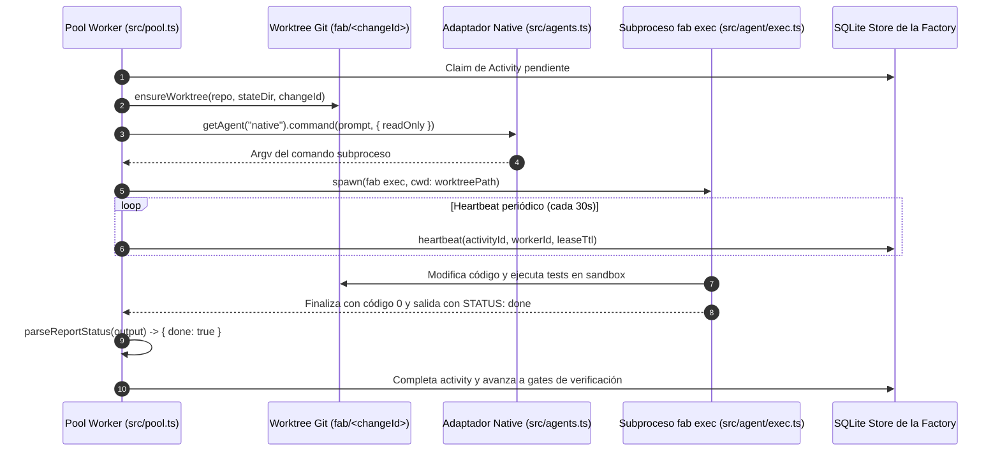

# Frontera con la Factory: El Adaptador Native

El motor `fab exec` opera como el agente de codificación nativo y predeterminado de la fábrica de software (`fab`). Esta página documenta la interfaz formal que delimita ambos sistemas y cómo el pool de workers de la fábrica orquesta ejecuciones headless del agente nativo.

Para la visión global de la fábrica, consultar el [Índice de la Factory](../factory/index.md) y la documentación de [Adaptadores de Agentes](../factory/05-adaptadores-de-agentes.md).

---

## 1. El Adaptador `native` (`src/agents.ts`)

En la fábrica, el pool nunca edita código directamente ni importa la lógica interna del agente como módulos TypeScript dentro de su propio proceso; en su lugar, delega el trabajo mediante la interfaz `AgentAdapter` (`src/agents.ts:29-37`):



### Especificación del Comando Generado (`src/agents.ts:131-140`)

El adaptador `native` construye la invocación de línea de comandos apuntando al ejecutable `exec`:

```typescript
const native: AgentAdapter = {
  name: 'native',
  command: (prompt, options) => [
    ...selfCommand('exec', new URL('./agent/exec.ts', import.meta.url)),
    '--require-status',
    '--auto', process.env.FABRICA_AGENT_AUTONOMY ?? 'medium',
    ...(process.env.FABRICA_AGENT_SETTINGS ? ['--settings', process.env.FABRICA_AGENT_SETTINGS] : []),
    ...(process.env.FABRICA_AGENT_TIMEOUT_MS ? ['--timeout-ms', process.env.FABRICA_AGENT_TIMEOUT_MS] : []),
    ...(process.env.FABRICA_AGENT_MAX_TURNS ? ['--max-turns', process.env.FABRICA_AGENT_MAX_TURNS] : []),
    ...(options?.readOnly ? ['--use-spec'] : []),
    prompt,
  ],
};
```

---

## 2. Invariantes en la Frontera

1. **Exigencia del Contrato de STATUS (`--require-status`):**
   - El adaptador añade siempre `--require-status`. Esto obliga al motor del agente a validar que la última línea del informe generado contenga exactamente `STATUS: done` o `STATUS: blocked - <motivo>` (`src/prompts.ts:79-83`).
   - Si el agente olvida incluir esta cabecera o produce un texto ambiguo, el bucle interno de `fab exec` rechaza la respuesta final y exige al modelo su reparación antes de terminar (`src/agent/engine.ts:288-294`).
2. **Confinamiento de Solo Lectura (`--use-spec`):**
   - Cuando la actividad asignada por la fábrica es de análisis, especificación o revisión (por ejemplo, generación de propuestas o análisis de dependencias), el pool pasa `options.readOnly = true`.
   - El adaptador mapea esta opción a la bandera `--use-spec`, bloqueando en el agente todas las herramientas de modificación (`Create`, `Edit`, `ApplyPatch`) y comandos mutadores.
3. **Autonomía y Entorno:**
   - La autonomía se inyecta desde la variable de entorno `FABRICA_AGENT_AUTONOMY` (por defecto `medium`).
   - El timeout por defecto de la fábrica para una actividad es de 20 minutos (`timeoutMs = 20 * 60_000`, `src/agents.ts:162`).
4. **Git Commits Gestionados por la Factory:**
   - A diferencia del adaptador `codex` (cuyo sandbox monta `.git` como solo lectura y exige `factoryCommits: true`), `native` permite que el agente realice commits si la autonomía lo autoriza, o deja los cambios en el árbol de trabajo para que el pipeline de la fábrica los valide y selle.

---

## 3. Orquestación desde el Pool de Workers (`src/pool.ts`)

En el bucle `processActivity` (`src/pool.ts:95-351`):
1. **Asignación de Agente (`src/pool.ts:104`):**
   - El pool determina el agente configurado en el workstream (`ws.agent`). Para workstreams modernos, el valor predeterminado es `native`.
2. **Worktree Dedicado:**
   - Cada tarea opera en un directorio de trabajo aislado (`ensureWorktree`, rama `fab/<changeId>`). El subproceso `fab exec` se lanza con `cwd` fijado a la raíz de dicho worktree.
3. **Supervisión por Heartbeat y Cancelación Escalonada (`src/pool.ts:107-116`, `src/agents.ts:188-206`):**
   - El worker renueva periódicamente su lease en la base de datos SQLite.
   - Si el heartbeat falla o la actividad es cancelada por el operador, se aborta la señal `AbortSignal`.
   - El ejecutor `runAgent` (`src/agents.ts:188-206`) envía `SIGTERM` al grupo de procesos (`pgid`) del subproceso `fab exec`. Si no finaliza tras un periodo de gracia, escala a `SIGKILL` forzado para garantizar que ningún proceso secundario quede en ejecución en el servidor.
4. **Recolección de Evidencia:**
   - El resultado de la ejecución (`AgentRun`), incluyendo la salida cruda, el código de salida, la duración en milisegundos y el estado parseado (`AgentRunStatus`), se persiste atómicamente en disco bajo `runs/<changeId>/<activityId>.json` para auditoría y trazabilidad.

---

## Archivos

| Archivo | Responsabilidad |
| :--- | :--- |
| `src/agents.ts` | Definición del adaptador `native`, mapeo de argumentos CLI y ejecución mediante `runAgent`. |
| `src/pool.ts` | Orquestador de la fábrica: asignación de activities, gestión de worktrees y leases. |
| `src/prompts.ts` | Funciones `parseReportStatus` y `reportStatusLine` para validar el contrato de salida de la factory. |
| `src/agent/exec.ts` | Punto de entrada del subproceso ejecutado por el adaptador `native`. |
