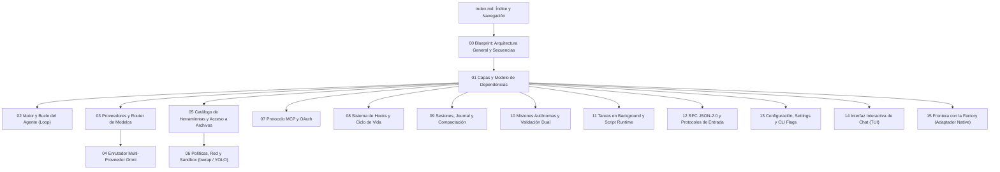

# fab exec — Agente de Codificación Nativo

Documentación técnica del **agente de codificación nativo y autónomo** de `fab` (`fab exec` y `fab chat`), implementado sobre **Bun y TypeScript**. Esta documentación está dirigida a desarrolladores y mantenedores de la plataforma; explica su arquitectura interna, las invariantes de aislamiento, el diseño del motor de turnos y dónde reside cada responsabilidad en el código fuente.

!!! info "Alcance y propósito"
    Esta sección cubre todo el código bajo `src/agent/**` (motor, proveedores, enrutado de modelos, herramientas, sandbox, misiones, MCP, hooks, persistencia y protocolos), la interfaz conversacional interactiva en `src/chat.ts` y `src/chat/**`, y el entorno de ejecución aislado en subproceso `src/script-runtime/**`.

!!! warning "Línea de código y árbol de trabajo"
    Las referencias técnicas y números de línea citados a lo largo de este documento (`src/archivo.ts:línea`) corresponden al árbol de trabajo actual en `sw-factory`. El motor se implementa en Bun sin dependencias del runtime original de Droid ni librerías propietarias.

---

## Qué es `fab exec`

`fab exec` es el agente de programación nativo de `fab`. A diferencia de los adaptadores externos de la fábrica (`claude`, `codex`, `agy`, `droid`) que delegan la ejecución en herramientas CLI de terceros mediante subprocesos y parsing de salidas, `fab exec` implementa su propia arquitectura:

1. **Motor de turnos y bucle de agente (`src/agent/engine.ts:33-335`):** Maneja la interacción por streaming con proveedores de modelos de lenguaje, el ensamblado de llamadas a herramientas concurrentes y la compactación automática de contexto.
2. **Aislamiento en el anfitrión (`src/agent/execution-policy.ts:15-30`):** Aplica contención en Linux mediante namespaces del kernel con `bwrap` (Bubblewrap) o modo host explícito (`--yolo`), con control estricto de red por comando (`src/agent/network-policy.ts:15-19`).
3. **Persistencia atómica y Reconciliación (`src/agent/session.ts:34-153`, `src/agent/journal.ts:13-55`):** Journal de intenciones con `fsync` antes de ejecutar mutaciones y recuperación determinista ante interrupciones.
4. **Misiones multi-rol con validación dual (`src/agent/mission.ts:20-406`):** Coordinación de orquestadores, implementadores (workers) y validadores independientes sin red sobre código desechable.
5. **Protocolos múltiples (`src/agent/exec.ts:24-32`):** Salida por texto, JSON, streaming de eventos NDJSON (`stream-json`) y un servidor bidireccional JSON-RPC 2.0 (`src/agent/rpc.ts:36-383`).

---

## Mapa de Lectura (De Arriba Abajo)

El orden de lectura recomendado va de los conceptos generales y el flujo de extremo a extremo a los componentes especializados y la frontera con el resto del sistema:

---

## Índice de Documentación

| Página | Qué Responde |
| :--- | :--- |
| [00 Blueprint](00-blueprint.md) | ¿Cómo interactúan los componentes globales, cómo se procesa un turno conversacional y cómo transita la máquina de estados de una sesión? |
| [01 Capas del Sistema](01-capas.md) | ¿Cuál es la jerarquía de capas arquitectónicas y qué invariantes de importación gobiernan el subsistema? |
| [02 Motor y Loop](02-motor-y-loop.md) | ¿Cómo opera `runCodingAgent`, cómo se maneja la cancelación, las recuperaciones, la validación de `STATUS:` y la herramienta `Loop`? |
| [03 Proveedores y Router](03-proveedores-y-router.md) | ¿Cómo se comunican los adaptadores de OpenAI, Anthropic y ChatGPT, cómo clasifica el router `auto` y cómo funciona el escalado de modelos? |
| [04 Enrutador Omni](04-omni.md) | ¿Cómo funciona el enrutador multi-proveedor con evaluación de ToS, perfiles de coste, leases concurrentes y degradación segura? |
| [05 Herramientas y Archivos](05-herramientas.md) | ¿Cuáles son las herramientas disponibles, cómo se garantiza la seguridad con descriptores `openat` y cómo opera el motor de parches KMP? |
| [06 Políticas y Sandbox](06-politicas-y-sandbox.md) | ¿Cómo se aíslan procesos en Linux con Bubblewrap, cómo se evalúa la política de red por comando y qué restricciones aplican al modo YOLO? |
| [07 Integración MCP](07-mcp.md) | ¿Cómo se integran servidores MCP mediante transportes stdio, HTTP y SSE, con soporte de OAuth 2.0 y sandboxing de procesos? |
| [08 Hooks](08-hooks.md) | ¿Cómo interceptan scripts locales los eventos del ciclo de vida (`PreToolUse`, `PostToolUse`, `Stop`) sin vulnerar las políticas de seguridad? |
| [09 Sesiones y Contexto](09-sesiones-y-contexto.md) | ¿Cómo se persisten las sesiones, cómo opera el journal con fsync ante caídas y cómo se recomprime el historial sin perder directivas del usuario? |
| [10 Misiones Autónomas](10-misiones.md) | ¿Cómo se descompone un objetivo en `features.json`, cómo se supervisan los workers y por qué se requiere validación dual en solo lectura? |
| [11 Tareas y Scripts](11-tareas-y-scripts.md) | ¿Cómo se ejecutan procesos en segundo plano, cómo se coordina el `ToolScheduler` y cómo se aíslan scripts en el worker VM de Bun? |
| [12 RPC y Protocolos](12-rpc-y-protocolos.md) | ¿Cuáles son los métodos JSON-RPC 2.0 soportados, cómo se estructura el transporte NDJSON y qué eventos emite el agente? |
| [13 Configuración](13-configuracion.md) | ¿Cómo se resuelven perfiles en `settings.json`, variables de entorno, cambios de configuración en caliente y worktrees temporales? |
| [14 Interfaz de Chat](14-chat.md) | ¿Cómo está construida la TUI conversacional (`fab chat`), su catálogo de 36 comandos slash, la gestión de pantallas y el rebobinado? |
| [15 Frontera con la Factory](15-frontera-con-la-factory.md) | ¿Cómo interactúa el pool de la fábrica con el adaptador `native` en `src/agents.ts` y qué contrato rige la entrega de actividades? |

---

## Archivos

| Archivo | Responsabilidad |
| :--- | :--- |
| `src/agent/index.ts` | Punto de entrada del paquete del agente nativo; reexporta las APIs principales de ejecución. |
| `src/agent/exec.ts` | Comando de entrada CLI (`fab exec`), parsing de argumentos, resolución de modos y despacho. |
| `src/chat.ts` | Comando de entrada interactivo (`fab chat` / `fab tui`). |
| `src/script-runtime/index.ts` | Exportación pública del subsistema de aislamiento de scripts en VM. |
