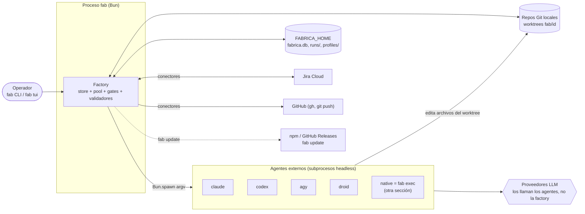
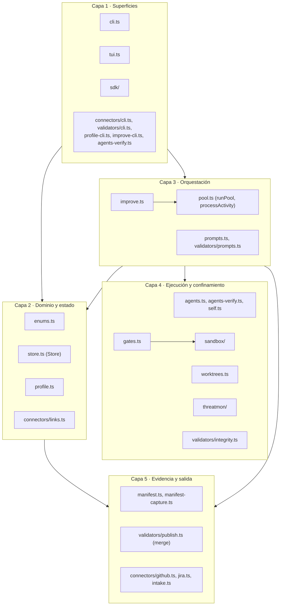
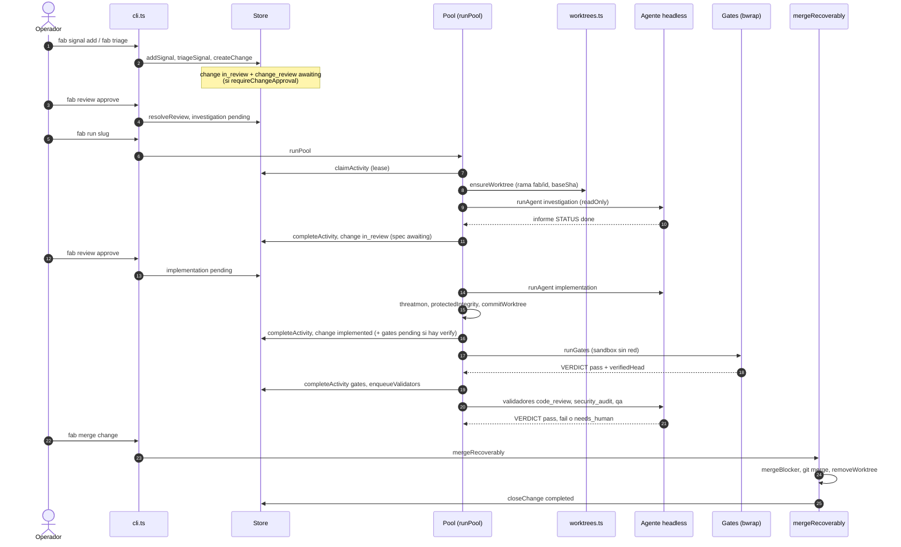

# 00 · Blueprint

La factory es un **orquestador local de agentes de código**. No edita código: entrega *una activity a una corrida de agente* (`src/agents.ts:1-2`). Su trabajo es todo lo que rodea al agente: un estado transaccional en SQLite, un worktree Git por change, puertas humanas y automáticas, evidencia y fusión.

## 1. Diagrama de contexto

- La factory **nunca** habla con un proveedor LLM: lanza CLIs (`claude`, `codex`, `agy`, `droid`) o el propio `fab exec` como subprocesos (`src/agents.ts:39-142`). Los proveedores LLM del agente nativo se documentan en [fab exec](../exec/index.md).
- El estado vive en `FABRICA_HOME` (por defecto `~/.fabrica`): `fabrica.db`, `worktrees/`, `runs/`, `profiles/`, `agents.json`, `deps/` (`src/cli.ts:34`, `src/worktrees.ts:41`, `src/manifest.ts:36-38`, `src/profile.ts:70`, `src/agents-verify.ts:12-15`, `src/pool.ts:144`).

## 2. Diagrama de componentes por capa

El detalle de dependencias reales está en [01 Capas](01-capas.md).

## 3. Flujo de extremo a extremo: de la señal al merge

Cadena de dominio: **workstream → signal → change → activity** (`src/enums.ts:1-2`). Un change avanza por activities (`change_review`, `investigation`, `implementation`, `gates`, validadores y `steward`), cada una ejecutada por un worker.

Referencias por paso:

| Paso | Código |
|---|---|
| Alta de señal y triage | `Store.addSignal` `src/store.ts:428`, `triageSignal` `:449`, `createChange` `:476` |
| Primera activity según gate de change | `src/store.ts:490-501` |
| Decisión humana | `Store.resolveReview` `src/store.ts:944`, tabla `REVIEW_FOLLOW_UP` `src/enums.ts:73-76` |
| Claim con lease | `Store.claimActivity` `src/store.ts:628` |
| Worktree y base | `ensureWorktree` `src/worktrees.ts:37`, `setChangeBase` `src/store.ts:527` |
| Ciclo del worker | `processActivity` `src/pool.ts:95-351` |
| Gates tras implementar | `src/store.ts:859`, rama `gates` en `src/pool.ts:134-184` |
| Validadores tras gates | `enqueueValidators` `src/store.ts:726`, invocado en `:828` |
| Puerta de merge | `mergeBlocker` `src/validators/publish.ts:29`, `mergeRecoverably` `:70` |

Sin `--verify` no hay activity `gates`: los validadores se piden a mano con `fab validate` (`src/store.ts:723`, `src/validators/cli.ts:113`).

## 4. Principios de diseño que se repiten en el código

1. **Compare-and-set en SQLite.** Toda transición es un `UPDATE ... WHERE status = ...` dentro de una transacción `IMMEDIATE` (`src/store.ts:1-3`, `:281-301`). Ver [02](02-modelo-de-datos.md).
2. **El agente es una caja negra con contrato de texto.** La primera línea del informe debe ser `STATUS: done` o `STATUS: blocked - <motivo>`; los validadores añaden `VERDICT:` (`src/prompts.ts:25-28`, `src/validators/prompts.ts:5-12`).
3. **La factory verifica, no confía.** Integridad de rutas protegidas, threatmon sobre la salida y el diff, gates deterministas en sandbox ([07](07-seguridad.md), [06](06-gates-y-validadores.md)).
4. **Un solo escritor por change.** `claimActivity` excluye activities concurrentes del mismo change (`src/store.ts:640-644`).
5. **Evidencia redactada antes de tocar disco** (`src/manifest.ts:23-30`).

## Límites conocidos (visión general)

- La factory asume pools en la misma máquina (`src/store.ts:1073`: `shortcut: asume pools en la misma máquina`).
- El aislamiento de los agentes depende del adaptador; solo `native` y los gates usan el sandbox propio de fab ([07](07-seguridad.md)).
- La documentación de usuario (`README.md`) afirma que la implementación corre "confinada en sandbox"; en el código el confinamiento por adaptador es el que declara `isolationFor` (`src/manifest.ts:52-59`).

## Archivos

| Archivo | Responsabilidad |
|---|---|
| `src/cli.ts` | Punto de entrada `fab`; enruta subcomandos. |
| `src/store.ts` | Estado transaccional y transiciones. |
| `src/pool.ts` | Workers y ciclo de una activity. |
| `src/worktrees.ts` | Worktree y rama por change. |
| `src/agents.ts` | Adaptadores de agentes headless. |
| `src/gates.ts` | Pasos de verificación declarados por el workstream. |
| `src/validators/` | Validadores, veredictos, integridad, merge. |
| `src/manifest.ts` | Evidencia por change. |
