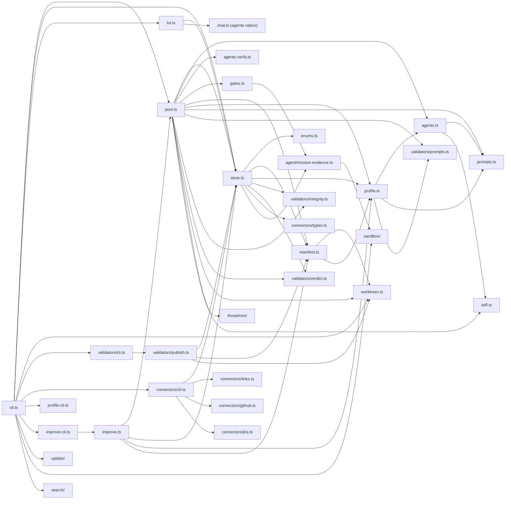

# 01 · Capas y dependencias

Esta página baja del blueprint a los módulos: qué importa a qué (según los `import` reales de `src/`), dónde están los límites y qué reglas se deducen del código.

## Grafo de dependencias entre módulos

!!! note "Fronteras con el agente nativo"
    Tres puntos de la factory importan código de `src/agent/**`: `store.ts` y `gates.ts`/`improve.ts` usan `verifierArgv`/`runVerifierAt`/`runSetupAt` de `src/agent/mission-evidence.ts` (`src/store.ts:32`, `src/gates.ts:2-3`, `src/improve.ts:7`); `cli.ts` enruta a `execMain`, `chatMain` y el runtime de Script (`src/cli.ts:20-24`); `sdk/` importa el tipo `McpConfig` (`src/sdk/types.ts:1`). Todo lo demás de `src/agent/` es de la otra sección.

## Capas

| Capa | Módulos | Regla observada |
|---|---|---|
| 1 Superficies | `cli.ts`, `tui.ts`, `sdk/`, `*-cli.ts`, `agents-verify.ts` (`agentsMain`) | Parsean argumentos y llaman al `Store`/pool. No contienen transiciones de estado. |
| 2 Dominio y estado | `enums.ts`, `store.ts`, `profile.ts`, `connectors/links.ts`, `connectors/types.ts` | `Store` es el único que muta las tablas `workstreams/signals/changes/activities/events` (`src/store.ts:139-163`). Los conectores añaden sus propias tablas sobre la misma conexión (`src/connectors/links.ts:8-13`) y `improve.ts` las suyas (`src/improve.ts:21-31`). |
| 3 Orquestación | `pool.ts`, `prompts.ts`, `validators/prompts.ts`, `improve.ts` | `pool.ts` decide el orden de las comprobaciones y qué método de `Store` cierra la activity. |
| 4 Ejecución y confinamiento | `agents.ts`, `self.ts`, `worktrees.ts`, `gates.ts`, `sandbox/`, `threatmon/`, `validators/integrity.ts` | Procesos hijos y Git. Sin estado propio salvo cachés (detección de bwrap `src/sandbox/detect.ts:8`). |
| 5 Evidencia y salida | `manifest.ts`, `manifest-capture.ts`, `validators/publish.ts`, `connectors/github.ts`, `jira.ts`, `intake.ts` | Escriben a disco o a sistemas externos; la evidencia se redacta antes de escribir (`src/manifest.ts:23-30`). |

## Acoplamientos que conviene conocer

- **`store.ts` ↔ `manifest.ts`.** `Store` llama a `writeManifest` en transiciones terminales (`src/store.ts:564`, `:863`, `:1205`), y `manifest.ts` importa el tipo `Store` (`src/manifest.ts:6`). La importación en `manifest.ts` es solo de tipo, así que no hay ciclo en tiempo de ejecución. Con un store `:memory:` no hay `stateDir` y `writeManifest` retorna sin escribir (`src/manifest.ts:70`, `src/store.ts:272`).
- **`profile.ts` → `agents.ts`.** La validación de un perfil comprueba `harness` contra `AGENT_NAMES` (`src/profile.ts:58`), de modo que añadir un adaptador cambia qué perfiles son válidos.
- **`improve.ts` → `pool.ts`.** Cada brazo de un experimento ejecuta `runPool` completo en un store y clon desechables (`src/improve.ts:153`).
- **`cli.ts` como árbol de decisión.** Primero despacha subcomandos con módulo propio (`jira`, `pr`, `agents`, `profile`, `improve`, `validate`, `exec`, `update`, …) en `main` (`src/cli.ts:107-136`); el resto pasa por `parseArgs` y un `switch` (`src/cli.ts:137-340`). Los subcomandos internos `__capture` y el worker de Script se atienden antes de `main` (`src/cli.ts:352-353`).

## Invariantes entre capas

1. Solo `Store` escribe estado de dominio; el pool y la CLI llaman a sus métodos (`completeActivity`, `failActivity`, `blockActivity`, `quarantineActivity`, `releaseActivity`, `requeueActivity`).
2. Los módulos de la capa 4 reciben rutas y argv; no conocen `Store`. La excepción es `improve.ts`, que crea sus propios stores.
3. Re-lanzar fab como hijo pasa siempre por `selfCommand`: desde código fuente ejecuta `bun <entry>.ts`; en binario compilado re-invoca el mismo ejecutable con un subcomando (`src/self.ts:7-16`). Lo usan el adaptador `native` (`src/agents.ts:133`), el envoltorio `__capture` (`src/pool.ts:211`) y `update` (`src/update/index.ts:7`, para `isCompiled`).

## Modos de fallo transversales

| Modo | Dónde se maneja |
|---|---|
| `SQLITE_BUSY` | `withRetry` reintenta hasta 4 veces con retroceso exponencial y jitter (`src/store.ts:281-301`); el pool re-encola sin contar fallo (`src/pool.ts:327-333`). |
| Proceso del worker muere | El lease caduca y `requeueOrphans` devuelve la activity a `pending` (`src/store.ts:1048-1122`). |
| Cancelación (SIGINT/SIGTERM) | `runPool` aborta los `AbortController` activos (`src/pool.ts:371-378`); `runAgent` mata el grupo de procesos (`src/agents.ts:188-206`). |

## Archivos

| Archivo | Responsabilidad |
|---|---|
| `src/cli.ts` | Composición: enruta a todos los módulos. |
| `src/self.ts` | Relanzado de fab como subproceso (fuente vs. binario compilado). |
| `src/enums.ts` | Vocabulario de dominio y tablas de transición. |
| `src/store.ts` | Capa de estado. |
| `src/pool.ts` | Capa de orquestación. |
| `src/agents.ts`, `src/worktrees.ts`, `src/gates.ts` | Capa de ejecución. |
| `src/manifest.ts` | Capa de evidencia. |
