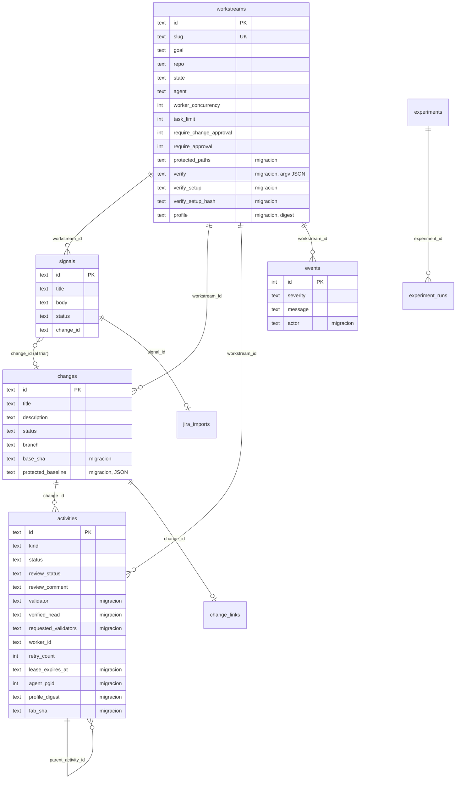
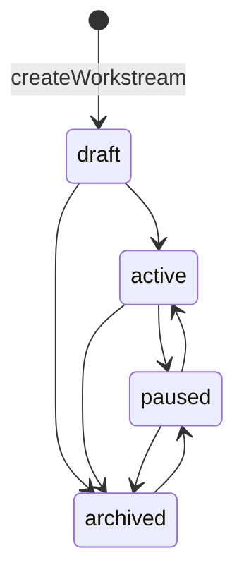
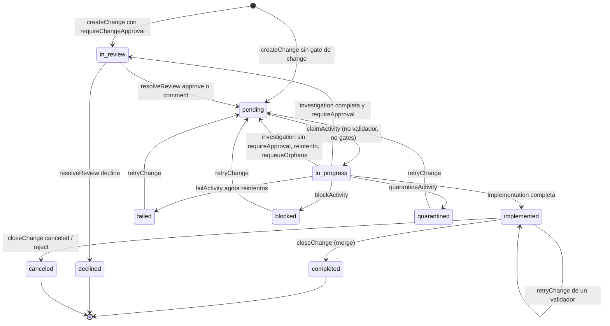
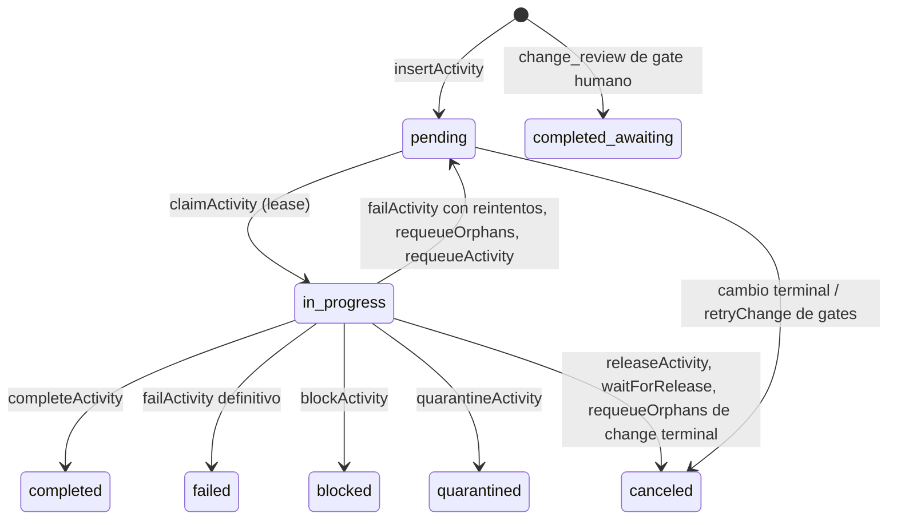

# 02 · Modelo de datos y máquinas de estado

Todo el estado de dominio vive en una base SQLite (`fabrica.db`, modo WAL) accedida con `bun:sqlite` (`src/store.ts:5`, `:275-278`). La clase `Store` (`src/store.ts:264-1214`) es la única que muta las tablas de dominio.

## Entidades y tablas

- Esquema base: `src/store.ts:139-163` (`workstreams`, `signals`, `changes`, `activities`, `events`, índice `idx_activities_claim`).
- Columnas añadidas por migración: `src/store.ts:307-323`. Las tablas `change_links` y `jira_imports` las crea `ChangeLinkStore` (`src/connectors/links.ts:8-13`); `experiments`, `experiment_ids` y `experiment_runs` las crea `improve.ts` (`src/improve.ts:21-31`, ver [09](09-perfiles-e-improve.md)).
- Los tipos TypeScript que reflejan las filas son `Workstream`, `Signal`, `Change`, `Activity` (`src/store.ts:61-128`) con conversores `toWorkstream` … `toActivity` (`:169-241`).

## Migraciones (`addColumn`)

No hay un sistema de versiones de esquema. `migrate()` es **idempotente**: por cada columna nueva llama a `addColumn(tabla, columna, ddl)` (`src/store.ts:307-322`), que consulta `PRAGMA table_info` y solo ejecuta `ALTER TABLE ... ADD COLUMN` si falta (`:330-339`). Si otro proceso la añadió entre la lectura y el `ALTER`, el error `duplicate column name` se ignora (`:336-337`).

Efectos secundarios de `migrate()`:

- crea `idx_activities_lease` (`:323`);
- da un lease nuevo de `LEASE_TTL_MS` a las activities `in_progress` sin lease (bases anteriores a los leases) (`:324-327`).

!!! note "Mismo patrón en otros módulos"
    `improve.ts` añade `experiment_runs.cost_usd` con el mismo patrón (`src/improve.ts:32-33`) y `ChangeLinkStore` añade `jira_imports.source_url` (`src/connectors/links.ts:14-15`). Los tests de migración están en `tests/store-migrations.test.ts` (no leído en detalle).

## Estados de workstream

Tabla `WORKSTREAM_TRANSITIONS` en `src/enums.ts:62-67`; la aplica `setWorkstreamState` con un `UPDATE ... WHERE state = ?` (`src/store.ts:411-424`). Solo un workstream `active` entrega activities (`claimActivity` devuelve `null` si no, `:630`).

## Señales

`SignalStatus`: `new → triaged | duplicate | ignored` (`src/enums.ts:12-17`). `triageSignal` exige `new`, crea el change y marca la señal `triaged` en la misma transacción (`src/store.ts:449-465`); `ignoreSignal` solo parte de `new` (`:467-472`).

## Estados de change

`ChangeStatus` base (`src/enums.ts:20-29`) más `blocked` y `quarantined` añadidos localmente en el store (`src/store.ts:36-38`). Los terminales son `completed, failed, canceled, declined, blocked, quarantined` (`:43-50`).

Dónde se aplica cada flecha:

| Transición | Código |
|---|---|
| Estado inicial según gate de change | `createChange` `src/store.ts:490-501` |
| `pending → in_progress` | `claimActivity` `:664-666` (solo si la activity no es validador ni `gates`) |
| `→ in_review` / `→ pending` tras investigation | `completeActivity` `:847-855` |
| `→ implemented` | `completeActivity` `:856-859` |
| Reintentos y `failed` | `failActivity` `:909-941` (`MAX_ACTIVITY_RETRIES = 3`, `src/enums.ts:78`) |
| `blocked` | `blockActivity` `:870-887` |
| `quarantined` | `quarantineActivity` `:890-906` |
| `declined` | `resolveReview` `:961-962` |
| `completed` / `canceled` | `closeChange` `:981-995` |
| Reabrir | `retryChange` `:998-1031` (admite `failed`, `implemented`, `blocked`, `quarantined`) |

!!! info "Tres intentos, no tres reintentos"
    `failActivity` incrementa `retry_count` y re-encola mientras `retryCount < MAX_ACTIVITY_RETRIES` (`src/store.ts:917-918`): la activity corre como máximo **3 veces** y la tercera falla es definitiva. La documentación de usuario habla de "hasta 3 reintentos"; el código implica 2 reintentos tras el primer intento.

Cada vez que un change entra en un estado terminal, `setChangeStatus` cancela sus activities `pending` (para que `--once` pueda terminar), registra el change en `terminalEvidence` y reescribe el manifest (`src/store.ts:556-567`).

## Estados de activity

`ActivityKind`: `change_review`, `investigation`, `implementation`, `steward` y, local al store, `gates` (`src/enums.ts:32-37`, `src/store.ts:36`). `ActivityStatus`: `pending, in_progress, completed, failed, canceled` más `blocked`, `quarantined` (`src/enums.ts:40-46`, `src/store.ts:37`).

`completed_awaiting` no es un estado: es una activity `change_review` que nace `completed` con `review_status = 'awaiting'` (`src/store.ts:497-498`, `:588`), y espera la decisión humana.

## Gates humanos

Hay **dos** puertas humanas, controladas por flags del workstream (`src/store.ts:70-71`, defaults `true` en `:382-383`):

| Flag (CLI) | Efecto |
|---|---|
| `requireChangeApproval` (`--no-change-approval`) | El change nace `in_review` con un `change_review` en `awaiting`; sin él nace `pending` con `investigation` (`:490-501`). |
| `requireApproval` (`--no-spec-approval`) | Tras `investigation`, `review_status='awaiting'` y change `in_review`; sin él se encola `implementation` directamente (`:847-855`). |

`resolveReview(activityId, decision, comment)` (`:944-978`) solo opera sobre `change_review` e `investigation` (`REVIEWABLE_KINDS`, `src/enums.ts:70`), exige `review_status='awaiting'` mediante CAS (`:955-958`) y consulta `REVIEW_FOLLOW_UP` (`src/enums.ts:73-76`):

| Actividad revisada | `approve` | `comment` | `decline` |
|---|---|---|---|
| `change_review` | encola `investigation` | nuevo `change_review` en `awaiting` (vuelve a la bandeja) | change `declined` |
| `investigation` | encola `implementation` | nueva `investigation` pendiente | change `declined` |

`decline` exige comentario (`:945-947`). La **bandeja** (`inbox`) lista las activities en `awaiting` y la última bloqueada/en cuarentena de changes en ese estado (`:619-625`).

Una tercera intervención humana es `allowGate` (`fab gate allow`): re-basa las rutas protegidas revisadas, invalida veredictos anteriores y re-encola (`:534-554`); ver [07](07-seguridad.md).

## Leases y heartbeat

| Constante | Valor por defecto | Fuente |
|---|---|---|
| `LEASE_TTL_MS` | 90 000 ms (`FABRICA_LEASE_TTL_MS`) | `src/store.ts:40` |
| `HEARTBEAT_INTERVAL_MS` | 30 000 ms (`FABRICA_HEARTBEAT_MS`) | `src/store.ts:41` |

- `claimActivity` fija `worker_id`, `started_at` y `lease_expires_at` (`:651-661`).
- `heartbeat` prorroga el lease solo si la activity sigue `in_progress` del mismo `worker_id`; rechaza changes terminales (`:674-692`).
- `requeueOrphans` busca `in_progress` con lease vencido o nulo; si hay `agent_pgid` vivo, lo mata con `SIGKILL` a todo el grupo y **no** re-encola en ese ciclo (`:1071-1087`); si el change es terminal cancela; si no, devuelve a `pending` (`:1089-1116`).
- `merge:<pid>` es un lease especial: `mergeRecoverably` inserta una activity `steward` con vencimiento `9999-12-31` para que `requeueOrphans` no la despache a un agente (`src/validators/publish.ts:56-58`, `:89-90`). Ver [04](04-worktrees-y-git.md).

## Eventos

`event(workstreamId, severity, message, changeId?, activityId?)` inserta en `events` con el actor (`FAB_ACTOR` o el usuario del SO) (`:1198-1203`). Si el change o la activity ya son terminales, además reescribe el manifest (`:1204-1205`). `listEvents` devuelve los últimos N en orden cronológico (`:1208-1213`).

## Concurrencia: `withRetry`

`withRetry(fn)` ejecuta `fn` en una transacción `IMMEDIATE` (toma el lock de escritura de entrada) y reintenta ante `SQLITE_BUSY` (máx. 4 intentos, retraso inicial 25 ms, tope 500 ms, jitter) (`src/store.ts:281-301`). Dentro de una transacción externa no reintenta: lo hace el llamador exterior (`:283`). `busy_timeout` es 5 s (`:276`).

## Invariantes

1. Solo el worker que tiene el lease (`worker_id`) puede completar, fallar, bloquear o poner en cuarentena una activity (`WHERE ... AND worker_id = ?`).
2. Como máximo una activity `in_progress` por change (`NOT EXISTS` en el SELECT y en el UPDATE del claim, `:640-659`).
3. `base_sha` se fija una sola vez (`WHERE base_sha IS NULL`, `:529`).
4. Un change terminal no acepta heartbeat ni completar/fallar (`:678`, `:811`, `:914`).
5. `blocked` y `quarantined` detienen los reintentos automáticos: solo `retryChange` o `allowGate` los reabren.

## Límites conocidos

- Sin versión de esquema ni migraciones descendentes; solo se añaden columnas.
- `requeueOrphans` asume que `agent_pgid` pertenece a esta máquina (`src/store.ts:1073`).
- `TERMINAL_ACTIVITY` (`src/enums.ts:59`) y `isTerminal` del store (`:1192-1194`) duplican parte de la noción de terminal; los changes usan `TERMINAL_CHANGE_STATUSES` (`:43-50`).

## Archivos

| Archivo | Responsabilidad |
|---|---|
| `src/enums.ts` | Estados, tipos de activity, transiciones de workstream, seguimiento de revisión, `MAX_ACTIVITY_RETRIES`. |
| `src/store.ts` | Esquema, migraciones, CAS, leases, eventos, todas las transiciones. |
| `src/connectors/links.ts` | Tablas `change_links` y `jira_imports`. |
| `src/improve.ts` | Tablas de experimentos (`ensureSchema`). |
| `tests/store.test.ts`, `tests/store-migrations.test.ts`, `tests/store-retry.test.ts`, `tests/pool-leases.test.ts` | Pruebas del store y de leases (existen; contenido no revisado). |
