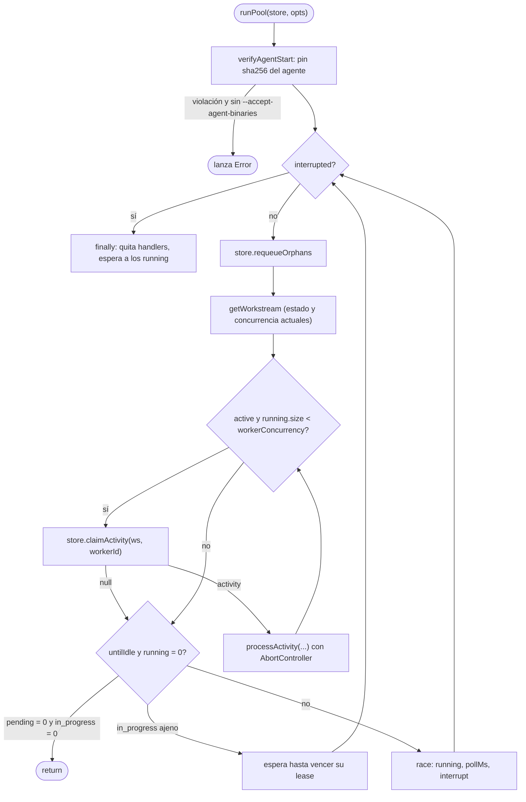
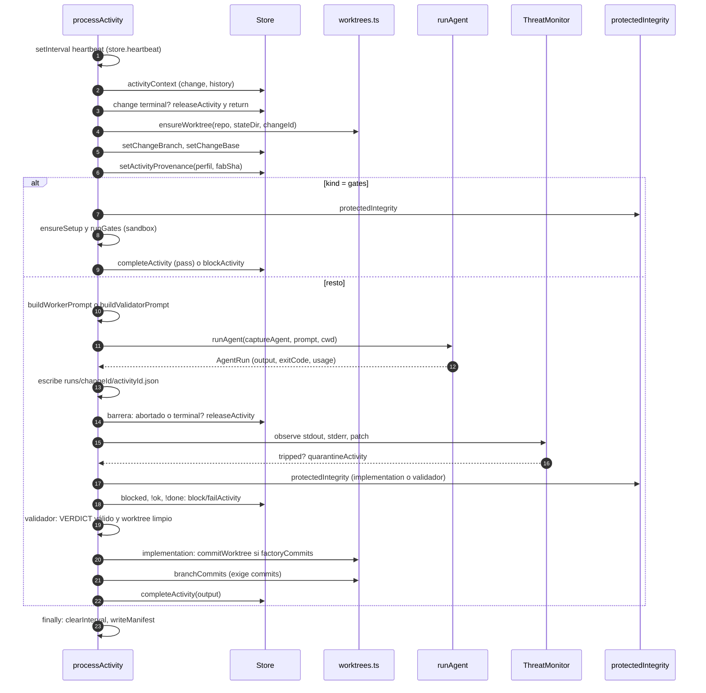

# 03 · Pool y workers

`src/pool.ts` (463 líneas) toma las activities `pending` del store, ejecuta una por worker y registra el resultado. Tiene dos funciones centrales: `runPool` (bucle y concurrencia) y `processActivity` (ciclo de una activity).

## Bucle del pool (`runPool`)

Detalles verificados:

- **Pin de binario.** `verifyAgentStart` corre una sola vez al arrancar; con pin y binario distinto lanza error salvo `acceptAgentBinaries` (`src/pool.ts:357-361`). Ver [05](05-adaptadores-de-agentes.md).
- **Interrupción.** `SIGINT`/`SIGTERM` abortan todos los controllers y resuelven la promesa de interrupción (`:371-381`); el `finally` espera con `Promise.allSettled` a los workers en vuelo (`:456-462`).
- **Huérfanas.** Cada vuelta del bucle llama a `requeueOrphans`; si hay `SQLITE_BUSY` espera 50 ms y reintenta (`:386-396`).
- **Concurrencia.** `workerConcurrency` del workstream (por defecto 2, `src/store.ts:380`) limita `running.size` (`:408`). El `workerId` es `w<slot>-<pid>` (`:409`).
- **Modo `--once` (`untilIdle`).** Termina cuando no hay `pending` ni `in_progress`. Si hay activities en vuelo de otro pool espera al vencimiento de su lease, acotado por `pollMs` (`:429-451`).
- **Demonio.** Sin `untilIdle` duerme `pollMs` (por defecto 30 s) o hasta que un worker termine (`:453-454`).
- Solo se reclaman activities de **changes no terminales** y de **workstreams activos** (`src/store.ts:630`, `:639`).

## Ciclo de una activity (`processActivity`)

Pasos con su código (`src/pool.ts`):

| # | Paso | Líneas |
|---|---|---|
| 1 | Heartbeat cada `heartbeatMs`; si falla (`lease` perdido, change terminal) aborta el controller | `:107-116` |
| 2 | `activityContext` y barrera "change terminal → `releaseActivity`" | `:119-125` |
| 3 | `ensureWorktree`, `setChangeBranch`, `setChangeBase` | `:127-129` |
| 4 | Perfil resuelto por digest y procedencia (`profile_digest`, `fab_sha`) | `:130-131` |
| 5 | Rama `gates` (integridad, setup, `runGates`) | `:134-184` |
| 6 | Un validador con `--verify` exige el HEAD verificado y árbol limpio antes de empezar | `:185-188` |
| 7 | `diffStat` para el prompt del validador (`git diff --stat main...<rama>`, con respaldo `HEAD~1`) | `:189-201` |
| 8 | Prompt: validador (`buildValidatorPrompt`) o worker (`buildWorkerPrompt`) | `:202-204` |
| 9 | `readOnly = (validador distinto de qa) o investigation` | `:206` |
| 10 | Sonda de egress: borra la del intento anterior, pasa `FABRICA_EGRESS_PROBE_FILE` al hijo | `:207-209` |
| 11 | `captureAgent`: antepone `__capture <log>` al comando del adaptador | `:210-213` |
| 12 | `runAgent` con `signal` y `onSpawn(pgid)` → `agent_pgid` | `:215-221` |
| 13 | Metadatos de ejecución (`isolation`, `durationMs`, `exitCode`, `usage`, `egressProbe`) | `:223-226` |
| 14 | Barrera posterior a la corrida | `:228-238` |
| 15 | Threatmon sobre stdout, stderr y diff | `:240-262` |
| 16 | Integridad de rutas protegidas (solo `implementation` y validadores) | `:264-273` |
| 17 | `STATUS: blocked` → `blockActivity`; salida no ok → `failActivity`; `STATUS` ausente → `failActivity` | `:274-289` |
| 18 | Validador: exige `VERDICT:` y worktree sin cambios | `:290-308` |
| 19 | `implementation`: commit por la factory si el adaptador no puede (`factoryCommits`), exige ≥1 commit salvo agente `fake` | `:309-323` |
| 20 | `completeActivity` | `:324-325` |
| 21 | `catch`: `SQLITE_BUSY` → `requeueActivity`; resto → `failActivity` (o `blockActivity` si es gates); change terminal → `releaseActivity` | `:326-346` |
| 22 | `finally`: detiene heartbeat y reescribe manifest | `:347-350` |

### Orden de las comprobaciones: por qué importa

El orden en `processActivity` es parte del contrato de seguridad:

1. **Barrera** → no se interpretan resultados de un change cancelado mientras el agente corría.
2. **Threatmon antes de integridad y de cualquier veredicto** → una salida ofensiva pone el change en cuarentena aunque el agente reporte `done`.
3. **Integridad antes de `STATUS`/`VERDICT`** → manipular tests o config protegidos bloquea (`GATE_TAMPERED`) aunque el informe sea correcto.
4. **Validador limpio** → un validador que dejó cambios falla (`:303-307`).

### Qué cierra cada resultado

| Resultado | Método de `Store` | Efecto en el change |
|---|---|---|
| Éxito | `completeActivity` | según el tipo (ver [02](02-modelo-de-datos.md)) |
| `THREAT_DETECTED` | `quarantineActivity` | `quarantined` |
| `GATE_TAMPERED`, `GATE_HEAD_CHANGED`, `GATES_FAIL`, `STATUS: blocked` | `blockActivity` | `blocked` |
| salida vacía, exit ≠ 0, `STATUS` ausente, sin `VERDICT`, sin commits | `failActivity` | reintento hasta 3 intentos, luego `failed` |
| Abortado o change terminal | `releaseActivity` | sin cambio de change |
| `SQLITE_BUSY` | `requeueActivity` | sin cambio ni contador |

## Setup de dependencias (`ensureSetup`)

Antes del primer gate se ejecuta `verifySetup` del workstream (argv sin shell) solo si su hash sha256 difiere del último que tuvo éxito (`verifySetupHash`) (`src/pool.ts:74-93`). Un mapa `setupInFlight` evita ejecutarlo dos veces a la vez por workstream (`:71`, `:79-80`). Las dependencias van a `<stateDir>/deps/<slug>` (`:144`). Detalles de aislamiento en [06](06-gates-y-validadores.md).

## Cancelación

- **Manual** (`fab reject`): `closeChange(..., 'canceled')` pasa el change a terminal; el heartbeat del worker falla (`heartbeat` rechaza terminales, `src/store.ts:678`), el controller aborta y `runAgent` mata el grupo (`src/pool.ts:109-113`, `src/agents.ts:208-216`). Luego `waitForRelease` espera a que las activities se liberen o caduquen sus leases y se borra el worktree (`src/cli.ts:315-322`, `src/store.ts:1151-1176`).
- **Señal al proceso**: abort global (`:371-378`).
- **Tiempo**: `runAgent` termina el grupo tras `timeoutMs` (20 min por defecto, `src/agents.ts:166`, `:218-220`) con SIGTERM y SIGKILL a los 2 s (`:198-206`).

## Invariantes y modos de fallo

- Un worker muerto no pierde la activity: su lease vence y se re-encola ([02](02-modelo-de-datos.md)).
- Un agente que ignora SIGTERM recibe SIGKILL al grupo; el `agent_pgid` guardado permite a otro pool matarlo (`src/store.ts:1071-1087`).
- `getWorktreeDiff` (usado para threatmon) combina `git diff <base>`, `git status --porcelain -uall` y el contenido de archivos sin seguimiento (`src/pool.ts:20-55`). Errores de git se tragan: un fallo deja el stream `patch` vacío.
- `diffStat` usa la rama `main` fija (`'main...' + branch`, `:192`): en repos cuya rama base no se llama `main` cae al respaldo `HEAD~1` (`:194-197`). No verificado con un repo real.

!!! warning "No verificado: investigation realmente solo-lectura"
    El pool pasa `readOnly` al adaptador (`:206`, `:215-217`), pero solo `codex` y `native` lo traducen a una restricción (sandbox de solo lectura / `--use-spec`) (`src/agents.ts:83-85`, `:139`). Para `claude`, `agy` y `droid` la restricción es solo el prompt. Tras una `investigation` el pool no comprueba que el worktree esté limpio (la comprobación de limpieza solo existe para validadores, `:297-307`); la integridad se aplica únicamente a `implementation` y validadores (`:264`).

## Archivos

| Archivo | Responsabilidad |
|---|---|
| `src/pool.ts` | `runPool`, `processActivity`, `ensureSetup`, `getWorktreeDiff`. |
| `src/store.ts` | `claimActivity`, `heartbeat`, `requeueOrphans`, `complete/fail/block/quarantine/releaseActivity`. |
| `src/self.ts` | `selfCommand` para el envoltorio `__capture`. |
| `src/manifest-capture.ts` | Proceso `__capture` que registra la salida del agente en el log. |
| `tests/pool.test.ts`, `tests/pool-leases.test.ts`, `tests/blocked.test.ts` | Pruebas del pool (existen; contenido no revisado). |
