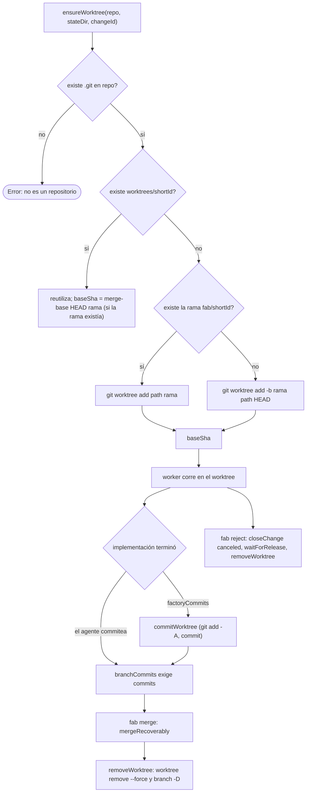

# 04 · Worktrees y Git

`src/worktrees.ts` (115 líneas) aísla cada change en **un worktree Git propio**, en una rama `fab/<8 primeros caracteres del id>`, bajo `<FABRICA_HOME>/worktrees/` (`src/worktrees.ts:1`, `:18`, `:41`). Investigación, implementación, gates y validadores de un change comparten ese worktree.

## Ciclo de vida



| Función | Qué hace | Línea |
|---|---|---|
| `GIT_SAFE_FLAGS` | `-c core.fsmonitor=false -c core.hooksPath=/dev/null -c diff.external=` en **todos** los comandos Git de la factory: ni hooks ni programas externos del repo se ejecutan | `src/worktrees.ts:5` |
| `git(cwd, ...args)` | Envoltorio `Bun.spawn` que lanza si el código ≠ 0 | `:7-16` |
| `branchFor(changeId)` | `fab/<id[0..8]>` | `:18` |
| `baseSha(repo, rama, existed)` | Si la rama existía: `merge-base HEAD rama`; si no, `rev-parse HEAD` | `:26-34` |
| `ensureWorktree` | Crea o reutiliza el worktree y devuelve `{ path, branch, baseSha }` | `:37-48` |
| `commitWorktree` | `git add -A` y commit con autor `fab <fab@localhost>`; `false` si no había cambios | `:54-59` |
| `commitProtectedPaths` | Commit **solo** de las rutas aprobadas (`--literal-pathspecs`, `commit --only`) | `:62-67` |
| `branchCommits` | `git log --oneline HEAD..<rama>` (commits de la rama no presentes en HEAD del repo) | `:70-73` |
| `mergeAndCleanup` | `git merge --no-edit`, elimina worktree y `branch -d` | `:76-96` |
| `removeWorktree` | `worktree remove --force` o `prune`; borra la rama con `-D` si cumple el patrón `fab/[A-Za-z0-9_-]+` | `:98-115` |

## Base SHA: por qué es un caso especial

`base_sha` es el punto desde el que se mide todo lo que el agente cambió (integridad de rutas protegidas, diff para threatmon). Se persiste **una sola vez** antes del primer worker (`Store.setChangeBase`, `WHERE base_sha IS NULL`, `src/store.ts:526-531`; llamado en `src/pool.ts:129`).

El comentario de `baseSha` explica el caso de reintento: si la rama ya existía (reintento o worker caído que dejó commits del agente), el HEAD del repo no es una base fiable y se usa el `merge-base` con HEAD (`src/worktrees.ts:20-34`, referencia interna "F2"). Como `setChangeBase` ya no sobrescribe, la base original del primer intento se conserva.

!!! warning "Límite: `diffStat` y base `main`"
    El diff que ve un validador se calcula contra `main` literal (`src/pool.ts:192`), no contra `base_sha`. En repos con otra rama principal depende del respaldo `HEAD~1` (`:194-197`).

## Merge recuperable

`fab merge` no llama a `mergeAndCleanup` sino a `mergeRecoverably` (`src/cli.ts:278-283`, `src/validators/publish.ts:70-131`). `mergeAndCleanup` existe en `worktrees.ts`, pero solo lo referencian los tests (`tests/worktrees.test.ts:6`, `:39`, `:65`); ni la CLI ni `src/` lo llaman (búsqueda de texto en `src`, `tests`, `scripts`).

```mermaid
sequenceDiagram
    autonumber
    participant CLI as fab merge
    participant M as mergeRecoverably
    participant S as Store
    participant G as git (repo)

    CLI->>M: changeId, force
    M->>S: transacción: estado implemented o completed
    M->>S: ¿activities in_progress ajenas? error; merge:pid muerto se cancela
    M->>S: mergeBlocker(validationSummary) salvo --force
    M->>S: INSERT steward in_progress worker merge:pid, lease 9999-12-31
    M->>G: symbolic-ref HEAD (rama destino)
    M->>S: evento merge_started {head, branch, target} (si no existía)
    M->>G: merge-base --is-ancestor head HEAD
    alt no es ancestro
        M->>G: git merge --no-edit head
    else ya fusionada
        Note over M: salida: rama ya fusionada
    end
    M->>S: writeManifest (antes de borrar la rama)
    M->>G: removeWorktree
    M->>S: closeChange completed, evento merge_completed
    M->>S: finally: steward completed o failed
```

Garantías del diseño (`src/validators/publish.ts`):

- **Exclusión.** La activity `steward` con `worker_id = merge:<pid>` y lease sin vencimiento impide que `claimActivity` lance otra activity del mismo change y que `requeueOrphans` la re-encole (`:56-58`, `:89-90`). Si el proceso `merge:<pid>` ya no existe, el siguiente `fab merge` cancela esa reserva (`:64-68`, `:78-83`).
- **Recuperación.** El evento `merge_started` guarda el SHA, rama y destino; un reintento reutiliza ese SHA, exige la misma rama destino y que la rama del change no haya cambiado (`:100-108`).
- **Idempotencia.** Si el SHA ya es ancestro de `HEAD` no vuelve a fusionar (`:109-110`).
- **Cierre.** `closeChange` rechaza un merge concurrente de otro proceso (`src/store.ts:984-987`).
- **`--force`** ignora validadores pendientes o en `fail`, no estados distintos de `implemented`/`completed`, y deja un evento `warning` (`:85-87`, `:91`).

## Invariantes y modos de fallo

- Un worktree por change; todos los workers del change lo comparten, pero `claimActivity` serializa las activities (`src/store.ts:640-644`).
- Git nunca ejecuta hooks del repo ni diff externos (`GIT_SAFE_FLAGS`). Excepción documentada: `improve.ts` usa `core.hooksPath=/dev/null` pero no el resto (`src/improve.ts:137`).
- Si `git worktree add` falla (p. ej. rama ya en uso por otro worktree) el error sube a `processActivity`, que lo registra como fallo de la activity (`src/pool.ts:326-346`).
- Un `reject` borra la rama con `-D` (sin comprobar que esté fusionada) (`src/worktrees.ts:112`); el merge exitoso usa `removeWorktree`, que también emplea `-D` (el `branch -d` seguro solo está en `mergeAndCleanup`).

!!! note "Código sin llamador en producción"
    `mergeAndCleanup` es una variante del merge sin reserva ni recuperación (usa `branch -d`, que rechaza ramas no fusionadas). `src/cli.ts` importa solo `commitProtectedPaths` y `removeWorktree` de `worktrees.ts` (`:19`) y `mergeRecoverably` de `publish.ts` (`:32`).

## Archivos

| Archivo | Responsabilidad |
|---|---|
| `src/worktrees.ts` | Worktree, rama, base, commits y limpieza. |
| `src/validators/publish.ts` | `mergeRecoverably` (merge con reserva y recuperación). |
| `src/store.ts` | `setChangeBranch`, `setChangeBase`, `closeChange`, `waitForRelease`. |
| `src/manifest.ts` | `gitEvidence` (lecturas Git síncronas con `GIT_SAFE_FLAGS`), estado `cleanup` en el manifest. |
| `tests/worktrees.test.ts` | Pruebas de worktrees (existe; contenido no revisado). |
