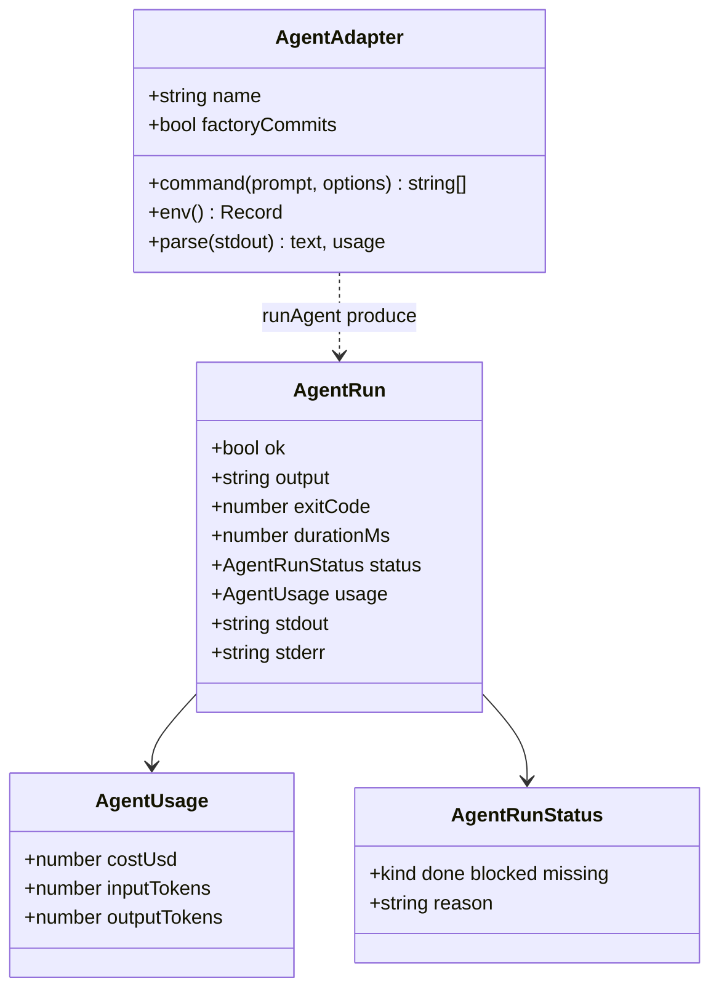
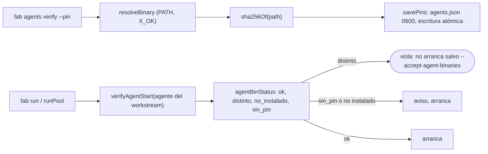

# 05 · Adaptadores de agentes

`src/agents.ts` convierte `(prompt, cwd)` en **una corrida no interactiva** de un CLI de código (`src/agents.ts:1-2`). La factory no edita código: el agente lo hace en el worktree y devuelve un informe de texto.

## Interfaz

- `AgentAdapter` (`src/agents.ts:29-37`): `command` arma el argv; `env` añade variables; `parse` extrae texto y uso de una salida estructurada (devuelve `null` si la salida es texto plano); `factoryCommits` indica que el agente no puede escribir metadatos Git y que la factory hará el commit.
- `AgentRun` (`:18-27`) y `AgentUsage` (`:12-16`): el coste es lo que el agente **declara**; "ausente cuando el CLI no lo reporta (codex, agy, droid, native)" (`:11`).
- Registro: `ADAPTERS = { claude, codex, agy, droid, native, fake }` (`:142`), `getAgent` lanza con la lista disponible si el nombre es desconocido (`:144-148`), `AGENT_NAMES` (`:150`) alimenta la CLI y la validación de perfiles.

## Adaptadores

| Adaptador | Comando | Particularidades | Línea |
|---|---|---|---|
| `claude` | `claude -p <prompt> --permission-mode acceptEdits --allowedTools … --output-format json` | Lista blanca de herramientas (`Read, Edit, Write, Glob, Grep`, `Bash(git:*)`, python, pytest, npm/bun test, `rtk`…). `parse = parseClaudeJson`. Ignora `readOnly`. | `:39-61` |
| `codex` | `codex exec --sandbox read-only\|workspace-write --skip-git-repo-check <prompt>` | `factoryCommits: true`: su sandbox monta `.git` en solo lectura. Usa `readOnly` para elegir el sandbox. | `:76-86` |
| `agy` | `agy -p <prompt> --dangerously-skip-permissions --output-format text` | Sin confinamiento de fab; usa la suscripción de Google AI iniciada. | `:88-92` |
| `droid` | `droid exec -m $FABRICA_DROID_MODEL --auto medium --output-format text <prompt>` | Airgap (`FACTORY_AIRGAP_ENABLED=1`); `FABRICA_DROID_HOME` → `FACTORY_HOME_OVERRIDE`; modelo por defecto `custom:qwen-local`. | `:99-117` |
| `native` | `selfCommand('exec', './agent/exec.ts') --require-status --auto <nivel> …` | Es `fab exec` como subproceso; `--use-spec` si `readOnly`. Variables `FABRICA_AGENT_AUTONOMY/SETTINGS/TIMEOUT_MS/MAX_TURNS`. | `:131-140` |
| `fake` | `sh -c` que imprime `STATUS: …` | Sustituto determinista para tests (`FABRICA_FAKE_STATUS/SLEEP/TOUCH`). | `:120-129` |

!!! info "Frontera con el agente nativo"
    El adaptador `native` es la única costura entre la factory y `src/agent/**`: arma un `argv` con `selfCommand` (`src/self.ts:14-16`) y lo ejecuta como cualquier otro CLI. Lo que hace `fab exec` por dentro (herramientas, router de modelos, proveedores, sandbox de herramientas, sonda de egress) se documenta en [fab exec](../exec/index.md). Desde la factory solo se observan: el código de salida, el informe, el `usage` (hoy ausente, `:11`) y el archivo de la sonda de egress que el hijo escribe en `FABRICA_EGRESS_PROBE_FILE` (`src/pool.ts:210`, `src/agent/registry.ts:162-169`).

## `runAgent`: ejecución y cancelación

`runAgent(agent, prompt, cwd, timeoutMs = 20 min, { readOnly, signal, onSpawn })` (`src/agents.ts:162-252`):

1. `Bun.spawn(agent.command(...))` con `cwd`, `env = process.env + agent.env()`, `stdin: 'ignore'` y **`detached: true`** (grupo de procesos propio) (`:170-177`).
2. `onSpawn(proc.pid)` permite al pool registrar `agent_pgid` en la base (`:179-183`, `src/pool.ts:218-220`).
3. Cancelación: aborto del `signal` o temporizador de `timeoutMs` → `SIGTERM` al grupo y `SIGKILL` a los 2 s (`:188-220`).
4. Recoge stdout, stderr y código de salida (`:222-226`).
5. `parse` (si existe) sustituye el texto del informe y aporta `usage` (`:236-237`).
6. `parseReportStatus` analiza la línea `STATUS:` (`:238`), `boundedAgentOutput` acota el informe a 20 000 caracteres conservando la línea de estado (`:152-160`).
7. `ok = exitCode === 0 && output.length > 0 && !wasAborted` (`:243`).

### Contrato de informe (`STATUS`)

`reportStatusLine` busca la primera línea `STATUS:` tolerando encabezados Markdown y negritas (`src/prompts.ts:74-77`). `parseReportStatus` devuelve `done`, `blocked` (con motivo) o `missing` (`:91-97`). Un informe sin `STATUS` válido provoca `failActivity`, uno con `blocked` provoca `blockActivity` (`src/pool.ts:274-289`).

### Coste por corrida (`parse` / `usage`)

`parseClaudeJson` (`src/agents.ts:64-74`) interpreta la salida de `claude -p --output-format json`:

- exige `type === 'result'`;
- `usage.costUsd` = `total_cost_usd` si es un número finito ≥ 0; si no, **no hay `usage`** (nunca 0);
- `inputTokens` suma `input_tokens + cache_creation_input_tokens + cache_read_input_tokens`; `outputTokens` = `output_tokens`; valores no numéricos o negativos cuentan 0;
- `text` = `result` (cadena) o `''`.

El pool guarda `run.usage ?? null` en `runs/<change>/<activity>.json` (`src/pool.ts:224`), y `improve.ts` lo suma por brazo (`armCost`, `src/improve.ts:116-129`). Ver [08](08-evidencia.md) y [09](09-perfiles-e-improve.md).

!!! warning "Consecuencia: logs con JSON bruto en claude"
    El envoltorio `__capture` escribe en el log de la activity la salida cruda del agente (`src/manifest-capture.ts:17-18`); con `claude` eso es el JSON del resultado, no el texto del informe. Lo que usa el pool para decidir es `run.output` (ya parseado). No comprobé cómo se ve el log en una corrida real.

## Pin de binarios (`agents-verify.ts`)

Para `claude`, `codex`, `agy` y `droid` (`PINNED_AGENTS`, `src/agents-verify.ts:10`) la factory puede fijar el **sha256 del binario** resuelto en `PATH`:

- Archivo: `<FABRICA_HOME>/agents.json` con `{ "agentBinaries": { agente: sha256 } }` (`:12-15`, `:37-57`); `loadPins` descarta claves y valores inválidos (`:37-48`). Escritura con `0600` y `rename` (`:51-57`).
- `agentBinStatus` produce `ok | distinto | no_instalado | sin_pin` (`:17`, `:74-84`).
- `fab agents verify` imprime el estado y un resumen; `--pin` guarda los hashes actuales (`:100-124`).
- `verifyAgentStart` se llama una vez en `runPool` (`src/pool.ts:359-361`). **Solo comprueba el adaptador del workstream** (o el `--agent`), no los demás (`src/agents-verify.ts:126-139`). `native`, `fake` y cualquier adaptador fuera de `PINNED_AGENTS` devuelven `{ ok: true }` sin comprobar nada (`:131`).
- Los experimentos de `improve` pasan `acceptAgentBinaries` al pool de cada brazo (`src/improve.ts:153`).

## `self.ts`: relanzar fab

`selfCommand(subcommand, entry)` devuelve `[process.execPath, subcommand]` si el proceso es un binario compilado (`$bunfs`) y `[process.execPath, '--no-env-file', <ruta .ts>]` si corre desde fuente (`src/self.ts:7-16`). Lo usan el adaptador `native` y el envoltorio `__capture`; `--no-env-file` evita que Bun cargue un `.env` del directorio de trabajo del agente.

## Invariantes y modos de fallo

- Cada corrida es un grupo de procesos propio: cancelar mata al agente y a sus descendientes.
- Si el agente no reporta coste (todos menos `claude`), `usage` es `undefined` y el coste de experimento queda `NULL` ([09](09-perfiles-e-improve.md)).
- `ok` es falso con salida vacía aunque el código de salida sea 0 (`:243`); `stderr` se usa como salida cuando stdout está vacío (`:237`).
- Un binario del agente reemplazado entre `verifyAgentStart` y la corrida no se detecta: la comprobación es única al arrancar el pool.

## Archivos

| Archivo | Responsabilidad |
|---|---|
| `src/agents.ts` | Adaptadores, `runAgent`, `parseClaudeJson`, `boundedAgentOutput`. |
| `src/agents-verify.ts` | Pines sha256, `fab agents verify`, `verifyAgentStart`. |
| `src/self.ts` | `selfCommand` / `isCompiled`. |
| `src/prompts.ts` | `parseReportStatus`, `reportStatusLine`, `validateReportStatus`. |
| `src/manifest-capture.ts` | Envoltorio `__capture` que persiste la salida del agente. |
| `tests/agents-output.test.ts`, `tests/agents-verify.test.ts` | Pruebas de `parse`/`usage` y de los pines (existen; contenido no revisado). |
