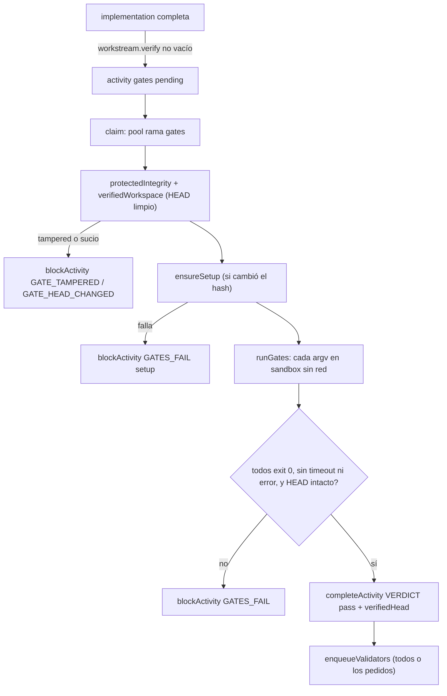

# 06 · Gates y validadores

La factory tiene **dos mecanismos de verificación distintos**, con garantías diferentes:

| | Gates (`--verify`) | Validadores (`code_review`, `security_audit`, `qa`) |
|---|---|---|
| Quién decide | Comandos deterministas declarados por el operador | Un agente LLM que emite `VERDICT:` |
| Dónde corre | Sandbox bwrap obligatorio, sin red, copia desechable | Adaptador del workstream en el worktree |
| Activity | `kind = 'gates'` | `kind = 'change_review'` con columna `validator` |
| Resultado | `VERDICT: pass` o bloqueo | `pass`, `fail`, `needs_human` |

## Gates deterministas

### Declaración

`fab ws create ... --verify <comando>` (repetible) y `--verify-setup <comando>` (`src/cli.ts:67-69`, `:186-187`). `createWorkstream` convierte cada comando en argv con `verifierArgv` (sin shell) y rechaza `--verify-setup` sin `--verify` (`src/store.ts:353-356`).

`verifierArgv` (`src/agent/mission-evidence.ts:77-112`) tokeniza como un shell POSIX **sin ejecutarlo**: comillas simples literales, dobles con agrupación, `\` escapa; cualquier operador sin comillas (`|`, `&`, `;`, `<`, `>`, `` ` ``, `$`, `(`, `)`…), expansión, salto de línea o comilla sin cerrar se rechaza. Límite 1000 caracteres. La única expansión permitida es `$FAB_DEPS` en el setup, que sustituye el runner (`src/store.ts:354-355`).

### Ejecución (`gates.ts` → `mission-evidence.ts`)

`runGates(cwd, commands, signal, onStep, timeoutMs = 120 000, deps)` ejecuta **todos** los pasos aunque uno falle y pasa solo si hay al menos uno y todos tienen `exitCode === 0`, sin `timedOut` ni `error` (`src/gates.ts:7-18`). Cada paso llama a `runVerifierAt` (`src/agent/mission-evidence.ts:176-197`):

- construye una **copia desechable** del código fuente (los archivos fingerprinted) en `/tmp/fab-verify-*`; los directorios ignorados (`node_modules`, `.venv`…) se montan **solo lectura** dentro de la copia (`:132-154`);
- entorno permitido: `PATH`, `HOME=/tmp`, `TMPDIR=/tmp`, `CI=1` y solo `LANG, LC_ALL, TZ, TERM, BUN_INSTALL` heredadas (`:115-124`);
- `wrapCommand(..., { mode: 'required', allowNetwork: false })`: si no hay bwrap lanza `SandboxUnavailableError`, **no** degrada (`:189`, `src/sandbox/wrap.ts:43-46`);
- temporizador con `AbortSignal.timeout` (120 s por defecto).

### Setup de dependencias

`runSetupAt` (`:203-221`) es una **fase aparte** del gate: red permitida, el worktree remontado solo lectura y `FAB_DEPS` (`<stateDir>/deps/<slug>`) como único path escribible; timeout 600 s. El gate monta `deps` en solo lectura y expone `PYTHONPATH`, `PATH/bin` y `NODE_PATH` (`:117-124`, `:188`). `ensureSetup` repite el setup solo si el hash de los argv cambió (`src/pool.ts:74-93`).

### Evidencia de un gate

Por activity de tipo `gates` el pool escribe `<activityId>.json` (isolation, `verifiedHead`, `durationMs`, `steps` con log por paso), `<activityId>.step-N.log`, `<activityId>.setup.log` y `<activityId>.log` (`src/pool.ts:143-171`). Ver [08](08-evidencia.md).

### Anclaje al HEAD (`verified_head`)

El gate de un change solo vale para **el HEAD en el que corrió**. `verifiedWorkspace(head)` exige que el HEAD del worktree coincida y que `git status --porcelain -uall` esté vacío (`src/pool.ts:132-133`). Al pasar, `completeActivity` guarda `verified_head` (`src/store.ts:822-829`). Después:

- cada validador nace con ese `verified_head` y, si cambia el HEAD o el árbol, se bloquea con `GATE_HEAD_CHANGED` antes y después de correr (`src/store.ts:741`, `src/pool.ts:185-188`, `:235-238`);
- `validationSummary` calcula `gatePassed` comparando `verified_head` con `git rev-parse <rama>` actual (`src/store.ts:784-785`);
- `requestValidation` manual no reutiliza evidencia de otro HEAD: si el gate no aprobó este HEAD encola uno nuevo (`:709-721`).

## Validadores

`VALIDATOR_KINDS = ['code_review', 'security_audit', 'qa']` (`src/connectors/types.ts:71`). Se encolan con `fab validate <change> [--only a,b]` (`src/validators/cli.ts:98-115`) o `fab pr open --validate`; con `--verify` configurado también se encolan automáticamente tras un gate `pass` (`src/store.ts:828`).

### Prompts

`buildValidatorPrompt` (`src/validators/prompts.ts:51-103`) compone: título y descripción del change, contexto (worktree, rama, base), resumen de diff (`git diff --stat`), el historial de trabajos previos (`historyBlock`), la instrucción del validador y las reglas (`VALIDATOR_RULES`). Reglas: no editar archivos, no `git add/commit/push`, terminar con `STATUS:` y `VERDICT: pass|fail|needs_human` seguido de un párrafo (`:5-12`). Las plantillas `code_review`, `security_audit` y `qa` son sustituibles por un [perfil](09-perfiles-e-improve.md) (`ValidatorTemplates`, `:46-49`).

### Modo de ejecución

El pool decide `readOnly = a.validator !== 'qa'` (`src/pool.ts:206`): `qa` puede ejecutar el código, los otros dos no deben. Ese flag solo lo respetan los adaptadores `codex` y `native` ([05](05-adaptadores-de-agentes.md)); en los demás vale el prompt. La salvaguarda es posterior: si el worktree queda con cambios, la activity falla (`:297-307`).

### Veredicto

`parseVerdict(report)` (`src/validators/verdict.ts:12-55`) busca la primera línea `VERDICT: pass|fail|needs_human` (tolerando `#` y `*`), y toma como resumen el primer párrafo posterior (máx. 600 caracteres). Sin veredicto válido el pool falla la activity (`src/pool.ts:290-296`).

`completeActivity` traduce el veredicto a `review_status`: `pass → approved`, `fail → declined`, `needs_human → commented` (`src/store.ts:834-840`).

### Resumen y puerta de merge

`validationSummary(changeId)` (`src/store.ts:753-795`) toma la **última** activity por validador y calcula `passed`, `pending`, `gatePassed`, `quarantined`. `mergeBlocker` (`src/validators/publish.ts:29-38`) devuelve el motivo por el que `fab merge` debe detenerse, en este orden:

1. change en cuarentena;
2. `gatePassed === false` (gates sin pass sobre el HEAD actual);
3. validadores pendientes o en curso;
4. algún `fail`;
5. algún validador sin veredicto.

Un change que nunca pidió validación se fusiona como antes (`src/validators/publish.ts:25-27`). `--force` ignora el bloqueo salvo que el estado no sea `implemented`/`completed` (`:85-87`).

`fab validate publish` convierte el resumen en una tabla Markdown (`validationMarkdown`, `:6-23`) y lo comenta en el PR enlazado (`publishValidation`, `:43-54`). Ver [11](11-integraciones.md).

## Invariantes y modos de fallo

- Un gate nunca reutiliza evidencia de otro HEAD.
- Un fallo de gate **bloquea** (no reintenta): hay que `fab retry` (que cancela los validadores y re-encola una `implementation`, `src/store.ts:1023-1026`) o `fab gate allow`.
- El timeout de 120 s es por paso; un gate lento falla como timeout, no como bloqueo infinito.
- Sin bwrap, los gates **no corren** (modo `required`); ver `fab doctor` (`src/cli.ts:324-331`).

!!! warning "No verificado"
    No ejecuté un gate real en esta documentación; el flujo se dedujo de `pool.ts`, `gates.ts` y `mission-evidence.ts`. Los tests relevantes (`tests/gates.test.ts`, `tests/validators-*.test.ts`) existen pero no los revisé.

## Archivos

| Archivo | Responsabilidad |
|---|---|
| `src/gates.ts` | `runGates` (pasos obligatorios) y re-export de `runVerifierAt`/`runSetupAt`. |
| `src/agent/mission-evidence.ts` | `verifierArgv`, `runVerifierAt`, `runSetupAt`, copia desechable (código del agente nativo, usado por la factory). |
| `src/validators/prompts.ts` | Plantillas y `buildValidatorPrompt`. |
| `src/validators/verdict.ts` | `parseVerdict`. |
| `src/validators/publish.ts` | `mergeBlocker`, `validationMarkdown`, `publishValidation`, `mergeRecoverably`. |
| `src/validators/cli.ts` | `fab validate`. |
| `src/validators/index.ts` | Reexportaciones públicas. |
| `src/connectors/types.ts` | `VALIDATOR_KINDS` y tipos de resumen. |
