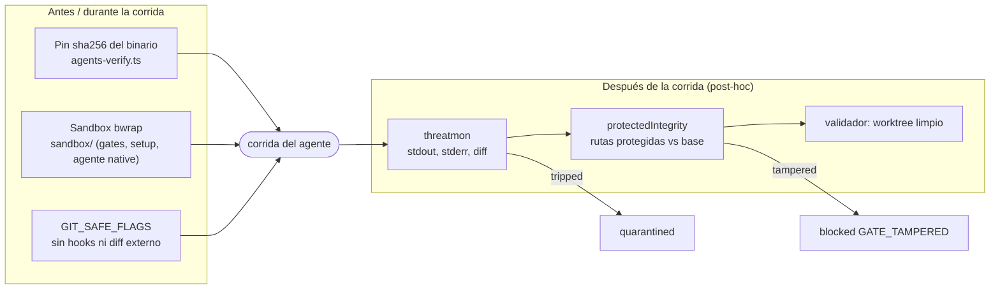
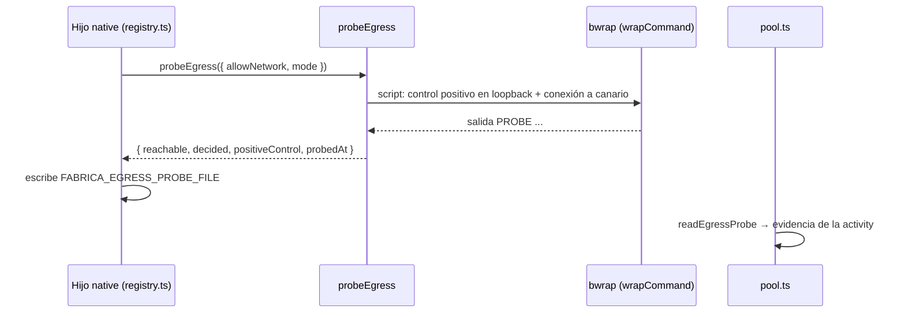
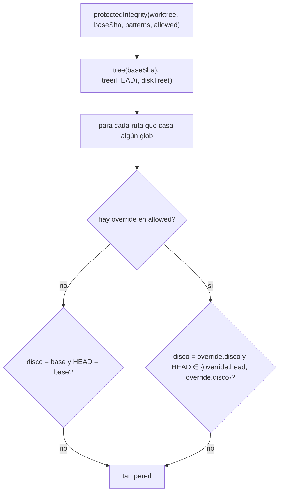

# 07 · Seguridad

La factory ejecuta código generado por un modelo. Su postura se apoya en **cuatro mecanismos independientes**, cada uno con un alcance distinto y, por tanto, con límites que conviene tener presentes.

| Mecanismo | Alcance | ¿Previene o detecta? | Cobertura |
|---|---|---|---|
| Sandbox bwrap (`src/sandbox/`) | Gates, setup, herramientas del agente `native` | Previene | Solo lo que pasa por `wrapCommand` |
| Pin de binarios | Los 4 CLIs externos | Previene el arranque con otro binario | Solo al arrancar el pool |
| threatmon | Salida y diff de **toda** corrida de agente (no gates) | Detecta, post-hoc | 43 reglas en 10 categorías |
| Integridad de rutas protegidas | `implementation` y validadores, y antes de gates | Detecta, post-hoc | Rutas por glob del workstream |

## Sandbox (`src/sandbox/`)

Backend único: **bubblewrap** (`SandboxBackend = 'bwrap' | 'none'`, `src/sandbox/types.ts:1`).

### Detección

`detectSandbox` ejecuta una invocación real de `bwrap` con las mismas banderas de montaje y namespaces que usará `wrapCommand`, para que una prueba verde implique que la real funcionará (`src/sandbox/detect.ts:3-6`, `:16-23`), y otra con `--unshare-net` para saber si el aislamiento de red es posible (`:44-57`). El resultado se cachea por proceso (`:8`, `:112-120`). Si falla con "Permission denied" distingue la restricción de AppArmor (`kernel.apparmor_restrict_unprivileged_userns=1`) y lo explica (`:71-86`). `fab doctor` imprime el informe con la guía de remediación (`src/sandbox/report.ts`, `src/cli.ts:324-331`).

### `wrapCommand`

Construye `bwrap` con (`src/sandbox/wrap.ts:69-136`):

| Bandera | Efecto |
|---|---|
| `--ro-bind / /`, `--dev /dev`, `--proc /proc`, `--tmpfs /tmp` | Raíz de solo lectura, `/tmp` privado |
| `--bind <workdir> <workdir>`, `--chdir` | Único directorio escribible (más `writablePaths`) |
| `--ro-bind` en `readOnlyPaths` y `readOnlyBinds` | Montajes de solo lectura, p. ej. dependencias |
| `--unshare-pid --unshare-ipc --unshare-uts --die-with-parent --new-session` | Namespaces y ciclo de vida |
| `--unshare-net` salvo `allowNetwork` | Sin red |
| `--clearenv` + `--setenv` | Entorno explícito: `PATH`, `HOME=workdir` y `opts.env` |

Dos modos (`SandboxMode`): `required` lanza `SandboxUnavailableError` con la remediación si no hay bwrap; `best-effort` (por defecto) devuelve el argv **sin envolver** con `degraded: true` y el motivo: «Never fakes isolation» (`:23-28`, `:43-55`).

### Quién lo usa dentro de la factory

- **Gates y setup**: `runVerifierAt` y `runSetupAt` usan `mode: 'required'` ([06](06-gates-y-validadores.md)).
- **Agente `native`**: sus herramientas pasan por su propia política de sandbox, descrita en [fab exec](../exec/index.md). La factory solo lee el resultado de la sonda de egress (abajo).
- **No** lo usan los adaptadores `claude`, `codex`, `agy` ni `droid`: la factory los lanza tal cual. `isolationFor` lo declara en la evidencia (`src/manifest.ts:52-59`):

| Adaptador | Postura declarada |
|---|---|
| `fake` | test process; no sandbox |
| `codex` | CLI sandbox: read-only or workspace-write |
| `claude` | CLI tool allowlist; no fab sandbox |
| `agy` | CLI permissions bypassed; no fab sandbox |
| `droid` | CLI auto medium; no fab sandbox |
| `native` | native tool sandbox policy |
| otro | unknown; no isolation attested |

Para gates, el pool declara «required OS sandbox; no network; disposable source; read-only dependencies; filtered environment» (`src/pool.ts:146`).

## Sonda de egress (`egress-probe.ts`)

Comprueba **antes de usar herramientas de red** si el aislamiento de red del sandbox funciona de verdad, con un control positivo (`src/sandbox/egress-probe.ts:1-15`):

- Control positivo: conexión TCP por loopback dentro del comando envuelto. Si falla (`positiveControl: false`) la sonda **no decide** (`decided: false`), para no tomar un canario inalcanzable por un falso negativo.
- Si el control pasa, intenta conectar a un canario externo (`1.1.1.1:80` por defecto, timeout 6 s) (`:149-156`); en red cortada falla al instante con `reachable: false, decided: true`.
- Resultado: `EgressProbeResult` (`:20-27`). El escritor es el agente nativo (`src/agent/registry.ts:162-169`); la factory pasa la ruta (`src/pool.ts:207-210`) y la lee con `readEgressProbe` solo para el adaptador `native` (`:225`, `src/manifest.ts:62-67`). Se guarda como `egressProbe` en `<activityId>.json`.

## threatmon (`src/threatmon/`)

Monitor de comportamiento sobre texto. Adaptado de `internal/threatmon` de ESF (MIT) (`src/threatmon/index.ts:1-2`, `third_party/esf/UPSTREAM.json` no lista este módulo; la cita está en el comentario del código).

### Qué analiza y cuándo

`processActivity` crea `new ThreatMonitor(defaultRules(), 'HIGH')` tras la corrida y observa tres flujos: `stdout`, `stderr` y `patch` (diff del worktree contra `baseSha` más archivos sin seguimiento) (`src/pool.ts:248-253`). **No** se aplica a gates (rama `gates` retorna antes, `:183`).

### Cómo funciona

1. `splitLines` une líneas con `\` final (`src/threatmon/index.ts:40-56`).
2. `normalizeLine` elimina secuencias ANSI y `\r`, y sustituye otros controles C0 por espacios (`:75-107`).
3. Cada regla (`ThreatRule`: `id, category, description, severity, pattern, stream?`) se prueba por línea; una regla con `stream` solo aplica a ese flujo (`:186-205`, `src/threatmon/rules.ts:15-22`).
4. Los hallazgos llevan un extracto acotado a 200 bytes en frontera UTF-8 (`:17`, `:113-127`).
5. `report()` ordena y marca `tripped` si algún hallazgo alcanza la severidad de disparo (`:209-244`). `severityRank`: `LOW=1 … CRITICAL=4` (`rules.ts:24-37`). Con el umbral `HIGH` disparan `HIGH` y `CRITICAL`; `MEDIUM` se registra pero no pone en cuarentena.

### Reglas por categoría (`defaultRules`, `rules.ts:170`)

| Categoría | Reglas | Ejemplos de severidad |
|---|---|---|
| privilege-escalation | PE-001…004 | sudoers (CRITICAL), setuid/setcap, módulos del kernel, firewall |
| credential-access | CA-001…006 | `/proc/*/environ`, `env \| grep`, credenciales de nube/gh |
| recon | RC-001…006 | mezcla HIGH/MEDIUM |
| reverse-shell | RS-001…006 | CRITICAL |
| persistence | PS-001…005 | HIGH |
| destructive | 5 reglas | — |
| exfiltration | 4 reglas | — |
| container-escape | 4 reglas | — |
| build-gate-tamper | BG-001 (HIGH, solo `patch`), BG-002 (MEDIUM) | parches que tocan `build.sh`/`test.sh`, Makefile, CI |
| cryptomining | 1 regla | — |

Total: **43 reglas** (recuento de entradas `category:` en `src/threatmon/rules.ts`). Las severidades exactas de las categorías sin ejemplo no las revisé una por una.

### Resultado

Si `tripped`, `quarantineActivity` marca la activity y el change `quarantined`, cancela las activities pendientes y deja el motivo `THREAT_DETECTED (<sev>): …` con los hallazgos (`src/pool.ts:254-262`, `src/store.ts:890-906`). Solo `fab retry` lo reabre (`src/store.ts:1002`).

!!! warning "Límite declarado (post-hoc)"
    El propio código lo advierte (`src/threatmon/index.ts:4-10`, `src/pool.ts:240-247`): el monitor opera sobre salida **capturada** y detecta; **no puede revertir** efectos ya ocurridos en el host si el agente corrió sin aislamiento previo (p. ej. `agy`). La mitigación de fondo es envolver los CLIs en sandboxes de egress, fuera de lo implementado. Además, depende de patrones de texto: un agente que no escriba la acción en stdout/stderr/diff no queda registrado.

## Integridad de rutas protegidas (`validators/integrity.ts`)

Impide que el agente "arregle" los tests o la configuración de build en lugar del código. Compara, para cada ruta que cumple un glob protegido, tres vistas: el **árbol de la base** (`base_sha`), el **árbol de `HEAD`** y el **disco** (`src/validators/integrity.ts:57-81`).

- **Rutas por defecto** (`DEFAULT_PROTECTED_PATHS`, `:7-12`): `tests/**`, `test/**`, `**/*.test.*`, `**/*.spec.*`, `package.json`, `bun.lock`, `bunfig.toml`, `tsconfig*.json`, `*vitest*`, `*jest*`, `pyproject.toml`, `pytest.ini`, `setup.cfg`, `conftest.py`, `Makefile`, `.github/**`, `.gitattributes`, `.gitmodules`. `createWorkstream` las une a las que añada `--protect` y exige `--protect-none` para vaciarlas (`src/store.ts:357-362`).
- **Validación de patrones**: rechaza vacíos, absolutos, con `..`, NUL o `!` (`:83-90`).
- **Disco sin seguir enlaces**: `diskTree` usa `lstat`, no entra en enlaces a directorios y hashea el destino del enlace simbólico (`:35-55`). Objetos especiales se marcan `special`.
- **Prosa bajo comodín de extensión no cuenta**: un glob que termina en `.*` (p. ej. `**/*.test.*`) no casa `.md/.txt/.rst`, porque esa prosa no se ejecuta en ningún runner (`:13`, `:64-67`).
- **Cuándo se evalúa**: antes de gates, y tras `implementation` o un validador (`src/pool.ts:137`, `:264-273`).
- **Resultado**: `blockActivity(..., 'GATE_TAMPERED: <rutas>')`.

### `fab gate allow`

Salida humana para cambios legítimos en rutas protegidas (`src/cli.ts:284-308`, `src/store.ts:534-554`):

1. exige un bloqueo `GATE_TAMPERED`, `--comment` con motivo y ningún worker en curso;
2. obtiene la `snapshot` actual y selecciona solo las rutas indicadas;
3. `commitProtectedPaths` hace un commit **solo** de esas rutas (`src/worktrees.ts:62-67`);
4. recalcula la snapshot y `allowGate` fusiona el nuevo baseline en `changes.protected_baseline`, **invalida** los veredictos de validadores previos y re-encola la activity (`:545-550`);
5. deja un evento `warning` con las rutas y el motivo (`:550`).

## Invariantes y modos de fallo

- Un fallo de seguridad nunca reintenta automáticamente: `quarantined` y `blocked` esperan una acción humana.
- Ejecutar sin bwrap con `mode: 'required'` falla de forma explícita; con `best-effort` queda registrado como degradado.
- Los comandos Git de la factory desactivan hooks y diff externo (`src/worktrees.ts:5`); una copia desechable evita que los tests del gate escriban en el worktree.
- Los secretos se redactan antes de escribir evidencia ([08](08-evidencia.md)).
- La seguridad del contenido del repositorio (qué pueda ejecutar un agente `claude`/`agy`/`droid` con sus propios permisos) queda fuera de lo que la factory impone.

## Archivos

| Archivo | Responsabilidad |
|---|---|
| `src/sandbox/detect.ts` | Detección real de bwrap y caché. |
| `src/sandbox/wrap.ts` | `wrapCommand`: argv de bwrap, modos `required`/`best-effort`. |
| `src/sandbox/types.ts` | Tipos y `SandboxUnavailableError`. |
| `src/sandbox/report.ts` | Informe para `fab doctor`. |
| `src/sandbox/egress-probe.ts` | Sonda de egress con control positivo. |
| `src/sandbox/README.md` | Documento del módulo (no revisado a fondo). |
| `src/threatmon/index.ts`, `src/threatmon/rules.ts` | Monitor y reglas. |
| `src/validators/integrity.ts` | Integridad de rutas protegidas y validación de patrones. |
| `src/agents-verify.ts` | Pin de binarios. |
| `tests/sandbox.test.ts`, `tests/egress-probe.test.ts`, `tests/threatmon.test.ts`, `tests/integrity.test.ts` | Pruebas (existen; contenido no revisado). |
