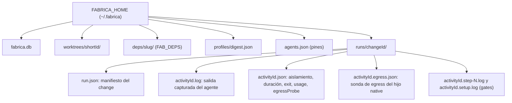

# 08 · Evidencia

Cada change deja un **rastro auditable en disco**: un `run.json` con el estado y las activities, más un log y un JSON de metadatos por activity. Todo se escribe de forma atómica y **redactada**.

## Disposición en disco



Rutas: `runDirectory = <stateDir>/runs/<changeId>` y `activityLog = <runDirectory>/<activityId>.log` (`src/manifest.ts:36-41`). Los ids se validan con `/^[A-Za-z0-9_-]+$/` para impedir salidas del directorio (`:32-35`).

## Escritura atómica y redacción

`atomicEvidence(path, text)` (`src/manifest.ts:23-30`): crea el directorio (`0700`), escribe un temporal `.<uuid>.tmp` con `flag: 'wx'` y modo `0600`, y hace `rename`. El contenido pasa por `redact` **antes** de tocar disco.

`redact` (`:10-21`) reemplaza por `[REDACTED]` o equivalente:

| Patrón | Ejemplo |
|---|---|
| Bloques de clave privada PEM | `-----BEGIN … PRIVATE KEY----- … -----END …` |
| `Bearer <token>` | cabeceras |
| `sk-…` (≥16), `AIza…` (35) | claves de proveedores |
| `AKIA…`/`ASIA…` (20) | AWS |
| `ghp_`/`gho_`/`ghu_`/`ghs_`/`ghr_`/`github_pat_` | GitHub |
| `xox[baprs]-…` | Slack |
| JWT `eyJ….….…` | tokens |
| credenciales en URL `scheme://usuario:clave@` | |
| `*api_key|token|secret|password|credential* = valor` | asignaciones genéricas |

Al serializar `run.json` además se aplica `redact` a **cada cadena** antes de codificar a JSON, para que un PEM multilínea no escape al filtro (`:88-93`).

!!! warning "Límite"
    La redacción es por expresiones regulares: reconoce formatos conocidos, no cualquier secreto. No se ha auditado qué formatos quedan fuera.

## `run.json`: el manifiesto

`writeManifest(store, changeId, stateDir = store.stateDir)` (`src/manifest.ts:69-94`) escribe, sin tocar nada si el store es `:memory:`:

```json
{
  "schemaVersion": 1,
  "changeId": "...", "status": "...",
  "profile": "<digest o digest por defecto>", "fabSha": "<sha o null>",
  "baseSha": "...", "branch": "fab/xxxxxxxx", "head": "<sha de la rama o el anterior>",
  "createdAt": "...", "updatedAt": "...", "durationMs": 0,
  "activities": [ { "...Activity", "verdict": "pass|fail|needs_human|null", "reason": "...", "log": "<id>.log", "isolation": {}, "durationMs": 0 } ],
  "cleanup": { "worktree": "retained|absent", "branch": "retained|absent" }
}
```

Cómo se construye cada campo:

- `head`: `git rev-parse --verify <rama>` o el valor del `run.json` anterior si la rama ya no existe (`:75-76`) — sobrevive al borrado de la rama tras el merge.
- `activities[]`: todas las activities del change más, por cada una, su `<id>.json` si existe (si no, `isolation: isolationFor(...)` y `egressProbe: null`) (`:77-85`). El `verdict` se deriva de `review_status` solo para validadores y gates (`:82`).
- Si falta el log de una activity, se crea con `result ?? error ?? ''` (`:78-79`).
- `durationMs`: el medido por el pool; si no, `completedAt - startedAt` (`:84`).
- `cleanup`: observa el estado real del worktree y la rama (`:86-87`).
- `profile`/`fabSha`: ver [09](09-perfiles-e-improve.md). Nota: `profile` usa el del workstream (`ws.profile ?? DEFAULT_DIGEST`); el digest efectivo con que corrió cada activity va en `activities[].profileDigest`/`fabSha` (columnas `profile_digest`, `fab_sha`).

### Cuándo se reescribe

`writeManifest` se invoca en: transición de change a terminal (`src/store.ts:564`), `completeActivity` (`:863`), `event` si change o activity son terminales (`:1204-1205`), `releaseActivity` (`:1134`), el `finally` de `processActivity` (`src/pool.ts:349`), `Store.close()` para los changes terminales vistos (refresca `cleanup` tras borrar el worktree) (`src/store.ts:341-345`) y `mergeRecoverably` antes y después de borrar la rama (`src/validators/publish.ts:119`, `:129`). No hay escritura periódica: el manifiesto de un change en curso refleja la última transición.

## Logs por activity (`__capture`)

El pool antepone al comando del agente `selfCommand('__capture', manifest-capture.ts) <log>` (`src/pool.ts:210-213`). `captureMain` (`src/manifest-capture.ts:4-24`):

1. ignora `SIGTERM`/`SIGINT` para seguir vivo hasta que se cierren las tuberías del hijo (el grupo recibe la señal a la vez);
2. ejecuta el comando, captura stdout y stderr;
3. **añade** al log existente (`existsSync ? read : ''`) `stdout` y, si lo hay, `\n[stderr]\n` + stderr — cada intento queda completo, también el stderr con stdout no vacío;
4. reenvía stdout/stderr a su propio stdout/stderr para que `runAgent` los reciba y devuelve el código del hijo.

Efecto: una activity cancelada conserva lo que el agente alcanzó a emitir.

## Metadatos de ejecución (`<activityId>.json`)

Dos escrituras en `processActivity` (`src/pool.ts:214`, `:223-226`):

| Momento | Contenido |
|---|---|
| Antes de lanzar | `{ isolation }` (`isolationFor(agent.name)`) |
| Tras la corrida | `{ isolation, durationMs, exitCode, usage: run.usage ?? null, egressProbe }` — `egressProbe` solo para `native` |
| Gate | `{ isolation: {adapter:'gates', posture}, verifiedHead, durationMs, steps[] }` (`:145-149`) |

`usage` es la fuente del coste por corrida ([05](05-adaptadores-de-agentes.md)): solo `claude` lo aporta. `improve.ts` lo lee con `armCost` ([09](09-perfiles-e-improve.md)). Un reintento conserva el id de la activity, así que **sobrescribe** el JSON del intento anterior (por eso `armCost` devuelve `null` si `retryCount > 0`, `src/improve.ts:112-121`); el pool borra la sonda de egress previa por la misma razón (`src/pool.ts:208-209`).

## Lectura de la evidencia

| Necesito saber… | Dónde |
|---|---|
| Estado final, rama, HEAD y limpieza | `runs/<id>/run.json` |
| Qué dijo el agente | `runs/<id>/<activity>.log` |
| Con qué aislamiento corrió, cuánto tardó, qué costó | `runs/<id>/<activity>.json` |
| Por qué se bloqueó/falló/puso en cuarentena | `activities[].reason` (de `error`) y `events` |
| Quién lo hizo | `events.actor` (`FAB_ACTOR` o usuario del SO, `src/store.ts:1202`) |

## Invariantes y modos de fallo

- Nada se escribe sin pasar por `redact`; nada se escribe parcialmente (temporal + `rename`).
- `run.json` se regenera entero desde la base de datos y el disco: es **derivado**, no la fuente de verdad.
- Si Git no está disponible para el repo (store de otra máquina), `gitEvidence` devuelve `null` en lugar de fallar (`:42-51`).
- Un manifiesto de un change cuyo worktree se borró después del último evento puede mostrar `cleanup: retained` hasta el siguiente `writeManifest`/`Store.close()`.

## Archivos

| Archivo | Responsabilidad |
|---|---|
| `src/manifest.ts` | `redact`, `atomicEvidence`, rutas de evidencia, `isolationFor`, `readEgressProbe`, `writeManifest`. |
| `src/manifest-capture.ts` | Proceso `__capture` (log por activity). |
| `src/pool.ts` | Escribe `<activity>.json`, `step-N.log`, `setup.log`. |
| `src/store.ts` | Dispara `writeManifest` en las transiciones. |
| `tests/manifest.test.ts` | Pruebas del manifiesto (existe; contenido no revisado). |
