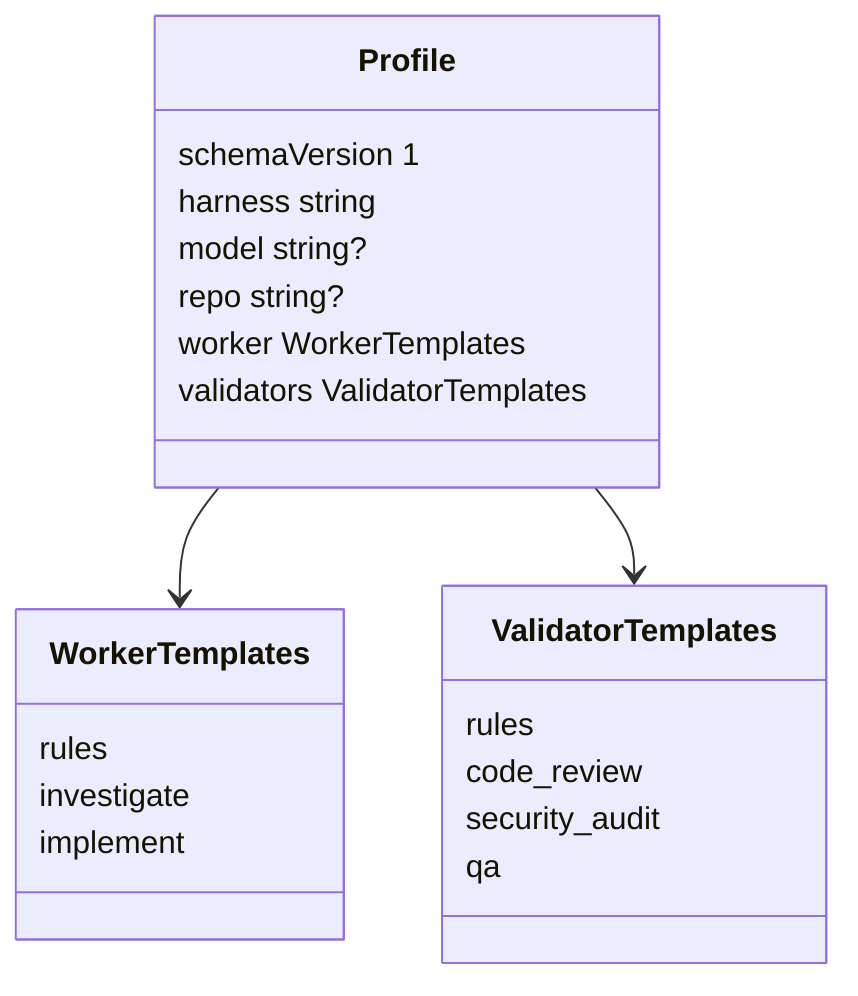
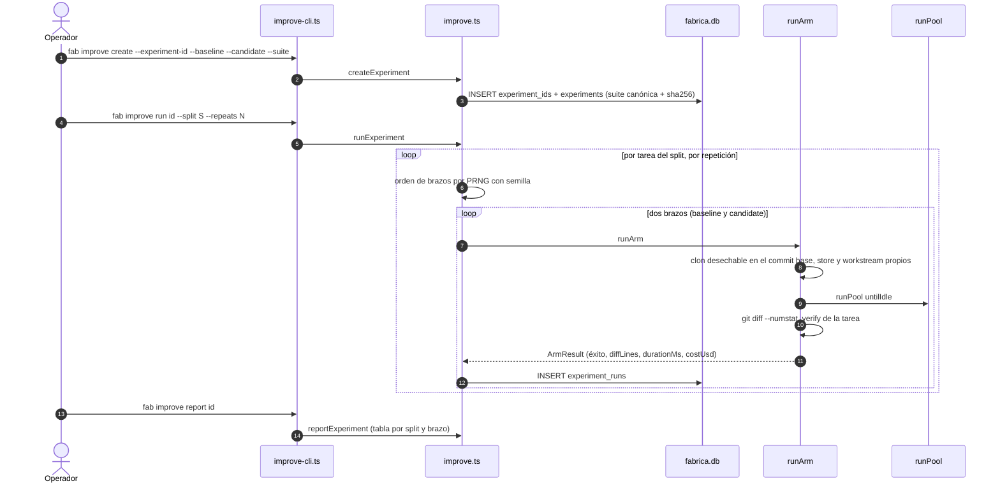
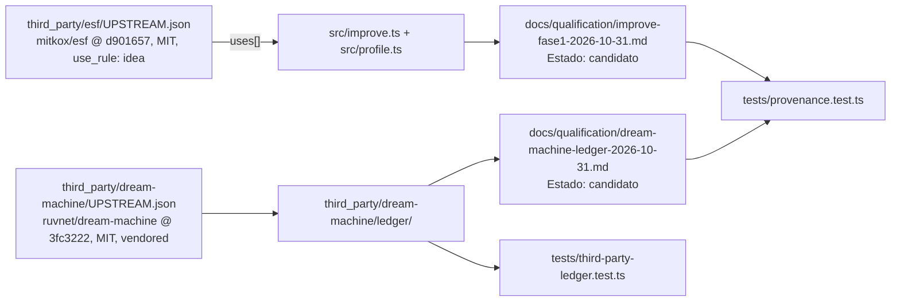

# 09 · Perfiles e `improve`

Dos piezas complementarias: un **perfil** es el conjunto inmutable de instrucciones (prompts) con que trabajan los agentes; `improve` compara **dos perfiles** con corridas pareadas sobre una suite congelada.

## Prompts de worker y de validador

| Prompt | Dónde | Contenido |
|---|---|---|
| Worker (`investigation`, `implementation`) | `buildWorkerPrompt` `src/prompts.ts:50-71` | Objetivo del workstream, título/descripción del change, historial (`historyBlock`), actividad y directorio/rama, la tarea (`INVESTIGATE` o `IMPLEMENT`) y las reglas compartidas |
| Validador | `buildValidatorPrompt` `src/validators/prompts.ts:51-103` | Ver [06](06-gates-y-validadores.md) |

- `INVESTIGATE`: "Do not change any files": reproducir, causa raíz con archivo:línea, spec de implementación (`src/prompts.ts:30-34`).
- `IMPLEMENT`: cambio mínimo, tests, ejecutar la suite, **commit** en la rama actual (`:36-41`). Cuando el adaptador es `factoryCommits`, la línea de commit se sustituye por "NO ejecutes git add/commit" (`COMMIT_LINE` → `NO_COMMIT_LINE`, `:43-44`, `:51`).
- `SHARED_RULES`: trabajar solo en el directorio actual; no push ni PRs; terminar con un informe cuya primera línea sea `STATUS: done` o `STATUS: blocked - <motivo>` (`:25-28`).
- `historyBlock` incluye el resultado y el comentario de revisión de cada actividad previa (`:13-23`).

## Perfil de instrucciones (`profile.ts`)

- **Identidad por contenido.** `profileDigest = sha256(canonicalJson(perfil))`; `canonicalJson` ordena claves y omite `undefined`, de modo que misma semántica ⇒ mismos bytes (`src/profile.ts:26-35`).
- **Validación estricta** (`validateProfile`, `:53-68`): objeto, sin claves desconocidas, `schemaVersion === 1`, `harness ∈ AGENT_NAMES`, plantillas no vacías y ≤ 32 KiB. Además exige marcas que el pool necesita para leer el resultado: `worker.rules` contiene `STATUS:`; `validators.rules` contiene `STATUS:` y `VERDICT:`; `worker.implement` conserva `COMMIT_LINE` (la factory la sustituye para agentes sin acceso a `.git`).
- **Almacén direccionado por contenido.** `<stateDir>/profiles/<digest>.json`, escritura con `wx`, modo `0444` y `rename`; reimportar el mismo perfil es idempotente y verifica la integridad (`:70-87`).
- **Carga con re-verificación.** `loadProfile` revalida el esquema y exige que el contenido en disco reproduzca el digest pedido; si no, "perfil corrupto" (`:90-97`).
- **Perfil por defecto.** `defaultProfile()` (harness `native`) construido con las plantillas actuales; su digest es `DEFAULT_DIGEST` (`:37-39`, `:103`). `resolveProfile(stateDir, digest)` devuelve el por defecto si el digest es nulo o igual a `DEFAULT_DIGEST` (`:106-110`). Un workstream con perfil por defecto guarda `NULL` en `workstreams.profile` (`src/store.ts:388`).
- **Fijación al crear el workstream.** `--profile <digest>` valida con `resolveProfile` antes de insertar (`src/store.ts:363-365`).
- **Procedencia.** Antes de cada activity el pool guarda `profile_digest` y `fab_sha` (`src/pool.ts:130-131`, `src/store.ts:1034-1038`). `fabSha()`: `FAB_SHA` si lo fija el empaquetado; si no, el HEAD del checkout de donde corre; si no, `null` (`src/profile.ts:112-121`).
- **`harness` es identidad, no imposición:** el perfil dice para qué adaptador se escribió, pero no obliga al workstream a usarlo (`:12`).

CLI (`profile-cli.ts`): `fab profile export [--out f]` (exporta el perfil por defecto), `import <archivo>`, `inspect <digest>`, `list` (`src/profile-cli.ts:7-34`).

## `improve`: experimentos de perfiles (fase 1)

Fase 1 de una cualificación al estilo de ESF: suite congelada con *splits*, corridas pareadas con semilla registrada e informe. **No** hay cualificación estadística, promoción ni rollback (`src/improve.ts:1-2`).

### Suite y splits

`Suite = { tasks: SuiteTask[] }`; `SuiteTask = { id, repo, base, description, verify, split }` con `split ∈ {development, validation, qualification}` (`src/improve.ts:13-16`). `parseSuite` valida: lista no vacía, campos obligatorios, `id` único `[a-z0-9-]`, `base` hexadecimal (7-40) y que `verify` sea un comando válido para `verifierArgv` (sin shell) (`:36-53`). La suite se guarda **canónica** (`canonicalJson`) con su sha256 (`suite_digest`) en `experiments` (`:63-69`).

### Ids no reutilizables

`experiment_ids` registra cada id al crearlo; `deleteExperiment` borra experimento y corridas pero **el id queda quemado** (`:55-84`). Reutilizarlo falla con `conflict` (`:71-73`). Esto evita comparar resultados de dos suites bajo el mismo nombre.

### Brazos pareados con semilla

`runExperiment` (`:172-199`): para cada tarea del split y cada repetición, un PRNG `mulberry32` con la semilla (registrada o aleatoria) decide si corre primero `baseline` o `candidate` (`:93-102`, `:186`); cada corrida se inserta en `experiment_runs` con `batch`, `seed`, `position`, `profile_digest`, `agent`, `success`, `diff_lines`, `duration_ms`, `cost_usd`, `change_id`, `error`.

### Un brazo (`runArm`)

(`:132-168`) en un directorio `improve/<exp>/<lote>-<tarea>-r<n>-<brazo>`:

1. clona el repo y hace `checkout` del commit `base` de la tarea (con `core.hooksPath=/dev/null`);
2. si el perfil no es el por defecto, lo copia al `stateDir` del brazo (`saveProfile(state, loadProfile(...))`);
3. crea un `Store` propio, un workstream `improve` (`workerConcurrency: 1`, sin gates humanos, `profile: digest`), activa y crea el change;
4. `runPool` hasta quedar inactivo, pasando `acceptAgentBinaries`;
5. mide `diffLines` (suma de `git diff --cached --numstat` contra la base) y **ejecuta el `verify` de la tarea** en el worktree con timeout 300 s; `success = (exit === 0)`;
6. la duración es la del agente completo (investigación + implementación), sin la verificación.

### Coste por brazo (`armCost`)

Suma `attemptCosts` de los `<activity>.json` del change: el pool conserva el coste de cada intento, incluidos los fallidos, y registra `0` si el intento falla antes de lanzar el agente. Justo antes del lanzamiento marca el coste como `null` hasta recibir el consumo real; los intentos lanzados sin coste reportado permanecen en `null`. `usage` e informe siguen describiendo el último intento. Para evidencia antigua sin reintentos lee `usage.costUsd`; con reintentos antiguos cuyo coste se perdió devuelve **`null`**. También devuelve **`null`** si no hay actividades, falta evidencia de algún intento o algún coste no es un número finito; un coste parcial subestimaría. Un coste reportado de cero sí cuenta como cero. La migración añade `experiment_runs.cost_usd` (`:32-33`).

### Informe

`reportExperiment` (`:205-227`) imprime, por split y brazo: `n`, media de éxito, varianza muestral de éxito y de `diff`, diff medio, duración media y **coste medio** con `(k/n)` si no todas las corridas lo reportaron, más las semillas `lote:semilla`. `variance` usa `n-1` y vale 0 con menos de dos observaciones (`:201-203`).

### Cambios sin confirmar en este árbol

El soporte de coste (`armCost`, `cost_usd`, columna de coste en el informe) y el campo `usage` de `AgentRun` figuran como modificaciones aún sin commit en `src/improve.ts`, `src/agents.ts` y `src/pool.ts` en el momento de esta documentación (`git status`).

## Relación con `docs/qualification/` y `third_party/`

- **`third_party/<repo>/UPSTREAM.json`** fija el commit de cada upstream, su licencia y una `use_rule`: `idea` (reimplementado, sin copiar código, como ESF para `improve.ts`/`profile.ts`) o `vendored` (código copiado con LICENSE y sha256 por archivo, como el ledger de dream-machine) (`third_party/esf/UPSTREAM.json`, `third_party/dream-machine/UPSTREAM.json`).
- **`docs/qualification/*.md`** son registros de cualificación por candidato. Cada uno declara `Estado: candidato|cualificado`, qué se **midió**, qué **no se midió** y los **gates pendientes**. Los registros actuales: `improve-fase1-2026-10-31.md` y `dream-machine-ledger-2026-10-31.md`.
- **`tests/provenance.test.ts`** (lint de procedencia) comprueba (`tests/provenance.test.ts:23-58`): toda cita `Idea: ext/<repo>/…@<sha>` en `src/` tiene pin con ese commit; el código `vendored` tiene LICENSE y los archivos no parcheados coinciden con el sha256 del pin; cada registro de cualificación declara estado y la sección `## Gates pendientes`, y "cualificado" exige evidencia en `docs/qualification/evidence/`; y `docs/research/ledger.md` pasa `verifyLedger`.
- **`tests/third-party-ledger.test.ts`** ejecuta en Bun los tests del ledger vendorizado (según el registro de cualificación, 57 tests upstream; no los ejecuté aquí).

### Estado declarado en el registro de `improve`

Del registro `improve-fase1`: la herramienta se comporta como dicen sus tests; **ningún experimento real con agentes** respalda aún que mejore nada. Gates pendientes (prerrequisitos de los tiers T1/T2, ADR-0004): integrar `integrity.ts` en `runArm` (hoy sin referencia), campo `group` en `SuiteTask` (bootstrap por cluster), brazo *repeated-baseline*, runner que compare dos builds de fab y la fase 2 (bootstrap pareado por cluster, `Lower95 > 0`, ≥ 100 tareas × 3 en ≥ 10 clusters). El coste por corrida ya está hecho; con adaptadores sin coste (todos menos `claude`) queda `NULL` y el gate ×1.2 dará INCONCLUSIVE.

!!! warning "No verificado"
    No leí `docs/research/arquitectura-ideacion/` (ADR-0003/0004/0005 citados por los registros) ni ejecuté `improve`. Lo anterior sobre los gates pendientes se toma de `docs/qualification/improve-fase1-2026-10-31.md`.

## Invariantes y modos de fallo

- Un perfil nunca se modifica: otro contenido ⇒ otro digest; un archivo alterado en disco falla en `loadProfile`.
- Cada brazo es hermético: clon, store y estado propios; un fallo de clon o checkout produce un `ArmResult` con `success: false` y `error`, no una excepción (`src/improve.ts:134-140`).
- `improve` no usa la integridad de rutas protegidas: un agente puede alterar tests y aun así "pasar" el `verify` de la tarea (gate pendiente arriba).
- `improve` abre `fabrica.db` del `FABRICA_HOME` principal para sus tablas (`src/cli.ts:111-114`), pero los brazos usan stores aparte.

## Archivos

| Archivo | Responsabilidad |
|---|---|
| `src/prompts.ts` | Prompts de worker, `historyBlock`, contrato `STATUS`. |
| `src/profile.ts` | Perfil, digest canónico, almacén por contenido, `resolveProfile`, `fabSha`. |
| `src/profile-cli.ts` | `fab profile export|import|inspect|list`. |
| `src/improve.ts` | Suite, experimentos, `runArm`, `armCost`, informe. |
| `src/improve-cli.ts` | `fab improve create|run|report|delete`. |
| `docs/qualification/` | Registros de cualificación (`Estado`, medido, no medido, gates). |
| `third_party/` | Pins de upstream (`UPSTREAM.json`) y código vendorizado (ledger). |
| `tests/profile.test.ts`, `tests/improve.test.ts`, `tests/provenance.test.ts`, `tests/third-party-ledger.test.ts` | Pruebas (existen; solo `provenance.test.ts` fue leído en parte). |
