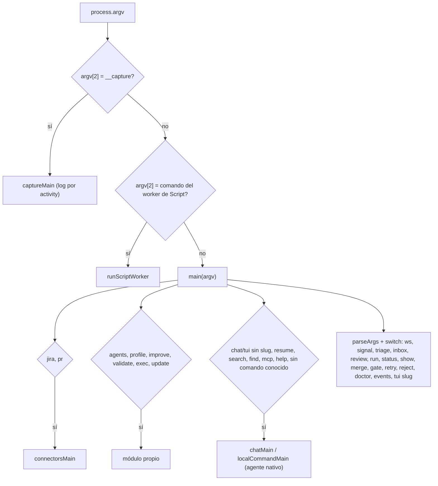
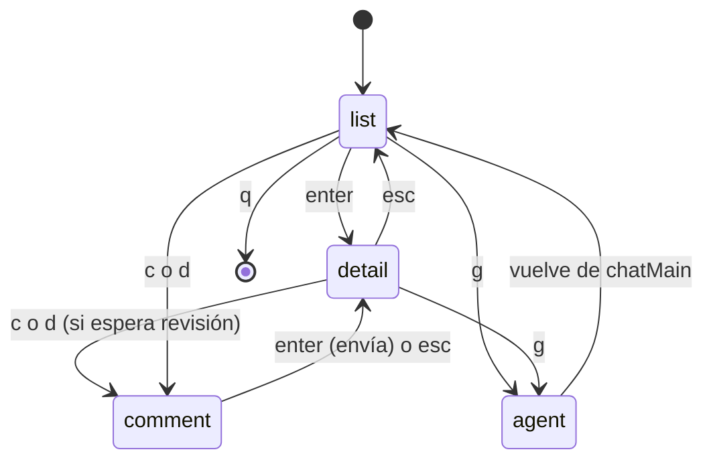
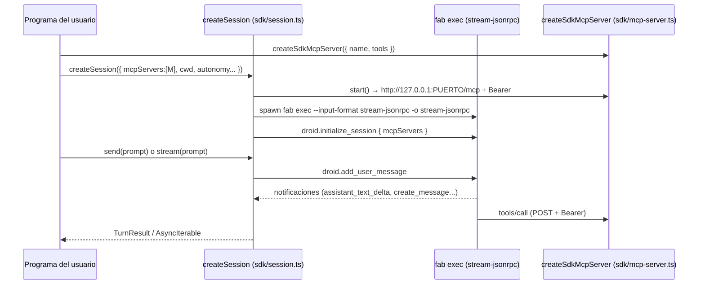

# 10 · Superficies: CLI, TUI y SDK

Las superficies **no contienen reglas de negocio**: parsean la entrada y llaman al `Store` o al pool. Las reglas están en [02](02-modelo-de-datos.md) y [03](03-pool-y-workers.md).

## CLI (`src/cli.ts`)

El ejecutable es `fab` (`package.json` → `bin.fab = ./src/cli.ts`). `STATE_DIR = FABRICA_HOME ?? ~/.fabrica` (`src/cli.ts:34`); `openStore()` crea el directorio y abre `fabrica.db` (`:86-89`).

### Mapa comando → capa

| Comando | Llama a | Línea |
|---|---|---|
| `fab ws create/list/state` | `Store.createWorkstream`, `listWorkstreams`, `setWorkstreamState` | `src/cli.ts:170-200` |
| `fab signal add/list` | `Store.addSignal`, `listSignals` | `:201-211` |
| `fab triage <id>` / `--all <slug>` | `Store.triageSignal` | `:212-221` |
| `fab inbox [slug]` | `Store.inbox` | `:222-237` |
| `fab review <act> approve|comment|decline` | `Store.resolveReview` | `:238-245` |
| `fab run <slug> [--once] [--agent] [--accept-agent-binaries]` | `runPool` | `:246-249` |
| `fab status/show/events` | lecturas del `Store` | `:254-277`, `:333-336` |
| `fab merge <change> [--force]` | `mergeRecoverably` | `:278-283` |
| `fab gate allow` | `protectedIntegrity`, `commitProtectedPaths`, `Store.allowGate` | `:284-308` |
| `fab retry` | `Store.retryChange` | `:309-314` |
| `fab reject` | `closeChange('canceled')`, `waitForRelease`, `removeWorktree` | `:315-323` |
| `fab doctor` | `sandboxReport`, `runScript` de prueba, `openSearch` | `:324-332` |
| `fab agents verify`, `profile`, `improve`, `validate`, `jira`, `pr`, `update` | módulos propios | `:107-125` |

Observaciones:

- Los ids se aceptan por **prefijo único** (`findByPrefix`, `:93-97`).
- Los errores del dominio (`StoreError`) se imprimen como `error (<code>): <mensaje>` y devuelven 1 (`:341-343`).
- Los comandos `daemon`, `plugin` y `computer` están reservados y fallan explícitamente sin invocar a nadie (`:127-130`).
- Un argumento no reconocido cae en el chat interactivo (`:136`), no en un error de "comando desconocido".
- El texto de ayuda (`HELP`, `:36-84`) es la única referencia de flags en el código; incluye flags del agente nativo que no pertenecen a esta sección.

## TUI de la factory (`fab tui <slug>`)

`src/tui.ts` (261 líneas) es un **panel ANSI sin dependencias** que solo lee el store y registra decisiones humanas; el pool corre aparte con `fab run` (`src/tui.ts:1-3`). No confundir con `fab tui` sin slug, que abre el agente interactivo (`src/cli.ts:135`).

- **Estado** (`TuiState`): `selected`, `mode`, `scroll`, `input`, `inputDecision`, `flash` (`:32-47`).
- **Render puro**: `render(store, workstream, state, width, height)` devuelve las líneas; `handleKey` aplica una tecla y devuelve `false` al salir. Esto permite probarlo sin terminal (`:132-133`, `:157-158`; `tests/tui.test.ts`).
- **Filas**: `buildRows` toma cada change con su última activity y la que espera revisión (`:53-58`).
- **Acciones** (escriben vía `Store`): `a` aprobar → `resolveReview(..., 'approve')`; `c` comentar y `d` rechazar abren un campo de texto (rechazar exige motivo); `r` → `retryChange` solo si el change está `failed`, `blocked` o `implemented` (`:196-221`).
- **Refresco**: redibuja cada 2 s y en `resize` (`:240`). Usa pantalla alternativa y modo raw (`:233-234`).
- **`g`** suspende el panel y entra en `chatMain({--cwd repo})` del agente nativo; al volver, redibuja (`:244`, `:259`).

## SDK (`src/sdk/`)

Exportado como `@…/sdk` (`package.json` → `exports["./sdk"] = ./src/sdk/index.ts`). Permite a un programa Bun **conducir `fab exec` por JSON-RPC** sobre stdio y exponer herramientas propias como servidor MCP. Es una API sobre el agente nativo, no sobre la factory; se documenta aquí por estar en `src/sdk/`.

- `tool(name, description, inputSchema, handler)` valida el nombre (`/^[\w.-]{1,128}$/`), descripción y esquema (`src/sdk/tools.ts:3-9`); `validateToolInput` implementa un subconjunto de JSON Schema (object/array/primitivos/enum/`additionalProperties:false`) (`:11-30`).
- `createSdkMcpServer` arranca `Bun.serve` en `127.0.0.1` con puerto efímero y **token Bearer aleatorio de 32 bytes** comparado en tiempo constante; límite de cuerpo 4 MiB, 128 herramientas, esquemas validados (`allowed` keys, profundidad ≤ 16), timeout 60 s por llamada (`src/sdk/mcp-server.ts:7`, `:11-27`, `:35-77`).
- `createSession` lanza `fab exec` como hijo (`bun cli.ts exec …` o `execPath`), habla JSON-RPC por NDJSON, y **responde por defecto "cancelar"** a `request_permission` y `ask_user` (el SDK no tiene interacción) (`src/sdk/session.ts:47-71`). Una sola turn activa a la vez (`:91`). `close()` pide `close_session`, envía `SIGTERM` y luego `SIGKILL` (`:127-135`).
- `resumeSession(id)` usa `load_session` del RPC existente (`:144-155`).
- Tipos públicos en `src/sdk/types.ts` (`Session`, `CreateSessionOptions`, `TurnResult`, …).

Los métodos RPC son los del protocolo del agente nativo (prefijo `droid.`, `factoryApiVersion: '1.0.0'`, `src/sdk/session.ts:32`); su definición está en [fab exec](../exec/index.md).

## Invariantes y modos de fallo

- La CLI cierra el store en `finally` (`src/cli.ts:344-346`); `Store.close()` refresca manifests de changes terminales ([08](08-evidencia.md)).
- La TUI no ejecuta nada: si el pool no corre, aprobar o reintentar encola trabajo pero nada lo consume.
- Una excepción de `handleKey` (p. ej. `StoreError` de una transición inválida) se muestra en la línea de estado (`flash`) en vez de cerrar la TUI (`:222-224`).

## Archivos

| Archivo | Responsabilidad |
|---|---|
| `src/cli.ts` | Enrutador y comandos de la factory. |
| `src/tui.ts` | Panel interactivo de changes/bandeja/eventos. |
| `src/sdk/index.ts` | Exportaciones públicas del SDK. |
| `src/sdk/session.ts` | Cliente JSON-RPC sobre `fab exec`. |
| `src/sdk/mcp-server.ts` | Servidor MCP HTTP local con autenticación Bearer. |
| `src/sdk/tools.ts` | `tool()` y validación de entrada. |
| `src/sdk/types.ts` | Tipos del SDK. |
| `tests/tui.test.ts`, `tests/sdk.test.ts` | Pruebas (existen; contenido no revisado). |
