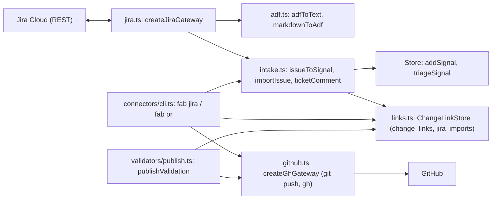
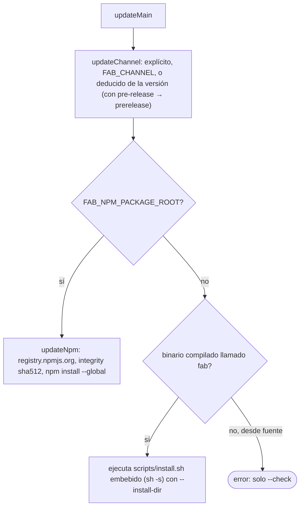

# 11 · Integraciones: conectores, búsqueda y autoactualización

## Conectores SDLC (`src/connectors/`)

Unen la factory con **Jira** (entrada de tickets) y **GitHub** (pull requests). El contrato compartido son interfaces en `src/connectors/types.ts` (`TicketGateway`, `PullRequestGateway`, `ChangeLinks`, `ChangeLinkLookup`, tipos de validación) (`:1-96`).



### Jira

- **Credenciales**: `JIRA_HOSTNAME`, `JIRA_USERNAME`, `JIRA_API_TOKEN` desde el entorno o desde archivos `.env` subiendo por los directorios (o el indicado por `JIRA_ENV_FILE`); solo esas variables más `JIRA_ACCEPTANCE_FIELD` se leen de los `.env`, y el entorno real tiene prioridad (`src/connectors/jira.ts:6-60`). El host debe ser HTTPS sin credenciales ni ruta (`:16-23`). Faltantes ⇒ error nombrando las variables.
- **Clave de ticket**: `PROYECTO-123` (`validateJiraKey`, `:25-27`).
- **Texto**: `adfToText` convierte Atlassian Document Format a texto/Markdown (profundidad ≤ 100) y `markdownToAdf` hace el camino inverso para comentarios (`src/connectors/adf.ts`, sin dependencias).
- **Importar** (`fab jira import <KEY> --ws <slug> [--triage] [--dry-run]`): `importIssue` es **idempotente**: si ya hay change enlazado o una importación previa, la reutiliza; si no, crea la señal (`## Descripción`, criterios de aceptación, subtareas, enlace a la HU) y registra `jira_imports`; con `--triage` crea el change y fija el enlace de origen, todo en una transacción (`src/connectors/intake.ts:7-53`). Una HU no se puede enlazar a dos changes ni reasignar su origen (`src/connectors/links.ts:18-29`).
- **Comentar** (`fab jira comment`): publica estado del change en la HU enlazada (`intake.ts:62-65`, `cli.ts:116-122`).

### GitHub

`createGhGateway` usa los CLIs `git` y `gh` por `argv` (sin shell), con validación de repo (`owner/name`) y de rama antes de cada uso (`src/connectors/github.ts:14-24`):

- `open`: `git push -u origin <rama>`; si ya hay un PR abierto para la rama lo devuelve; si no, `gh pr create --body-file` (el cuerpo va a un archivo temporal `0600`) y valida que la URL devuelta sea `https://github.com/<repo>/pull/N` (`:86-104`).
- `find`: `gh pr view`, tolerando "no PR" y verificando que número, URL y rama coincidan (`:67-85`).
- `comment`: `gh pr comment --body-file` (`:105-109`).
- Los errores no reenvían la salida del comando (puede contener credenciales de remotos) (`:55-56`, `cli.ts:87-93`).
- `repoSlugFromRemote` deduce `owner/name` del remoto `origin` (solo `github.com` por HTTPS/SSH) (`:26-39`).

### `fab pr open`

Exige que el change esté `implemented`, tenga rama y al menos un commit propio frente a la base (`src/connectors/cli.ts:123-132`); resuelve credenciales Jira **antes** de publicar y solo después de persistir el PR comenta la HU (`:142-148`); `--validate` encola todos los validadores (`:149-152`); `--dry-run` imprime los comandos y cuerpos sin ejecutar nada (`:134-141`). Con `fab validate publish` el resumen de validación se comenta en el PR ([06](06-gates-y-validadores.md)).

### Enlaces (`ChangeLinkStore`)

Tablas `change_links` (origen Jira y PR en JSON) y `jira_imports` creadas con `CREATE TABLE IF NOT EXISTS` sobre la misma conexión (`src/connectors/links.ts:8-16`). `get` fusiona ambas fuentes, porque una señal importada puede triarse por la CLI normal fuera del camino de los conectores (`:36-46`).

## Búsqueda (`src/search/`)

`openSearch(root, prefer)` devuelve un `SearchBackend` con `files(query)` y `grep(pattern)`: primero **fff** (`@ff-labs/fff-bun`, MIT, buscador difuso nativo); si no carga, **ripgrep** (`rg`) con `--fixed-strings` y `--` para que un patrón con `-` no inyecte flags (`src/search/index.ts:22-86`). Hoy lo usa `fab doctor` (`src/cli.ts:328`) y los comandos `search`/`find` del agente (otra sección). `grep` limita a 20 coincidencias por archivo en `rg` (`:64`).

## Directorio `src/graft/`

Contiene únicamente `.cache/telemetry-repo-id.json`, ignorado por Git (`.gitignore:13` ignora `graft/`). **No hay código fuente de la factory en este directorio**; es la caché local de la herramienta graft que indexa el repo.

## Autoactualización (`src/update/`)

`fab update [--channel stable|prerelease] [--version V] [--check]` (`src/update/index.ts:16-45`):



- **Canales**: `parseVersion`/`compareVersions` implementan SemVer con pre-release (`src/update/version.ts`); un `latest` de npm con pre-release se rechaza para el canal estable (`npm.ts:59`).
- **Vía binario**: el instalador `scripts/install.sh` se embebe en el binario (`import ... with { type: 'text' }`, `index.ts:5`) y se alimenta por stdin a `sh -s` (`:39-43`). Solo reemplaza un ejecutable llamado `fab` (`:30`).
- **Vía npm** (`npm.ts:37-77`): comprueba que la instalación es global y de `@okuanb/fab`, que el manifiesto de release coincide con la versión y el hash del ejecutable en caché (`~/.cache/fab/<versión>/<sha>/fab-<os>-<arch>`), consulta `registry.npmjs.org` (sin redirecciones, respuesta ≤ 8 MiB), exige tarball HTTPS del mismo host con integridad `sha512`, descarga (≤ 16 MiB), **verifica la integridad** y recién entonces `npm install --global` con configuraciones de npm vacías; después comprueba nombre y versión instalados.
- **Procesos**: `runOwnedCommand` lanza el instalador/npm como grupo propio y lo mata con `SIGTERM`+`SIGKILL` si se aborta (`src/update/process.ts`); timeout total 5 min por defecto (≤ 10 min) y cancelación por señal (`index.ts:31-35`).
- **Rollback**: bajar de versión exige `--version` explícito (`npm.ts:65`).

## Residente en observe: lanzarlo e informar (`fab resident`)

`fab resident --repo O/R --mode observe` (`src/admission/`) hace poll de los issues del repo y registra en las tablas `adm_*` si los admitiría (`would_admit`); no crea changes. Solo admite con la etiqueta `fab` puesta por alguien con rol triage o superior; sin cursor lee el último día (`--since` mueve el inicio).

```bash
# Base aparte: nunca el ~/.fabrica real. Un ciclo (--once) o continuo (cada --interval s).
FABRICA_HOME=~/fab-observe fab resident --repo O/R --mode observe
FABRICA_HOME=~/fab-observe fab resident report          # informe legible; --json para scripts
```

`report` es de solo lectura y no toma el lock: se puede ejecutar con el residente en marcha. Muestra:

- **Fuentes**: cursor y fecha del último poll (si el poll falla, la fecha no avanza).
- **Decisiones**: recuento por `would_admit` y primera razón (`no-trigger-label`, `label-not-verified`, `trigger-label`…).
- **label-not-verified**: issue, quién puso la etiqueta y su rol.
- **Efectos** con `attempts > 1` o en `dead`/`unknown`, con su `last_error`.

Qué mirar:

- **(a) ¿Se verifica bien la etiqueta?** Compara los `label-not-verified` con lo que ves en GitHub: `label-by` debe ser quien la puso y el rol debe ser el real. Los `trigger-label` deben llevar un rol `admin|maintain|write|triage`.
- **(b) ¿Aparece el 403?** Rol `unknown` en `label-not-verified`: el token no tiene acceso push al repo y no puede leer permisos; el gate rechaza (falla cerrado).
- **(c) ¿`labeled` llega tarde?** Efectos `admit` con `attempts > 1` y `last_error` «no se encontró el evento labeled»: el efecto reintenta con espera creciente; si agota 5 intentos queda `dead`.

## Invariantes y modos de fallo

- Ninguna integración usa shell: todo es `argv` + validación previa de entrada externa.
- Los conectores son opt-in; el núcleo de la factory no importa Jira ni GitHub salvo por los tipos de validadores (`src/store.ts:24-30`).
- Si falta `gh` o la autenticación, `open` falla con "No se pudo ejecutar gh" sin detalles.
- El instalador por `sh -s` y el flujo npm ejecutan código descargado; la mitigación es la verificación de integridad/SHA del manifiesto de release ([12](12-build-y-release.md)).

!!! warning "No verificado"
    No leí `src/connectors/jira.ts` más allá de la carga de credenciales (`createJiraGateway` y las llamadas REST) ni el cuerpo de `scripts/install.sh`. Tampoco ejecuté `fab update`.

## Archivos

| Archivo | Responsabilidad |
|---|---|
| `src/connectors/types.ts` | Contratos de conectores y validadores. |
| `src/connectors/cli.ts` | `fab jira` y `fab pr`. |
| `src/connectors/jira.ts` | Credenciales y gateway Jira. |
| `src/connectors/adf.ts` | ADF ↔ texto/Markdown. |
| `src/connectors/intake.ts` | Señal desde HU, importación idempotente, cuerpos de PR/comentarios. |
| `src/connectors/github.ts` | Gateway `git`/`gh` y validación de repo/rama. |
| `src/connectors/links.ts` | Enlaces change ↔ HU/PR. |
| `src/search/index.ts` | Búsqueda fff / ripgrep. |
| `src/update/index.ts`, `npm.ts`, `version.ts`, `process.ts` | Autoactualización. |
| `src/graft/` | Solo caché local ignorada (sin código). |
| `tests/connectors-*.test.ts`, `tests/sdlc-integration.test.ts`, `tests/update.test.ts`, `tests/search.test.ts` | Pruebas (existen; contenido no revisado). |
