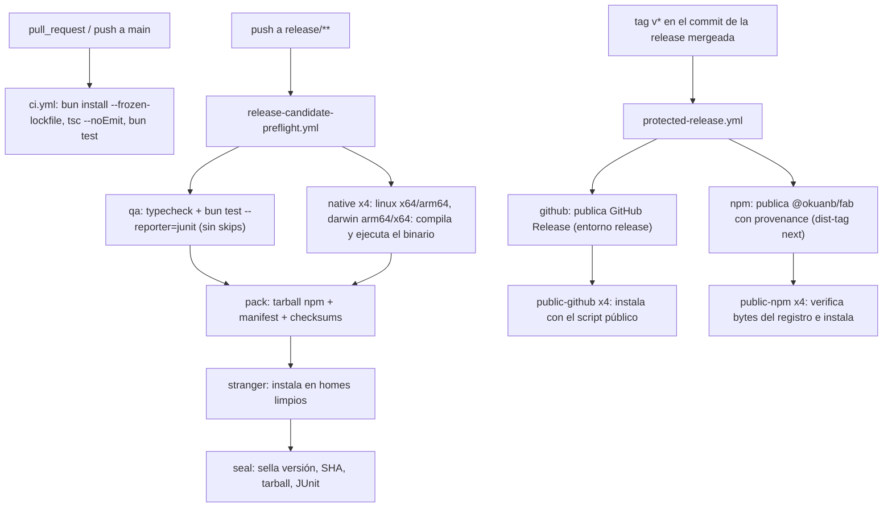

# 12 · Build, tests y release

Página breve: cómo se construye, prueba y publica fab. El detalle operativo vive en `docs/release.md` y `docs/install-update.md`.

## Herramientas

| Elemento | Valor | Fuente |
|---|---|---|
| Runtime | Bun 1.3.14 (CI y tipos `@types/bun@1.3.14`) | `package.json`, `.github/workflows/ci.yml` |
| Lenguaje | TypeScript 5.9.3, `strict` + `noUncheckedIndexedAccess`, `noEmit`, imports `.ts` | `tsconfig.json` |
| Dependencia en ejecución | `@ff-labs/fff-bun` 0.11.0 (búsqueda) | `package.json` |
| Versión actual | `0.1.0-rc.12` (paquete privado `fabrica`; el publicado es `@okuanb/fab`) | `package.json`, `packaging/npm/package.json` |
| Tests | `bun test tests` con `root = "tests"` (las fixtures de `bench/` traen sus propias copias de tests y no deben ejecutarse) | `package.json`, `bunfig.toml` |
| Typecheck | `tsc --noEmit -p .` (incluye `src/**` y `tests/**`) | `package.json`, `tsconfig.json` |

Scripts: `fab` (`bun ./src/cli.ts`), `test`, `typecheck` y `postinstall` → `sh scripts/build-native.sh --if-needed` (que **sale sin hacer nada en Linux**; solo compila en Darwin) (`scripts/build-native.sh:6`).

## Módulo nativo

`scripts/build-native.sh` compila `src/agent/native/posix.c` a `posix.node` (Node-API) con `cc -Wall -Wextra -Werror`, necesita las cabeceras de Node (`include/node/node_api.h`) y solo soporta Linux y macOS; el `.node` está en `.gitignore` (`scripts/build-native.sh`). Pertenece al agente nativo ([fab exec](../exec/index.md)).

## Binarios compilados

`scripts/build.sh` construye un binario autónomo por plataforma: ejecuta `build-native.sh`, luego `bun build --compile --target=bun-<os>-<arch> --no-compile-autoload-dotenv --no-compile-autoload-bunfig src/cli.ts --outfile dist/fab-<os>-<arch>` y escribe el `.sha256` (`scripts/build.sh`). **Cada distribución se compila en su host nativo** (no hay compilación cruzada porque el módulo Node-API lo impide).

Consecuencia en el código: un binario compilado no tiene los `.ts` en disco, por eso `selfCommand` relanza el mismo ejecutable con un subcomando (`__capture`, `exec`, el worker de Script) ([05](05-adaptadores-de-agentes.md)).

## CI y release

- **`ci.yml`** (`FAB CI`): en PRs y en `main`; Ubuntu 24.04, instala `bubblewrap` y `ripgrep` y relaja la restricción de AppArmor sobre user namespaces para que el sandbox funcione; luego `bun install --frozen-lockfile`, `tsc --noEmit` y `bun test` (`.github/workflows/ci.yml`).
- **`release-candidate-preflight.yml`**: se dispara al subir una rama `release/**` o a mano. Jobs: `qa` (JUnit "sin skips ni todos"), `native` (matriz de 4 hosts), `pack` (necesita `qa` y `native`), `stranger` (instalación desde cero) y `seal` (ejecuta `qualify.mjs` y `seal.mjs` y sube el artefacto `fab-sealed-<SHA>`) (`.github/workflows/release-candidate-preflight.yml:12`, `:41`, `:108`, `:137`, `:172`, `:193-196`).
- **`protected-release.yml`**: se dispara con tags `v*`; busca un preflight exitoso del mismo SHA, publica en GitHub (entorno protegido `release`) y npm (`needs: github`), y luego instala desde las URLs públicas en los cuatro hosts (`public-github`, `public-npm`) (`.github/workflows/protected-release.yml`).
- **`pages.yml`**: publica en GitHub Pages un inventario explícito de archivos tomado de `site/` (`.github/workflows/pages.yml:36-50`).

### Scripts de release (`scripts/release/`)

`prepare.mjs` (versión y changelog), `pack.mjs`, `seal.mjs`, `qualify.mjs`, `publish-github.mjs`, `publish-npm.mjs`, `public-install.mjs`, `smoke.mjs`/`smoke-yolo.mjs`, `notes.mjs`/`backfill-notes.mjs`, `find-candidate.mjs`, `probe-update.mjs`, entre otros (listado de `scripts/release/`). El flujo completo y sus garantías están descritos paso a paso en `docs/release.md` (9 pasos: preparar, preflight, binarios nativos, empaquetado, cualificación, sellado, tag, publicación, instalación pública).

### Empaquetado

- **npm** (`packaging/npm/`): paquete `@okuanb/fab` con `bin/fab.mjs`, `runtime.mjs`, `postinstall.mjs` y `release-manifest.json`; Node ≥ 22; linux/darwin × x64/arm64; `provenance: true`. `runtime.mjs` elige el binario por plataforma, **verifica su SHA-256 contra el manifiesto antes de ejecutarlo**, limita descargas al tamaño declarado y a redirecciones HTTPS de GitHub, y reemplaza la caché de forma atómica (`docs/release.md`, sección de `runtime.mjs`; el código no lo leí).
- **Script** `scripts/install.sh`: instalador POSIX (`curl | sh`), canal `stable` por defecto, `~/.local/bin`; requiere `curl`, `python3` y `sha256sum`/`shasum`; no soporta Windows nativo (`scripts/install.sh:1-30`).

### Pruebas de extremo a extremo (no en CI de PR)

`scripts/e2e/` contiene arneses por ola (`ola0-*`, `ola2-*`, `ola3-*`) y `threatmon-fp.ts` para falsos positivos; `bench/` tiene fixtures de tareas. No los revisé; no forman parte de `bun test` (`bunfig.toml`).

## Cobertura de tests por módulo de la factory

`bun test` ejecuta `tests/*.test.ts`. Hay archivos de prueba para `store`, `pool`/leases, `worktrees`, `agents-output`, `agents-verify`, `gates`, `integrity`, `threatmon`, `sandbox`, `egress-probe`, `manifest`, `profile`, `improve`, `provenance`, `validators-*`, `connectors-*`, `tui`, `sdk`, `search`, `update`, `installer`, `release-*`. No auditado el contenido ni la cobertura.

## Invariantes y modos de fallo

- El pipeline de release es **fail-closed**: sin preflight verde del mismo SHA no se publica.
- `bun test` sin skips: el job `qa` falla si hay `skip`/`todo` (según `docs/release.md`).
- Los sandboxes de Linux dependen de `bubblewrap` y de que AppArmor permita user namespaces (`ci.yml` lo configura explícitamente).

!!! warning "No verificado"
    Lo descrito de `protected-release.yml`, `pages.yml`, `pack.mjs`, `seal.mjs` y `runtime.mjs` proviene de los nombres de jobs, de `docs/release.md` y de listados; no leí esos scripts línea a línea.

## Archivos

| Archivo | Responsabilidad |
|---|---|
| `package.json` | Scripts, versión, `bin`, `exports`. |
| `bunfig.toml` | Limita `bun test` a `tests/`. |
| `tsconfig.json` | Opciones de TypeScript. |
| `scripts/build.sh` | Binarios autónomos y checksums. |
| `scripts/build-native.sh` | Módulo Node-API del agente nativo. |
| `scripts/install.sh` | Instalador público. |
| `scripts/release/` | Pipeline de release. |
| `scripts/e2e/` | Arneses de extremo a extremo. |
| `packaging/npm/` | Paquete npm `@okuanb/fab`. |
| `.github/workflows/` | `ci.yml`, `release-candidate-preflight.yml`, `protected-release.yml`, `pages.yml`. |
| `docs/release.md`, `docs/install-update.md` | Documentación operativa existente. |
