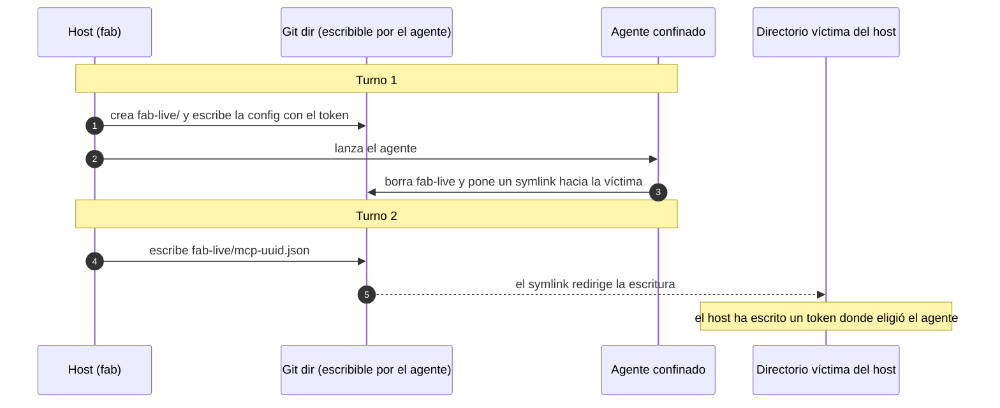
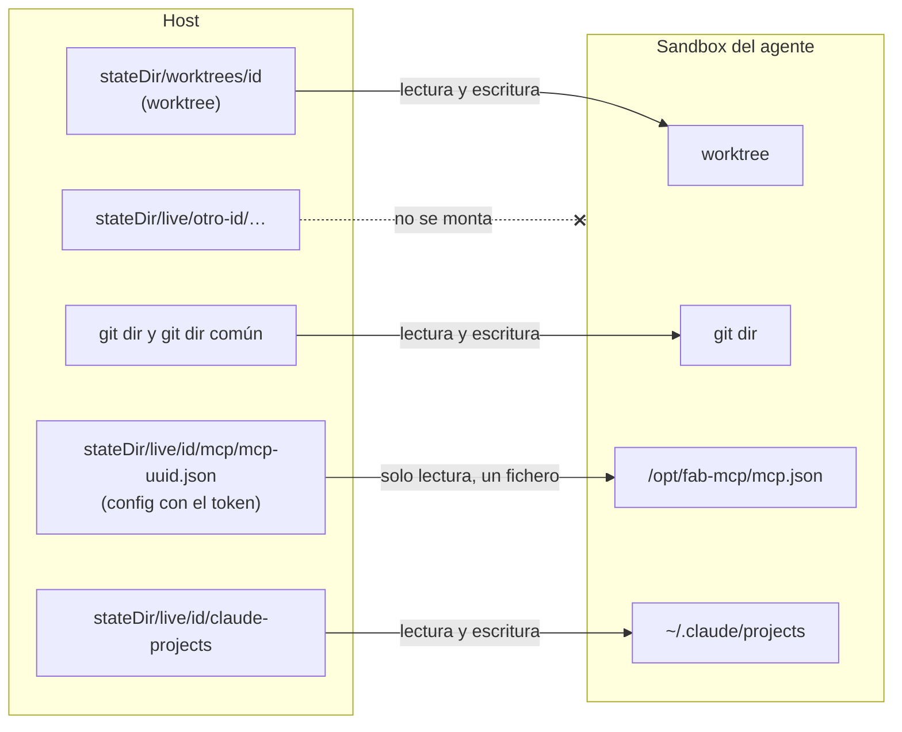
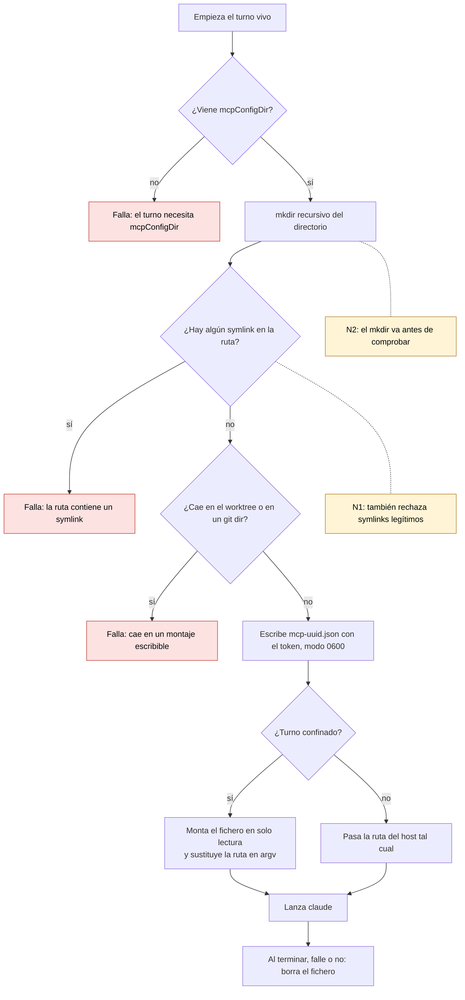
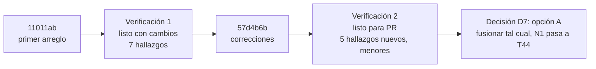
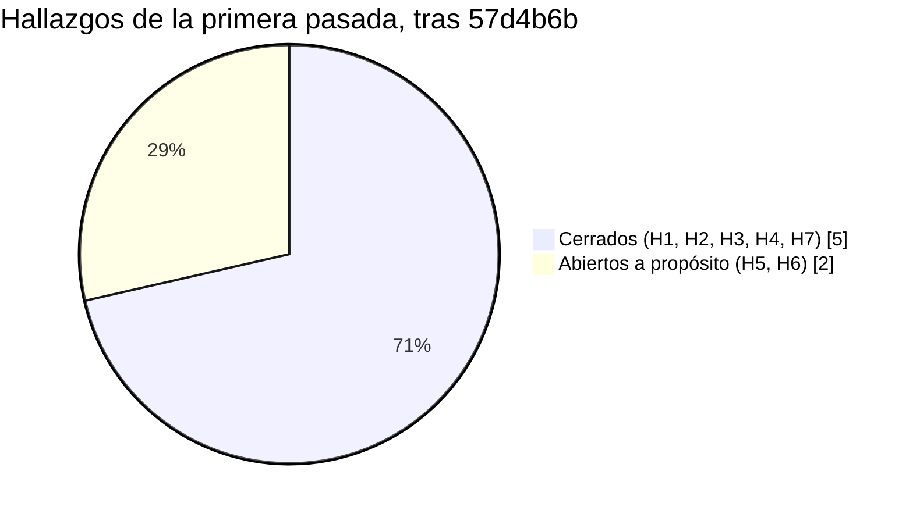
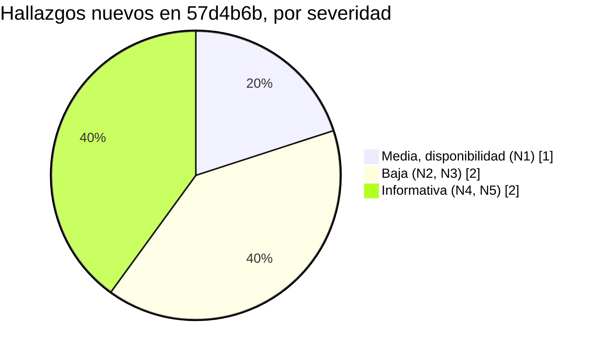
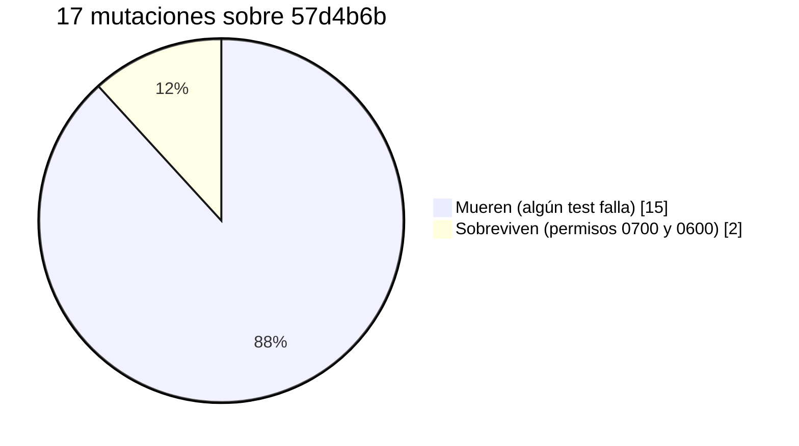
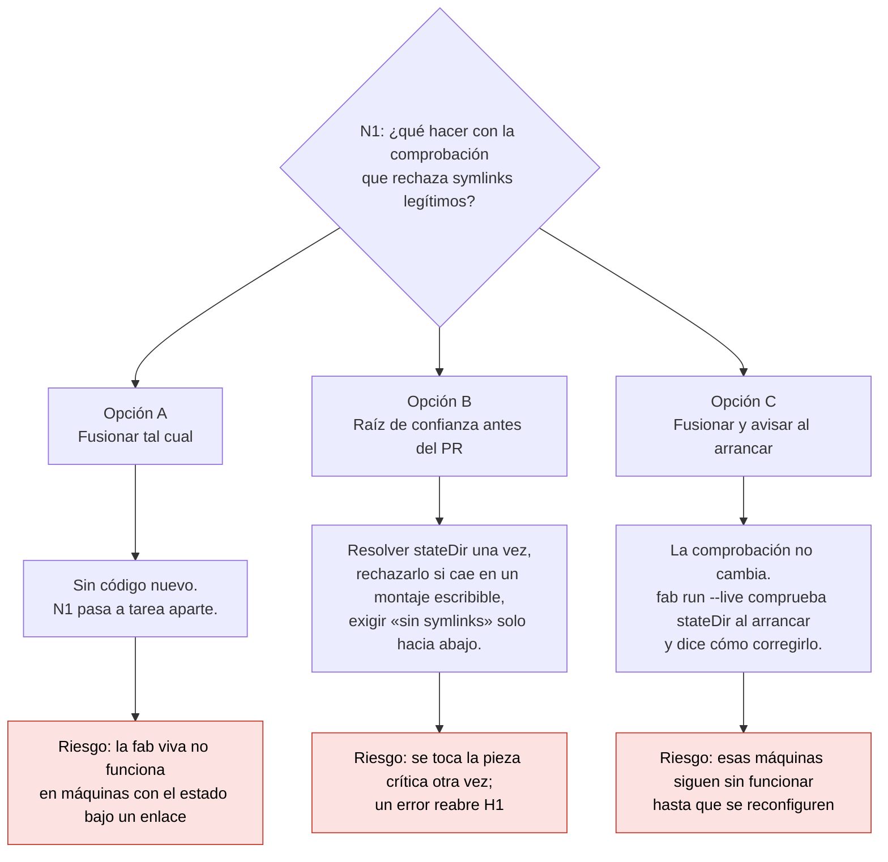
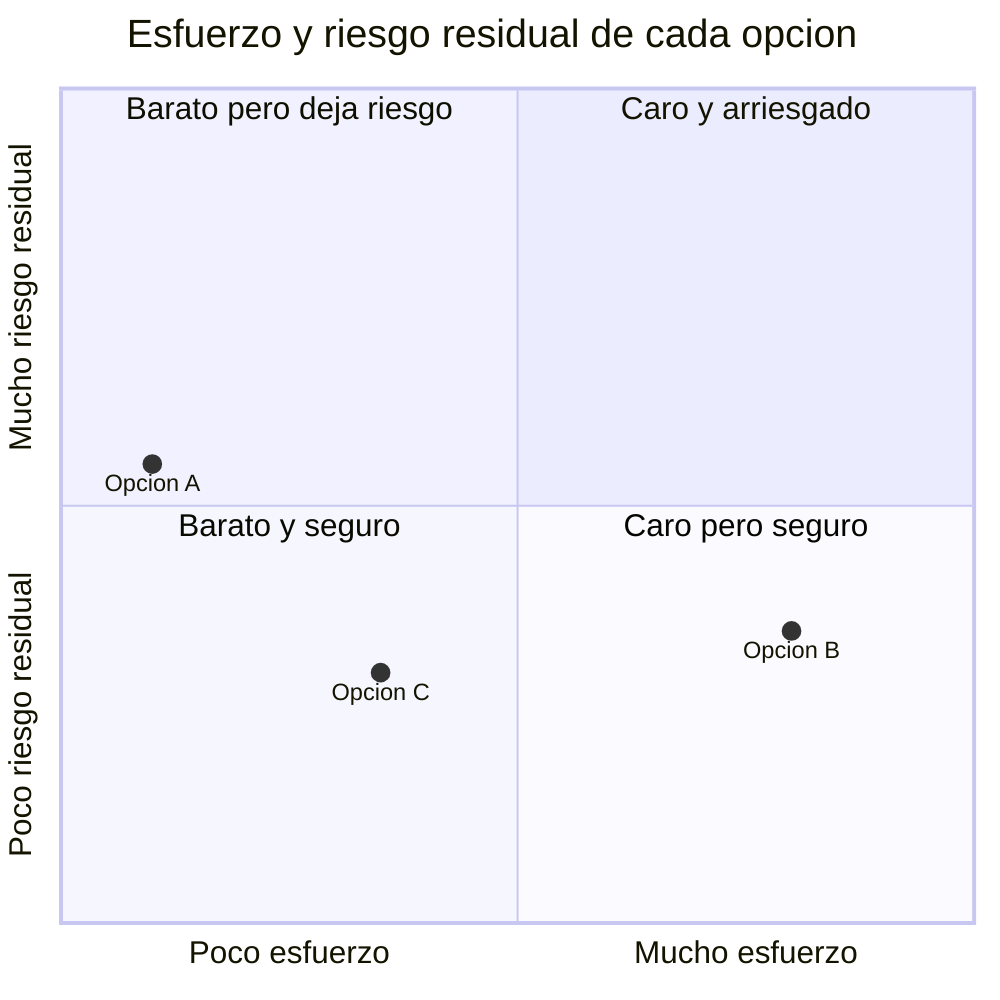

# T41: la config MCP del turno vivo, fuera de lo que el sandbox escribe

Esta página explica qué fallo arregla T41, cómo quedó el arreglo y qué dijo la verificación. Sirve para decidir si la rama entra y qué queda pendiente.

!!! warning "Estado de lo que se describe"
    Rama `fix/t41-fab-live-symlink`, commits `11011ab` y `57d4b6b`, sobre `release/0.1.0-rc.12`. **No está fusionada.** Las citas `archivo:línea` son de `57d4b6b`. El informe completo está en `docs/research/superagent-vs-fab/t41/verif-fable.md`.

## En una frase

El host escribía un token en un directorio que el agente confinado podía cambiar por un enlace simbólico, y así el agente decidía dónde escribía el host. Ahora el token vive en un directorio que el agente no ve, y el turno falla antes de escribir si esa garantía no se cumple.

## Vocabulario mínimo

| Término | Qué es |
|---|---|
| Turno vivo | Una ejecución de `claude -p` dentro de una sesión que se puede reanudar (`fab run --live`). |
| Config MCP | Fichero JSON que le dice a `claude` cómo llamar a la herramienta `report` de la fab. Lleva la URL y el **token** de ese turno. |
| Confinado | El agente corre dentro de bubblewrap y solo ve lo que el host le monta. Obligatorio para el trabajo que entra por canal. |
| `stateDir` | Directorio de estado de la fab, por defecto `~/.fabrica`. Contiene `worktrees/<id>` y `live/<id>`. |
| Git dir | Los metadatos de Git del worktree. El sandbox los monta **en escritura**, porque el agente hace commits. |

## El fallo original

El host escribía la config en `<git-dir>/fab-live/`. Ese directorio está dentro de algo que el agente puede escribir.

El agente no sale del sandbox por sí mismo: convence al host de que escriba por él. Es la misma clase de fallo que T40 (`claude-projects`).

## Qué ve el sandbox después del arreglo

Tres cosas cambian respecto al original:

- La config está en `<stateDir>/live/<id>/mcp`, fuera del worktree y del git dir (`src/pool.ts:300`).
- El agente la ve en una ruta fija, `/opt/fab-mcp/mcp.json`, y en solo lectura (`src/sandbox/confine.ts:90`).
- El `argv` del agente lleva esa ruta fija, no la del host (`src/sandbox/confine.ts:91`).

## Cómo decide el host si escribe

Toda la garantía está en `hostDir` (`src/sandbox/confine.ts:33-39`). Se llama antes de escribir la config (`src/live/claude.ts:53`) y antes de montar `claude-projects` (`src/sandbox/confine.ts:84`).

Los tres finales en rojo son el «falla cerrado»: el agente no llega a lanzarse.

## Cómo se llegó aquí

El primer arreglo cerraba el ataque en la configuración normal, pero su «falla cerrado» no saltaba justo cuando había un symlink plantado (H1). El segundo commit lo cierra.

## Resultado de la verificación

### Los siete hallazgos de la primera pasada

| id | Qué era | Estado |
|---|---|---|
| H1 | Con `stateDir` en el git dir y un symlink plantado, el host escribía el token en la víctima. | Cerrado |
| H2 | Un test no comprobaba el código de salida: sus aserciones no afirmaban nada. | Cerrado |
| H3 | La sustitución en `argv` cambiaba solo la primera aparición y no avisaba si faltaba. | Cerrado |
| H4 | El camino sin confinar seguía usando `fab-live`, atacable desde otro change. | Cerrado: `fab-live` ya no existe |
| H5 | `/opt/fab-mcp` se puede renombrar dentro del sandbox. | Abierto: solo cambia la vista del propio agente |
| H6 | La ruta del host se lee en `/proc/1/cmdline`. | Abierto: es una ruta, no el token |
| H7 | El mismo hueco de H1 en `claude-projects` (T40), montado en escritura. | Cerrado |

### Los cinco hallazgos nuevos

| id | Severidad | Qué pasa | Cuándo se nota |
|---|---|---|---|
| N1 | Media, disponibilidad | `hostDir` rechaza cualquier symlink en toda la ruta. | `stateDir` alcanzado por un enlace legítimo: todos los turnos vivos fallan. Antes funcionaba. |
| N2 | Baja | El `mkdir` va antes de la comprobación. | Con un ancestro cambiado por symlink, queda un directorio vacío en la víctima. El turno falla igual. |
| N3 | Baja | Un turno sin confinar exige que `cwd` sea un repo git, y el error dice `--confine`. | Solo si se llama al backend fuera de un repo; el pool no lo hace. |
| N4 | Informativa | Se comprueba el directorio de la config, no el fichero. | No se alcanza: el fichero lo crea el host con un UUID. |
| N5 | Informativa | Con un adaptador que no es `claude`, `mcpConfig` se ignora sin aviso. | No se alcanza: no hay otro backend vivo. |

Ninguno permite que el agente escriba o lea fuera de lo suyo.

### Qué tan bien cubren los tests

Una mutación rompe a propósito una condición del cambio; si ningún test falla, hay un hueco.

Las dos que sobreviven son los modos de fichero y directorio. Es un hueco de test anterior a T41.

Suite completa en el worktree real: 1411 pasan, 2 se saltan, 0 fallan. `typecheck` limpio.

## La decisión sobre N1

!!! success "Decidido el 2026-11-17: opción A"
    La rama se fusiona tal cual. N1 no bloquea el PR y pasa a la tarea **T44**, junto con N2. Queda anotado como decisión **D7** en `docs/research/superagent-vs-fab/task.json`. Mientras tanto, quien tenga el estado bajo un enlace apunta `FABRICA_HOME` a la ruta real.

Lo que sigue es el análisis con el que se decidió.

**El problema.** `hostDir` rechaza cualquier enlace simbólico en la ruta del directorio de estado. No distingue el que plantó un agente del que puso el dueño de la máquina. Falla cerrado, así que no es un riesgo de seguridad, pero en una máquina con `stateDir` bajo un enlace todos los turnos vivos fallan.

**Dato de esta máquina.** `FABRICA_HOME` no está definido y `~/.fabrica` es una ruta real, sin enlaces: aquí N1 no se dispara.

### Las tres opciones

### Esfuerzo frente a riesgo que queda

La posición de cada opción es una estimación mía, no una medición.

- **A** queda arriba porque el fallo sigue ahí y aparece a mitad de un turno.
- **B** elimina el fallo de disponibilidad, pero añade un riesgo de seguridad hasta que se verifique de nuevo.
- **C** no elimina el fallo: lo convierte en un aviso temprano con instrucciones.

### Riesgos, a favor y en contra

| | Opción A: fusionar tal cual | Opción B: raíz de confianza antes del PR | Opción C: fusionar y avisar al arrancar |
|---|---|---|---|
| **Qué se hace** | Nada más. Se abre una tarea para N1. | Tercer commit en `hostDir` y en el pool. | Se fusiona y se añade una comprobación de `stateDir` al arrancar el pool vivo. |
| **Riesgo de seguridad** | Ninguno nuevo: lo verificado se queda como está. | El más alto de las tres: lógica nueva en la pieza que cierra H1 y H7. | Ninguno nuevo: la comprobación crítica no cambia. |
| **Riesgo de disponibilidad** | El más alto: turnos vivos que fallan en máquinas con enlace, sin aviso previo. | Ninguno si queda bien hecho. | Medio: sigue sin funcionar, pero se sabe al arrancar y cómo arreglarlo. |
| **A favor** | Cierra T41 y T40 ya. Es exactamente el estado verificado (suite, mutaciones y exploits). | Seguro y funciona en todas las máquinas. Se puede arreglar N2 de paso. | Barato. No toca la pieza crítica. El fallo deja de aparecer a mitad de un turno. |
| **En contra** | Deja una regresión conocida. No se sabe cuántas máquinas la sufren. | Retrasa el PR. Exige una tercera verificación completa. | No devuelve la función. Añade código y un test nuevos en el arranque. |
| **Arreglo del usuario afectado** | Apuntar `FABRICA_HOME` a la ruta real. | No hace falta. | El mismo que en A, pero el mensaje se lo dice. |
| **Reversible** | Sí: B o C se pueden hacer después. | Sí, pero con el coste ya pagado. | Sí: B se puede hacer después. |

### Recomendación (la que se tomó)

**Opción A ahora, con B como tarea siguiente (T44).**

- La rama cierra dos huecos de seguridad reales y está verificada tal como está. Cada commit más en `hostDir` obliga a otra pasada completa.
- En esta máquina N1 no se dispara, y quien lo sufra tiene un arreglo de una línea.
- B es la solución de fondo, pero conviene hacerla sin la presión del PR y con su propia verificación.
- C merece la pena solo si hay usuarios con el estado bajo un enlace y B va a tardar.

Lo que haría cambiar la recomendación: saber que alguna máquina de destino tiene `HOME` o `FABRICA_HOME` bajo un enlace. En ese caso, B antes de publicar.

!!! note "Lo que no está comprobado"
    El riesgo de B (reabrir H1) y el comportamiento de C son razonados, no probados: ninguna de las dos está implementada. Tampoco se midió en cuántas máquinas el estado vive bajo un enlace.

## Lo que la verificación no cubre

- No se ejecutó `claude` real ni `b2.ts` tras `57d4b6b`. Todo se probó con un `claude` falso.
- N1 se reprodujo llamando al backend directamente, no con el pool de punta a punta.
- No se ejecutaron `mergeAndCleanup` ni `removeWorktree`; solo se leyeron. Borran `<stateDir>/live/<id>` entero (`src/worktrees.ts:169,191`).
- No se probó en otro kernel, otra versión de bubblewrap ni macOS.
- T34 (el servidor MCP escucha en `127.0.0.1`, alcanzable desde el sandbox) queda fuera.
