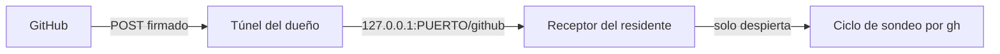

# 15 · T69 · Avisos de GitHub al residente

Con un aviso de GitHub el residente sondea al instante en vez de esperar al intervalo. El aviso **solo despierta**: no trae contenido ni autoridad. El residente vuelve a leer issues, etiquetas y roles por la API de `gh`, igual que sin aviso. Si el aviso no llega, el sondeo periódico sigue funcionando.



## 1. Genera el secreto

```bash
openssl rand -hex 32
```

Guárdalo en tu gestor de secretos. Nunca lo pongas en un fichero del repo, en `argv` ni en un issue. El residente rechaza secretos de menos de 16 caracteres.

## 2. Arranca el residente

El secreto solo se pasa por entorno. No existe una opción `--hook-secret`.

```bash
export FAB_GITHUB_WEBHOOK_SECRET='<tu-secreto>'
bun run fab resident --repo <owner>/<repo> --mode observe --hook-port 8787
```

El receptor escucha **solo en `127.0.0.1`**, solo contesta a `POST /github` y rechaza cuerpos de más de 64 KiB. Sin `--hook-port` no se abre ningún puerto. Con `--mode off` tampoco.

## 3. Abre un túnel

Necesitas algo que publique `127.0.0.1:8787` con HTTPS: Cloudflare Tunnel, ngrok, Tailscale Funnel u otro. El túnel es tuyo y la fab no lo controla:

!!! warning "Expón solo `/github`"
    Configura el túnel para reenviar únicamente la ruta `/github` y únicamente a este puerto. Si apuntas el túnel a otro puerto, por ejemplo el de `fab web`, o publicas más rutas, la fab no puede impedirlo.

## 4. Crea el webhook en GitHub

En el repositorio: **Settings → Webhooks → Add webhook**.

| Campo | Valor |
|---|---|
| Payload URL | `https://<tu-túnel>/github` |
| Content type | `application/json` |
| Secret | el del paso 1 |
| SSL verification | activada |
| Events | *Let me select individual events*: **Issues** e **Issue comments** |

Los demás eventos se ignoran. Un `ping` de GitHub recibe 202 y no despierta.

## 5. Comprueba

- En GitHub, **Recent Deliveries** debe mostrar `202`. Un `401` indica un secreto distinto; un `400`, cabeceras mal formadas.
- `bun run fab resident report` incluye la sección de avisos: recuento por resultado en 24 h (`woke`, `coalesced`, `ignored_event`, `ignored_repo`) y la fecha del último.
- Varios avisos en menos de 5 s se coalescen: solo el primero despierta (como mucho 12 ciclos por minuto).

## Prueba local sin GitHub

`scripts/probar-hook.sh [puerto]` arranca un residente desechable con un secreto generado al vuelo, un `gh` falso y una base temporal. Envía con `curl` una entrega firmada y otra con firma inválida e imprime los códigos esperados:

```text
entrega válida:   202 (esperado 202)
firma inválida:   401 (esperado 401)
```

Necesita `bun`, `openssl` y `curl`. No toca `~/.fabrica` ni la red.

## Rotar el secreto

Cambia el secreto en GitHub y en el entorno, y reinicia el residente. Hasta entonces los avisos reciben 401 y el sondeo periódico cubre el hueco.
