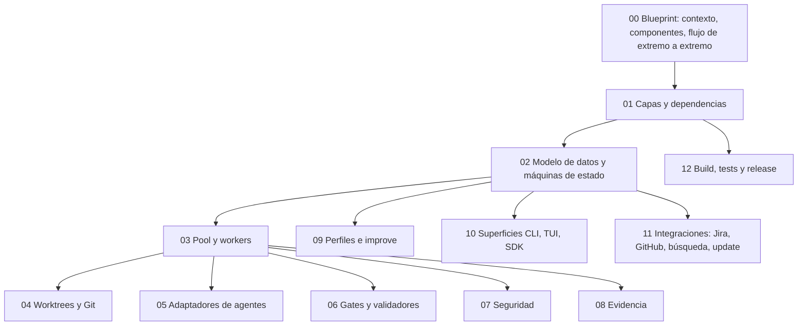

# Factory (`fab ws`, `fab run`, …)

Documentación técnica de la **factory**: el sistema que convierte una *señal* en un *change* revisado, implementado por un agente de código headless, verificado y fusionado. Está pensada para quien mantiene el código; no es una guía de uso.

!!! info "Alcance y frontera"
    Esta sección cubre todo `src/` **excepto** el agente nativo (`src/agent/**`, `src/chat.ts`, `src/chat/**`, `src/script-runtime/**`), que documenta la sección [fab exec](../exec/index.md). Cuando la factory lanza el adaptador `native` (`src/agents.ts:131-140`), la frontera es un subproceso `fab exec ...`; ver [Adaptadores de agentes](05-adaptadores-de-agentes.md).

!!! warning "Línea de código documentada"
    Los números de línea corresponden al árbol de trabajo de la rama `release/0.1.0-rc.12` (HEAD `2bed96f` más cambios sin confirmar en `src/agents.ts`, `src/improve.ts`, `src/pool.ts`). Si el código se mueve, las citas `archivo:línea` pueden desplazarse unas líneas.

## Mapa de lectura (de arriba abajo)

| Página | Qué responde |
|---|---|
| [00 Blueprint](00-blueprint.md) | ¿Qué es la factory, con qué habla y cómo viaja un change de la señal al merge? |
| [01 Capas](01-capas.md) | ¿Qué módulo depende de cuál? ¿Dónde están los límites? |
| [02 Modelo de datos](02-modelo-de-datos.md) | Tablas SQLite, máquinas de estado de change y activity, gates humanos, leases, migraciones. |
| [03 Pool y workers](03-pool-y-workers.md) | Claim, lease, heartbeat y el ciclo completo de una activity. |
| [04 Worktrees y Git](04-worktrees-y-git.md) | Un worktree por change, ramas `fab/<id>`, `baseSha`, merge recuperable. |
| [05 Adaptadores de agentes](05-adaptadores-de-agentes.md) | claude, codex, agy, droid, native, fake; pins sha256; `parse`/`usage`. |
| [06 Gates y validadores](06-gates-y-validadores.md) | `--verify`, setup, validadores y veredictos, puerta de merge. |
| [07 Seguridad](07-seguridad.md) | Sandbox bwrap, threatmon, integridad de rutas protegidas, sonda de egress. |
| [08 Evidencia](08-evidencia.md) | `runs/<id>/run.json`, logs por activity, redacción de secretos. |
| [09 Perfiles e improve](09-perfiles-e-improve.md) | Perfiles inmutables por digest y experimentos pareados; `docs/qualification/` y `third_party/`. |
| [10 Superficies](10-superficies-cli-tui-sdk.md) | CLI, TUI de la factory y SDK. |
| [11 Integraciones](11-integraciones.md) | Conectores Jira/GitHub, búsqueda, autoactualización. |
| [12 Build y release](12-build-y-release.md) | Bun, binarios compilados, CI y publicación. |

## Archivos

| Archivo | Responsabilidad |
|---|---|
| `techdocs/docs/factory/*.md` | Esta sección. |
| `src/` (excepto `src/agent/**`, `src/chat*`, `src/script-runtime/**`) | Código documentado; ver la matriz de cobertura en cada página. |
