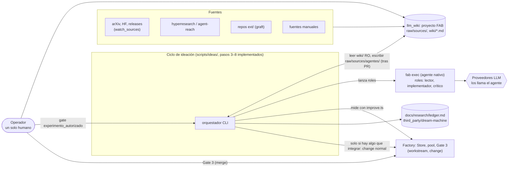
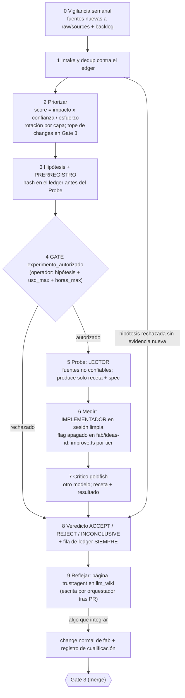
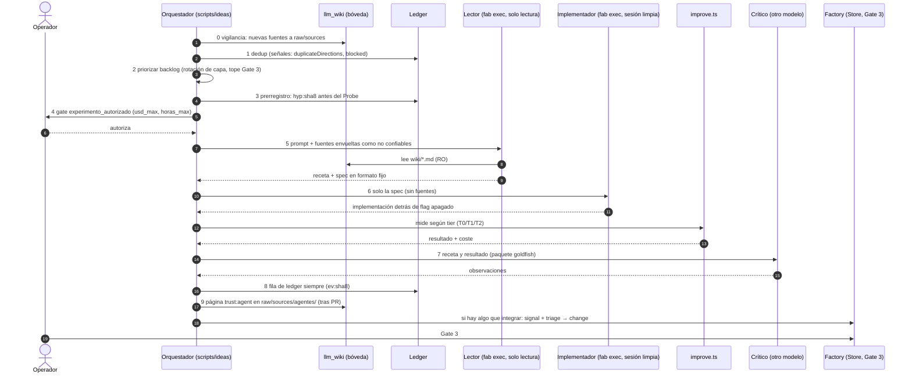

# 00 · Blueprint

Resuelve el **flujo B (ideación)**: ¿qué papers, repos y artículos pueden mejorar fab y cómo se convierte una idea en una mejora con evidencia? (`ARQUITECTURA.md` §1). La decisión principal es un **harness propio pero delgado**: un orquestador CLI **fuera de la máquina de estados de fab** que compone piezas existentes y adopta, con pin, piezas MIT de las referencias (ADR-0001, `docs/research/arquitectura-ideacion/adr/ADR-0001-componer-no-construir.md`).

!!! info "Propuesto e implementado (v0.2)"
    El orquestador **sí existe** en `scripts/ideas/`: `ciclo.ts` (783 líneas) implementa los pasos 3–8 (prerregistro, gate, probe, medir, crítico goldfish y veredicto con ledger). Los pasos 0–2 (vigilancia semanal y backlog) siguen como **propuesta** (ADR-0003), excluidos del ciclo mínimo. El paso 9 (reflejar en la bóveda tras revisión/PR) está implementado en `scripts/ideas/reflejar.ts` en la rama `feat/t7-paso9` (sin mergear). Lo que ya está en el repo se marca como *Implementado* en la tabla de componentes y en [02](02-integracion-factory.md).

## 1. Contexto del sistema

El requisito del operador es tomar papers, repos, artículos, PDF, imágenes y videos y **proponer mejoras orientadas a fab**, reutilizando llm_wiki, graft y la memoria analizada (`ARQUITECTURA.md` §1).

## 2. Componentes y estado

| Capa | Componente | Estado | Referencia |
|---|---|---|---|
| Ingesta | llm_wiki, proyecto **FAB** (decisión D2: antes llamado fab-research; ruta configurable; MinerU, caption de imágenes, grafo, UI) | Externo y existente (`~/Desktop/llm_wiki_v2`) | [03](03-boveda-llm-wiki.md) |
| Lectura de agentes | `wiki/*.md` montado solo-lectura, buscado con `rg`, envuelto como no confiable | **Parcial / en rama sin mergear** (`ciclo.ts:264,300-305`; `graft-lector.ts` lee repos; montaje `--ro-bind` en curso en rama `feat/t6-lector-boveda`) | ADR-0002, [11](11-fuentes-no-confiables.md) |
| Escritura en la bóveda | `raw/sources/agentes/` con `trust: agent`: solo el orquestador escribe tras revisión humana/PR (D1) | **En rama sin mergear** (`feat/t7-paso9`, `reflejar.ts` @`686efe4`) | ADR-0002, [03](03-boveda-llm-wiki.md), [09](09-flujo-de-conocimiento.md) |
| Vigilancia | `watch_sources` + barrido semanal | **Propuesto** (`registry.json` no tiene `watch_sources`: claves `schema_version`, `note`, `repos`) | ADR-0003 |
| Backlog | `docs/research/backlog.json` | **Propuesto** (el archivo no existe) | ADR-0003 |
| Pasos 3–8 del ciclo | Hipótesis/prerregistro, gate, probe, medir con `improve.ts`, crítico goldfish, veredicto + ledger | **Implementado** (`scripts/ideas/ciclo.ts`: init `:198-235`, gate `:236-247`, probe `:248-328`, medir `:351-628`, crítico `:629-680`, cerrar `:681-748`) | [01](01-ciclo-y-ledger.md) |
| Ledger | 10 columnas, `verifyLedger`, señales | **Implementado** (`third_party/dream-machine/ledger/index.ts`; `ciclo.ts:71-80` escribe en `docs/research/ledger.md`) | [01](01-ciclo-y-ledger.md) |
| Medición | `improve.ts`, coste por brazo, tiers T0/T1/T2 | **Implementado** fase 1 en fab y evaluado en `ciclo.ts:351-628` | [02](02-integracion-factory.md) |
| Integración | pin, registro de cualificación, lint | **Implementado** | [02](02-integracion-factory.md) |
| Roles con `fab exec` | lector, implementador, crítico | **Parcial** (briefs y runners en `ciclo.ts`; lector confinado con `--ro-bind` de bóveda en rama `feat/t6-lector-boveda`) | [10](10-integracion-exec.md) |
| Probe de paper con código | Paper2Agent, manual, VM desechable | Manual, fuera del flujo | ADR-0006 |
| Cadencia | timer de `systemd --user` (no hay `fab daemon`: `src/cli.ts:127`) | **Propuesto** | ADR-0003 |

!!! success "Implementado"
    Que `fab daemon` no existe se verifica en `src/cli.ts:127-130`: los comandos `daemon`, `plugin` y `computer` imprimen "falta un backend propio" y devuelven 1.

## 3. Ciclo 0–9

Cabecera canónica de `design-loops-investigacion.md` §2, con **`usd_max` y `horas_max` obligatorios**: sin ellos el ciclo no arranca (`ARQUITECTURA.md` §5).

El paso 4 sólo aparece una vez por ciclo y cuesta "una línea en el inbox" (`ARQUITECTURA.md` §5). Si en el paso 3 falta cualquier requisito (limitación con receipt, mecanismo causal, predicción numérica, métrica) el ciclo termina en `INCONCLUSIVE(hipótesis incompleta)` sin gastar más. Los pasos 3–8 están implementados en `scripts/ideas/ciclo.ts` (init, gate, probe, medir, crítico goldfish y cerrar). El paso 9 (reflejar) está implementado en `scripts/ideas/reflejar.ts` (en rama `feat/t7-paso9`, sin mergear), y exige aprobación/PR humana previa (decisión D1).

### Secuencia

## 4. Dónde encaja respecto a la factory y a fab exec

| Con quién | Relación | Estado |
|---|---|---|
| **Factory** ([Factory](../factory/00-blueprint.md)) | Está **fuera** de `Store`: triagear una señal crea siempre un change (`src/store.ts:449-465`) y los tipos de activity son de ingeniería (`src/enums.ts:32-37`). Solo al final abre un change normal; antes usa `improve.ts` como instrumento de medida. | Propuesto; ver [02](02-integracion-factory.md) |
| **fab exec** ([fab exec](../exec/index.md)) | Ejecuta los tres roles (lector, implementador, crítico) como subprocesos. Es el mismo binario que la factory lanza con el adaptador `native` (`src/agents.ts:131-140`). | Propuesto; ver [10](10-integracion-exec.md) |
| **llm_wiki** | Bóveda única: ingiere y es la UI del operador; los agentes leen sus archivos. | Propuesto; ver [03](03-boveda-llm-wiki.md) |

!!! warning "Prerrequisito pendiente"
    Hasta que exista un runner que compare **dos builds de fab**, el ciclo solo puede medir ideas de **perfil, prompt o skill**; las ideas de motor quedan en `INCONCLUSIVE(sin runner)` (`ARQUITECTURA.md` §6, ADR-0004). `improve.ts` compara perfiles (`runArm` recibe un `digest` de perfil, `src/improve.ts:132`).

!!! warning "Prerrequisito pendiente: rol de lector"
    El lector debe correr con `native` o `codex`: con `claude`, `agy` y `droid` el solo-lectura de una `investigation` es solo de prompt (`src/agents.ts:83-85`, `:139`).

## Límites declarados

- **Autor = revisor**: con un solo operador, el crítico goldfish y la aprobación ligada al hash mitigan, no resuelven (`ARQUITECTURA.md` §10).
- **Coste de T2**: ≈ 600 corridas por cualificación (900 en modo adaptativo); no se sabe si es asumible hasta medir el coste medio por corrida (`ARQUITECTURA.md` §10).
- **Calidad de MinerU y del caption de imágenes**: sin verificar.

## Archivos

| Archivo | Responsabilidad |
|---|---|
| `docs/research/arquitectura-ideacion/ARQUITECTURA.md` | Diseño v0.2 (§1-§10). |
| `docs/research/arquitectura-ideacion/adr/` | Decisiones 0001–0007. |
| `third_party/dream-machine/ledger/index.ts` | Ledger (implementado). |
| `src/improve.ts` | Medidor (implementado, fase 1). |
| `src/cli.ts` | Prueba de que no hay `fab daemon` (`:127`). |
| `scripts/ideas/` | **Implementado** (pasos 3–8 en `ciclo.ts:783`; `graft-lector.ts`, `lector-fab.ts`; paso 9 `reflejar.ts` en rama `feat/t7-paso9`, sin mergear). |
