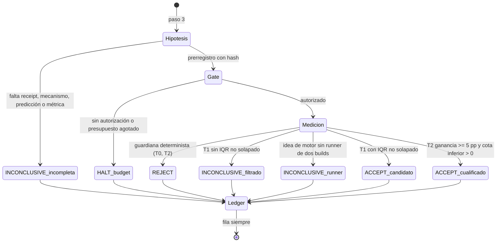

# 01 · Ciclo y ledger

Esta página baja el ciclo 0–9 del [blueprint](00-blueprint.md) a sus reglas y describe el único artefacto del ciclo que **ya está implementado**: el ledger.

!!! info "Propuesto (v0.2)"
    Vigilancia, backlog, prerregistro, gate de gasto, crítico, veredictos con tier y árbol de experimentos son diseño (ADR-0003, ADR-0004, `ARQUITECTURA.md` §5-§6). No hay código en `scripts/ideas/` (no existe).

## Reglas por paso

| Paso | Regla | Origen |
|---|---|---|
| 0 Vigilancia | Semanal, independiente del ciclo. Cada fuente nueva entra a `raw/sources/` con url, fecha y hash, más una entrada de backlog con capa sugerida. Tope `fuentes_max`. Orígenes: feeds arXiv por categoría, HF daily papers, releases de repos con `watch: true` | ADR-0003 |
| 1 Intake | Deduplicación determinista contra el ledger: dirección repetida ≥ 3 veces → rotar; hipótesis rechazada sin evidencia nueva → descartar | ARQ §5 |
| 2 Priorizar | Primer candidato del backlog por `score = impacto × confianza / esfuerzo`; no dos ciclos seguidos en la misma capa sin evidencia nueva. **Con ≥ N changes `ideas` esperando Gate 3 (N inicial = 3) no se abre change nuevo**: solo se registra | ADR-0003 |
| 3 Hipótesis + prerregistro | Exige (i) limitación de fab con *receipt* (métrica, valor, `fab_sha`, comando que la reproduce), (ii) mecanismo causal, (iii) predicción numérica, (iv) métrica primaria y guardianas de la tabla C0–C9. El hash va al ledger **antes** del Probe; cambiarla = ciclo nuevo | ADR-0003 |
| 4 Gate `experimento_autorizado` | El operador aprueba hipótesis y presupuesto (`usd_max`, `horas_max` obligatorios) | ADR-0003 |
| 5 Probe | El lector produce solo receta y spec | ADR-0007 |
| 6 Medir | El implementador en sesión limpia; `improve.ts` mide según el tier | ADR-0004 |
| 7 Crítico | Otro modelo, paquete goldfish; verifica también que la spec no contenga instrucciones ajenas al objetivo | ADR-0003, ADR-0007 |
| 8 Veredicto | `ACCEPT-candidato`, `ACCEPT-cualificado`, `REJECT`, `INCONCLUSIVE(razón)` + fila de ledger **siempre**, también con `HALT: budget` | ADR-0003/0004 |
| 9 Reflejar | Página `trust: agent` en `raw/sources/agentes/`; actualizar `registry.json` y backlog | ARQ §5 |

Las capas C0–C9 y su métrica primaria están en `docs/research/design-loops-investigacion.md` §1 (por ejemplo C2 Orquestación → entregas correctas por hora; C6 Validación → sensibilidad y precisión; C5 → escapes exitosos = 0).

!!! warning "Prerrequisito pendiente"
    El backlog (`docs/research/backlog.json`) no existe y `docs/research/registry.json` no tiene `watch_sources` (sus claves son `schema_version`, `note`, `repos`; cada repo trae un campo `watch`). Además, dream-machine, OpenResearch, Paper2Agent, deer-flow y harness2 no figuran aún en el registro (`registry.json` lista droid-factory, esf, warp, opencode, pi, elephant-goldfish-model, agent-reach, hyperresearch); es el "Loop B mínimo" pendiente de `REVISION.md`.

## Veredictos

Cuándo emite cada tier y la regla estadística están en [02](02-integracion-factory.md).

## Ledger

!!! success "Implementado"
    El código del ledger es el de dream-machine, copiado tal cual y fijado por pin (`third_party/dream-machine/UPSTREAM.json`, `use_rule: vendored`); `index.ts` no está parcheado y su sha256 lo comprueba el lint. Los 57 tests upstream corren en Bun (`tests/third-party-ledger.test.ts`; registro `docs/qualification/dream-machine-ledger-2026-10-31.md`). `docs/research/ledger.md` existe, pero **no tiene filas**: solo la cabecera.

### Esquema de 10 columnas

`LEDGER_COLUMNS` (`third_party/dream-machine/ledger/index.ts:17-28`): `Date`, `Deep`, `Finding`, `Issue`, `PR`, `Evaluated?`, `Verdict`, `Effect`, `Witness`, `Prior-night fates`. Una fila es un `LedgerRow` (`:33-44`). `verifyLedger` exige exactamente 10 columnas, por eso **no se permiten columnas extra** (ADR-0003).

### Convenciones de fab sobre las columnas (`docs/research/ledger.md`)

| Columna | Convención de fab |
|---|---|
| `Date` | `YYYY-MM-DD` y fecha de calendario real (`isValidCalendarDate`, `index.ts:182-187`) |
| `Deep` | Capa `C0`–`C9` |
| `Issue`, `PR` | Id del change de fab (`chg_…`) o `NONE` |
| `Evaluated?` | `yes`, `no` o `blocked` (`EVALS`, `:164`) |
| `Verdict` | `ACCEPT`, `REJECT` o `INCONCLUSIVE` (`VERDICTS`, `:163`) |
| `Effect` | El **tier** va al inicio: `T1 candidato: …`, `T2 cualificado: …`, o la razón del `INCONCLUSIVE` |
| `Witness` | `hyp:<sha8> ev:<sha8>`: hash de la hipótesis prerregistrada (antes del Probe) y de la evidencia |

Restricción de formato: **fuera de la tabla no uses el carácter barra vertical**, porque el parser upstream cuenta como fila toda línea que lo contenga (`docs/research/ledger.md`).

!!! note "Verdict y tiers"
    El esquema solo admite tres veredictos (`ACCEPT|REJECT|INCONCLUSIVE`). La distinción `candidato`/`cualificado` no es una columna: viaja en el prefijo de `Effect`. Es una convención de fab, no una garantía del parser.

### `verifyLedger` y el lint

`verifyLedger(markdown, opts)` (`index.ts:232-267`) comprueba: cabecera `Date` presente, columnas bien formadas (`row N: malformed — wrong column count`), `Verdict` y `Evaluated?` dentro de rango y fecha de calendario válida. `opts.sinceRow` permite exigir solo las filas nuevas y `legacyPrefixDigest` ancla ese límite al contenido (`:189-229`); si el digest no coincide, verifica todas las filas. En fab, `tests/provenance.test.ts:60-63` ejecuta `verifyLedger` sobre `docs/research/ledger.md` y exige `errors` vacío; ese es el mecanismo que impide que el ledger se degrade.

!!! success "Implementado"
    `tests/provenance.test.ts:60-63`; con el ledger vacío el test pasa porque no hay filas que violen el esquema.

### Señales de aprendizaje (código listo, sin datos)

`learningSignals(rows, opts)` (`index.ts:372`) es código determinista (no re-derivación por LLM). Devuelve `LearningSignals` (`:273-319`):

| Señal | Significado | Uso en el ciclo |
|---|---|---|
| `zeroMergeStreak` | Ningún PR candidato fusionado en la ventana (`window` por defecto 14, `:373`) | Preferir candidatos pequeños |
| `duplicateDirections` | Texto de `Finding` visto en ≥ 3 filas previas | Rotar (paso 1) |
| `lowScoreStreak` | ≥ 3 puntuaciones consecutivas < 5 | Reducir a una superficie |
| `blockedEvalStreak` | Racha larga de `Evaluated? = blocked` | Candidatos sin llamadas a modelo |
| `ledgerStale`, `daysSinceLastRow` | El ledger local lleva días sin filas: las demás señales no son fiables | Desconfiar de las señales |
| `reviewBacklogSize` | PRs abiertos y sin revisar (lo aporta el llamador) | Alimenta el tope de Gate 3 |

Otras utilidades del mismo archivo: `parseLedger` (`:119`), `renderRow`/`appendRow` (`:150`, `:158`), `outcomeMetrics` (`:521`) e `implementationBacklog` (`:575`).

!!! warning "Prerrequisito pendiente"
    Las señales no se han calculado sobre un ledger real de fab: no hay filas. El registro de cualificación lo anota en "No medido" y deja como gates pendientes el primer ciclo real y la decisión de si `scripts/ideas/` usará `appendRow` del upstream o escribirá la fila a mano (`docs/qualification/dream-machine-ledger-2026-10-31.md`). El motivo del tope de Gate 3 es el ledger real de dream-machine: "0/30 merged", borradores sin revisar (ADR-0003).

## Árbol de experimentos

!!! info "Propuesto (v0.2)"
    Cada medición es un **nodo** (código + comando + entorno + resultado) que **no se edita una vez respondido**; reparar o ramificar crea un nodo nuevo. Es la regla de nodo congelado de OpenResearch, adoptada como esquema (ADR-0003). En fab no hay hoy estructura equivalente: `improve.ts` guarda `experiment_runs` (una fila por brazo y repetición) y los ids de experimento no se reutilizan (`src/improve.ts:21-31`, `:55-75`); eso garantiza inmutabilidad del *id*, no un árbol.

## Invariantes propuestas

1. Fila de ledger siempre, incluso sin resultado.
2. El hash de la hipótesis precede al Probe; cambiarla = ciclo nuevo.
3. Sin `usd_max` y `horas_max` no hay ciclo.
4. Un nodo respondido no se edita.

## Archivos

| Archivo | Responsabilidad |
|---|---|
| `third_party/dream-machine/ledger/index.ts` | `LEDGER_COLUMNS`, `parseLedger`, `verifyLedger`, `learningSignals`, `outcomeMetrics`, `implementationBacklog` (implementado, vendorizado). |
| `third_party/dream-machine/UPSTREAM.json` | Pin: commit, licencia, `vendored[]` con sha256, `local_patches`. |
| `docs/research/ledger.md` | Ledger de fab (sin filas) y convenciones de columnas. |
| `tests/provenance.test.ts`, `tests/third-party-ledger.test.ts` | Lint y tests del ledger. |
| `docs/qualification/dream-machine-ledger-2026-10-31.md` | Registro de cualificación (candidato). |
| `docs/research/arquitectura-ideacion/adr/ADR-0003-ciclo-una-hipotesis.md` | Decisión del ciclo. |
