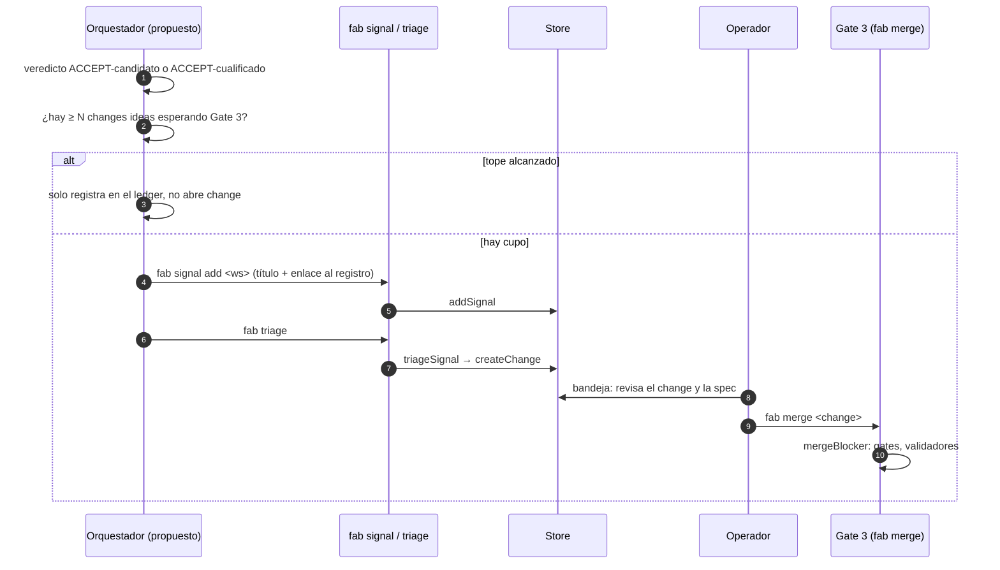
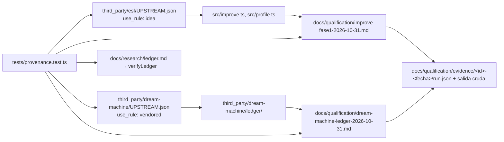

# 02 · Integración con la factory

Cómo se relaciona el ciclo de ideación con la factory: por qué queda **fuera de `Store`**, cómo abre un change al final, cómo `improve.ts` actúa de medidor, qué decide cada tier y cómo se registran pin, cualificación y coste.

## Por qué el ciclo vive fuera de `Store`

!!! success "Implementado (las razones se verifican en el código)"
    - **Triagear siempre crea un change.** `triageSignal` exige una señal `new`, llama a `createChange` y la marca `triaged` en la misma transacción (`src/store.ts:449-465`). No existe una señal "exploratoria" que no cree change.
    - **Los tipos de activity son de ingeniería**: `change_review`, `investigation`, `implementation`, `steward` (`src/enums.ts:32-37`), más `gates` local al store (`src/store.ts:36`).
    - **Una `investigation` completada encola una `implementation`**: con `requireApproval` espera revisión y, tras aprobarla, `REVIEW_FOLLOW_UP` encola `implementation` (`src/store.ts:847-855`, `src/enums.ts:73-76`). La exploración no tiene "terminar sin implementar".
    - El límite de changes abiertos (`taskLimit`, 20 por defecto) también contaría los experimentos (`src/store.ts:480-488`, `:381`).

Meter la exploración dentro de la factory llenaría la base de changes de papers descartados (ADR-0001, alternativa "workstream dentro de Store", rechazada). Detalle del modelo en [Factory · modelo de datos](../factory/02-modelo-de-datos.md).

## Apertura del change en Gate 3

!!! info "Propuesto (v0.2)"
    Cuando un ciclo termina con algo que integrar, el orquestador abre un **change normal** en un workstream de fab (rama `fab/ideas-<id>` para el implementador, `ARQUITECTURA.md` §5 paso 6) con el registro de cualificación. Ningún código de `scripts/ideas/` existe aún; el camino reutiliza los comandos existentes.

- La entrada y las puertas son las existentes: `addSignal` (`src/store.ts:428`), `triageSignal` (`:449`), revisión humana (`:944`) y la puerta de merge `mergeBlocker` (`src/validators/publish.ts:29-38`). Ver [Factory · gates y validadores](../factory/06-gates-y-validadores.md) y [Factory · worktrees y Git](../factory/04-worktrees-y-git.md).
- Nomenclatura: el README numera como "Punto de Control 3" el **merge**; `ARQUITECTURA.md` usa "Gate 3" para la revisión humana final del change de integración. Aquí "Gate 3" = `fab merge` con validadores pasando.
- El **tope** (N = 3) lo aplica el orquestador, no la factory: `Store` no cuenta changes "ideas" (`src/store.ts:486` solo aplica `taskLimit`).

!!! warning "Prerrequisito pendiente"
    Falta decidir cómo marca el orquestador sus changes (workstream dedicado o prefijo) para contar los que esperan Gate 3. No está definido en ningún ADR.

## `improve.ts` como medidor

!!! success "Implementado: fase 1"
    `improve.ts` compara dos **perfiles de instrucciones** con corridas pareadas sobre una suite congelada (`src/improve.ts:1-2`). Detalle en [Factory · perfiles e improve](../factory/09-perfiles-e-improve.md). Lo relevante para el ciclo:

    - Suite con `split ∈ {development, validation, qualification}` (`:13`), `SuiteTask = { id, repo, base, description, verify, split }` (`:15`).
    - Brazos `baseline`/`candidate` en orden aleatorio con semilla registrada (`:93-102`, `:172-199`); cada brazo es un clon desechable con store propio (`:132-168`).
    - Ids de experimento no reutilizables (`:55-75`); informe con medias y varianza muestral (`:205-227`).
    - Pide un `digest` de **perfil** por brazo (`runArm(…, digest, agent, …)`, `:132`): no compara builds de fab.

!!! warning "Prerrequisito pendiente: runner de dos builds"
    Hoy solo se pueden medir ideas de **perfil, prompt o skill**. Una idea de motor (por ejemplo del router o de las herramientas) no tiene cómo medirse y queda `INCONCLUSIVE(sin runner)` (ARQ §6, ADR-0004). El nombre "development/validation/qualification" de los *splits* no equivale a los tiers T0/T1/T2.

## Tiers T0 / T1 / T2: evaluar no es promover

!!! info "Propuesto (v0.2)"
    ADR-0004. Ningún tier está implementado como tal en `improve.ts`.

| Tier | Contenido | Regla | Puede emitir |
|---|---|---|---|
| **T0** humo | 5 tareas × 1, agente `fake` o barato | ¿rompe algo? | `REJECT` solo por guardiana determinista (integridad, escape de sandbox, licencia) |
| **T1** filtro | `bench/ola3` + casos nuevos; ≥ 10 corridas pareadas, IQR | Mejora con IQR no solapado | `INCONCLUSIVE(filtrado)` o `ACCEPT-candidato`; **no emite `REJECT`** salvo guardiana |
| **T2** cualificación | ≥ 100 tareas intactas, ≥ 10 clusters, × 3, bootstrap de ESF | Ganancia ≥ 5 pp y cota inferior del IC bilateral del 95 % > 0 | `ACCEPT-cualificado` o `REJECT` |

Dos clases de integración, para no paralizar el sistema mientras no existe T2:

- **`ACCEPT-candidato`** (T1): se integra con **flag apagado por defecto**, estado `candidato` en el registro y gates pendientes escritos. Es lo que hizo ESF con Harness2 ("implemented candidate; production adaptation disabled and unqualified").
- **`ACCEPT-cualificado`** (T2): única vía para **activar por defecto** o cambiar el comportamiento por omisión.

!!! warning "Prerrequisito pendiente: T1 y T2 no existen todavía"
    `bench/ola3` tiene 20 casos (`bench/ola3/cases.json`; README: 10 son de `toy-calc`) en 2 clusters y mide validadores, no perfiles de worker (ADR-0004). T2 exige ≥ 10 clusters. Además, un "flag activo por defecto sin `cualificado`" **no se puede detectar** hasta que exista un registro de flags (ADR-0005).

## Pin, registro de cualificación y lint de procedencia

!!! success "Implementado"
    Mecanismo de ADR-0005, ya en uso para `improve.ts` y para el ledger.

- **Pin** (`third_party/<upstream>/UPSTREAM.json`): `repo`, `commit` (40 hex), `license_spdx`, `use_rule` (`idea` o `vendored`), `not_imported`. Con `idea`, `uses[]` con `src`, `adapted_from`, `candidate_id`; con `vendored`, `LICENSE` más `vendored[]` con sha256 y `local_patches`. Ejemplos reales: `third_party/esf/UPSTREAM.json` (mitkox/esf @ `d901657`, `idea`, "reimplemented, no code copied") y `third_party/dream-machine/UPSTREAM.json` (@ `3fc3222`, `vendored`).
- **Registro** `docs/qualification/<id>-<fecha>.md`: `Estado: candidato|cualificado`, `base_sha`, pin, **Medido / No medido / Gates pendientes**, evidencia en `docs/qualification/evidence/<id>-<fecha>/` (`run.json` con comando, exit code, sha256 de la salida, `base_sha`, versión de Bun).
- **Lint** `tests/provenance.test.ts:23-58`: (1) toda cita `Idea: ext/<repo>/…@<sha>` en `src/` tiene pin con ese commit; (2) el código `vendored` tiene `LICENSE` y los archivos sin parchear coinciden con el sha256 del pin; (3) cada registro declara `Estado:` y `## Gates pendientes`; un registro `cualificado` exige evidencia; (4) el ledger pasa `verifyLedger` (`:60-63`).
- Citas `Idea: ext/…` en el código: `src/improve.ts:2` (`Idea: ext/esf/internal/harnessprofile/qualification.go@d901657`) y `src/profile.ts:2`.
- **La revisión ocurre antes del merge** y no hay merge con hallazgos críticos abiertos; la aprobación del operador se liga al hash del registro (ADR-0005). Esto es una regla de proceso: **no hay un check automático** que la imponga.

Estado de los dos registros hoy: ambos `Estado: candidato`; ningún experimento real con agentes respalda aún que `improve.ts` mejore algo (`docs/qualification/improve-fase1-2026-10-31.md`, "No medido").

## Coste por corrida y sus límites

!!! success "Implementado"
    El camino completo del dato:

    1. `AgentUsage { costUsd, inputTokens, outputTokens }` (`src/agents.ts:12-16`) y `AgentAdapter.parse` (`:34`).
    2. `parseClaudeJson` lee `claude -p --output-format json` y aporta `usage` solo si `total_cost_usd` es un número finito ≥ 0 (`:64-74`); el adaptador `claude` lo registra como `parse` (`:60`).
    3. `runAgent` devuelve `usage` en `AgentRun` (`:248`).
    4. El pool lo escribe en `runs/<change>/<activity>.json` como `usage: run.usage ?? null` (`src/pool.ts:223-226`). Ver [Factory · evidencia](../factory/08-evidencia.md).
    5. `armCost` suma `usage.costUsd` de todas las activities del change del brazo (`src/improve.ts:116-129`); `ArmResult.costUsd` (`:110`) y `experiment_runs.cost_usd` (migración `:32-33`) lo guardan; el informe muestra el coste medio con `(k/n)` (`:217-219`).

### Cuándo el coste es `NULL` (nunca 0)

| Caso | Por qué | Código |
|---|---|---|
| Agente distinto de `claude` (`codex`, `agy`, `droid`, `native`, `fake`) | Sus CLIs no reportan coste a la factory | `src/agents.ts:11`, solo `claude` tiene `parse` |
| Activity reintentada (`retryCount > 0`) | El reintento conserva el id y sobrescribe el JSON del intento anterior; un coste parcial subestimaría | `src/improve.ts:121` |
| Falta el JSON de la activity o `costUsd` no es número finito | Evidencia incompleta | `:122-126` |
| El change no tiene activities | Nada que sumar | `:118` |

Consecuencias: con un brazo de coste `NULL`, el gate ×1.2 de ESF da `INCONCLUSIVE` para ese agente (registro `improve-fase1`). Es decir, **con `native` el ciclo no puede medir coste** hasta resolver [12](12-prerrequisitos-exec.md), y los experimentos solo tienen coste real con `claude`.

!!! warning "Prerrequisito pendiente"
    `claude` lo reporta, pero la validación de ESF también exige topes de coste ×1.2/×5 (ADR-0004), que `improve.ts` no implementa. El coste medio por corrida en `bench/ola3` está sin medir (`REVISION.md`, pendiente 4), así que el tamaño de T2 (≈ 600 corridas) sigue sin dimensionarse.

## Gates pendientes de improve-fase1

Del registro `docs/qualification/improve-fase1-2026-10-31.md`, prerrequisitos de los tiers T1/T2 (ADR-0004):

| Gate | Estado | Verificación en el código |
|---|---|---|
| Coste por corrida en `runArm` | **Hecho** (2026-10-31) | `src/improve.ts:110`, `:116-129` |
| Integrar `integrity.ts` en `runArm` | Pendiente | `src/improve.ts` no tiene ninguna referencia a `integrity` (0 coincidencias) |
| Campo `group` en `SuiteTask` | Pendiente | `SuiteTask` (`:15`) no tiene `group` |
| Brazo `repeated-baseline` | Pendiente | sin coincidencias en `improve.ts` |
| Runner que compare dos builds de fab | Pendiente | `runArm` recibe un digest de perfil (`:132`) |
| Fase 2: bootstrap pareado por cluster, `Lower95 > 0`, ≥ 100 tareas × 3 en ≥ 10 clusters | Pendiente | no implementado |

!!! warning "Referencias de línea desplazadas"
    `ARQUITECTURA.md` y ADR-0004 citan `ArmResult` en `src/improve.ts:107` y `SuiteTask` en `:14`. Tras añadir el coste, esas definiciones están en `:110` y `:15`. Úsense las líneas de esta página.

!!! warning "Riesgo de medición sin integridad"
    Mientras `integrity.ts` no esté en `runArm`, un agente puede alterar los tests de una tarea y aun así pasar su `verify`: el brazo mediría trampa, no mejora. Ver [Factory · seguridad](../factory/07-seguridad.md).

## Archivos

| Archivo | Responsabilidad |
|---|---|
| `src/store.ts`, `src/enums.ts` | Por qué la exploración no cabe en el modelo (`triageSignal`, tipos de activity). |
| `src/improve.ts`, `src/improve-cli.ts` | Medidor de perfiles, `armCost`, `cost_usd`. |
| `src/agents.ts` | `AgentUsage`, `parseClaudeJson`, `parse`. |
| `src/pool.ts` | Escribe `usage` en la evidencia por activity. |
| `src/validators/integrity.ts` | Integridad de rutas protegidas (aún sin uso en `improve.ts`). |
| `src/validators/publish.ts` | `mergeBlocker` (Gate 3). |
| `third_party/`, `tests/provenance.test.ts` | Pin y lint de procedencia. |
| `docs/qualification/` | Registros de cualificación y evidencia. |
| `bench/ola3/` | Banco de 20 casos (base de T1). |
