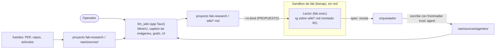

# 03 · Bóveda llm_wiki

El ciclo necesita un lugar único donde viven las fuentes (PDF, repos, artículos, imágenes) y lo aprendido. La propuesta usa **llm_wiki** (proyecto `fab-research`, en `~/Desktop/llm_wiki_v2`) como **bóveda**: la app **ingiere**, los agentes **leen archivos**, no usan la app.

!!! info "Propuesto (v0.2)"
    ADR-0002. En el repo de fab **no hay código** de esta integración: ni montaje, ni envoltorio, ni escritura en `raw/sources/agentes/`. Lo que existe es llm_wiki (proyecto externo) y las piezas de fab sobre las que la propuesta se apoya.

## Principio: la app ingiere, los archivos se leen

| Dirección | Mecanismo | Quién | Estado |
|---|---|---|---|
| Ingesta (fuente → wiki) | La app: MinerU, caption, grafo | llm_wiki | Existe en llm_wiki; calidad de MinerU y caption **sin verificar** (ARQ §10) |
| Lectura por agentes | Archivos `<proyecto>/wiki/*.md`, solo-lectura, buscados con `rg`; envueltos como no confiables | Lector | **Propuesto** (ADR-0002, ADR-0007) |
| Escritura por agentes | Solo `<proyecto>/raw/sources/agentes/`, frontmatter `trust: agent`; llm_wiki la ingiere | Orquestador o agente | **Propuesto** |
| MCP de llm_wiki | **Opcional**, solo sesiones interactivas con la app abierta | Operador | Opcional |

La búsqueda de agentes es **léxica** (`rg`), no semántica, salvo con la app abierta (consecuencia negativa en ADR-0002). A cambio hay modo headless sin red ni app.

## Por qué no el MCP de llm_wiki

La v0.1 usaba el MCP como acceso de los agentes. Se descartó por cuatro hechos verificables:

!!! success "Verificado en el código"
    - **Requiere la app abierta.** El MCP es un proxy a `http://127.0.0.1:19828` (`llm_wiki_v2/mcp-server/src/api-client.ts:1`, `DEFAULT_API_BASE_URL`), y el servidor de esa API lo arranca la app Tauri (`llm_wiki_v2/src-tauri/src/lib.rs:606`, `api_server::start_api_server`).
    - **Chocaría con `--unshare-net`.** El sandbox de fab añade `--unshare-net` salvo que `allowNetwork` sea verdadero (`src/agent/mcp-sandbox.ts:30`); con red total el sandbox pierde su valor. Ver [Factory · seguridad](../factory/07-seguridad.md) y [11](11-fuentes-no-confiables.md).
    - **Los adaptadores externos no leen la config MCP de fab.** `claude`, `codex`, `agy` y `droid` son CLIs lanzados con su propio argv (`src/agents.ts:39-117`); solo `native` (fab exec) recibe `--settings` (`:136`). Ver [Factory · adaptadores](../factory/05-adaptadores-de-agentes.md).
    - **Expone `llm_wiki_chat`** (`llm_wiki_v2/mcp-server/src/index.ts:124`, `:271`). ADR-0002 afirma que ese agente tiene `shell.exec` y `web.search` (`src-tauri/src/agent/tools.rs`); **no verifiqué esa herramienta** en el código de llm_wiki.

Regla resultante: **nunca** se expone `llm_wiki_chat` a agentes de fab (ADR-0002, ADR-0007).

## Estructura de un proyecto llm_wiki

Un proyecto es una carpeta. Los dos directorios relevantes (ADR-0002 y `llm_wiki_v2/README.md:45`, `:129`):

- `raw/sources/`: fuentes; la app detecta cambios externos con un vigilante de carpeta (*source folder auto-watch*).
- `wiki/*.md`: páginas generadas.

Por eso un agente que escribe en `raw/sources/agentes/` queda ingerido sin API: es un archivo nuevo.

## Contrato de las páginas escritas por agentes

!!! info "Propuesto (v0.2)"
    - Ubicación: `<proyecto>/raw/sources/agentes/`.
    - Frontmatter `trust: agent`: las páginas de agentes se leen después con el **mismo envoltorio no confiable** que el resto (ADR-0007).
    - Contenido: la página `trust: agent` del paso 9 del ciclo (resultado del veredicto), de modo que ciclos futuros no repitan ideas ya rechazadas.
    - Las fichas Loop B (`docs/research/analisis/<repo>.md`) son la **excepción** y siguen en fab, porque llevan `archivo:línea@sha` que `registry.json` referencia (ADR-0002).

!!! warning "Prerrequisito pendiente: dónde corre la escritura"
    Un lector en solo lectura no puede escribir en `raw/sources/agentes/`. La propuesta no fija si escribe el orquestador (fuera del sandbox) o un agente con un montaje escribible solo en esa carpeta. Es una decisión abierta de mi lectura de ADR-0002 y ADR-0007, no algo que digan literalmente.

## Dos bóvedas, no mezclar

- `fab-research` es la bóveda del flujo B (ideación de fab).
- El flujo A (operación con clientes) usa **un proyecto llm_wiki por cliente**, nunca mezclado con `fab-research` (ARQ §7).
- Riesgo registrado: si MinerU usa la API en la nube, las fuentes de clientes salen de la máquina; en el flujo A hay que usar MinerU local o pdfium (ARQ §7).

## Lo que queda por confirmar

!!! warning "Prerrequisito pendiente"
    - Ruta del proyecto `fab-research` y montaje `--ro-bind` en bwrap (`REVISION.md`, pendiente 3). El sandbox de herramientas del agente nativo ya sabe montar rutas de solo lectura con `--ro-bind` (`src/agent/mcp-sandbox.ts:27`), pero no hay una opción para fijar la bóveda; ver [12](12-prerrequisitos-exec.md).
    - Video: fuente de segunda clase. Transcripciones vía agent-reach (YouTube) hasta que exista un script con dueño. Alternativa descartada por ahora: `graphicle` (duplica graft).
    - Alternativas descartadas en ADR-0002: carpeta markdown en git sin llm_wiki (pierde MinerU, caption y UI); bóveda de hyperresearch (sin caption ni proyectos por cliente).

## Archivos

| Archivo | Responsabilidad |
|---|---|
| `docs/research/arquitectura-ideacion/adr/ADR-0002-llm-wiki-boveda-unica.md` | Decisión de la bóveda. |
| `docs/research/arquitectura-ideacion/adr/ADR-0007-fuentes-no-confiables.md` | Envoltorio no confiable y `trust: agent`. |
| `src/agent/mcp-sandbox.ts` | `bwrap` con `--ro-bind` y `--unshare-net` para MCP stdio. |
| `src/agents.ts` | Adaptadores: solo `native` usa `--settings`. |
| `~/Desktop/llm_wiki_v2/mcp-server/`, `src-tauri/` | Proyecto externo: MCP proxy y servidor de API (citados, no documentados aquí). |
