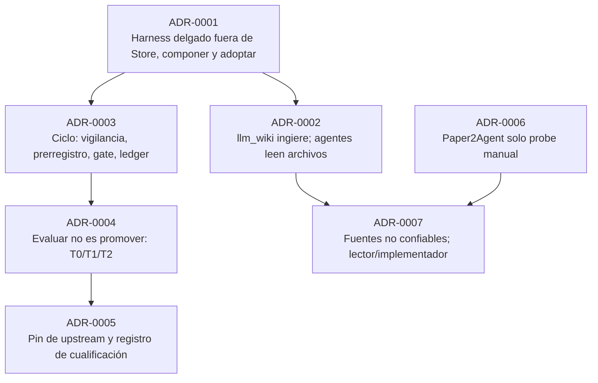

# 04 · Decisiones

Mapa de los siete ADR de la propuesta, qué se adopta de cada referencia y cómo se compara el flujo con el de ESF. Fuente: `docs/research/arquitectura-ideacion/` (`ARQUITECTURA.md`, `adr/ADR-0001..0007`, `REVISION.md`).

!!! info "Propuesto (v0.2)"
    Los siete ADR tienen estado *propuesto* (v0.2) y fecha 2026-10-31. Lo **implementado** de cada uno se señala en la columna "Hoy".

## Mapa de ADR

| ADR | Decide | Capa | Hoy | Página |
|---|---|---|---|---|
| **0001** Componer, no construir | Orquestador CLI delgado en `scripts/ideas/`, fuera de `Store`; adopta ledger, nodo congelado, envoltorio, cualificación; reutiliza llm_wiki, graft, hyperresearch/agent-reach, `improve.ts`, gates. Revisión: 2026-12-15 o 10 ciclos, con tres números (ciclos completados, % `INCONCLUSIVE` por falta de corpus o runner, horas humanas por ciclo) | C4b | Razones del "fuera de Store" **verificadas**; orquestador **no existe** | [00](00-blueprint.md), [02](02-integracion-factory.md) |
| **0002** llm_wiki bóveda única | App ingiere; agentes leen `wiki/*.md` RO y escriben en `raw/sources/agentes/` (`trust: agent`); MCP opcional; nunca `llm_wiki_chat` | C7 | Sin código en fab | [03](03-boveda-llm-wiki.md) |
| **0003** Ciclo de una hipótesis | Vigilancia, backlog, tope de Gate 3 (N = 3), prerregistro con hash, gate `experimento_autorizado`, crítico, ledger de 10 columnas, árbol de experimentos, timer de systemd | C2 | **Ledger implementado** (vendorizado + lint); el resto propuesto | [01](01-ciclo-y-ledger.md) |
| **0004** Evaluar no es promover | T0/T1/T2; `ACCEPT-candidato` con flag apagado, `ACCEPT-cualificado` para activar; 5 prerrequisitos en orden | C6 | Coste hecho; 4 prerrequisitos pendientes | [02](02-integracion-factory.md) |
| **0005** Pin y cualificación | `UPSTREAM.json`, registro `docs/qualification/<id>-<fecha>.md`, lint, revisión antes del merge | C6 | **Implementado** para `improve.ts` y el ledger | [02](02-integracion-factory.md) |
| **0006** Paper2Agent fuera | Solo manual en VM desechable; si hace falta ejecutar código de un paper: `fab exec --sandbox required`, `--verify-setup` con red solo hacia `$FAB_DEPS` | C5 | Sin código | [11](11-fuentes-no-confiables.md) |
| **0007** Fuentes no confiables | Todo texto ajeno envuelto como dato; lector e implementador separados; crítico revisa la spec | C5 | `fetch_url` ya marca contenido externo; el resto propuesto | [11](11-fuentes-no-confiables.md), [10](10-integracion-exec.md) |

## Qué se adopta de cada referencia

| Referencia (licencia) | Qué se toma | Cómo | Estado |
|---|---|---|---|
| **dream-machine** (MIT) | Esquema de ledger de 10 columnas y señales de aprendizaje; disciplina de ciclo y prerregistro (su ADR-0009) | **Adoptar**, código copiado y fijado con pin (`use_rule: vendored`) | **Implementado**: `third_party/dream-machine/` (@ `3fc3222`) |
| **ESF** (MIT) | Cualificación (`internal/harnessprofile/qualification.go`), pin, registro con gates pendientes | **Adoptar la idea**, reimplementada (`use_rule: idea`) | **Parcial**: `improve.ts` fase 1 y `profile.ts` (@ `d901657`); falta fase 2 |
| **OpenResearch** (MIT) | Árbol de experimentos y regla de nodo congelado, como esquema | **Copiar el esquema**; evaluar `orx` como herramienta de ámbito `investigacion` | Propuesto; sin entrada en `registry.json` |
| **hyperresearch** (MIT) | Barrido (uso) y envoltorio `<untrusted-source>` (adopción con pin) | **Usar** y **adoptar** el envoltorio | Propuesto; está en `registry.json` |
| **deer-flow** (MIT) | Procedencia por productor y contrato de informe de subagente | **Copiar disciplina**, sin runtime | Propuesto; sin entrada en `registry.json` |
| **Harness2** (Apache-2.0) | Candidato a medir con este ciclo | Medir | Propuesto |
| **Paper2Agent** (MIT) | Probe manual | VM desechable | Manual |

Nota (`ARQUITECTURA.md` §8): `improve.ts` fase 1 es la **cualificación de ESF**, no *Propose–Probe–Compose* de Harness2. Todas las referencias deben entrar en `registry.json` con `archivo:línea@sha` (Loop B mínimo) antes de aprobar el documento; hoy el registro lista `droid-factory`, `esf`, `warp`, `opencode`, `pi`, `elephant-goldfish-model`, `agent-reach` y `hyperresearch`.

!!! warning "Prerrequisito pendiente"
    Loop B mínimo para dream-machine, OpenResearch, Paper2Agent, deer-flow y harness2 (`REVISION.md`, pendiente 1). Los pendientes 3 (ruta de `fab-research` y `--ro-bind`) y 4 (coste medio en `bench/ola3`) también siguen abiertos; el 2 (ledger en Bun) quedó **hecho** el 2026-10-31.

## Comparación con el flujo de ESF

El caso de referencia es Harness2, PR #43 de ESF (`ARQUITECTURA.md` §9).

| Paso | ESF | fab v0.2 | Implementado |
|---|---|---|---|
| Descubrimiento | Sin rastro en el repo | Vigilancia + backlog puntuado | No |
| Análisis del upstream | Sin ADR (solo PR #4) | Loop B mínimo con `archivo:línea@sha` | Parcial (fichas en `docs/research/analisis/`) |
| Hipótesis | No explícita | Prerregistrada con hash, mecanismo y predicción | No |
| Autorización para gastar | No visible | Gate `experimento_autorizado` con `usd_max` | No |
| Instrucciones del agente | Fuera del repo (`.gitignore` excluye `AGENTS.md`) | Versionadas en `scripts/ideas/` | No |
| Inyección desde fuentes | No tratada | Lector/implementador, envoltorio, `trust` | No |
| Implementación | Reimplementación nativa | Igual, detrás de flag apagado | Práctica ya seguida en `improve.ts` |
| Medición | `esf-improvement-suite/v1`, 4 brazos, ×3, bootstrap | T0/T1/T2; bootstrap solo en T2 | Fase 1 parcial |
| Pin y licencia | `third_party/harness2/{LICENSE,NOTICE,UPSTREAM.json}` | Igual + lint | **Sí** |
| Registro | `release/qualification/<feature>-<fecha>.md` | `docs/qualification/<id>-<fecha>.md` | **Sí** |
| Revisión | Bot, después del merge | Goldfish antes del change + Gate 3; sin merge con críticos abiertos | Solo como regla de proceso |
| Memoria entre ideas | No | Ledger + página en llm_wiki | Ledger sí, sin filas |
| Estado al integrar | "candidate, disabled, unqualified" | `ACCEPT-candidato` igual; `ACCEPT-cualificado` para activar | No hay flags registrados |

Hechos sobre ESF que sustentan las decisiones (ADR-0004, ADR-0005; no los reverifiqué en el repo de ESF):

- Cualificación: ≥ 100 tareas, ×3, ≥ 10 clusters, coste conocido por corrida (`qualification.go:97`), topes ×1.2/×5 (`:160-164`), bootstrap de 10 000 con semilla fija, ganancia ≥ 5 pp y percentil 2.5 > 0 (`:217-219`).
- El lint de release no verifica la firma (`scripts/release_qualification.py:65`); la promoción en runtime sí (`qualification.go:240-253`).
- El PR #43 se mergeó a las 14:10 y la única revisión (bot) llegó a las 14:19, con 2 P1 abiertos en `d901657`.

Resumen del diseño: de ESF se toma lo que hace bien al **final** del flujo (cualificación, pin, registro honesto); el **principio** (descubrimiento, hipótesis, autorización, inyección) viene de dream-machine, OpenResearch y hyperresearch.

## Hallazgos de revisión que moldearon la v0.2

`REVISION.md` registra los hallazgos de Fable 5.1 (refutación) y agy (viabilidad); los marcados ✔ se verificaron en el código. Los más relevantes y su disposición:

| Hallazgo | Disposición |
|---|---|
| El ciclo no cabe en `Store` (`src/store.ts:449`, `src/enums.ts:33`) ✔ | Aceptado → ADR-0001 |
| Sin coste por corrida, portar `Qualify` falla siempre ✔ | Aceptado → coste como prerrequisito (hecho para `claude`) |
| MCP de llm_wiki bloqueado por `--unshare-net` ✔ (`src/agent/mcp-sandbox.ts:30`) | Aceptado con otra solución → ADR-0002 |
| `integrity.ts` no se usa en `improve.ts` ✔ | Aceptado → prerrequisito pendiente |
| No hay daemon ✔ (`src/cli.ts:127`) | Aceptado → timer de systemd |
| T2 paraliza el sistema | Aceptado parcialmente → `ACCEPT-candidato` |
| Reemplazar llm_wiki por carpeta markdown | **Rechazado** |
| Video es una distracción | Parcial: segunda clase |
| Eliminar la prohibición de `ACCEPT` sin T2 | Parcial: candidato sí, activar por defecto no |

## Riesgos y no decidido

- Origen y coste del corpus T2 (≈ 600 corridas; 900 en modo adaptativo).
- Autor = revisor con un solo operador.
- Calidad de MinerU y del caption de imágenes.
- Un check automático de "flag activo sin `cualificado`" (ADR-0005) sigue pendiente de un registro de flags.

## Archivos

| Archivo | Responsabilidad |
|---|---|
| `docs/research/arquitectura-ideacion/ARQUITECTURA.md` | Diseño v0.2: componentes, ciclo, tiers, referencias, comparación con ESF. |
| `docs/research/arquitectura-ideacion/adr/ADR-0001..0007` | Decisiones. |
| `docs/research/arquitectura-ideacion/REVISION.md` | Hallazgos y disposición v0.1 → v0.2. |
| `docs/research/registry.json` | Registro de referencias (Loop B). |
| `third_party/esf/UPSTREAM.json`, `third_party/dream-machine/UPSTREAM.json` | Pines. |
