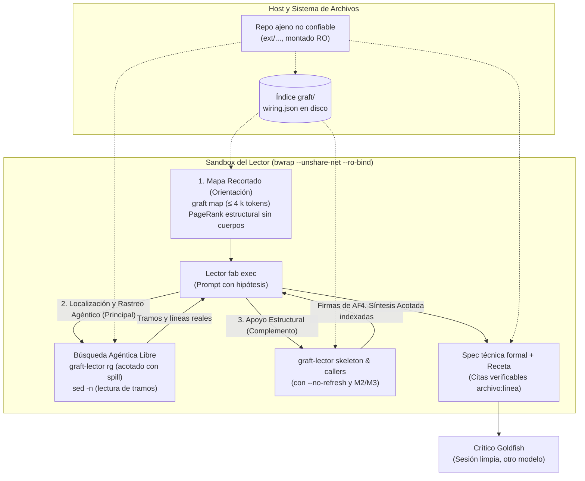
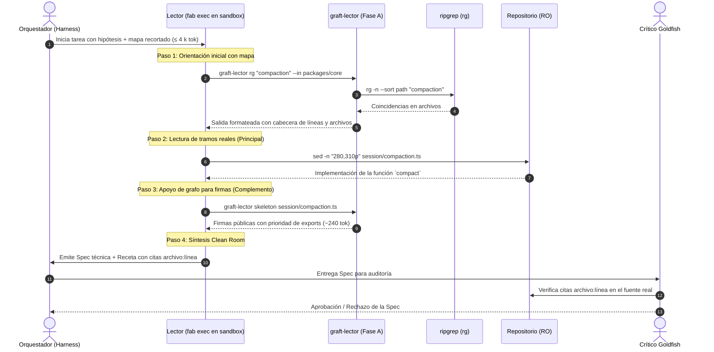
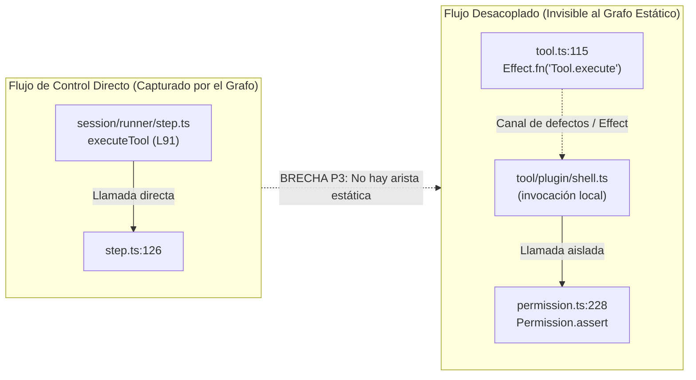

# 05 · Lectura de Repositorios Grandes

Esta página define la arquitectura y el flujo operativo del rol **Lector** dentro del ciclo de ideación de fab cuando se enfrenta al perfil de Probe "repo grande" (repositorios $\ge 500\text{ k}$ líneas de código).

Formalizado en el **ADR-0008 (aceptado el 2026-11-02)** (`docs/research/arquitectura-ideacion/adr/ADR-0008-probe-por-tipo-de-fuente.md`), el principio rector establece: **en repositorios grandes, el lector localiza y sigue llamadas mediante búsqueda agéntica ([`rg`](07-rg-y-limites-de-tree-sitter.md), lectura de tramos con `sed -n`); el grafo de graft actúa como complemento de apoyo para orientación y extracción de firmas, nunca como contexto masivo inyectado al modelo** (ver análisis detallado en [07 · ripgrep y límites de tree-sitter](07-rg-y-limites-de-tree-sitter.md)).

!!! success "Implementado: Fase A del Lector"
    Las piezas operativas del lector para repositorios grandes están implementadas y verificadas en `scripts/ideas/graft-lector.ts:1-233` (Bun/TypeScript) y `scripts/ideas/lector-fab.ts:1-22`, con cobertura completa en `tests/graft-lector.test.ts:1-79` y `tests/lector-fab.test.ts:1-20` (`bun test` en verde, 10 tests):
    
    - **Búsqueda agéntica acotada:** Subcomando `rg` con ordenación por ruta, cabecera de conteo y desvío a disco si supera el presupuesto (`scripts/ideas/graft-lector.ts:77-81, 206-212`).
    - **Medición de volumen:** Subcomando `measure` sobre `git ls-files` que calcula `tokens_medidos = ceil(bytes/4)` y evalúa la decisión `leer_entero` vs `bajar_nivel` (`:84-89, 163-175`).
    - **Presupuesto y sesión con corte estricto:** Tipo `ProbeBudget` con validador y control de sesión (`--session`) que acumula consultas y bytes servidos, cortando de forma irreversible con código de salida 5 al superar los topes (`:92-120, 137-148, 215-219`).
    - **Mejoras M2, M3 y M4:** Desambiguación fail-closed (`candidatesOrNull`, `:24-31`), salida acotada con prioridad a exports (`bound`, `exportedNames`, `exportRank`, `:35-53, 64-74`) y frescura $O(1)$ con sidecar `.lector-meta.json` (`staleness`, `:57-61, 154-161`).
    - **Consultas a graft protegidas:** Invocaciones a `ask`, `skeleton`, `callers` y `grep` con la bandera `--no-refresh` obligatoria (`:185, 190-205`).
    - **Adaptador MCP para fab:** Generación de configuración con `readPaths` resueltos en `scripts/ideas/lector-fab.ts:8-16`.

!!! info "Propuesto (v0.2)"
    El orquestador completo del ciclo de ideación (`scripts/ideas/` automático 0–9), la vigilancia semanal y el prerregistro de hipótesis con hash previo del ADR-0003 continúan en estado de **propuesta v0.2**.

---

## 1. El Problema de Escala

Al evaluar repositorios externos masivos (como `ext/opencode` @ `79469efc`, con **8 642 archivos versionados** y unas **920 000 líneas** de código; `docs/research/arquitectura-ideacion/codesearch/README.md:3`), el enfoque ingenuo de transferir el código o un volcado plano a la ventana de contexto colapsa inmediatamente:

1. **Volumen intratable en tokens:**
   - 920 000 líneas de código equivalen aproximadamente a **~9,5 M tokens** (asumiendo ratios estándar de código fuente; `docs/research/arquitectura-ideacion/codesearch/README.md:22-23`).
   - El grafo de cableado estático completo generado por graft (`graft/`) para este monorepo ocupa **326 MB en disco** (`docs/research/arquitectura-ideacion/codesearch/grafos.md:19`), con un archivo central `wiring.json` de **32,3 MB**, **32 188 símbolos** y **80 077 aristas** (`docs/research/arquitectura-ideacion/adr/ADR-0008-probe-por-tipo-de-fuente.md:9`).
   - Cargar el árbol o el grafo completo saturaría cualquier ventana de inferencia con millones de tokens de coste prohibitivo.
2. **Deterioro de la atención (*Context Rot* y *Lost in the Middle*):**
   - Inyectar volcados masivos dispersa la atención del LLM, degradando su capacidad de razonamiento causal (*Context Rot*, Anthropic Research 2025; `docs/research/arquitectura-ideacion/codesearch/web-contexto.md:65,141-144`).
3. **Fracaso del RAG vectorial ingenuo:**
   - Trocear código por líneas fijas y usar similitud coseno colapsa las relaciones estructurales entre módulos y pierde llamadas indirectas (Kovrigin et al. 2024, arXiv:2406.04464; `docs/research/arquitectura-ideacion/codesearch/web-contexto.md:60-62`).
4. **Seguridad y Fuentes no Confiables (ADR-0007):**
   - El código analizado es ajeno y potencialmente malicioso. No se debe ejecutar ningún script del repositorio ni permitir que un LLM lea todo el árbol para resumirlo, pues abriría vectores de inyección indirecta de prompts (`docs/research/arquitectura-ideacion/codesearch/README.md:73`, `docs/research/arquitectura-ideacion/codesearch/floorplan.md:57,62`).

---

## 2. Flujo Adoptado: Búsqueda Agéntica con Apoyo de Grafo

Validado experimentalmente en dos repositorios independientes (`opencode` y `deer-flow`), el ADR-0008 consagra que **quien localiza y sigue llamadas es el modelo mediante búsqueda agéntica** (`rg`, `find`, `sed -n`), mientras que `graft` actúa como **complemento de bajo coste** para la orientación inicial y extracción de firmas (`docs/research/arquitectura-ideacion/adr/ADR-0008-probe-por-tipo-de-fuente.md:31-35,97-101`):

### Los Cuatro Pasos Operativos

1. **Mapa Recortado de Orientación (≤ 4 k tokens):**
   El lector arranca recibiendo un resumen estructural de `graft map` limitado a un presupuesto estricto de **1–4 k tokens** (`docs/research/arquitectura-ideacion/adr/ADR-0008-probe-por-tipo-de-fuente.md:33`). Proyecta los directorios y módulos con mayor centralidad estructural según PageRank, sin cuerpos de funciones ni docstrings.
2. **Localización y Rastreo Agéntico ([`rg`](07-rg-y-limites-de-tree-sitter.md) y lectura de tramos):**
   El lector conduce la exploración mediante búsquedas dirigidas:
   - Ejecuta `graft-lector rg <patrón>` (`scripts/ideas/graft-lector.ts:206-212`), que invoca `rg` respetando `.gitignore`, ordena los resultados por ruta y asegura que la cabecera de conteo no se pierda al truncar.
   - Lee tramos específicos de líneas mediante comandos POSIX (`sed -n "start,endp"` o equivalente), manteniendo la exploración focalizada en el código relevante.
3. **Consultas de Apoyo al Grafo (`skeleton` y `callers` con `--no-refresh`):**
   Cuando el lector requiere examinar interfaces o dependencias:
   - Invoca `graft-lector skeleton <archivo>` para obtener firmas y rangos con prioridad a las declaraciones exportadas (`scripts/ideas/graft-lector.ts:40-53, 64-74`).
   - Invoca `graft-lector callers <símbolo>` con desambiguación (`--in <ruta>`) para recibir la lista estructurada de candidatos sin selecciones arbitrarias (`:24-31`).
   - Todas las llamadas operan con `--no-refresh` obligatorio (`:185`), ahorrando 110–150 ms y evitando escrituras sobre el repositorio de solo lectura.
4. **Entrega de la Spec Clean Room al Crítico:**
   El lector entrega únicamente una receta de implementación y una especificación formal con citas exactas `archivo:línea`. El crítico audita las citas leyendo directamente el código fuente antes de autorizar la fase de implementación (`docs/research/arquitectura-ideacion/codesearch/README.md:31,126-129`).

### Diagrama de Secuencia del Flujo

---

## 3. Umbrales Medidos: Repo $\to$ Subsistema $\to$ Símbolo

Las mediciones empíricas realizadas sobre los monorepos de prueba demuestran el estrechamiento radical de volumen a medida que el lector desciende en la jerarquía (`docs/research/arquitectura-ideacion/codesearch/README.md:32-33`, `docs/research/arquitectura-ideacion/adr/ADR-0008-probe-por-tipo-de-fuente.md:8-10`):

| Nivel de Inspección | Objeto / Operación | Volumen en Bruto / Espacio | Coste en Tokens | Latencia Típica |
|---|---|---|---|---|
| **Nivel Repositorio** | Monorepo completo (`ext/opencode`) | 8 642 archivos (~920 000 líneas) | ~9,5 M tokens | Inviable en prompt |
| | Grafo completo en disco (`graft/`) | `graft/` 326 MB; grafo `wiring.json` 32,3 MB (32 188 símbolos, 80 077 aristas) | ~8 M tokens | Inviable en prompt |
| | Mapa recortado (`graft map`) | Directorios y módulos raíz | **1 000 – 4 000 tokens** (tope propuesto, ADR-0008) | < 1 s |
| **Nivel Subsistema** | Subsistema focal (`session/`) | Archivos del subsistema completo | **~117 k tokens** (`ADR-0008:10`) | Inviable completo |
| | Búsqueda agéntica (`rg`) | Escaneo exhaustivo en 920 k líneas | **40 – 150 tokens** con `-c` / matches | **~0,06 s (61 ms)** |
| **Nivel Símbolo** | API de archivo (`graft skeleton`) | Firmas y tipos de 500+ líneas | **~240 tokens** | ~0,7 s |
| | Invocadores (`graft callers`) | Árbol de dependencias inmediatas | **~220 tokens** | ~1,0 s |
| | Tramo de código (`sed -n`) | Rango acotado `archivo:Lstart-Lend` | **50 – 500 tokens** | I/O directa de disco (< 5 ms) |

El comando `measure` (`scripts/ideas/graft-lector.ts:163-175`) automatiza la decisión: sobre `packages/core/src/session` midió 117 057 tokens y determinó `leer_entero` frente al presupuesto de 128 000 tokens (`codesearch/medicion/implementacion-fase-a.md:41-43`). La búsqueda agéntica completa A2 consumió apenas **~42 k tokens** en opencode y **~18 k tokens** en deer-flow (`codesearch/medicion/deerflow.md:126`), respetando holgadamente el presupuesto.

---

## 4. Pruebas Experimentales T1–T5 y Veredicto de Herramientas

Para determinar la composición óptima del lector, se evaluaron siete herramientas de búsqueda de código y grafos sobre las mismas cinco tareas benchmark (T1–T5) en `ext/opencode` (`docs/research/arquitectura-ideacion/codesearch/README.md:3-9`, `docs/research/arquitectura-ideacion/codesearch/grafos.md:58-69`, `docs/research/arquitectura-ideacion/codesearch/busqueda.md:118-151`):

- **T1 (Localizar):** Encontrar el mecanismo de compactación/resumen de sesión cuando se llena el contexto (`packages/core/src/session/compaction.ts:284`).
- **T2 (Aristas):** Identificar quién invoca la ejecución de herramientas y dónde se evalúan los permisos (`packages/core/src/session/runner/step.ts:91`, `packages/core/src/tool.ts:115` y `packages/core/src/permission.ts:214,228`).
- **T3 (Exhaustivo):** Localizar todas las ocurrencias exactas del evento `permission.asked` / `Permission.Event.Replied` (60 ocurrencias en 44 archivos según `rg`; 55 en 40 en código fuente).
- **T4 (Conceptual):** Responder sin nombres de símbolos: *"¿Cómo decide qué modelo o proveedor usar para una petición?"* (`packages/core/src/model-resolver.ts`).
- **T5 (API de un archivo):** Extraer la superficie pública y tipos de un archivo central (`packages/core/src/session/compaction.ts`).

### Tabla Resumida de Resultados T1–T5

| Herramienta | T1 (Localizar) | T2 (Aristas) | T3 (Exhaustivo) | T4 (Conceptual) | T5 (API) | Decisión Final |
|---|---|---|---|---|---|---|
| **graft** | ◐ Acierta con frase adaptada (~1,9 k tok, 1,6 s) | ◐ Halla invocador local; no ve permisos | ◐ 36–39 aciertos en 21 archivos (solo código indexado) | ◐ #2 y #7 entre ruido (~380 tok, 1,6 s) | ✔ **Exacto con `skeleton`** (54 líneas, 244 tok, 0,7 s) | **Complemento de apoyo** (`ADR-0008:31,98`) |
| **ripgrep ([`rg`](07-rg-y-limites-de-tree-sitter.md))** | ◐ 409 archivos con `-i compaction` (94 ms) | ✘ Volcado ciego (80+ ocurrencias, 7,2 k tok) | ✔ **60 en 44 archivos** (40 tok, 61 ms) | ✘ Falla (0 hits con lenguaje natural) | ◐ Regex sobre `export` sin parseo de firmas | **Herramienta principal del lector** (`ADR-0008:31,98`; ver [07](07-rg-y-limites-de-tree-sitter.md)) |
| **codegraph** | ✔ Directo con `context` (`compact:284`, 1 k tok, 0,8 s) | ◐ `callers -f` da `tool.ts:115` (0,3 KB, 0,6 s); no ve permisos | ✘ 4 símbolos (no hace búsqueda de texto) | ◐ Acierta con `explore` pero con 25 KB (~6 k tok) | ✔ 100 símbolos con línea y rangos (0,4 s) | **Complemento diferido** (`docs/research/arquitectura-ideacion/codesearch/README.md:16`) |
| **tgrep** | ◐ 409 archivos en 44 ms | ✘ Volcado ciego en 12 ms | ✔ Conteo idéntico a `rg` en **9 ms** (6,7× más rápido) | ✘ 0 hits (lenguaje natural) | ◐ Regex plano en 10 ms | **Descartar** (`docs/research/arquitectura-ideacion/codesearch/README.md:17`) |
| **semble** | ✔ #1 directo con `search` (650 tok, 2,7 s) | ✘ Carece de grafo de llamadas | ✘ 0 hits reales por tokenización y top-k | ◐ Parcial (`models-dev.ts`), cuela i18n | ✘ Carece de vistas sintácticas | **Descartar** (`docs/research/arquitectura-ideacion/codesearch/README.md:18`) |
| **codebase-memory-mcp** | ◐ BM25 halla `compaction.ts:1067` entre ruido | ◐ Halla `runtime.ts:30`; no halla permisos | ✘ 11 archivos / 15 hits (incompleto) | ✘ Falla; búsqueda semántica dio ruido | ✔ 84 símbolos con rango (3,6 s) | **Descartar por ahora** (`docs/research/arquitectura-ideacion/codesearch/README.md:19`) |
| **code-graph-rag** | ✘ `resolved: null` sin modelo semántico | ◐ `graph callers` da 407 líneas JSON (12 KB); no ve permisos | n/a (sin búsqueda de texto) | n/a (requiere modelo semántico / red) | ◐ Devuelve una sola función, no el archivo | **Descartar** (`docs/research/arquitectura-ideacion/codesearch/README.md:20`) |
| **xerj** | ◐ Localiza doc web (`.mdx`), no el código | ✘ Carece de comando `callers` | ◐ 2 pasajes agrupados en vez de 5 ocurrencias | ✘ No halla el resolvedor central | ✘ Carece de vistas de API | **Descartar** (`docs/research/arquitectura-ideacion/codesearch/README.md:21`) |

---

## 5. Validación en Dos Repositorios: opencode frente a deer-flow

Para responder a la pregunta de si el fallo de `graft callers` en `opencode` era propio del paradigma funcional de Effect-TS o una limitación general, el 2026-11-02 se evaluó un segundo monorepo: `ext/deer-flow` (@ `35656d6`, Python, ~871 k líneas `.py`), con prerregistro formal (`tareas-deerflow.md` sha256 `2fe5fd0a…` y `verdad-deerflow.md` `6352c69d…`; `docs/research/arquitectura-ideacion/codesearch/medicion/deerflow.md:10-18`).

### Tabla Comparativa Cruzada opencode vs deer-flow

| Dimensión de Análisis | opencode (TypeScript / Effect-TS) | deer-flow (Python / Protocolos y Clases) | Conclusión Verificada (ADR-0008) |
|---|---|---|---|
| **Paradigma y escala** | 8 642 archivos, ~920 k líneas TS; cierres monádicos `Effect.fn` | ~871 k líneas `.py`; arquitectura modular clásica | Paradigmas radicalmente distintos (`deerflow.md:124`). |
| **A2: Búsqueda agéntica libre** | **5 / 5 aciertos exactos** 52 comandos, ~42 k tokens, 1 126 ms shell | **5 / 5 aciertos exactos** 39 comandos, ~18 k tokens, 313 ms shell | **La búsqueda agéntica resuelve el 100% de las tareas** en ambos repositorios con coste acotado (`deerflow.md:125-126`). |
| **A0 `ask`: hit@5 de archivo** | 2 / 9 (22,2 %) | 4 / 9 (44,4 %) | Mejora en deer-flow por nombres de módulo canónicos (`summarization_middleware.py`), pero solo en inglés (`deerflow.md:128`). |
| **A0 `ask`: hit@5 de símbolo** | 0 / 9 (0 %) | 4 / 9 (44,4 %) | En opencode hits sin rango; en deer-flow las clases indexadas permitieron aciertos dentro de los 5 primeros en inglés (`deerflow.md:130`). |
| **A0 `ask`: R1 (español)** | **0 / 3 (0 %)** | **0 / 3 (0 %)** | **Fallo sistemático total en lenguaje natural en español** en ambos repositorios por dispersión léxica (`deerflow.md:131, 145`). |
| **A0 `callers`: resolución de aristas** | Falla: símbolos ausentes del grafo por closures `Effect.fn` (`permission.assert` omitido) | Falla: símbolos **presentes** en `wiring.json`, pero con 25–30 definiciones homónimas (`evaluate`, `wrap_tool_call`), graft descarta las aristas entre archivos | En opencode falla el *parser*; en deer-flow falla el *modelo estático ante polimorfismo dinámico* (`deerflow.md:132, 148-149`). |
| **`graft grep` frente a `rg`** | 36 en 21 archivos (omite archivos no indexados) | 64 en 10 archivos (omite `docs/GUARDRAILS.md`) | `graft grep` solo cubre código indexado; `rg` alcanza el 100% del árbol versionado (`deerflow.md:133`). |
| **`skeleton`: fidelidad de tipos** | 10 de 12 exports (omite constantes `layer`/`node`) | **100 % de la API pública** (4 clases, 2 métodos en `provider.py`) | El skeleton sintáctico es altamente fiel cuando las clases siguen sintaxis canónica (`deerflow.md:134`). |

### Conclusión de la Validación Cruzada

La evidencia confirma que **la Decisión 2 revisada del ADR-0008 queda plenamente validada en dos ecosistemas**:
1. La búsqueda agéntica (`rg`, `sed -n`) es el único mecanismo con fiabilidad del 100% para localizar y seguir llamadas en monorepos reales.
2. `graft ask` sufre una dependencia crítica del vocabulario técnico exacto en inglés y falla en lenguaje natural.
3. El fallo de `graft callers` es transversal: en TypeScript fracasa por abstracciones funcionales que ocultan símbolos al AST, y en Python fracasa por descarte de aristas ante colisiones polimórficas de nombres.

---

## 6. El Problema P3: Llamadas que el Grafo no Ve y el Rol del Crítico

El análisis en ambos repositorios demostró brechas estructurales en grafos estáticos (`docs/research/arquitectura-ideacion/codesearch/README.md:31`, `docs/research/arquitectura-ideacion/codesearch/medicion/deerflow.md:87-88`):
- En `opencode`, `executeTool` conecta con `Permission.assert` a través de canales de defectos monádicos que escapan al grafo.
- En `deer-flow`, `GuardrailMiddleware.wrap_tool_call` invoca `provider.evaluate()`, pero al existir 25 métodos homónimos en el repositorio, graft descarta la arista entre archivos para evitar conjeturas erróneas.

### Regla de Oro Invariable para el Crítico

!!! warning "Invariante de Verificación del Crítico"
    **El crítico JAMÁS aceptará un "no tiene llamadores" (`no callers found`) como prueba de que una función o módulo está inactivo o desacoplado** (`docs/research/arquitectura-ideacion/codesearch/README.md:31,119`, `docs/research/arquitectura-ideacion/adr/ADR-0008-probe-por-tipo-de-fuente.md:42`).

Protocolo obligatorio de auditoría:
1. El **Lector** debe reconstruir las aristas no evidentes combinando `graft-lector rg` y lectura de tramos con `sed -n`, documentando la procedencia exacta de cada salto.
2. El **Crítico** debe verificar las afirmaciones leyendo el código fuente real montado en solo lectura en su propia sesión aislada, desestimando cualquier deducción que se base exclusivamente en ausencias dentro del grafo de graft.

---

## 7. Seguimientos no Bloqueantes (ADR-0008)

El ADR-0008 formaliza seis tareas de seguimiento no bloqueantes (`docs/research/arquitectura-ideacion/adr/ADR-0008-probe-por-tipo-de-fuente.md:136-142`):

1. ~~**Filtro de `measure`**~~ **hecho (2026-11-02):** descarta los binarios que git marca como `i/-text`; opencode baja de 34,5 M a 18,9 M tokens. No filtra por extensión (el código `.ts`+`.tsx` mide ~9,4 M) (`ADR-0008-probe-por-tipo-de-fuente.md:137`).
2. ~~**Ruido en `rg`**~~ **hecho (2026-11-02):** `rg` excluye `graft/` cuando existe `graft/.graph` (`ADR-0008-probe-por-tipo-de-fuente.md:138`).
3. **Medición combinada A2 + envoltura:** Evaluar si apoyar la búsqueda agéntica A2 con `graft-lector` (`skeleton` y `callers` acotados más `rg`) reduce turnos y tokens respecto a A2 solo.
4. **Conectar `graft mcp` a un agente de fab real:** Utilizar la configuración generada por `scripts/ideas/lector-fab.ts:8-16` para enlazar el servidor MCP en sesiones de producción de fab (en el sandbox ya se validó `graft --version`).
5. **Soporte multilingüe en `exportedNames`:** La prioridad de exports de M3 solo analiza sintaxis TypeScript/JavaScript (`scripts/ideas/graft-lector.ts:64-68`); falta incorporar analizadores ligeros para Python (`__all__`, funciones y clases públicas) y Go (`Mayúscula inicial`).
6. **Modo MCP del lector:** Exponer el propio `graft-lector` como servidor MCP para que pueda ser consumido por cualquier harness agéntico. Extraerlo a su propio repositorio cuando exista un segundo consumidor real.

---

## Archivos

| Archivo | Responsabilidad |
|---|---|
| `docs/research/arquitectura-ideacion/adr/ADR-0008-probe-por-tipo-de-fuente.md` | ADR formal aceptado el 2026-11-02 (Decisión 2 revisada, M1 retirada, validación en dos repos). |
| `scripts/ideas/graft-lector.ts` | Núcleo independiente del lector (`:1-233`): M2–M4, `rg` acotado, `measure`, `ProbeBudget` y sesión. |
| `scripts/ideas/lector-fab.ts` | Adaptador MCP de fab (`:1-22`): genera configuración con `readPaths` resueltos para el sandbox. |
| `tests/graft-lector.test.ts` | Pruebas unitarias del lector (`:1-79`, 9 tests): M2, M3, M4, A1–A5 e independencia de imports. |
| `tests/lector-fab.test.ts` | Prueba de integración de sandbox (`:1-20`, 1 test): arranca `graft --version` vía `wrapMcpCommand`. |
| `docs/research/arquitectura-ideacion/codesearch/medicion/deerflow.md` | Informe empírico de validación cruzada sobre `deer-flow` (Python). |
| `docs/research/arquitectura-ideacion/codesearch/medicion/implementacion-fase-a.md` | Informe de implementación de la Fase A (`graft-lector.ts` y `lector-fab.ts`). |
| `docs/research/arquitectura-ideacion/codesearch/medicion/m1-m4.md` | Informe empírico de medición de M1–M4 sobre `opencode`. |
| `docs/research/arquitectura-ideacion/codesearch/medicion/a2-y-sandbox.md` | Informe empírico de búsqueda agéntica A2 y evaluación de graft en sandbox Bubblewrap. |
| `techdocs/docs/investigacion/07-rg-y-limites-de-tree-sitter.md` | Documentación técnica de `rg` y límites medidos de tree-sitter. |
| `src/agent/mcp-sandbox.ts` | Confinamiento en Bubblewrap (`bwrap --unshare-net --tmpfs /tmp --ro-bind`). |
