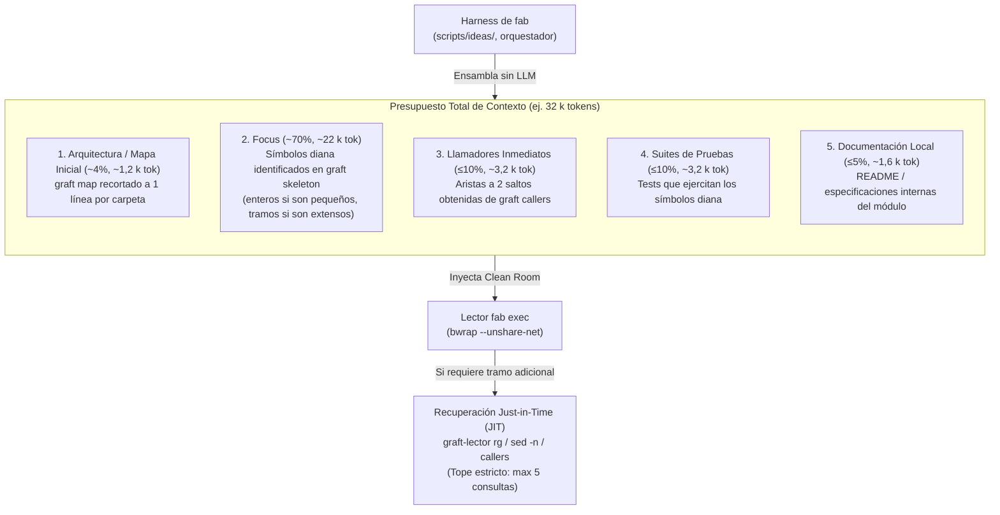
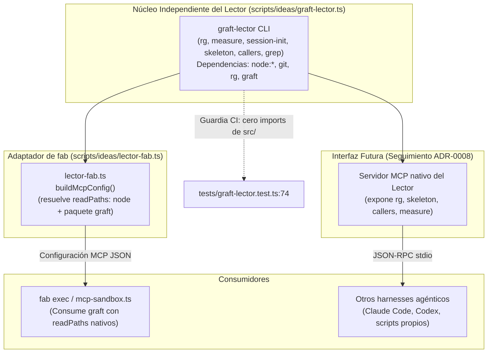

# 06 · Selección de Contexto

Esta página aborda la selección de contexto y el empaquetado presupuestario de código en repositorios grandes para el rol Lector de fab investigación. Se fundamenta en la síntesis de la literatura de la industria, las evidencias de la web y el análisis arquitectónico de sistemas de referencia (`docs/research/arquitectura-ideacion/codesearch/README.md:42-82`, `docs/research/arquitectura-ideacion/codesearch/web-contexto.md:1-171`), revisado y formalizado con la aceptación del **ADR-0008 (aceptado el 2026-11-02)** (`docs/research/arquitectura-ideacion/adr/ADR-0008-probe-por-tipo-de-fuente.md:1-142`).

El principio de diseño adoptado es: **el mapa estructural sirve para orientarse; el resto del contexto se recupera bajo demanda mediante un paquete con presupuesto segmentado y búsqueda agéntica**.

!!! success "Implementado: Fase A de graft-lector y lector-fab"
    El núcleo independiente `scripts/ideas/graft-lector.ts:1-233` (Bun/TypeScript) y el adaptador `scripts/ideas/lector-fab.ts:1-22` están implementados y verificados con 10 pruebas unitarias e integración en `tests/graft-lector.test.ts:1-79` y `tests/lector-fab.test.ts:1-20`. Implementan `rg` acotado, `measure`, `ProbeBudget`, control de sesión con corte, mejoras M2–M4 y configuración MCP con `readPaths`.

!!! info "Propuesto (v0.2)"
    El empaquetador de contexto estratificado del harness del ciclo general, la extracción del lector a un repositorio externo independiente y la integración del ciclo automático en `scripts/ideas/` continúan como **propuesta v0.2**.

---

## 1. Sistemas de Referencia y las Dos Escuelas

El análisis sistemático de cómo los agentes modernos seleccionan contexto en repositorios $\ge 500\text{ k}$ líneas revela una convergencia unánime: **ningún sistema vuelca el árbol completo al prompt** (`docs/research/arquitectura-ideacion/codesearch/README.md:59-67`, `docs/research/arquitectura-ideacion/codesearch/web-contexto.md:11-32`).

### Comparativa de Sistemas de Referencia

| Sistema | Qué entra al prompt inicial | Mecanismo de recuperación posterior | ¿Usa LLM para construir el mapa? | Presupuesto y Límites | Fuente y Cita |
|---|---|---|---|---|---|
| **Aider** | *Repo map* esquelético: firmas ordenadas por PageRank | Búsqueda agéntica a demanda (`/add` de archivos) | **No** (Tree-sitter estático + `networkx.pagerank`) | **1 024 tokens** por defecto (duplicado a 2 048 si no hay archivos en chat) | `repomap.py:493-514`; `docs/research/arquitectura-ideacion/codesearch/web-contexto.md:25` |
| **Terrain** | `context.md` conciso | Búsqueda bajo demanda; aristas vía CodeGraph; no precarga `repomix.md` | **Sí** (`context.md` lo escribe un LLM) | $\le 14\text{ 000}$ caracteres (**~3,5 k tokens**) | `ext/codesearch/terrain/crates/terrain-core/src/agent_context.rs:245`; `freshness/compute.rs:47` |
| **graphicle** | Nada estático fijo | Arma un **paquete por pregunta** (BM25 + símbolos + grafo) | **No** (100% determinista y local) | **32 k tokens** por defecto vía MCP; hook de prompt 8 400 caracteres | `ext/codesearch/graphicle/crates/graphicle/src/code_pack.rs:57`; `docs/pack.md` |
| **Claude Code** | `CLAUDE.md` jerárquicos y system prompt | Búsqueda agéntica con `GlobTool`, `GrepTool` ([`rg`](07-rg-y-limites-de-tree-sitter.md)) y `FileReadTool` | **No** (inspección directa en disco) | Ventana 200k tokens; compactación automática al ~80% | Boris Cherny en HN #43164089; `docs/research/arquitectura-ideacion/codesearch/web-contexto.md:22` |
| **Codex CLI** | Instrucciones de sistema | Búsqueda agéntica paralela con `rg`, `glob` y lecturas de tramo | **No** | Ventana estándar; sin presupuesto estático para mapa | OpenAI Cookbook 2025; `docs/research/arquitectura-ideacion/codesearch/web-contexto.md:23` |
| **Cursor** | Instrucciones de contexto | Búsqueda híbrida (embeddings locales propios + `rg` + reranker) | **No** para el índice (árboles de Merkle e inferencia local) | Chunks acotados por AST; +12,5% precisión al combinar semántica con grep | Stefan Heule et al. 2025; `docs/research/arquitectura-ideacion/codesearch/web-contexto.md:24` |
| **Sourcegraph Cody** | Instrucciones del proyecto | 2 etapas: Zoekt (trigramas) + Code Graph (SCIP/LSIF). Retiró embeddings en 2024 | **No** | Presupuesto estricto por política y SLAs de latencia | Sourcegraph Blog 2024; `docs/research/arquitectura-ideacion/codesearch/web-contexto.md:26` |
| **GitHub Copilot** | Snippets clasificados y recortados | Búsqueda híbrida (Blackbird InfoNCE + léxico local + LSP) | **No** | Tope de **20 KiB** por comando; compactación al 80%, parada preventiva al 95% | `COPILOT_LARGE_OUTPUT_THRESHOLD_BYTES`; `docs/research/arquitectura-ideacion/codesearch/web-contexto.md:27` |
| **hindsight** | Banco de memoria de historial git y sesiones | 4 estrategias (vectorial, BM25, grafo, temporal) + RRF + cross-encoder | **Sí** (`retain` usa LLM para extraer hechos) | Acotado por tokens; requiere servidor persistente y API key | `ext/codesearch/hindsight/README.md`; `docs/research/arquitectura-ideacion/codesearch/README.md:57` |

### Las Dos Escuelas de Selección de Contexto

El ecosistema industrial se divide en dos enfoques antagónicos (`docs/research/arquitectura-ideacion/codesearch/README.md:63-67`):

1. **Escuela 1: Búsqueda Agéntica Pura sin Índice (Claude Code, OpenAI Codex):**
   - El sistema no precalcula índices persistentes. Entrega al modelo un conjunto mínimo de archivos guía (`CLAUDE.md`, `AGENTS.md`) y le proporciona herramientas de bajo nivel (`glob`, `grep`, `read_file`).
   - *Ventajas:* Cero desactualización (*zero index drift*), privacidad absoluta (cero exportación de código) y máxima precisión léxica sobre identificadores exactos.
   - *Desventajas:* Mayor consumo de turnos exploratorios (10 a 30 turnos por tarea).
2. **Escuela 2: Paquete Preparado por el Sistema (graphicle, Cursor, Cody):**
   - Un motor de recuperación externo (harness o recuperador especializado) reúne candidatos mediante grafos y heurísticas léxicas/semánticas, ensamblando un paquete estructurado antes de convocar al modelo.
   - *Ventajas:* Reduce los turnos de exploración a 2–5 consultas y acota la variabilidad de la navegación.
   - *Conclusión empírica de Cursor:* La mayor precisión se logra **combinando búsqueda semántica con grep** (`docs/research/arquitectura-ideacion/codesearch/web-contexto.md:51`).

---

## 2. El Paquete con Presupuesto por Secciones (Patrón graphicle)

Para el lector de fab investigación se adopta el **patrón de empaquetado estructurado por secciones con presupuesto cerrado** de `graphicle` (`ext/codesearch/graphicle/crates/graphicle/src/code_pack.rs:57-120`, `docs/research/arquitectura-ideacion/codesearch/README.md:51,71-80`):



### Reglas Arquitectónicas del Paquete en fab

1. **Construido por el Harness, nunca por el Lector (ADR-0007):**
   El paquete lo ensambla el orquestador combinando salidas deterministas de `graft` y `rg`. **No se emplea ningún LLM sobre el repositorio no confiable** para resumir o clasificar archivos (`docs/research/arquitectura-ideacion/codesearch/README.md:73`).
2. **Reparto Porcentual Estricto:**
   - **Arquitectura (~4%):** Un resumen esquelético del árbol generado por `graft map` (una línea descriptiva por directorio clave).
   - **Focus:** Definiciones centrales extraídas con `graft skeleton`. Los archivos pequeños (< 100 líneas) se incluyen enteros; los archivos extensos se recortan a los tramos de las funciones implicadas.
   - **Llamadores (≤ 10%):** Vecindario de llamadas a 2 saltos (`graft callers`).
   - **Tests (≤ 10%):** Casos de prueba asociados a los símbolos identificados.
   - **Documentación (≤ 5%):** Notas de diseño locales presentes en el repositorio.
3. **Recuperación Just-in-Time (JIT) y Búsqueda Agéntica:**
   Si el lector requiere profundizar en una arista o tramo no cubierto en el paquete, recurre a búsqueda agéntica directa con `graft-lector rg` o `graft-lector callers` bajo demanda (ver [07 · ripgrep y límites de tree-sitter](07-rg-y-limites-de-tree-sitter.md)), sujeto a los topes de `ProbeBudget` (`scripts/ideas/graft-lector.ts:92-120`).
4. **Invalidación y Frescura por Commit:**
   El paquete registra el hash de commit Git indexado (`git rev-parse HEAD`). Si el pin del repositorio cambia en el ledger, el paquete se reconstruye de forma incremental (patrón de Terrain; `docs/research/arquitectura-ideacion/codesearch/README.md:79`).

---

## 3. Estado de las Mejoras en la Implementación Real (Fase A)

Tras la implementación de la Fase A (`docs/research/arquitectura-ideacion/codesearch/medicion/implementacion-fase-a.md:1-99`) y la verificación en dos repositorios (`docs/research/arquitectura-ideacion/adr/ADR-0008-probe-por-tipo-de-fuente.md:78-86`), el estado de las mejoras es el siguiente:

### Tabla de Mejoras y Estado de Implementación

| # | Mejora Propuesta | Problema | Estado en Fase A | Implementación en Código |
|---|---|---|---|---|
| **M1** | **Semillas de hipótesis** | P1, P2, P5 | **Retirada:** Medida sin efecto en hit@1 y hit@5 en opencode. Borrada del código. | Test `tests/graft-lector.test.ts:30-33` verifica que `buildSeedIndex`, `extractSeeds` y `prioritize` ya no se exportan. |
| **M2** | **Desambiguación fail-closed** | P4 | **Adoptada e Implementada:** Si hay $>1$ definición homónima, no elige: devuelve la lista de candidatos con `archivo:línea` y referencias. | `scripts/ideas/graft-lector.ts:24-31` (`candidatesOrNull`), test `tests/graft-lector.test.ts:7-13`. |
| **M3** | **Salida acotada y vista previa de exports** | P5 | **Adoptada e Implementada:** `bound()` desvía salidas $> 8\text{ KB}$ a archivo temporal. Conserva cabecera (`head`) y prioriza símbolos exportados (`exportRank`). | `scripts/ideas/graft-lector.ts:35-53, 64-74`, tests `tests/graft-lector.test.ts:15-22, 40-48`. |
| **M4** | **Frescura $O(1)$ con sidecar** | Frescura | **Adoptada e Implementada:** `init` registra commit y fecha en `.lector-meta.json`. Valida contra `git rev-parse HEAD` y sale con código 3 si difiere. | `scripts/ideas/graft-lector.ts:57-61, 154-161` (`staleness`), test `tests/graft-lector.test.ts:24-28`. |
| **A2** | **Búsqueda agéntica `rg` integrada** | Localización | **Adoptada e Implementada:** Subcomando [`rg`](07-rg-y-limites-de-tree-sitter.md) con formato uniforme, ordenación por ruta, cabecera de líneas/archivos y spill a disco (ver análisis en [07](07-rg-y-limites-de-tree-sitter.md)). | `scripts/ideas/graft-lector.ts:77-81, 206-212` (`rgReport`), test `tests/graft-lector.test.ts:35-38`. |
| **A4** | **Medición de tokens determinista** | Umbral | **Adoptada e Implementada:** Subcomando `measure` sobre `git ls-files`; calcula `tokens_medidos` y evalúa `leer_entero` vs `bajar_nivel`. | `scripts/ideas/graft-lector.ts:84-89, 163-175` (`tokensOf`, `measureDecision`), test `tests/graft-lector.test.ts:50-54`. |
| **A5** | **Control de sesión y presupuestos** | Presupuesto | **Adoptada e Implementada:** Tipo `ProbeBudget` y comando `session-init`. Cuenta consultas y bytes; corta con código 5 al superar topes. | `scripts/ideas/graft-lector.ts:92-120, 137-148, 215-219` (`validateProbeBudget`, `chargeSession`), test `tests/graft-lector.test.ts:56-71`. |

---

## 4. El Lector como Producto Independiente

Un principio arquitectónico derivado de la implementación de la Fase A es la **estricta separación entre el núcleo del lector y el motor de fab** (`docs/research/arquitectura-ideacion/codesearch/medicion/implementacion-fase-a.md:21-29`):

### Arquitectura de Desacoplamiento

1. **Núcleo Agnóstico (`scripts/ideas/graft-lector.ts`):**
   - El archivo central del lector (`233 líneas`) solo importa módulos de la biblioteca estándar de Node (`node:child_process`, `node:fs`, `node:os`, `node:path`).
   - Depende exclusivamente de Bun/Node en el host y de las herramientas CLI externas `git`, `rg` y `graft`.
   - **No importa ningún módulo de `src/` de fab.**
2. **Adaptador Específico de fab (`scripts/ideas/lector-fab.ts`):**
   - Todo lo acoplado a las convenciones de configuración de fab vive en este archivo auxiliar de 22 líneas.
   - Expone `buildMcpConfig(graftBin, nodeBin)` (`scripts/ideas/lector-fab.ts:8-16`), que resuelve las rutas absolutas (`realpathSync`) requeridas para que Bubblewrap monte el binario `node` y la raíz del paquete `@nanonets/graft`.
3. **Test de Guardia de Independencia:**
   - La suite incluye una prueba automatizada (`tests/graft-lector.test.ts:74-79`) que escanea estáticamente los imports del archivo `graft-lector.ts`:
   ```typescript
   test("Independencia: el núcleo no importa nada de src/ de fab", () => {
     const src = readFileSync(join(import.meta.dir, "..", "scripts", "ideas", "graft-lector.ts"), "utf8");
     const specs = [...src.matchAll(/(?:from|import)\s*\(?\s*["']([^"']+)["']/g)].map((m) => m[1]!);
     expect(specs.length).toBeGreaterThan(0);
     expect(specs.filter((x) => /(^|\/)src\//.test(x) || /lector-fab/.test(x))).toEqual([]);
   });
   ```
   Cualquier acoplamiento accidental con el código de `src/` rompe la suite de integración de forma inmediata.

### Diagrama de Frontera Arquitectónica



### Criterio de Extracción a Repositorio Propio

El lector se mantiene temporalmente dentro de `sw-factory/scripts/ideas/` por conveniencia de desarrollo y pruebas.

!!! info "Criterio Formal de Extracción"
    **El lector se extraerá a su propio repositorio de código abierto independiente tan pronto como exista un SEGUNDO CONSUMIDOR REAL** (por ejemplo, otro arnés agéntico, una herramienta de CI externa o un proyecto de investigación que consuma su CLI o su futuro servidor MCP; `docs/research/arquitectura-ideacion/adr/ADR-0008-probe-por-tipo-de-fuente.md:142`).

---

## 5. El Sandbox de fab: Configuración Nativa sin Cambios de Código

La verificación empírica del 2026-11-02 demostró que ejecutar `graft` en el sandbox estricto de fab (`src/agent/mcp-sandbox.ts:8-34`) **no requiere modificar el código del motor de fab** (`docs/research/arquitectura-ideacion/codesearch/plan-implementacion-adr-0008.md:7`):

1. **Soporte Nativo de `readPaths` en fab:**
   - El tipo `McpConfig` ya contempla la propiedad opcional `readPaths?: string[]` (`src/agent/mcp.ts:38`).
   - El método `McpServer.start` traslada directamente `config.readPaths` hacia `wrapMcpCommand` (`src/agent/mcp.ts:87-88`).
   - La validación del catálogo RPC incluye explícitamente `'readPaths'` en su lista blanca de opciones permitidas (`src/agent/rpc.ts:118`).
2. **Generación Automática de la Entrada:**
   El adaptador `scripts/ideas/lector-fab.ts:8-16` genera el bloque de configuración JSON con las rutas resueltas del entorno:
   ```json
   {
     "graft": {
       "command": "/home/orlando/.nvm/versions/node/v22.22.1/bin/graft",
       "args": ["mcp"],
       "readPaths": [
         "/home/orlando/.nvm/versions/node/v22.22.1/bin/node",
         "/home/orlando/.nvm/versions/node/v22.22.1/lib/node_modules/@nanonets/graft"
       ]
     }
   }
   ```
3. **Validación en Sandbox:**
   El test de integración `tests/lector-fab.test.ts:11-20` ejecuta `graft --version` invocando directamente `wrapMcpCommand` con aislamiento de red (`--unshare-net`) y directorio en solo lectura, verificando que arranca y reporta versión sin errores.

!!! success "Estado del Sandbox"
    El soporte del sandbox está **resuelto en la arquitectura de fab**. El único trabajo pendiente es **operativo**: conectar `graft mcp` a un agente de fab real en su archivo de configuración `mcpServers` para sesiones de producción (`docs/research/arquitectura-ideacion/adr/ADR-0008-probe-por-tipo-de-fuente.md:140`).

---

## 6. floorplan: Adoptar el Patrón, Descartar la Herramienta

La herramienta `floorplan` (Hayden Smith, v0.6.1, MIT; `ext/codesearch/floorplan`) fue auditada sobre una copia de sw-factory (715 archivos; `docs/research/arquitectura-ideacion/codesearch/floorplan.md:1-87`):

- **Componente Determinista:** Escanea archivos mediante `git ls-files` y expresiones regulares en Node (`extract.mjs:136`, sin Tree-sitter), midiendo 1,5 s y 4 110 bytes (~1 k tokens). Sus consultas CLI (`overview`, `find`, `show`, `path`) tardan ~20 ms.
- **Por Qué Choca con ADR-0007:** Su valor diferencial requiere que un LLM genere nombres llanos y descripciones para cada archivo (`SKILL.md:68-106`), lo que abriría vectores de inyección indirecta sobre repositorios ajenos no confiables. Sin LLM, solo produce un grafo de imports entre archivos sin llamadas a nivel de función (`docs/research/arquitectura-ideacion/codesearch/README.md:101`).

!!! warning "Veredicto Arquitectónico sobre floorplan"
    **Descartar la herramienta como dependencia en fab investigación; adoptar tres de sus patrones de diseño** (`docs/research/arquitectura-ideacion/codesearch/README.md:97-107`):
    1. **Hash de firma por archivo (`sig`):** Hash sobre firmas de exports/endpoints para detectar cambios reales de interfaz y arrastrar metadatos al renombrar (`floorplan.md:70`).
    2. **Arista petición web $\to$ endpoint:** Mapear enlaces frontend $\to$ backend con resolución de routers.
    3. **Superficie de consulta con cuatro verbos acotados:** Exponer `overview`, `find`, `show` y `path`.

**Ámbito de aplicación:** Se evaluará para la etapa de **operación de fab** (auditoría de repositorios de clientes con autorización explícita; `README.md:102`).

---

## 7. Memoria entre Tareas: Etapa de Operación, no de Ideación

A partir de la evidencia del informe de Stompy (2025) sobre memoria persistente en repositorios (`docs/research/arquitectura-ideacion/codesearch/web-contexto.md:119-124`):
1. **La memoria NO eleva la calidad del código:** Las condiciones con y sin memoria alcanzaron el mismo rango de corrección funcional (**84% – 96%**).
2. **Reducción de turnos solo en tareas transversales:** Disminuyó entre 28% y 40% los turnos de exploración y 22%–32% los costes únicamente en tareas complejas multi-módulo.
3. **Sobrecosto innecesario en tareas acotadas:** En tareas delimitadas generó mayor latencia y gasto de tokens.

En fab investigación, cada Probe es una **tarea nueva, autocontenida y aislada** sobre un repositorio fijado a un commit (`pin` en el ledger).

!!! info "Frontera Arquitectónica"
    **La memoria entre tareas pertenece a la etapa de OPERACIÓN de fab (capa C7 del sistema general), no a la etapa de IDEACIÓN** (`docs/research/arquitectura-ideacion/codesearch/README.md:70`).

---

## 8. Seguimientos no Bloqueantes (ADR-0008)

El ADR-0008 formaliza las siguientes tareas de seguimiento no bloqueantes (`docs/research/arquitectura-ideacion/adr/ADR-0008-probe-por-tipo-de-fuente.md:136-142`):

1. ~~**Filtro de `measure`**~~ **hecho (2026-11-02):** descarta los binarios que git marca como `i/-text`; opencode baja de 34,5 M a 18,9 M tokens. No filtra por extensión (el código `.ts`+`.tsx` mide ~9,4 M) (`ADR-0008-probe-por-tipo-de-fuente.md:137`).
2. ~~**Ruido en `rg`**~~ **hecho (2026-11-02):** `rg` excluye `graft/` cuando existe `graft/.graph` (`ADR-0008-probe-por-tipo-de-fuente.md:138`).
3. **Medición combinada A2 + envoltura:** Medir en tokens y comandos si apoyar la búsqueda agéntica A2 con `graft-lector` (`skeleton` y `callers` acotados más `rg`) supera a A2 solo.
4. **Conectar `graft mcp` a un agente de fab real:** Enlazar la configuración generada por `lector-fab.ts` en un agente de fab en ejecución real.
5. **Soporte multilingüe en `exportedNames`:** Ampliar la heurística de M3 para reconocer interfaces públicas en Python (`__all__`, símbolos públicos) y Go (`Mayúscula inicial`), limitada hoy a TypeScript/JavaScript (`scripts/ideas/graft-lector.ts:64-68`).
6. **Modo MCP del lector:** Exponer el propio `graft-lector` como servidor MCP y extraerlo a repositorio propio cuando exista un segundo consumidor real.

---

## Archivos

| Archivo | Responsabilidad |
|---|---|
| `docs/research/arquitectura-ideacion/adr/ADR-0008-probe-por-tipo-de-fuente.md` | ADR formal aceptado el 2026-11-02 (Decisión 2 revisada, M1 retirada, validación cruzada). |
| `scripts/ideas/graft-lector.ts` | Núcleo independiente del lector (`:1-233`): M2–M4, `rg` acotado, `measure`, `ProbeBudget` y sesión. |
| `scripts/ideas/lector-fab.ts` | Adaptador MCP de fab (`:1-22`): genera configuración con `readPaths` resueltos para el sandbox. |
| `tests/graft-lector.test.ts` | Pruebas unitarias del lector (`:1-79`, 9 tests): M2–M4, A1–A5 e independencia de imports. |
| `tests/lector-fab.test.ts` | Prueba de integración de sandbox (`:1-20`, 1 test): valida `wrapMcpCommand` con `readPaths`. |
| `docs/research/arquitectura-ideacion/codesearch/medicion/implementacion-fase-a.md` | Informe de implementación de la Fase A (`graft-lector.ts` y `lector-fab.ts`). |
| `docs/research/arquitectura-ideacion/codesearch/medicion/deerflow.md` | Informe empírico de validación cruzada sobre `deer-flow` (Python). |
| `techdocs/docs/investigacion/07-rg-y-limites-de-tree-sitter.md` | Documentación técnica de `rg` y límites medidos de tree-sitter. |
| `src/agent/mcp.ts` | Soporte nativo de `readPaths` en `McpConfig` (`:38`) y pase a `wrapMcpCommand` (`:87-88`). |
| `src/agent/rpc.ts` | Lista blanca de opciones MCP permitidas (`:118`). |
| `src/agent/mcp-sandbox.ts` | Confinamiento en Bubblewrap con montaje de `readPaths` (`:18, 27`). |
