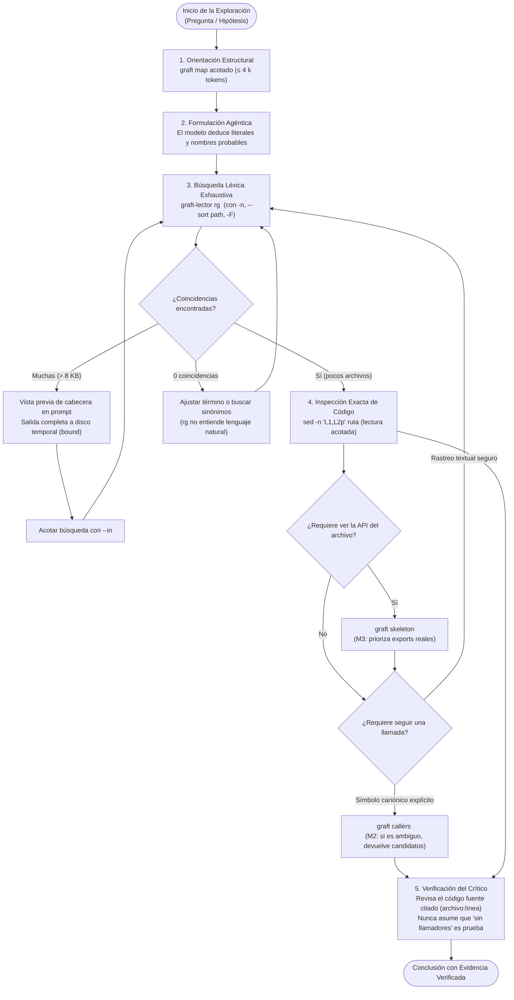

# 07 · ripgrep (`rg`) y los Límites de tree-sitter

Esta página explica qué es la herramienta de búsqueda `rg` (ripgrep), qué es el analizador sintáctico `tree-sitter` junto con los mapas de código basados en él (como el generado por `graft`), por qué los modelos sintácticos estáticos resultaron insuficientes para la exploración autónoma de repositorios grandes según la evidencia medida en `fab`, y cuál es la división de responsabilidades adoptada en el rol de **Lector**.

---

## 1. Qué es `rg` (ripgrep)

Para quien nunca ha utilizado un terminal de desarrollo, **`rg`** (abreviatura de [ripgrep](https://github.com/BurntSushi/ripgrep)) es un programa ejecutable por línea de comandos diseñado para buscar texto o patrones dentro de múltiples archivos a la vez.

Si un repositorio de software es como una biblioteca con decenas de miles de documentos, `rg` actúa como un índice ultrarrápido que recorre todas las páginas en milisegundos y muestra exactamente en qué archivo y en qué número de línea aparece una palabra o frase determinada.

### En qué se diferencia del clásico `grep`

El comando tradicional de sistemas tipo Unix es `grep` (creado en la década de 1970). Aunque ambos buscan texto, `rg` resuelve tres problemas fundamentales de los repositorios modernos:

1. **Respeta reglas de exclusión (`.gitignore` y `.ignore`):** `grep` busca a ciegas en todos los archivos que encuentra, incluyendo directorios masivos de dependencias (como `node_modules/` o `target/`), binarios y archivos temporales. En cambio, `rg` lee automáticamente los archivos `.gitignore` y omite todo lo que no forme parte del código versionado.
2. **Es recursivo por defecto:** Mientras que `grep` requiere parámetros adicionales como `-r` para descender a los subdirectorios, `rg` explora por defecto todo el árbol del proyecto desde la carpeta en que se invoque.
3. **Velocidad extrema:** Escrito en el lenguaje Rust sobre un motor de expresiones regulares multihilo con aceleración SIMD, `rg` escanea monorepos de cientos de miles de líneas en fracciones de segundo (por ejemplo, ~60 ms para recorrer ~920 000 líneas en `opencode`, `docs/research/arquitectura-ideacion/codesearch/README.md:15`).

### Opciones utilizadas por el Lector en `fab`

Dentro del arnés de investigación de `fab`, el comando auxiliar `graft-lector rg` (`scripts/ideas/graft-lector.ts:215-221`) invoca a `rg` con las siguientes opciones de control:

- **`-n`**: Muestra el número de línea exacto de cada coincidencia (`scripts/ideas/graft-lector.ts:217`).
- **`-F`** (`--fixed`): Desactiva la interpretación de expresiones regulares y busca la cadena literal exacta, evitando que caracteres como `.`, `*` o `[` rompan la consulta (`scripts/ideas/graft-lector.ts:217`).
- **`--sort path`**: Ordena las coincidencias de forma determinista por la ruta del archivo, garantizando que dos ejecuciones idénticas devuelvan la misma salida bit a bit (`scripts/ideas/graft-lector.ts:217`).
- **`--max-columns 200` y `--max-columns-preview`**: Trunca las líneas que superen los 200 caracteres para evitar que archivos generados o líneas minificadas colapsen la memoria o la ventana de contexto del modelo (`scripts/ideas/graft-lector.ts:217`).
- **`-g '!/graft/'`**: Excluye el directorio `.graph/` o `graft/` generado por la herramienta de indexado si existe `graft/.graph`, eliminando falsos positivos procedentes de las fichas del propio índice (`scripts/ideas/graft-lector.ts:217`, seguimiento formalizado en `docs/research/arquitectura-ideacion/adr/ADR-0008-probe-por-tipo-de-fuente.md:138`).
- **Cabecera de conteo (`rgReport`)**: La función `rgReport` antepone una cabecera estructurada del tipo `"<patrón>" — N líneas en M archivos (rg; respeta .gitignore/.ignore)` (`scripts/ideas/graft-lector.ts:77-81`), de modo que el modelo conozca el orden de magnitud del hallazgo incluso si la salida debe truncarse.

### Ejemplo real de salida

El siguiente fragmento es una ejecución real sobre `ext/opencode` @ `79469efc` (2026-11-02, ya con la exclusión `-g '!/graft/'`), con `--max-bytes 600` para forzar el truncado:

```text
$ bun scripts/ideas/graft-lector.ts rg permission.asked --fixed --repo . --max-bytes 600
"permission.asked" — 55 líneas en 40 archivos (rg; respeta .gitignore/.ignore)
./packages/app/e2e/regression/multi-server.spec.ts:168:      type: "permission.asked",
./packages/app/src/runtime/server/client.test.ts:9:  type: "permission.asked",
./packages/app/src/runtime/server/client.test.ts:18:} satisfies Extract<OpenCodeEvent, { type: "permission.asked" }>
./packages/app/src/runtime/server/client.test.ts:30:    server.event.on("permission.asked", (event) => {
./packages/app/src/runtime/server/client.test.ts:56:    repoEvents.on("permission.asked", (event) => {
[truncado: 5548 bytes en total, 6 de 56 líneas; salida completa en /tmp/lector-BoCCYl/salida.txt]
```

*(Antes de la exclusión, la misma búsqueda daba 59 líneas en 44 archivos: las 4 de más eran fichas del índice en `graft/`; `docs/research/arquitectura-ideacion/codesearch/medicion/implementacion-fase-a.md:53`, `docs/research/arquitectura-ideacion/adr/ADR-0008-probe-por-tipo-de-fuente.md:138`).*

---

## 2. Qué es tree-sitter y qué es un Grafo de Código

Para comprender los límites del análisis estático, es necesario clarificar qué papel desempeña **tree-sitter** y cómo se construyen herramientas de navegación de código como **graft**.

### Qué es tree-sitter

**tree-sitter** es una biblioteca generadora de analizadores sintácticos (*parsers*). Cuando un humano o un compilador lee código, no lo procesa como una secuencia ciega de letras, sino como una estructura jerárquica con reglas gramaticales.

tree-sitter toma un archivo fuente en cualquier lenguaje compatible (TypeScript, Python, Go, Rust, etc.) y genera un **Árbol Sintáctico Abstracto** (*Abstract Syntax Tree* o AST). En este árbol, el código queda etiquetado en bloques lógicos: "aquí comienza una función llamada `calcular`", "estos son sus argumentos", "aquí hay una clase", "esta es una cláusula `import`".

### Qué es un mapa o grafo de código con graft

La herramienta `graft` (utilizada en `fab` como soporte estructural; `docs/research/arquitectura-ideacion/adr/ADR-0008-probe-por-tipo-de-fuente.md:14-16`) utiliza tree-sitter para analizar todos los archivos del repositorio en una fase de indexación estática (`graft build`).

A partir de los árboles sintácticos de cada archivo, `graft` construye un **grafo de llamadas y dependencias** (`wiring.json`):

- **Nodos:** Cada símbolo formalmente declarado (clases, funciones, métodos, tipos de datos).
- **Aristas (conexiones):** Relaciones directas entre nodos deducidas por la sintaxis (por ejemplo, si la función `A` contiene una instrucción `B()`, se dibuja una arista de llamada de `A` hacia `B`).

### Qué ve y qué no ve tree-sitter

| Dimensión | Qué SÍ ve tree-sitter (Sintaxis) | Qué NO ve tree-sitter (Significado / Semántica) |
|---|---|---|
| **Estructuras** | Declaraciones canónicas explícitas (`function foo()`, `class Bar`, `interface Config`). | Patrones funcionales dinámicos, closures anidados, constructores envueltos en funciones de biblioteca. |
| **Firmas** | Nombres de funciones, listas de parámetros declarados y tipos estáticos explícitos. | Tipos dinámicos en tiempo de ejecución, polimorfismo indirecto, resolución tardía (*duck typing*). |
| **Relaciones** | Llamadas léxicas directas donde el identificador en el texto coincide de forma unívoca con la definición. | Inyección de dependencias (DI), eventos publicados por cadena de texto (*pub/sub*), paso de mensajes o tablas de despacho. |
| **Semántica** | Tokens textuales del lenguaje de programación. | Intención conceptual: no sabe si una función "resume una sesión" si dicha función se llama `compact()` o `prune()`. |

---

## 3. Por qué tree-sitter no fue suficiente: Evidencia Medida

Durante la fase de diseño del ADR-0008, la hipótesis inicial era que un agente podría comprender y explorar un repositorio apoyándose primordialmente en el grafo estático de llamadas (`graft ask`, `graft callers`, `graft skeleton`).

La experimentación controlada sobre dos repositorios reales —`ext/opencode` (TypeScript con paradigma funcional Effect, 920 000 líneas) y `ext/deer-flow` (Python, 871 000 líneas)— demostró de forma concluyente que **el grafo estático es ciego a la estructura real de ejecución**.

### 3.1. Ceguera ante símbolos sin forma canónica de declaración

tree-sitter busca patrones gramaticales estándar (`function_declaration`, `class_declaration`). Cuando un proyecto utiliza estilos funcionales avanzados o constructores de orden superior, los símbolos no adoptan la forma de una declaración formal y quedan invisibles en el AST:

- **Efecto de closures funcionales (`Effect.fn` en opencode):** En `packages/core/src/permission.ts`, las funciones nucleares de autorización `ask` (línea 214) y `assert` (línea 228) están definidas dentro de cierres funcionales de la biblioteca Effect-TS. El analizador de graft solo extrajo 22 símbolos de nivel superior en ese archivo, ignorando por completo `ask` y `assert` (`docs/research/arquitectura-ideacion/codesearch/medicion/m1-m4.md:67`).
- **Omisión de funciones clave:** En `packages/core/src/tool.ts:115`, la función crítica `executeTool` tampoco fue registrada en el grafo `wiring.json` (`docs/research/arquitectura-ideacion/adr/ADR-0008-probe-por-tipo-de-fuente.md:76`).
- **Superficie incompleta en T5 (`skeleton`):** Al inspeccionar la API de `packages/core/src/session/compaction.ts`, el comando `rg '^export '` reveló exactamente **12 símbolos exportados** (`docs/research/arquitectura-ideacion/codesearch/medicion/m1-m4.md:81`). En cambio, `graft skeleton` devolvió únicamente 10 de ellos: omitió `layer` y `node` porque estaban declaradas como constantes asignadas a llamadas complejas (`Layer.effect` y `makeLocationNode`), y en su lugar saturó la salida listando unas 40 funciones internas privadas no exportadas (`docs/research/arquitectura-ideacion/codesearch/medicion/m1-m4.md:81`, `docs/research/arquitectura-ideacion/adr/ADR-0008-probe-por-tipo-de-fuente.md:74,81`).

### 3.2. Colisión de nombres homónimos sin resolución semántica

tree-sitter no es un compilador: no enlaza tipos entre proyectos ni resuelve polimorfismo. Compara meros nombres textuales. Si múltiples clases definen un método con el mismo nombre, el grafo colapsa ante la ambigüedad:

- **Medición en deer-flow (`ext/deer-flow` @ `35656d6`, ~871 k líneas `.py`):**
  - La consulta `graft callers evaluate` devolvió **25 definiciones distintas** con el nombre `evaluate` (un volcado de 17 609 bytes; `docs/research/arquitectura-ideacion/codesearch/medicion/deerflow.md:87`). Ante tal volumen, el motor de graft reportó:
    > *"no indexed callers — 25 definitions share the name 'evaluate'; a cross-file caller of an ambiguous name is dropped rather than guessed"* (`docs/research/arquitectura-ideacion/codesearch/medicion/deerflow.md:87`).
    La llamada real desde `GuardrailMiddleware.wrap_tool_call` hacia el proveedor de políticas fue descartada para evitar conjeturas erróneas.
  - La consulta `graft callers wrap_tool_call` encontró **30 definiciones homónimas** (39 849 bytes), mostrando únicamente llamadas desde tests unitarios y perdiendo el flujo principal de ejecución (`docs/research/arquitectura-ideacion/codesearch/medicion/deerflow.md:88`).
- **Respuesta en opencode:** La consulta `graft callers execute` arrojó **26 definiciones homónimas** (10 202 bytes; `docs/research/arquitectura-ideacion/codesearch/medicion/m1-m4.md:60`).
- **Mitigación M2 adoptada:** Para no engañar al modelo con falsas conjeturas, el adaptador `graft-lector` implementa la regla fail-closed `candidatesOrNull` (`scripts/ideas/graft-lector.ts:24-31`): ante más de una definición, no elige ninguna; devuelve la lista de candidatos (`AMBIGUO: N definiciones`) con `archivo:línea` para obligar al modelo a acotar con `--in` (`docs/research/arquitectura-ideacion/adr/ADR-0008-probe-por-tipo-de-fuente.md:38,83`).

### 3.3. Aristas invisibles en la sintaxis: Eventos, Inyección de Dependencias y Despacho Dinámico

En el desarrollo de software real, una gran parte de las interacciones entre subsistemas no utiliza llamadas sintácticas directas `A() -> B()`:

1. **Eventos desacoplados por cadenas de texto:** En `opencode`, la invocación de permisos se comunica mediante eventos con nombre literal `"permission.asked"` (`packages/schema/src/permission.ts:45`, `docs/research/arquitectura-ideacion/codesearch/medicion/a2-y-sandbox.md:46`). El emisor emite el string y el receptor escucha el string. Para tree-sitter son dos cadenas aisladas; no existe ninguna arista en el grafo que las vincule.
2. **Inyección de dependencias y dispatch dinámico:** En sistemas modulares, los servicios se ensamblan en tiempo de ejecución. En la tarea T2 sobre `opencode`, **ninguna de las herramientas estáticas evaluadas logró conectar la ejecución de herramientas (`executeTool`) con la verificación de políticas (`Permission.assert`)** (`docs/research/arquitectura-ideacion/adr/ADR-0008-probe-por-tipo-de-fuente.md:42`, `docs/research/arquitectura-ideacion/codesearch/README.md:31`).

!!! warning "Regla del Crítico en fab (ADR-0008)"
    **«Una arista ausente en el grafo estático no prueba nada»** (`docs/research/arquitectura-ideacion/adr/ADR-0008-probe-por-tipo-de-fuente.md:42`).
    Si una consulta a `callers` indica que un símbolo no tiene llamadores, el crítico de investigación no puede aceptar esa ausencia como prueba de aislamiento. Las llamadas dinámicas, los eventos y la inyección de dependencias se pierden en el AST. El crítico verifica siempre las afirmaciones leyendo los tramos reales con citas `archivo:línea`.

### 3.4. Acierto de `graft ask` frente a la Búsqueda Agéntica con `rg`

La prueba de fuego para el grafo consistió en comparar el comando de lenguaje natural `graft ask` (brazo A0) frente a la búsqueda agéntica directa en terminal con `rg`, `find` y `sed -n` (brazo A2) a lo largo de las 5 tareas de referencia (T1–T5 con redacciones en español R1 e inglés R2/R3):

| Métrica de Evaluación | opencode (TypeScript/Effect)<br/>`m1-m4.md`, `a2-y-sandbox.md` | deer-flow (Python)<br/>`deerflow.md`, `ADR-0008` |
|---|:---:|:---:|
| **Acierto global Búsqueda Agéntica (brazo A2 con `rg` / `sed`)** | **5 / 5 (100 %)** (`a2-y-sandbox.md:22`) | **5 / 5 (100 %)** (`deerflow.md:39`) |
| Consumo de tokens en búsqueda agéntica A2 | 168 686 bytes (~42 k tokens; `a2-y-sandbox.md:22`) | 72 393 bytes (~18 k tokens; `deerflow.md:39`) |
| Comandos de shell ejecutados en A2 | 52 comandos (`a2-y-sandbox.md:22`) | 39 comandos (`deerflow.md:39`) |
| Tiempo total de shell en A2 | 1 126 ms (`a2-y-sandbox.md:22`) | 313 ms (`deerflow.md:39`) |
| **`graft ask`: archivo en hit@1** | 1 / 9 (11,1 %) (`m1-m4.md:49`) | 1 / 9 (11,1 %) (`deerflow.md:69`) |
| **`graft ask`: archivo en hit@5** | 2 / 9 (22,2 %) (`m1-m4.md:49`) | 4 / 9 (44,4 %) (`deerflow.md:70`) |
| **`graft ask`: símbolo en hit@1** | 0 / 9 (0 %) (`m1-m4.md:49`) | 0 / 9 (0 %) (`deerflow.md:71`) |
| **`graft ask`: símbolo en hit@5** | 0 / 9 (0 %) (`m1-m4.md:49`) | 4 / 9 (44,4 %) (`deerflow.md:72`) |
| **`graft ask`: consultas en español (R1)** | **0 / 3 (0 % de acierto)** (`deerflow.md:131`) | **0 / 3 (0 % de acierto)** (`deerflow.md:74,131`) |
| **Exhaustividad T3 (`graft grep` vs `rg`)** | `rg`: 44 archivos / 60 ocurrencias (antes de excluir `graft/`; 40 archivos después)<br/>`graft grep`: 21 archivos / 36 aciertos (`m1-m4.md:73-74`) | `rg`: 11 archivos / 74 ocurrencias<br/>`graft grep`: 10 archivos / 64 aciertos (`deerflow.md:36,85`) |

El contraste es demoledor: la búsqueda agéntica con `rg` alcanzó el **100 % de aciertos** (5/5 en ambos repositorios), mientras que `graft ask` fracasó sistemáticamente en identificar los símbolos específicos (0/9 en opencode) y mostró un **fracaso total del 0/3 en consultas formuladas en español**, provocando falsos positivos léxicos (como asociar la palabra castellana "resume" con métodos de reanudación `resume()` en lugar de compactación; `deerflow.md:74`, `m1-m4.md:39`). Además, `graft grep` omitió sistemáticamente archivos no indexados (como documentación Markdown `docs/GUARDRAILS.md`; `deerflow.md:85`).

### 3.5. El mapa completo no cabe en la ventana de contexto

Un mapa de grafo exhaustivo no es una alternativa viable para alimentar directamente la ventana del LLM:

- En `ext/opencode` @ `79469efc`, el código fuente suma **37,8 MB**, equivalentes a unos **9,4 M tokens** (`docs/research/arquitectura-ideacion/adr/ADR-0008-probe-por-tipo-de-fuente.md:8,137`).
- El archivo de grafo `wiring.json` generado por graft ocupa **32,3 MB** con **32 188 símbolos y 80 077 aristas** (`docs/research/arquitectura-ideacion/adr/ADR-0008-probe-por-tipo-de-fuente.md:9`).
- La medición bruta con `git ls-files` sin filtrar binarios arrojó **34,5 M tokens** (137,9 MB; `docs/research/arquitectura-ideacion/codesearch/medicion/implementacion-fase-a.md:41,46`), y tras el filtro de binarios del 2026-11-02 se ajustó a **18,9 M tokens** (`docs/research/arquitectura-ideacion/adr/ADR-0008-probe-por-tipo-de-fuente.md:137`).
- **Práctica en sistemas industriales de referencia:** Ningún sistema moderno transfiere el mapa completo (`docs/research/arquitectura-ideacion/codesearch/README.md:23,59-62`, `docs/research/arquitectura-ideacion/codesearch/web-contexto.md:21-31`):
  - **Aider** limita su mapa a **1 024 tokens** por defecto (`repomap.py:493-514`, `docs/research/arquitectura-ideacion/codesearch/web-contexto.md:25`).
  - **Terrain** restringe su `context.md` a $\le 14\text{ 000}$ caracteres (**~3,5 k tokens**; `agent_context.rs:245`, `docs/research/arquitectura-ideacion/codesearch/web-contexto.md:24`).
  - **fab lector** establece un tope máximo para el mapa recortado de $\le 4\text{ k}$ tokens (`docs/research/arquitectura-ideacion/adr/ADR-0008-probe-por-tipo-de-fuente.md:33`).

### 3.6. El índice se desactualiza (*Index Drift*)

Los repositorios vivos reciben cambios constantemente. Un índice en disco representa una instantánea fija que envejece con cada commit (*Index Drift*; `docs/research/arquitectura-ideacion/codesearch/web-contexto.md:43`):

- Si el código cambia y el índice no se reconstruye, el modelo cita archivos renombrados, líneas desplazadas o funciones ya inexistentes.
- **Mecanismo de detección M4 en `graft-lector`:** El comando `init` genera un archivo sidecar `.lector-meta.json` asociando el commit con la fecha (`scripts/ideas/graft-lector.ts:55,166`). En cada consulta posterior a graft, la función `staleness` (`scripts/ideas/graft-lector.ts:58-61`) compara dicho commit con `git rev-parse HEAD`. Si difieren, interrumpe inmediatamente con **código de salida 3** (`scripts/ideas/graft-lector.ts:192`, `docs/research/arquitectura-ideacion/codesearch/medicion/m1-m4.md:89`, `docs/research/arquitectura-ideacion/adr/ADR-0008-probe-por-tipo-de-fuente.md:85`).
- Nótese que `rg` no padece este problema: el comando `rg` en `graft-lector` se ejecuta directamente sobre el sistema de archivos vivo, por lo que nunca queda bloqueado por la obsolescencia del índice (`scripts/ideas/graft-lector.ts:192,216-218`).

---

## 4. Reparto de Papeles: Cómo Trabaja el Lector

A partir de estas mediciones, el **ADR-0008 (Decisión 2 revisada)** redefinió radicalmente el papel de cada herramienta:

1. **Localizador y rastreador principal (Búsqueda Agéntica):**
   - El modelo formula búsquedas léxicas precisas con `rg` (subcomando `graft-lector rg`).
   - Lee fragmentos exactos de código mediante tramos (`sed -n "L1,L2p" ruta`).
   - Sigue los saltos entre archivos analizando los imports y llamadas reales en el texto del tramo.
2. **Apoyo complementario y acotado (graft):**
   - **`graft map` recortado ($\le 4\text{ k}$ tokens):** Ofrece orientación estructural de primer nivel al comenzar el Probe.
   - **`graft skeleton`:** Una vez localizado un archivo mediante `rg`, extrae su índice de definiciones públicas priorizando los `export` (mejora M3 / A3; `scripts/ideas/graft-lector.ts:63-74,213`).
   - **`graft callers`:** Se consulta únicamente ante símbolos específicos que se sabe que están formalmente declarados, desambiguando mediante M2 (`--in`) y asumiendo siempre la regla del crítico.

### Diagrama de Flujo Operativo del Lector



---

## 5. Límites de `rg`: Por qué tampoco se puede usar a ciegas

Aunque `rg` es el motor principal de búsqueda, no es una solución mágica. Adolece de dos limitaciones críticas que el arnés de `fab` debe controlar:

### 5.1. Ceguera total ante el lenguaje natural conceptual

`rg` no posee inteligencia semántica: busca cadenas de bytes idénticas o expresiones regulares.

- Si el agente busca una descripción en lenguaje natural ("¿dónde se compacta la conversación del usuario cuando se llena la ventana?"), `rg` devuelve **0 coincidencias** (`docs/research/arquitectura-ideacion/adr/ADR-0008-probe-por-tipo-de-fuente.md:72,122`, `docs/research/arquitectura-ideacion/codesearch/README.md:25`, `techdocs/docs/investigacion/05-lectura-de-repos-grandes.md:154`).
- **Exigencia agéntica:** El modelo LLM debe actuar como puente inteligente, traduciendo conceptos abstractos a identificadores léxicos verosímiles (`compact`, `summarize`, `Permission`, `assert`, `executeTool`, `GuardrailDecision`).

### 5.2. Volcados masivos ante términos comunes (*Output Flooding*)

Si el modelo realiza una búsqueda sobre un término frecuente o genérico (como `execute`, `test`, `error` o `model`), `rg` puede localizar miles de líneas en cientos de archivos:

- En `opencode`, buscar `compaction` sin acotar arrojó **409 archivos** (`techdocs/docs/investigacion/05-lectura-de-repos-grandes.md:154`).
- Un volcado indiscriminado saturaría la ventana de contexto del LLM y multiplicaría los costes de inferencia innecesariamente.

### Mecanismos de protección en `graft-lector.ts`

Para neutralizar estos riesgos, el lector implementa dos barreras de contención deterministas:

1. **Tope de salida y desvío a disco (`bound()`):**
   - La función `bound()` (`scripts/ideas/graft-lector.ts:35-53`) establece un techo estricto de `MAX_BYTES = 8192` (**8 KB**, `scripts/ideas/graft-lector.ts:10,35`).
   - Si la salida de `rg` supera los 8 KB, el texto íntegro se guarda en un archivo efímero en disco (`/tmp/.../salida.txt`), y al contexto del agente solo se devuelve la cabecera de conteo estructurada (`rgReport`, `scripts/ideas/graft-lector.ts:77-81`) y las primeras líneas visibles, junto con la ruta del archivo completo.
2. **Presupuesto de sesión estricto (`ProbeBudget`):**
   - El tipo `ProbeBudget` y el comando `session-init` (`scripts/ideas/graft-lector.ts:100-111,145-155`) fijan un límite máximo para el número de consultas y para el volumen acumulado de bytes devueltos.
   - En cada llamada, `chargeSession` (`scripts/ideas/graft-lector.ts:116-128`) actualiza el estado. Si se supera el número de consultas permitidas o el presupuesto de bytes, el lector aborta la sesión de forma irreversible con **código de salida 5** (`scripts/ideas/graft-lector.ts:227`, `docs/research/arquitectura-ideacion/codesearch/medicion/implementacion-fase-a.md:19,65`).

---

## 6. Archivos y Rutas Citadas

| Archivo del Repositorio | Descripción y Relevancia |
|---|---|
| `scripts/ideas/graft-lector.ts` | Núcleo agnóstico del lector: subcomando `rg` (:215-221), `rgReport` (:77-81), `bound` y `MAX_BYTES = 8192` (:10, 35-53), M2 `candidatesOrNull` (:24-31), M4 `staleness` con código 3 (:58-61, 192), `ProbeBudget` y corte con código 5 (:100-128, 227). |
| `scripts/ideas/lector-fab.ts` | Adaptador específico de `fab` para configurar Bubblewrap con `readPaths` hacia Node y el paquete graft (:8-16). |
| `docs/research/arquitectura-ideacion/adr/ADR-0008-probe-por-tipo-de-fuente.md` | Decisión formal de arquitectura: el grafo como complemento y `rg` agéntico como localizador principal (:31, 98), regla del crítico (:42), seguimientos de 2026-11-02 (:137-138). |
| `docs/research/arquitectura-ideacion/codesearch/README.md` | Síntesis comparativa de 12 herramientas de codesearch, análisis de opencode y referencias de la industria (Aider, Terrain, Cursor, Copilot). |
| `docs/research/arquitectura-ideacion/codesearch/web-contexto.md` | Estudio de selección de contexto en agentes de referencia (Claude Code abandonando RAG por `rg`, presupuestos de tokens). |
| `docs/research/arquitectura-ideacion/codesearch/medicion/m1-m4.md` | Medición controlada de brazos A0 y A1 sobre `opencode` (hit@1 y hit@5 de `ask`, `callers` con Effect, T3 exhaustivo y T5 skeleton). |
| `docs/research/arquitectura-ideacion/codesearch/medicion/deerflow.md` | Medición cruzada de A0 y A2 sobre `deer-flow` (Python; 5/5 en A2, colisiones de 25-30 definiciones en `callers`, 0/3 en español en `ask`). |
| `docs/research/arquitectura-ideacion/codesearch/medicion/a2-y-sandbox.md` | Medición del brazo A2 sobre `opencode` (5/5 aciertos, comandos, tokens y tiempos) y prueba de graft en sandbox Bubblewrap. |
| `docs/research/arquitectura-ideacion/codesearch/medicion/implementacion-fase-a.md` | Informe de implementación de la Fase A: verificación de `rgReport`, spill `bound`, códigos de salida y ejemplos reales. |
| `docs/research/arquitectura-ideacion/codesearch/medicion/verdad.md` | Verdad de referencia sellada para las tareas T1–T5 sobre `opencode`. |
| `techdocs/docs/investigacion/05-lectura-de-repos-grandes.md` | Documentación técnica del flujo del lector de repositorios grandes en `fab`. |
| `techdocs/docs/investigacion/06-seleccion-de-contexto.md` | Documentación técnica de selección de contexto y presupuestos de inferencia. |
