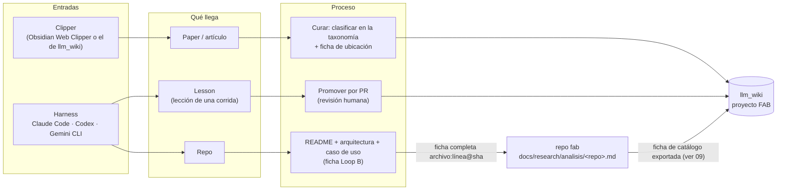
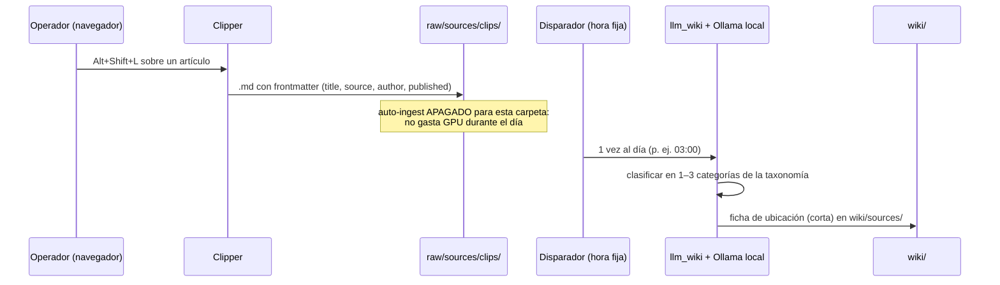
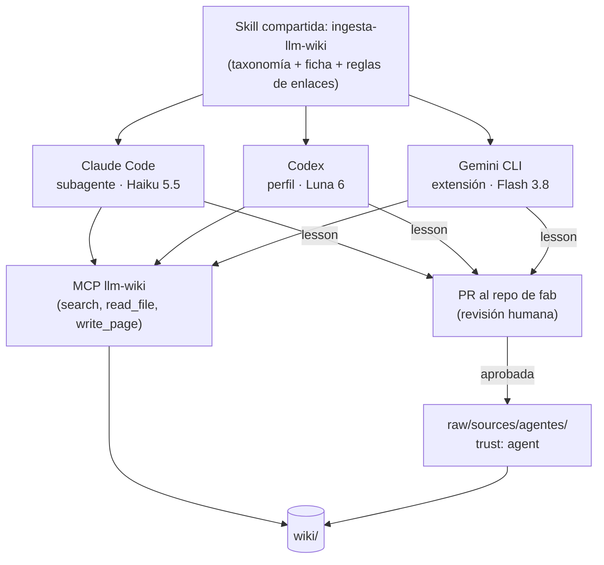
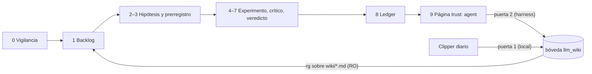

# 08 · Ingesta dual en llm_wiki: clipper local y harness en la nube

La bóveda ([03](03-boveda-llm-wiki.md)) recibe material por **dos puertas** con costes y riesgos distintos. Esta página propone separarlas: lo que captura el **clipper** del navegador lo procesa un **modelo local** en lote, a una hora fija; lo que traen los **harness** (Claude Code, Codex, Gemini CLI) lo procesa el modelo del propio harness. Las dos puertas comparten **una taxonomía** y **un formato de ficha**, de modo que encontrar el artículo correcto no dependa de quién lo ingirió.

!!! info "Propuesto"
    Nada de esta página está implementado en fab. Se apoya en piezas que **sí existen** en llm_wiki (`~/Desktop/llm_wiki_v2`) y en una prueba de ingesta con modelos locales hecha el 2026-11-08 (sección [Evidencia](#evidencia-prueba-del-2026-11-08)).

## Vista general



| Puerta | Qué trae | Modelo | Cuándo | Destino en la bóveda |
|---|---|---|---|---|
| **Clipper** | Papers y artículos | **Local** (Ollama) | En lote, a una hora fija | `raw/sources/clips/<categoría>/` |
| **Harness · lesson** | Lección de una corrida o ciclo | Del harness: Haiku 5.5, Luna 6, Flash 3.8 | Al cerrar la corrida, tras PR | `raw/sources/agentes/` con `trust: agent` |
| **Harness · repo** | Lectura de un repo | Del harness | Bajo demanda | Ficha Loop B en fab (autoridad) **y** ficha de catálogo en `raw/sources/repos/` para encontrarlo desde otros proyectos ([09](09-flujo-de-conocimiento.md#1-repos-de-referencia-en-los-dos-sitios-con-una-autoridad)) |

## Puerta 1: clipper con modelo local



Por qué local y en lote: los clips son muchos, baratos de releer y no urgentes. Un modelo local no gasta dinero y, a una hora fija, no compite por la GPU con el trabajo del día.

!!! success "Existe en llm_wiki"
    - **Taxonomía en el prompt:** el análisis de ingesta recibe `purpose.md` y `schema.md` del proyecto (`llm_wiki_v2/src/lib/ingest.ts:1081`, `buildAnalysisPrompt(purpose, index, sourceContext, schema)`). La taxonomía y el formato de ficha se escriben en `schema.md`; no hace falta tocar código para eso.
    - **Solo ingiere `raw/sources/`:** los filtros están en `src/lib/project-file-sync.ts:385` y `:428`. Las subcarpetas cuentan.
    - **Importación programada:** existe `scheduledImportConfig` con `interval` en minutos (`src/lib/scheduled-import.ts`; hoy `enabled: false, interval: 60` en FAB).
    - **Ollama como proveedor** con contexto configurable (`src/lib/llm-providers.ts:1031`, endpoint `/v1/chat/completions`).

!!! warning "Prerrequisito pendiente"
    - **Hora fija:** la importación programada es por **intervalo**, no por hora. Para «a las 03:00» hace falta un temporizador externo (systemd timer o cron) que dispare la ingesta.
    - **No hay endpoint de ingesta** en la API local (solo `POST /projects/{id}/sources/rescan`, `src-tauri/src/api_server.rs:380`), y `rescan` no re-ingiere fuentes ya vistas. El disparador externo necesita ese endpoint.
    - **Contexto de Ollama:** por el endpoint compatible con OpenAI, Ollama usa su contexto por defecto (4096). Hay que crear una variante con `PARAMETER num_ctx` (en la prueba: `gemma4-64k`).

## Puerta 2: harness con modelo de nube



Una **sola skill** con las reglas (taxonomía, formato de ficha, cuándo crear página de entidad o concepto, enlaces `[[…]]`), y un agente fino por harness que solo fija el modelo. Tres copias de las reglas acabarían divergiendo.

!!! success "Decisión cerrada: el orquestador escribe tras PR (D1)"
    La cuestión sobre quién escribe en la bóveda quedó cerrada por la decisión **D1** (ver [09](09-flujo-de-conocimiento.md#1-repos-de-referencia-en-los-dos-sitios-con-una-autoridad) y [09](09-flujo-de-conocimiento.md#integracion-completa), y la enmienda a ADR-0002): se adopta la **Opción 1**. Los agentes confinados en el sandbox **solo leen** archivos con `--ro-bind`. Quien escribe en `<proyecto>/raw/sources/agentes/` o `repos/` es el **orquestador**, y únicamente **tras revisión humana previa / PR aprobada**. La escritura por MCP queda restringida a sesiones interactivas con la app abierta.

## Taxonomía (14 categorías)

`ONTOLOGIA` · `WIKI` · `HARNESS` · `MEMORY` · `LOOP` · `SELF-IMPROVING` · `CONTEXT` · `FACTORY` · `MODEL` · `RL` · `FINE-TUNING` · `EVAL` · `SKILL` · `GRAPH`

Reglas propuestas: entre 1 y 3 categorías por fuente, la primera es la principal y decide la carpeta; ninguna categoría nueva sin cambiar `schema.md` (y su PR).

## Ficha de ubicación

El objetivo no es resumir todo, sino **encontrar la fuente correcta** cuando se necesite. Formato propuesto (frontmatter + cuerpo corto):

```markdown
---
type: source
categories: [HARNESS, EVAL]        # 1–3, la primera es la principal
source: https://…                  # URL o ruta en raw/sources/
published: 2026-11-02
trust: clip | agent
---
# <título>
**En una frase:** qué aporta.
**Responde a:** 2–4 preguntas que esta fuente contesta.
**Evidencia clave:** 3–5 cifras o resultados, con su contexto.
**Relacionado:** [[entidad]] · [[concepto]]
```

## Integración con el ciclo de investigación



- La **puerta 1** alimenta la vigilancia y el backlog (pasos 0–1 del [blueprint](00-blueprint.md)): el lector busca con `rg` por categoría y por «Responde a».
- La **puerta 2** cierra el ciclo: la página del paso 9 (veredicto, también los rechazados) entra como `trust: agent`, para que ciclos futuros no repitan ideas.
- Las fichas de repo (Loop B) tienen su autoridad en fab porque llevan `archivo:línea@sha` que `registry.json` referencia; la wiki recibe una ficha de catálogo derivada. Repos, lecciones de sesión, ADR, PRD y diagramas se detallan en [09](09-flujo-de-conocimiento.md).

## Evidencia: prueba del 2026-11-08

Un mismo clip (artículo «Sparks of Weight-Space Programming», 101 KB) ingerido por llm_wiki 0.6.13 con Ollama, sin cambiar la app:

| Modelo | Contexto | Resultado | Nota (rúbrica de 6 criterios) |
|---|---|---|---|
| lfm3 1,7B | 32k | Terminó en 40 s; 65 KB, 70 % de líneas repetidas, instrucciones del prompt filtradas | **3/10** |
| mimo-v2.6 9B | 32k | Falló: trozo 1/10 cortado en el límite de 4096 tokens de salida | — |
| mimo-v2.6 9B | 64k | Falló: trozo 6/7 cortado en 4915 tokens | — |
| gemma4 12B | 64k | Terminó en 13 min; 26 KB, cifras fieles, casi todo en español | **≈6/10** |

!!! warning "Hallazgos que condicionan la propuesta"
    - **Límite de salida bajo:** el análisis de cada trozo admite solo ~4–5k tokens aunque el modelo tenga 64k de contexto (`src/lib/ingest.ts:2864`, `computeIngestAnalysisMaxTokens`). Los modelos verbosos no caben. La ficha corta de esta página también ayuda aquí.
    - **Ningún modelo creó páginas de entidad ni de concepto:** las dos ingestas completas escribieron solo `wiki/sources/…` y `wiki/log.md`. Sin comprobar si es del modelo o de la app.
    - **Sin enlaces `[[…]]`** en ninguna de las dos.
    - Pendiente: la misma prueba con Haiku 5.5 vía harness, para justificar la puerta 2 con datos.

### Clasificador local (jevify) y descarte de gemma4

Para clasificar clips y fuentes en las 14 categorías sin depender del análisis completo de ingesta de la app, se evaluó **jevify** (`fidecastro/jevify` @`0f60a53`):
- **jevify sobre Ollama `qwen3.5-32k`**: formula una pregunta booleana ("noul") por categoría y selecciona las 1–3 de mayor probabilidad. En la prueba clasificó 14 preguntas en 3,4 s con probe satisfactorio (Sparks: `MODEL 0.815`, `SELF_IMPROVING 0.815`, `EVAL 0.599`).
- **`gemma4` descartado para clasificación**: en Ollama no es posible desactivar su *thinking* (el primer token generado es `<|channel>`), lo que invalida su uso para clasificación rápida y determinista.
- **Implementación en rama sin mergear**: la herramienta `scripts/ideas/clasificar.ts` (16 tests verdes, commit @`e2cc907`, worktree `sw-factory-t11`), desarrollada en la rama `feat/t11-clasificador`, implementa esta clasificación confinada atómicamente a `raw/sources/` (en rama, sin mergear; pendiente de calibración con conjunto etiquetado).

## Lo que queda por decidir y estado

1. **Quién escribe:** **Cerrada (decisión D1)**. Escribe el orquestador tras revisión humana / PR (ver [09](09-flujo-de-conocimiento.md#1-repos-de-referencia-en-los-dos-sitios-con-una-autoridad) y enmienda a ADR-0002).
2. **Endpoint de ingesta** en la API local de llm_wiki y temporizador a hora fija (tarea T4, pendiente).
3. **Modelo local para la puerta 1:** `qwen3.5-32k` con jevify para clasificar en 14 categorías (en rama `feat/t11-clasificador`, sin mergear); `gemma4` descartado porque no apaga su thinking en Ollama.
4. **Ruta del proyecto:** **Cerrada (decisión D2)**. Denominado **`FAB`** (en lugar de `fab-research`), configurable por entorno; hoy en `~/Desktop/VAUL-FAB/FAB`.

## Archivos

| Archivo | Responsabilidad |
|---|---|
| `~/Desktop/llm_wiki_v2/src/lib/ingest.ts` | Pipeline de ingesta: análisis por trozos, límites de salida. |
| `~/Desktop/llm_wiki_v2/src/lib/scheduled-import.ts` | Importación programada por intervalo. |
| `~/Desktop/llm_wiki_v2/src-tauri/src/api_server.rs` | API local: `rescan`, sin endpoint de ingesta. |
| `<proyecto>/schema.md`, `purpose.md` | Donde vivirían la taxonomía y el formato de ficha. |
| `docs/research/arquitectura-ideacion/adr/ADR-0002-llm-wiki-boveda-unica.md` | Decisión de la bóveda que la opción 2 enmendaría. |
