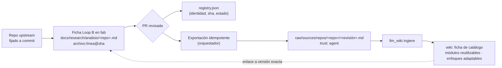
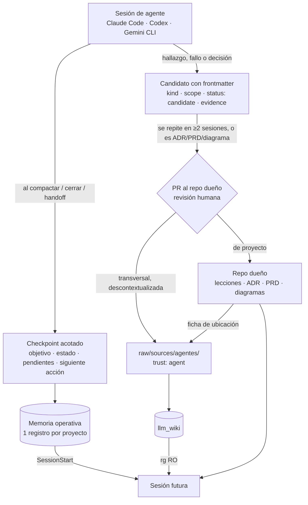
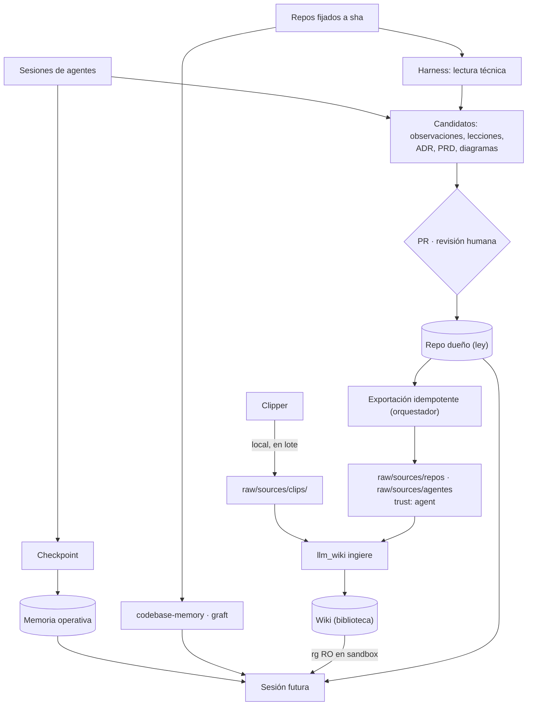

# 09 · Flujo de conocimiento: repos, sesiones y memoria

Esta página amplía [08](08-ingesta-dual-llm-wiki.md) con dos fuentes de conocimiento que la ingesta de clips no cubre: los **repos de referencia** que queremos reencontrar desde otros proyectos, y lo que **se aprende durante una sesión** de agente (observaciones, lecciones, ADR, PRD, diagramas). También evalúa **ai-memory** (`akitaonrails/ai-memory`) frente a lo que ya usamos.

!!! info "Propuesto (síntesis de tres análisis)"
    Consolida tres análisis independientes del 2026-11-08: Claude Opus 5.5, Codex (GPT-6.1-Sol) y agy (Gemini 3.8 Flash), sobre ai-memory en el commit `957b1dd` (v3.4.4, MIT). Ninguno instaló ni ejecutó ai-memory: todo lo que se dice de él es lectura de código y documentación. Los informes originales están en el scratchpad de la sesión (`analisis-memoria-{claude,codex,agy}.md`).

## Cuatro capas, cuatro trabajos

Los tres análisis llegan a la misma división. Ninguna capa sustituye a otra; el riesgo es usar dos para lo mismo.

| Capa | Trabajo | Responde a | No debe convertirse en |
|---|---|---|---|
| **llm_wiki** | **Biblioteca**: conocimiento externo y catálogo | «¿qué se publicó sobre X? ¿qué repo resuelve Y?» | Estado de tareas o evaluación técnica sin fuente fijada |
| **Memoria operativa** (fab-memoria, registro del proyecto) | **Diario**: continuidad entre sesiones y harness | «¿dónde lo dejamos? ¿qué falló?» | Copia editable de ADR/PRD |
| **codebase-memory / graft** | **Mapa** del código de cada repo | «¿quién llama a esto? ¿dónde vive?» | Catálogo de papers o autoridad de decisiones |
| **Repo dueño** (fab u otro proyecto) | **Ley**: artefactos aprobados por PR | «¿qué decidimos oficialmente?» | Vertedero de observaciones sin revisar |

!!! warning "Dos «LLM wiki»"
    llm_wiki y ai-memory se definen igual (wiki markdown al estilo Karpathy, compatible con Obsidian). Se separan por **origen**: llm_wiki para lo externo, la memoria operativa para lo vivido. Nunca dos apps escribiendo el mismo árbol (Codex).

## 1. Repos de referencia: en los dos sitios, con una autoridad

Corrige la vista de [08](08-ingesta-dual-llm-wiki.md): la lectura de un repo **también** llega a la wiki, como **ficha de catálogo** derivada.



| Contenido | Autoridad | En la wiki |
|---|---|---|
| Código, README y licencia | Repo upstream en un commit fijado | Solo referencia (repo + commit + ruta) |
| Lectura técnica, encaje y decisión de uso en fab | Ficha Loop B en fab | Ficha corta que apunta a esa versión |
| Identidad, sha evaluado, estado | `registry.json` | Lo lee la exportación; no hay otro registro editable |
| Comparaciones entre enfoques útiles para varios proyectos | Páginas de síntesis de la wiki | Cada afirmación enlaza a fichas y versiones |

La ficha de catálogo contesta cuatro preguntas: **qué módulo o enfoque reutilizar**, **para qué problema**, **límites y licencia**, y **dónde está la prueba**. No copia el análisis ni presenta «adoptado en fab» como recomendación universal.

Reglas de sincronización (Codex y agy):

- **Dirección única fab → wiki.** La ficha de la wiki es una proyección regenerable, no un segundo original.
- **Dos sha distintos:** `upstream_commit` (el código analizado) y `canonical_commit` (la versión de la ficha en fab). Una lectura puede corregirse sin que cambie el código.
- **Clave idempotente** `(knowledge_id, canonical_revision, content_hash)`: el mismo contenido no se vuelve a publicar.
- Si el sha upstream cambia, la ficha se marca **«requiere reevaluación»** y se conserva la anterior; nunca se sustituye la evidencia por enlaces a `main`.
- Enlaces por identidad (repo + commit + ruta), no por ruta local absoluta: tienen que servir en otros proyectos y máquinas.

## 2. Conocimiento de sesión: capturar barato, promover con evidencia



Qué es cada cosa y dónde termina:

| Tipo | Ejemplo | Captura | Promoción | Destino final |
|---|---|---|---|---|
| **Checkpoint** | «quedó pendiente rebasar fab/9cfa36fd» | Automática al compactar, cerrar o traspasar | Ninguna | Memoria operativa |
| **Observación** | «el comando X falló así» | El agente la anota al ocurrir | Solo si se repite | Candidato local |
| **Patrón repetible** | «Ollama por /v1 ignora num_ctx: crear variante con PARAMETER» | Candidato | Visto en ≥2 sesiones → PR | Lección del repo dueño o skill |
| **Lección (error a no repetir)** | «no editar app-state.json con la app abierta» | Candidato | PR | Lección del repo dueño; transversal → wiki |
| **ADR / PRD** | ADR-0002 bóveda única | Borrador en el repo | PR con aprobación del responsable | Repo dueño; ficha de ubicación en la wiki |
| **Diagrama** | este flujo | Fuente mermaid junto a su especificación | Con la PR de la especificación | Repo dueño; nunca imagen suelta |

Formato del candidato (Codex):

```yaml
knowledge_id: lesson-<id-estable>
kind: lesson            # observation | lesson | adr | prd | diagram | checkpoint
scope: project          # transversal solo tras revisión explícita
project_id: fab
status: candidate       # reviewed | superseded | rejected
trust: agent            # procedencia, no certificado de verdad
origin_session: <id>
source_revision: <commit-o-snapshot>
evidence: ["ruta:línea@sha", "receipt: comando y resultado"]
supersedes: null
```

Cuerpo: condición → observación → evidencia → causa (o «hipótesis») → acción aplicable → excepciones.

Reglas:

- **Un evento aislado no es un patrón.** El criterio de repetición (≥2 sesiones distintas) viene de la «confianza por evidencia» de ai-memory, que cuenta sesiones que reafirman una página.
- **El agente propone, no promueve.** Nada pasa a un repo sin PR; un checkpoint no necesita PR.
- **Proyecto vs transversal.** fab solo es dueño de lo que describe fab; un ADR de otro proyecto vive en ese repo. Lo transversal se descontextualiza antes de ir a la wiki, y **nunca** con datos de clientes ([03](03-boveda-llm-wiki.md#dos-bovedas-no-mezclar)).
- **La memoria da pistas, no permisos.** Una lección almacenada nunca autoriza un comando por sí misma; antes de aplicarla se verifica contra el checkout actual.
- **Un registro operativo por proyecto.** Si varios harness lo proyectan, los demás son cachés reemplazables. Por decisión del 2026-11-08, AgentDB se abandona; el registro operativo adoptado es **fab-memoria** (fork local endurecido de ai-memory, sin activar).

## 3. ai-memory: qué es y qué hacemos con él

!!! success "Verificado en el código (commit 957b1dd)"
    - **Fuente de verdad markdown con git** y SQLite como índice derivado (`crates/ai-memory-wiki/src/lib.rs:3-6`, `docs/ARCHITECTURE.md:621-640`).
    - **Captura por hooks** con frontera de saneamiento tipada `Sanitized<NewObservation>` antes de guardar (`crates/ai-memory-hooks/src/router.rs:5132`, `crates/ai-memory-core/src/sanitize.rs:9`); distingue `Stop`, compactación y `SessionEnd` (`crates/ai-memory-core/src/observation.rs:50`).
    - **Cero LLM por defecto**; al cerrar sesión genera `sessions/<id>.md` (tier episódico) por reglas (`crates/ai-memory-hooks/src/synth.rs:65`).
    - **Niveles** working / episodic / semantic / procedural con decaimiento configurable (`crates/ai-memory-core/src/page.rs:663`, `docs/ARCHITECTURE.md:1362-1365`); **supersesión** en vez de borrado.
    - **Confianza por evidencia** (`page_evidence`: sesiones distintas que reafirman una página) y **feedback por versión** `helpful/not_helpful/stale/wrong` (`page_feedback`).
    - **Handoffs tipados** entre harness, reclamados una sola vez (`crates/ai-memory-store/migrations/V02__handoffs.sql:6-25`); 31 harness declarados, incluidos Claude Code, Codex, Gemini CLI y Antigravity (`crates/ai-memory-core/src/ids.rs:330-362`).
    - **Búsqueda** FTS5 + entidades + grafo de enlaces + vectores opcionales, fusionados por RRF (`crates/ai-memory-store/src/reader.rs:8668`, `:8871`).
    - **Perfil transversal** `_global` con los hábitos del usuario, que llega a cada repo nuevo (`README.md:43-49`).

!!! warning "Riesgos verificados (Codex)"
    - **Aprobación automática:** el planificador de revisión corre cada 3600 s con `require_approval: false` (`crates/ai-memory-cli/src/config.rs:1863`, `:1877`) y aprueba propuestas cuando no se exige aprobación (`crates/ai-memory-mcp/src/admin.rs:2966`). Activar un LLM no es neutral respecto al gate humano.
    - **El spool del cliente** guarda el payload y el bearer **antes** del saneamiento del servidor (`crates/ai-memory-cli/src/commands/hook_spool.rs:108`, `SECURITY.md:38`). La frontera de privacidad incluye cliente, spool y backups.
    - **Aislamiento entre proyectos débil por defecto:** un valor de acceso desconocido se trata como `open` (`crates/ai-memory-store/src/project_authz.rs:81`).
    - **No toda la continuidad es markdown:** observaciones, handoffs y auditoría viven en SQLite; respaldar solo la wiki no basta.
    - Proyecto muy activo (CHANGELOG de 302 KB): habría que fijar versión.

### Decisión: extraer ideas ahora, piloto aislado después

Las tres opiniones: Claude proponía **combinar con piloto**, agy **combinar y extraer**, Codex **solo extraer**. La síntesis sigue a Codex en lo inmediato, porque sus objeciones están verificadas y ya tenemos tres sistemas que solapan el «diario»:

**Ideas que adoptamos en el diseño (sin instalar nada):**

1. **Checkpoint portable** entre harness, acotado, que distingue fin de turno, compactación y fin de sesión.
2. **Confianza por evidencia**: una lección se promueve cuando se repite en ≥2 sesiones.
3. **Supersesión y feedback `stale/wrong`** en vez de borrar o sobrescribir.
4. **Saneamiento tipado** de secretos antes de persistir, también en el cliente.
5. **Hooks no bloqueantes** que vuelcan en un spool local y salen enseguida (agy).
6. **Esquema de handoff**: sesión y agente de origen, agente destino, resumen, preguntas abiertas, siguientes pasos, archivos tocados (agy).

**Piloto, si se decide más adelante:** aislado, con `require_approval: true`, sin proveedor LLM, en un solo proyecto y sin compartir árbol con llm_wiki. Se mide contra la continuidad actual: recuperar una tarea tras cambiar de harness o tras un cierre brusco, precisión y frescura de lo recuperado, duplicados, latencia y separación entre proyectos.

**Avance y estado del registro operativo (`fab-memoria`):**
En ejecución de la tarea T2 (tasks.json), se adoptó memoria propia construyendo el fork local **fab-memoria** (`~/Desktop/factory/fab-memoria` commit `@25fab65` en rama `fab/main`). Incorpora `DISENO.md` y tres endurecimientos verificados:
1. Aprobación requerida por defecto (`require_approval: true`).
2. Saneamiento tipado en el spool antes de persistir.
3. Autorización y aislamiento estricto de proyectos (`closed` por defecto).
Cuenta con 3354 tests unitarios en verde y se mantiene **sin activar / no instalado**. Siguiente paso: definir el perfil diario aplicado y ejecutar un piloto aislado.

**Clasificación con jevify en rama sin mergear:**
Para la clasificación de fuentes y clips en las 14 categorías, se probó **jevify** (`fidecastro/jevify` @`0f60a53`) sobre Ollama con `qwen3.5-32k` (14 preguntas en 3,4 s; `gemma4` quedó descartado porque Ollama no apaga su thinking). La herramienta `scripts/ideas/clasificar.ts` (16 tests verdes, commit @`e2cc907`, worktree `sw-factory-t11`) está desarrollada en la rama `feat/t11-clasificador`, **en rama sin mergear**, pendiente de calibración con conjunto etiquetado.

## Integración completa



| Tipo de conocimiento | Dónde vive | Quién escribe | Cómo se recupera |
|---|---|---|---|
| Artículo / paper / clip | `raw/sources/clips/` → ficha en la wiki | Clipper; la app ingiere con modelo local | Categoría y «Responde a»; `rg` RO |
| Repo de referencia | Upstream fijado + ficha Loop B en fab + ficha de catálogo en la wiki | Agente propone, PR, exportador publica | Wiki para descubrir; fab y código para verificar |
| Símbolos y llamadas | Índices derivados por repo | codebase-memory, graft | Grafo primero, luego fuente |
| Checkpoint / pendiente | Un registro operativo por proyecto | Harness al compactar, cerrar o traspasar | SessionStart; verificar contra el estado actual |
| Observación sin validar | Candidato local | Agente de sesión | Consulta dirigida, nunca inyección universal |
| Lección de proyecto | Repo dueño | Agente propone, responsable aprueba | Enlace desde la memoria; condición y evidencia |
| Lección transversal | `raw/sources/agentes/` → síntesis en la wiki | Exportador tras PR | Concepto, categoría y ámbito |
| ADR / PRD / diagrama | Repo dueño; ficha de ubicación en la wiki | Autor y revisor | Documento canónico |
| Veredicto de experimento | Ledger y receipts de fab; reflexión en la wiki | Orquestador del ciclo | Ledger para auditar; wiki para recordar |

!!! success "Se mantiene ADR-0002"
    La app **ingiere**; el lector confinado **solo lee** archivos. Quien escribe en `raw/sources/` es el **orquestador**, fuera del sandbox del lector y solo tras revisión. Esto resuelve la «decisión abierta» de [08](08-ingesta-dual-llm-wiki.md#puerta-2-harness-con-modelo-de-nube) a favor de la opción 1 para el ciclo; la escritura por MCP queda para sesiones interactivas.

## Lo que queda por hacer y estado de tareas (según tasks.json)

1. **Taxonomía en `schema.md` y `purpose.md` (tarea T1): Hecho.** Las 14 categorías y la ficha de ubicación están implementadas en el vault `FAB` (`/home/orlando/Desktop/VAUL-FAB/FAB/schema.md`, `purpose.md`).
2. **Registro operativo único (tarea T2 / decisión 2026-11-08): Hecho.** AgentDB se abandona. Construido el fork local endurecido `fab-memoria` (@`25fab65`, 3354 tests verdes, en `~/Desktop/factory/fab-memoria`), actualmente sin activar/instalar. Siguiente paso: perfil diario aplicado y piloto aislado.
3. **Plantilla de candidato (tarea T5): Hecho.** Skill compartida `llm-wiki-ingesta` (`~/.agents/skills/llm-wiki-ingesta/`).
4. **Decisiones D1 y D2: Hechas.** D1: escribe el orquestador tras revisión/PR (enmendando ADR-0002). D2: fijado el nombre del proyecto como `FAB` con ruta configurable.
5. **Script de exportación fab → raw/sources/repos/ (tarea T3): Pendiente.** Con clave idempotente y control de sha (depende de T1).
6. **Endpoint de ingesta y temporizador a hora fija en llm_wiki_v2 (tarea T4): Pendiente.** Sin endpoint en `api_server.rs`.
7. **Lector de bóveda y escritor de paso 9:** T6 (lector con `--ro-bind` de bóveda) en curso en rama `feat/t6-lector-boveda`; T7 (escritor del paso 9, `scripts/ideas/reflejar.ts` @`686efe4`) implementado en rama `feat/t7-paso9`, en rama sin mergear.
8. **Clasificador jevify (tarea T11): Hecho en rama.** `scripts/ideas/clasificar.ts` implementado en rama `feat/t11-clasificador` (@`e2cc907`, sin mergear); pendiente calibración con conjunto etiquetado.

## Archivos

| Archivo | Responsabilidad |
|---|---|
| `docs/research/analisis/<repo>.md`, `docs/research/registry.json` | Ficha Loop B y registro: autoridad de los repos de referencia. |
| `<proyecto>/raw/sources/{clips,repos,agentes}/` | Entradas de la bóveda por origen. |
| `~/Desktop/factory/fab-memoria` (commit `@25fab65`) | Fork local endurecido de ai-memory; 3354 tests verdes; no instalado. |
| `~/Desktop/refs/ai-memory` (commit `957b1dd`) | Clon de referencia evaluado; fuente no confiable, no instalado. |
| `docs/research/arquitectura-ideacion/adr/ADR-0002-llm-wiki-boveda-unica.md` | Se mantiene: la app ingiere, el lector solo lee (enmendado 2026-11-09). |
