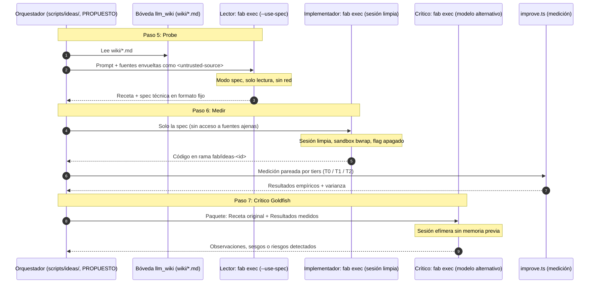

# 10 · Integración con fab exec (Roles del Ciclo)

El ciclo de ideación de `fab investigación` (`ARQUITECTURA.md` §5, ADR-0003) estructura la exploración y evaluación de nuevas ideas mediante **tres roles de agente bien diferenciados**: el **lector**, el **implementador** y el **crítico**. 

En la propuesta v0.2, estos roles no se ejecutan con herramientas externas arbitrarias, sino que se delegan en subprocesos de [`fab exec`](../exec/index.md) (el mismo motor que la fábrica utiliza a través del adaptador `native`, `src/agents.ts:131-140`).

---

## 1. Separación de Roles y Flujo de Información

Para mitigar riesgos de seguridad por inyección indirecta de prompts y garantizar aislamiento por diseño (clean room, ADR-0007), los roles se comunican mediante artefactos estrictamente desacoplados:

---

## 2. Definición y Políticas de Cada Rol

### Rol 1: El Lector (Probe, Paso 5)

El lector tiene como única misión comprender la fuente (paper, repositorio o artículo) y extraer una **receta reproducible** y una **especificación técnica (`spec`)** para `fab`.

!!! info "Propuesto (v0.2)"
    El rol de lector se define en `ARQUITECTURA.md` §5 y ADR-0007. Opera en el paso 5 del ciclo tras superar el gate `experimento_autorizado`.

- **Confinamiento de Solo Lectura:** Se ejecuta mediante `fab exec --use-spec` (`src/agent/exec.ts:254`).
  - Las herramientas mutadoras (`Create`, `Edit`, `ApplyPatch`) quedan completamente bloqueadas (`src/agent/engine.ts:94`).
  - La herramienta `Loop` queda denegada en modo spec (`src/agent/loop.ts:16`).
  - Se debe fijar `opts.allowExitSpecMode = false` (`src/agent/session-tools.ts:13`) para impedir que el modelo invoque `ExitSpecMode` y salte al modo de ejecución.
- **Política de Red:** `deny` estricto (`src/agent/network-policy.ts:17-19`). Las fuentes se leen desde archivos locales de la bóveda montados en el sandbox; el lector no tiene acceso a Internet.
- **Salida:** Exclusivamente texto estructurado con la receta y la spec; **no toca ningún archivo de `src/`**.

!!! success "Implementado (Hallazgo clave de la Fase 1)"
    En los adaptadores externos `claude`, `agy` y `droid`, la opción `readOnly` de la fábrica es **únicamente una directiva de prompt** en el texto (`src/agents.ts:83-85, 139`). Solo los adaptadores **`codex`** y **`native`** (`fab exec`) la aplican de forma forzada a nivel de proceso (`--sandbox read-only` y `--use-spec` respectivamente). Por este motivo, **el rol de lector debe correr obligatoriamente con `native` o `codex`**.

### Rol 2: El Implementador (Medir, Paso 6)

El implementador recibe la receta y la especificación redactadas por el lector y escribe el código correspondiente.

!!! info "Propuesto (v0.2)"
    ADR-0007. El implementador opera en una **sesión limpia (`clean room`)**:
    - **Amnesia de Fuentes:** No recibe los textos originales del paper ni los directorios de la bóveda; únicamente recibe la `spec` técnica depurada por el lector. Esto impide que inyecciones de prompt maliciosas escondidas en las fuentes lleguen al agente que tiene permisos de escritura en el código.
    - **Rama Aislada:** Trabaja en una rama temporal `fab/ideas-<id>` utilizando el flag de worktrees de `fab exec` (`-w`, `src/agent/exec-flags.ts:7-42`).
    - **Flag Apagado por Defecto:** Todo código experimental nuevo debe implementarse detrás de una bandera inactiva por defecto (ADR-0004).

- **Políticas y Sandbox:**
  - Modo: `standard` con autonomía `medium` o `high` (`src/agent/execution-policy.ts:15-30`).
  - Sandbox: Bubblewrap (`bwrap`) requerido (`src/agent/tools.ts:356`) con workspace montado en lectura/escritura y red offline por defecto (`--unshare-net`).
  - Herramientas: Catálogo completo de edición atómica con descriptores anclados (`Create`, `Edit`, `ApplyPatch`, `src/agent/files.ts:11-29`) y ejecución confinada de tests con `Execute`.

### Rol 3: El Crítico Goldfish (Paso 7)

El crítico actúa como revisor escéptico antes de emitir un veredicto o consolidar cambios.

!!! info "Propuesto (v0.2)"
    `ARQUITECTURA.md` §5 y ADR-0003. El crítico opera bajo el patrón **goldfish** (memoria efímera):
    - **Modelo Distinto:** Debe utilizar un proveedor o modelo diferente al empleado por el lector y el implementador (por ejemplo, si el implementador usó Anthropic Claude, el crítico debe usar OpenAI o viceversa) para romper sesgos cognitivos sistemáticos de un mismo proveedor.
    - **Sin Historial Previo:** Arranca en una sesión completamente nueva (`opts.sessionId = undefined`), recibiendo como única entrada la receta inicial y el informe de resultados empíricos devuelto por `improve.ts`.
    - **Comprobación de Seguridad:** Verifica específicamente que la implementación no haya introducido dependencias no autorizadas, accesos a red injustificados o debilitamiento de las suites de test protegidas.

---

## 3. Matriz de Configuración de `fab exec` por Rol

| Parámetro / Dimensión | Lector (Probe) | Implementador (Medir) | Crítico (Goldfish) |
| :--- | :--- | :--- | :--- |
| **Subcomando** | `fab exec` | `fab exec` | `fab exec` |
| **Adaptador** | `native` (o `codex`) | `native` | `native` |
| **Interacción** | `--use-spec` (modo `spec`) | `--auto medium` (modo `auto`) | `--use-spec` (modo `spec`) |
| **Permisos** | Solo lectura forzado | Edición y ejecución en workspace | Solo lectura forzado |
| **Sandbox** | `bwrap` con `--ro-bind` | `bwrap` con `--bind <worktree>` | `bwrap` con `--ro-bind` |
| **Red (`networkPolicy`)** | `deny` estricto | Opt-in por comando (offline por omisión)| `deny` estricto |
| **Entrada** | Fuentes envueltas de la bóveda | Solo la `spec` del Lector | Receta + Resultados de `improve.ts` |
| **Salida** | Receta + `spec` en texto | Código en rama `fab/ideas-<id>` | Análisis crítico y observaciones |
| **Estado en `sw-factory`** | **Propuesto** (ADR-0007) | **Propuesto** (ADR-0003) | **Propuesto** (ADR-0003) |

---

## 4. Prerrequisitos Pendientes para la Integración

Para que esta división de roles opere de forma desatendida y segura dentro del harness propuesto, restan los siguientes desarrollos en `fab exec` (detallados en [12 · Prerrequisitos pendientes](12-prerrequisitos-exec.md)):

1. **Flag `--allow-exit-spec-mode false` en CLI:**
   Actualmente la propiedad `allowExitSpecMode` se gobierna internamente en `AgentOptions` (`src/agent/session-tools.ts:13`), pero no existe una bandera CLI directa en `src/agent/exec-flags.ts` para fijarla externamente en el subproceso del lector.
2. **Inyección de Montajes Adicionales en el Sandbox:**
   `fab exec` monta el `cwd` del workspace (`src/agent/mcp-sandbox.ts:28`), pero requiere un flag CLI para inyectar `<proyecto>/wiki/` en modo `--ro-bind` sin exponer el resto del sistema de archivos.

---

## Archivos

| Archivo | Responsabilidad |
| :--- | :--- |
| `docs/research/arquitectura-ideacion/ARQUITECTURA.md` | Diseño v0.2: roles de lector, implementador y crítico (§5). |
| `docs/research/arquitectura-ideacion/adr/ADR-0007-fuentes-no-confiables.md` | Decisión de separar lector e implementador en clean room. |
| `src/agent/exec.ts` | Punto de entrada del subproceso `fab exec` y paso de flags `--use-spec`. |
| `src/agent/engine.ts` | Control de modo spec y bloqueo de herramientas mutadoras (`:94`). |
| `src/agent/session-tools.ts` | Herramienta `ExitSpecMode` y guarda de confinamiento en spec (`:13`). |
| `src/agents.ts` | Adaptador `native` y verificación de aplicación real de `readOnly` (`:139`). |
