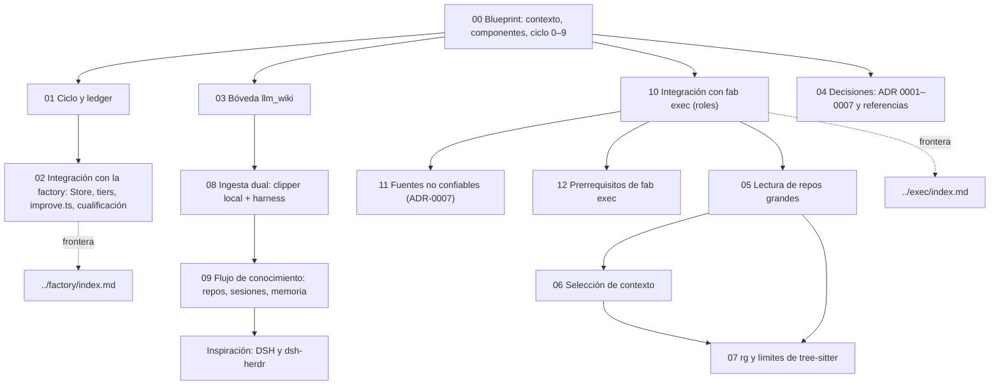

# fab investigación (propuesta v0.2)

Documentación técnica del **harness delgado de ideación**: el proceso que convierte papers, repos y artículos en **mejoras medidas de fab**. Una hipótesis por ciclo, prerregistro con hash, gate de gasto, lector e implementador separados, crítico, veredicto y ledger siempre, y tiers T0/T1/T2 donde *evaluar no es promover*.

!!! info "Propuesto e implementado (v0.2)"
    El diseño general está en estado **borrador v0.2** (`docs/research/arquitectura-ideacion/ARQUITECTURA.md:3`). El orquestador base **sí existe** en el repositorio: `scripts/ideas/ciclo.ts` (783 líneas) implementa los pasos 3–8 (prerregistro con hash, gate de gasto, probe con citas `@sha`, medición con T0/T1/T2, crítico goldfish y veredicto con ledger). La vigilancia (paso 0) y el backlog (pasos 1–2) siguen como propuesta (ADR-0003). El paso 9 (`reflejar.ts`) y el clasificador (`clasificar.ts`) están implementados en ramas locales (`feat/t7-paso9` y `feat/t11-clasificador`), en rama sin mergear.

!!! success "Implementado"
    Las piezas que ya están en el repo y que el ciclo reutiliza: el orquestador base (`scripts/ideas/ciclo.ts`), el ledger vendorizado de dream-machine (`third_party/dream-machine/`), el pin de ESF (`third_party/esf/UPSTREAM.json`), el lint de procedencia (`tests/provenance.test.ts`), los registros de cualificación (`docs/qualification/`), `improve.ts` fase 1 y el **coste por corrida** (`src/agents.ts:64-74`, `src/pool.ts:224`, `src/improve.ts:116-129`).

## Estado por componente

| Componente | Estado | Dónde se documenta |
|---|---|---|
| Ledger de 10 columnas, `verifyLedger`, señales de aprendizaje | **Implementado** (código copiado con pin; `docs/research/ledger.md` sin filas; `ciclo.ts` escribe) | [01](01-ciclo-y-ledger.md) |
| Pin `UPSTREAM.json`, registro de cualificación, lint de procedencia | **Implementado** | [02](02-integracion-factory.md) |
| `improve.ts` fase 1 (splits, brazos pareados, coste por brazo) | **Implementado** | [02](02-integracion-factory.md) |
| Coste por corrida | **Implementado solo para `claude`**; `NULL` en el resto | [02](02-integracion-factory.md) |
| Orquestador `scripts/ideas/` (pasos 3–8: prerregistro, gate, probe, medir, crítico, veredicto con ledger) | **Implementado** (`scripts/ideas/ciclo.ts:783`; pasos 0–2 propuestos; paso 9 en rama sin mergear) | [00](00-blueprint.md), [01](01-ciclo-y-ledger.md) |
| Tiers T0/T1/T2 y clases `ACCEPT-candidato`/`ACCEPT-cualificado` | **Implementado en ciclo** (`ciclo.ts:351-628` evalúa tiers y bootstrap) | [01](01-ciclo-y-ledger.md), [02](02-integracion-factory.md) |
| Prerrequisitos de `improve.ts` (`integrity.ts`, `group`, `repeated-baseline`, runner de dos builds) | **Pendiente** | [02](02-integracion-factory.md) |
| Bóveda llm_wiki: proyecto FAB (D2); lectura de `wiki/*.md` RO, escritura en `raw/sources/agentes/` por el orquestador tras PR (D1) | **Parcial / en rama sin mergear** (lectura en curso en `feat/t6-lector-boveda`; paso 9 en `feat/t7-paso9`) | [03](03-boveda-llm-wiki.md) |
| Ingesta dual: clipper con modelo local en lote y harness en nube, taxonomía de 14 categorías en FAB, clasificador jevify | **Parcial** (taxonomía implementada en FAB; jevify en rama `feat/t11-clasificador` sin mergear; endpoint/timer pendientes) | [08](08-ingesta-dual-llm-wiki.md) |
| Flujo de conocimiento: repos en fab y wiki, lecciones, decisiones D1/D2 cerradas, AgentDB abandonado, fab-memoria | **Parcial** (fab-memoria @`25fab65` sin activar; plantilla T5 hecha; exportador T3 pendiente) | [09](09-flujo-de-conocimiento.md) |
| Ejecución de los roles con `fab exec` | **Propuesto**, con huecos | [10](10-integracion-exec.md), [11](11-fuentes-no-confiables.md), [12](12-prerrequisitos-exec.md) |
| Decisiones y referencias adoptadas | Documento de diseño | [04](04-decisiones.md) |
| Lectura de repositorios grandes (ADR-0008 aceptado, búsqueda agéntica y T1–T5) | **Implementado** fase A (núcleo y adaptador) | [05](05-lectura-de-repos-grandes.md) |
| Selección de contexto y presupuesto (sistemas de referencia, paquete e independencia) | **Implementado** fase A (núcleo independiente) | [06](06-seleccion-de-contexto.md) |
| ripgrep (`rg`) y límites de tree-sitter (por qué el grafo no basta, evidencia A0 vs A2) | **Documentado** (evaluación en opencode y deer-flow) | [07](07-rg-y-limites-de-tree-sitter.md) |
| Inspiración: repos de referencia externos (DSH, dsh-superagent, dsh-herdr) | **Documentado** (evaluación y síntesis de 3 análisis) | [Inspiración](inspiracion/index.md) |

## Mapa de lectura (de arriba abajo)

## Cómo leer los avisos

| Aviso | Significa |
|---|---|
| `!!! success "Implementado"` | Existe en el código o en el repo; lleva cita `archivo:línea`. |
| `!!! info "Propuesto (v0.2)"` | Solo existe en un ADR o en `ARQUITECTURA.md`; lleva la referencia al ADR. |
| `!!! warning "Prerrequisito pendiente"` | Algo que falta para que la propuesta funcione. |

## Relación con el resto de la documentación

- La **factory** (`workstream → signal → change → activity`) se documenta en [Factory](../factory/index.md). El ciclo de investigación se queda **fuera** de su `Store` y solo entra por la puerta normal al final.
- El agente nativo que ejecutaría los roles del ciclo se documenta en [fab exec](../exec/index.md).

!!! warning "Hallazgo que atraviesa la sección"
    Con los adaptadores `claude`, `agy` y `droid`, el `readOnly` de una `investigation` es **solo de prompt**; únicamente `codex` y `native` lo aplican (`src/agents.ts:83-85`, `:139`; ver [Factory · adaptadores](../factory/05-adaptadores-de-agentes.md)). Por eso el rol de **lector** del ciclo debería correr con `native` o `codex`.

## Archivos

| Archivo | Responsabilidad |
|---|---|
| `techdocs/docs/investigacion/*.md` | Esta sección. |
| `docs/research/arquitectura-ideacion/` | Fuente de la propuesta: `ARQUITECTURA.md`, `adr/ADR-0001..0007`, `REVISION.md`. |
| `docs/research/design-loops-investigacion.md` | Capas C0–C9 y Loops A/B. |
| `docs/research/registry.json`, `docs/research/ledger.md` | Registro de referencias y ledger de ideación. |
